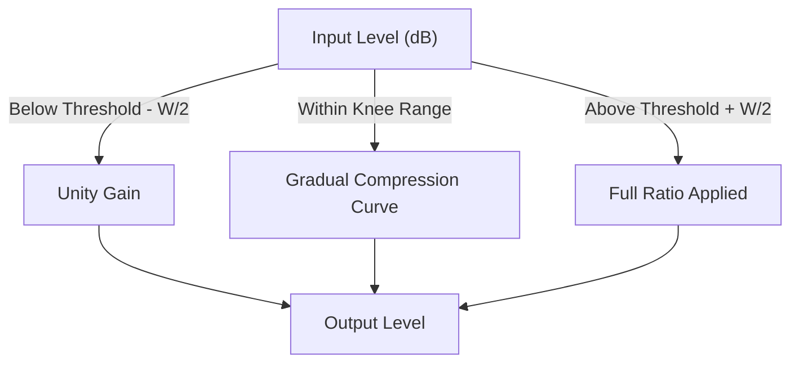
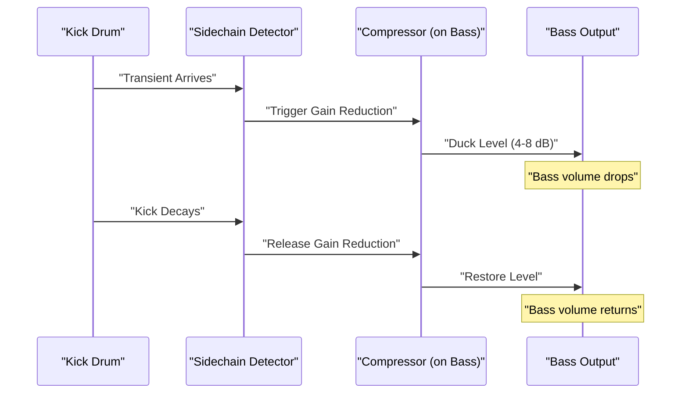
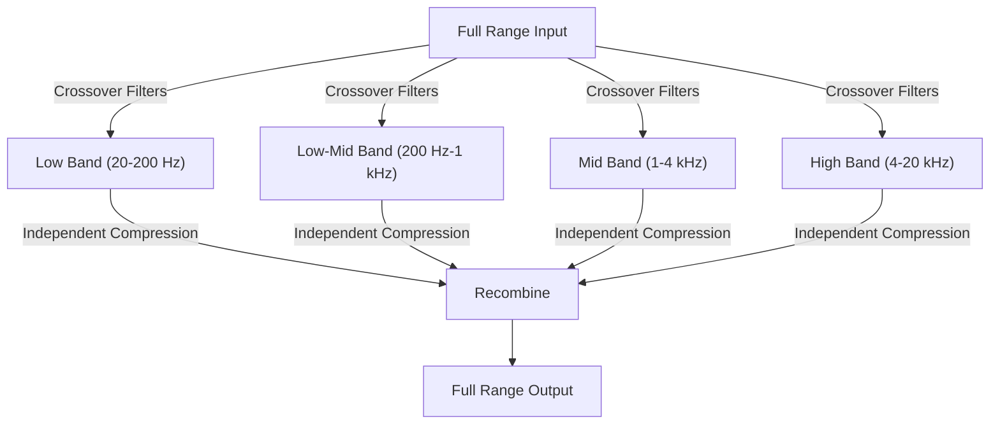
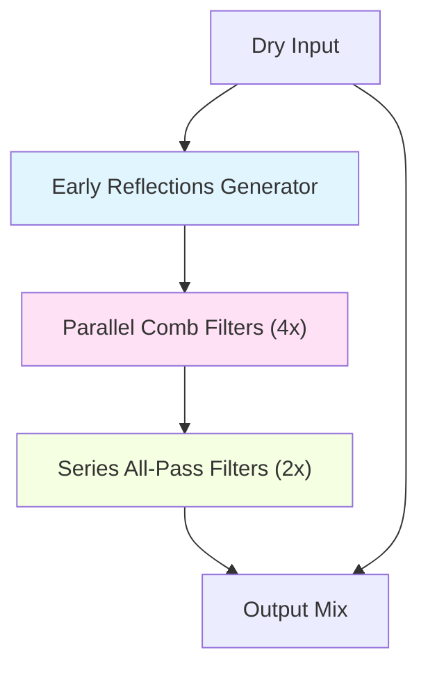
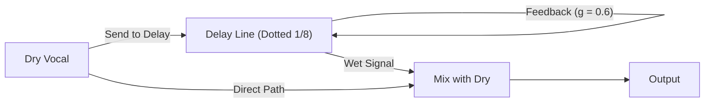
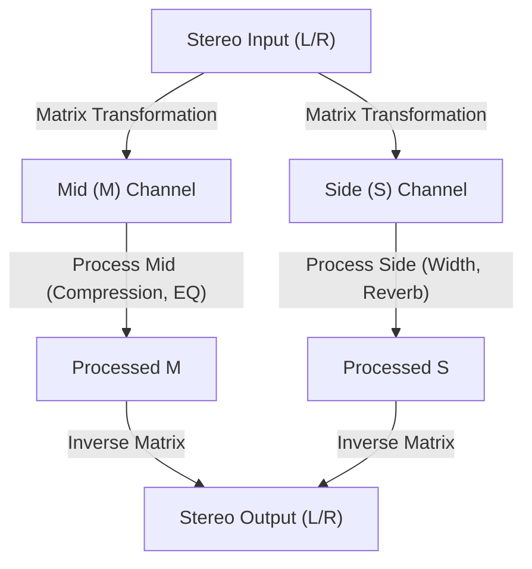
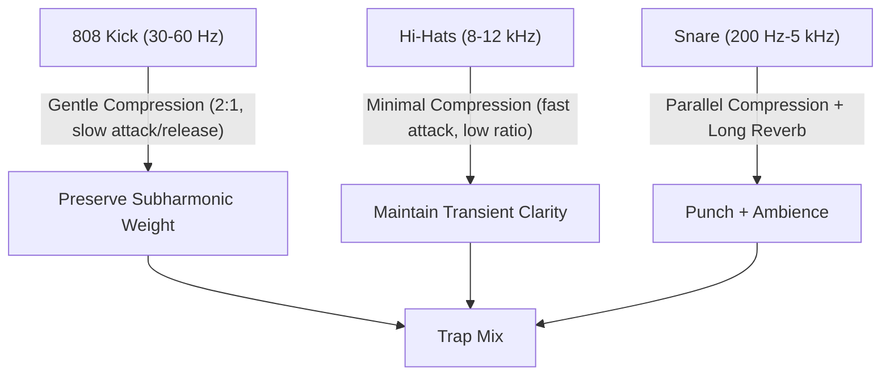
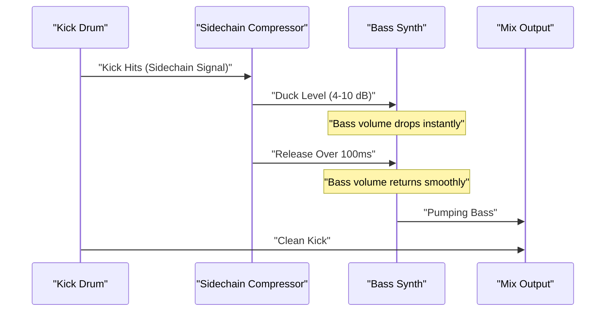
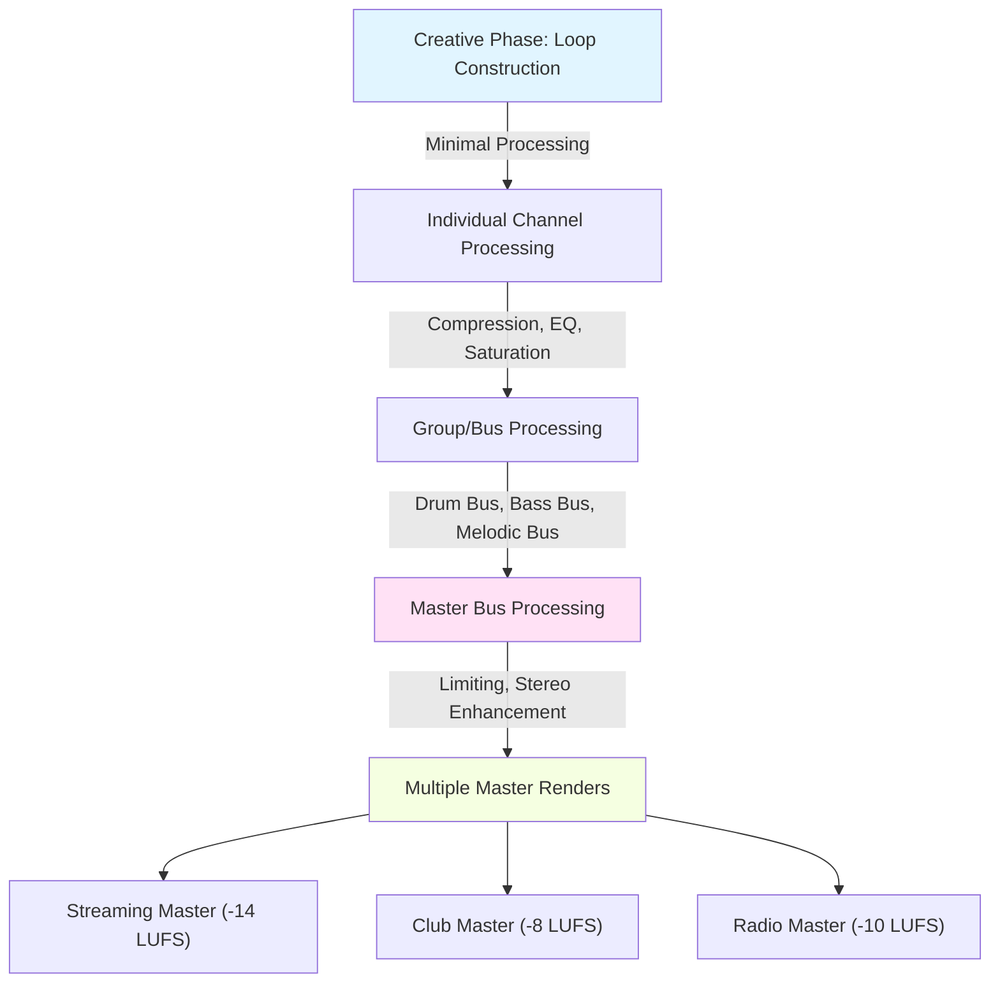

# Lesson 4: Dynamics Processing, Spatial Design, Genre-Specific Production Context

## 1. First-Principles Intuition & Invariants

The modern beatmaker operates at the intersection of engineering precision and artistic expression, wielding dynamics processors and spatial effects as both corrective tools and creative instruments. Unlike traditional mixing paradigms where the engineer receives pre-recorded material and polishes it toward a fixed aesthetic target, the beatmaker constructs the sonic architecture from the ground up, making irreversible creative decisions at every stage. A kick drum is not merely captured and balanced—it is synthesized, layered, compressed into submission, and carved into frequency space with surgical intent. The snare does not simply occupy a position in the stereo field—it explodes outward through reverb chambers and delay networks, its transient energy shaped by attack times measured in microseconds and release curves tuned to match the groove's rhythmic subdivisions.

At the heart of all dynamics processing lies a deceptively simple physical principle: the logarithmic relationship between acoustic amplitude and human loudness perception. Our ears compress dynamic range naturally through the nonlinear response of hair cells in the cochlea, and we replicate this compression electronically to achieve perceptual cohesion across elements that would otherwise fight for attention. When a compressor's threshold is breached, the device reduces gain by a ratio—2:1 means that for every 2 dB of input signal exceeding the threshold, only 1 dB emerges at the output. This ratio, combined with attack time (how quickly compression engages), release time (how quickly it disengages), and makeup gain (restoration of lost level), forms the core control surface. The compressor is not merely a volume leveler; it is a transient sculptor, a sustain enhancer, and a glue that binds disparate elements into a unified whole.

The limiter extends this concept to its logical extreme: an infinitely high ratio that creates a brick wall ceiling, preventing any signal from exceeding a specified output level. Modern digital audio workstations process audio at 32-bit floating point internally, granting enormous headroom, but the final delivery format—whether streaming service submission or club sound system playback—demands adherence to strict peak level constraints. The limiter serves as the final guardian, ensuring that the beatmaker's creative vision translates without distortion into the physical or digital distribution medium.

Spatial processing—reverb, delay, stereo imaging—operates on fundamentally different principles rooted in psychoacoustics and the physics of sound propagation in three-dimensional space. When you hear a sound in the real world, your brain triangulates its position through interaural time differences (the microsecond gap between arrival at your left and right ears), interaural level differences (volume disparity caused by your head's acoustic shadow), and spectral coloration (high frequencies absorbed more rapidly by air and surfaces). Artificial reverb emulates the complex network of reflections that occur when sound energy bounces off walls, ceilings, and objects in an enclosed space. Early reflections arrive within the first 50 milliseconds and provide spatial localization cues—your brain uses them to estimate room size and surface materials. The diffuse reverb tail follows, a dense wash of reflections so numerous and randomized that they merge into a continuous decay envelope characterized by $RT_{60}$, the time required for the reverb to fall 60 dB below its initial level.

Delay, the simpler cousin of reverb, creates discrete echoes by storing incoming audio in a circular buffer and playing it back after a specified time interval. Feedback routing sends the delayed signal back into the input, creating rhythmic repetitions that decay over time. While reverb situates a sound within an ambient space, delay operates in rhythmic time, its intervals synchronized to the track's tempo to reinforce the groove or deliberately stagger against it to create tension.

Genre conventions crystallize these tools into recognizable production signatures. Hip-hop's boom-bap aesthetic, rooted in the early sampling culture of the 1980s and 1990s, prizes the warm distortion of analog saturation, the punchy transient shaping of SSL bus compression, and the shallow, boxy reverb of small concrete rooms. Trap production, emerging from Southern hip-hop in the early 2000s, inverts many of these priorities: 808 bass drum tones must retain subharmonic weight below 60 Hz without compression artifacts, hi-hat rolls demand pristine transient clarity at 16th and 32nd note subdivisions, and snare reverb often extends into cathedral-length tails with pre-delay offsets that push the reflection onset 30 to 60 milliseconds after the initial transient. Electronic dance music subgenres each encode their own spatial and dynamic signatures—techno's relentless brick-wall limiting, house music's sidechain pumping synchronized to the four-on-the-floor kick, drum and bass's meticulous transient layering to preserve clarity at 170+ BPM.

The beatmaker's workflow must accommodate collaboration, particularly with vocalists who arrive with their own microphones, preamps, and room acoustics. The beat must leave frequency space for the vocal, typically occupying a 200 Hz to 8 kHz band with peak intelligibility between 2 kHz and 4 kHz. Compression glues the vocal to the instrumental, while sidechain processing ducks the beat's midrange elements whenever the vocalist is present, preventing frequency masking that would bury lyrical content. This dynamic interplay between beat and vocal is not merely technical—it is the essence of modern production, where the instrumental anticipates and responds to human performance in real time.

## 2. Core Architecture & Mechanics

### Signal Flow and Detection Topology

The signal flow of a modern dynamics processor begins with detection and gain calculation. The input signal passes through a level detector—typically a peak or RMS (root-mean-square) circuit. Peak detection responds instantaneously to the highest amplitude value in each sample window, making it ideal for catching transient spikes in drums and percussive material. RMS detection averages signal energy over a sliding time window, providing a measurement closer to perceived loudness, useful for vocal compression and bus processing where sustained energy matters more than instantaneous peaks.

Once the detector measures the incoming level, it compares that value against the threshold parameter. If the signal exceeds the threshold, the compressor calculates the required gain reduction using the ratio. Consider a threshold set at -20 dBFS with a 4:1 ratio. An input signal peaking at -10 dBFS exceeds the threshold by 10 dB. The compressor applies the excess divided by the ratio: $\frac{10 \text{ dB}}{4} = 2.5 \text{ dB}$ of actual reduction. The output signal emerges at $-10 \text{ dBFS} - 2.5 \text{ dB} = -12.5 \text{ dBFS}$, effectively reducing the 10 dB overshoot to 7.5 dB.

The gain reduction does not apply instantaneously. Attack time governs how quickly the compressor responds once the threshold is breached. A 1 ms attack time allows the initial transient to pass through unaffected before compression engages, preserving the percussive crack of a snare drum. A 30 ms attack time softens the transient by applying compression more gradually, useful for taming overly aggressive drum hits without destroying their character entirely. Release time determines how quickly the compressor returns to unity gain after the signal drops below the threshold. A fast release (50-100 ms) allows the compressor to track the rhythm of the music, pumping and breathing with each hit. A slow release (300-1000 ms) creates smooth, transparent gain reduction that glues a mix together without calling attention to itself.

The envelope follower that implements attack and release is typically a first-order low-pass filter applied to the gain reduction control signal. The filter's time constant determines the speed of response. For attack time $t_a$, the gain reduction signal approaches its target value exponentially:

$$
g(t) = g_{\text{target}} \left(1 - e^{-t/t_a}\right)
$$

where $g_{\text{target}}$ is the calculated gain reduction in dB. Release follows a similar exponential decay back to 0 dB reduction. These exponential curves create the characteristic smooth onset and offset of professional compressors, avoiding the zipper noise and pumping artifacts that would result from instantaneous gain changes.

### Knee Characteristics and Transfer Functions

The knee parameter determines the transition sharpness at the threshold. A hard knee applies the full ratio immediately once the signal crosses the threshold, creating an abrupt transition suitable for limiting and special effects. A soft knee gradually increases the compression ratio over a range of several dB around the threshold, resulting in more transparent gain reduction. The transfer function for a soft knee compressor can be modeled as:

$$
y = \begin{cases}
x & \text{if } x < (T - W/2) \\
x + \frac{(1/R - 1)(x - T + W/2)^2}{2W} & \text{if } (T - W/2) \leq x \leq (T + W/2) \\
T + \frac{x - T}{R} & \text{if } x > (T + W/2)
\end{cases}
$$

where $x$ is the input level in dB, $y$ is the output level in dB, $T$ is the threshold, $R$ is the ratio, and $W$ is the knee width in dB.

### Sidechain Processing and Frequency-Dependent Dynamics

Sidechain processing routes an external signal into the compressor's detector circuit, allowing one sound to control the compression of another. The classic application is sidechain compression in electronic dance music, where the kick drum triggers compression on the bass and pad elements, creating the characteristic pumping effect that reinforces the four-on-the-floor rhythm. The kick's transient ducks the other elements by 4-8 dB, then releases quickly to restore level before the next kick hits. This rhythmic breathing is not a mixing accident—it is a deliberate production choice that enhances groove and energy.

Frequency-dependent sidechain processing applies a filter to the detection signal before it triggers compression. A high-pass filter at 80-100 Hz prevents low-frequency energy from triggering compression, useful when compressing bass-heavy material where you want to control midrange and treble dynamics without the bottom end dominating the detector. This technique, called de-essing when applied narrowly around 4-8 kHz, tames harsh sibilance in vocals by compressing only when high-frequency energy exceeds the threshold, leaving the rest of the vocal unaffected.

### Parallel Compression and New York Technique

Parallel compression, also known as New York compression, blends a heavily compressed copy of the signal with the dry, uncompressed original. This technique preserves the natural dynamics and transients of the original while adding the thickness and sustain of heavy compression. The compressed signal typically uses aggressive settings—a 10:1 or higher ratio, fast attack, medium release, and enough makeup gain to bring the compressed signal to a similar perceived loudness as the original. When blended at 20-40% wet, the result combines the punch of the uncompressed transients with the density and glue of heavy compression.

The mathematical principle underlying parallel compression is that it creates a form of upward compression—quiet elements become louder relative to the peaks, but the peaks themselves remain largely untouched. If the dry signal is $d(t)$ and the compressed signal is $c(t)$, the parallel mix is:

$$
y(t) = \alpha \cdot d(t) + (1 - \alpha) \cdot c(t)
$$

where $\alpha$ is the dry/wet mix ratio (0.6-0.8 for typical applications). This preserves the peak-to-average ratio of the dry signal while thickening the body, an effect impossible to achieve with serial compression alone.

### Multiband Compression and Spectral Dynamics

Multiband compression divides the frequency spectrum into separate bands—typically low (20-200 Hz), low-mid (200 Hz-1 kHz), mid (1-4 kHz), and high (4-20 kHz)—and applies independent compression to each band. This allows precise control over frequency-specific dynamics. A typical application compresses the low end with a slow attack and release to control boom and rumble, applies moderate compression to the low-mids to tame boxiness, uses gentle compression on the mids to glue vocal-range elements, and applies de-essing style compression to the highs to control harshness.

The crossover filters that split the spectrum must be carefully designed to avoid phase distortion and magnitude ripple at the crossover points. Linkwitz-Riley filters with 24 dB/octave slopes are the industry standard, as their squared magnitude responses sum to unity across the crossover region:

$$
|H_{\text{low}}(f)|^2 + |H_{\text{high}}(f)|^2 = 1
$$

This ensures that when the bands are recombined, no frequency content is lost or doubled at the crossover frequency.

## 3. Spatial Processing: Reverb, Delay, and Stereo Field Manipulation

### Reverb Architecture and Algorithmic Models

Artificial reverb emulates the acoustic behavior of sound in enclosed spaces through algorithmic models that range from physically accurate impulse response convolution to purely synthetic feedback networks. Convolution reverb captures the impulse response of a real space—a recording of how the space responds to an ideal impulse (a gunshot, balloon pop, or starter pistol)—and convolves this impulse response with the input signal. The convolution operation is mathematically defined as:

$$
y(t) = x(t) \ast h(t) = \int_{-\infty}^{\infty} x(\tau) h(t - \tau) \, d\tau
$$

where $x(t)$ is the input signal, $h(t)$ is the impulse response, and $y(t)$ is the reverberated output. In the frequency domain, this becomes simple multiplication:

$$
Y(f) = X(f) \cdot H(f)
$$

Convolution reverb provides unmatched realism for emulating specific spaces—concert halls, cathedrals, famous studios—but requires substantial CPU resources and lacks the real-time parameter control of algorithmic reverbs.

Algorithmic reverb uses networks of delay lines, all-pass filters, and feedback loops to synthesize reverberation. The Schroeder reverb, developed in the 1960s, combines four parallel comb filters followed by two series all-pass filters. Each comb filter consists of a delay line with feedback:

$$
y(n) = x(n) + g \cdot y(n - M)
$$

where $M$ is the delay length in samples and $g$ is the feedback gain (typically 0.7-0.9). The delay lengths are chosen to be mutually prime to avoid periodic resonances. The all-pass filters add diffusion without coloring the frequency response:

$$
y(n) = -g \cdot x(n) + x(n - M) + g \cdot y(n - M)
$$

Modern algorithmic reverbs extend this architecture with modulated delay lines (to break up metallic ringing), early reflection generators (to simulate first-order room reflections), and frequency-dependent decay times (to model high-frequency absorption by air and surfaces).

### Reverb Parameters and Production Applications

Pre-delay separates the onset of reverberation from the dry signal by a specified time interval, typically 10-80 ms. This delay allows the initial transient to remain clear and distinct before the reverb tail begins, crucial for maintaining intelligibility in vocal production and punch in drum processing. A 30 ms pre-delay on a snare drum pushes the reverb onset just after the transient, allowing the crack to cut through while the tail adds size and depth. The pre-delay time can be synchronized to the track's tempo to reinforce the groove—a 1/16 note pre-delay at 140 BPM equals approximately 107 ms, creating a distinct rhythmic gap between hit and ambience.

$RT_{60}$ (reverberation time) defines how long the reverb takes to decay 60 dB below its initial level. Small rooms exhibit $RT_{60}$ times of 0.2-0.8 seconds, medium studios and clubs range from 0.8-2.0 seconds, and large halls and cathedrals extend to 2.0-5.0 seconds or beyond. The decay time directly affects the perceived size of the space and the density of late reflections. Production context dictates appropriate choices: boom-bap hip-hop favors short $RT_{60}$ times (0.4-1.2 seconds) that add dimension without washing out the groove, while ambient electronic music exploits long decay times (3.0-8.0 seconds) to create evolving textures and harmonic blooms.

Damping controls frequency-dependent decay, simulating the absorption of high frequencies by air and porous surfaces. Real spaces absorb high frequencies more rapidly than lows, creating a darker, warmer reverb tail as time progresses. A damping setting at 5 kHz with a decay multiplier of 0.5 causes frequencies above 5 kHz to decay twice as fast as the overall $RT_{60}$ time. This parameter is critical for naturalistic reverb—excessive high-frequency content in the tail creates a synthetic, metallic character, while too much damping produces a muddy, indistinct wash.

The wet/dry mix determines the balance between the original signal and the reverberated output. Auxiliary send/return routing allows multiple tracks to share a single reverb instance, with each track's send level controlling its individual contribution to the reverb. This approach is more CPU-efficient than inserting separate reverb instances on each track and ensures spatial coherence—all elements exist within the same ambient space. The return fader controls the overall reverb level in the mix. Typical send levels for individual elements range from -12 dB (subtle ambience) to -3 dB (prominent space), with the return fader set to taste.

### Delay Types and Rhythmic Applications

Delay effects range from simple single-tap delays that produce a single echo to complex multi-tap and feedback delays that generate rhythmic patterns. A single-tap delay is defined by its delay time $t_d$ and feedback gain $g$:

$$
y(n) = x(n) + g \cdot x(n - M)
$$

where $M = t_d \cdot f_s$ and $f_s$ is the sample rate. Feedback routing creates repeating echoes:

$$
y(n) = x(n) + g \cdot y(n - M)
$$

The number of audible echoes and the rate of decay depend on the feedback gain. A feedback of 0.5 produces roughly 6-8 audible repeats before falling below the noise floor, while 0.7 extends this to 12-15 repeats.

Tempo-synchronized delay locks the delay time to musical subdivisions—quarter notes, eighth notes, dotted eighths, triplets. At 120 BPM, a quarter note equals 500 ms, an eighth note 250 ms, a dotted eighth 375 ms. Syncing delay to tempo embeds the echo pattern into the rhythmic grid, reinforcing the groove or creating syncopation. A dotted eighth delay on a vocal creates a galloping rhythm that weaves around the beat, a staple of dub reggae and modern trap production. The mathematical relationship between tempo and delay time is:

$$
t_d = \frac{60000 \text{ ms}}{\text{BPM}} \cdot \frac{\text{subdivision}}{4}
$$

where subdivision is 1 for quarter notes, 2 for eighths, 3 for triplets, 1.5 for dotted eighths, and so forth.

Multi-tap delays generate multiple discrete echoes at specified time intervals, creating complex rhythmic patterns. A three-tap delay might place echoes at 250 ms, 500 ms, and 875 ms (eighth note, quarter note, dotted quarter at 120 BPM), producing a cascading pattern that evolves over time. Feedback can be applied globally to all taps or independently per tap, allowing intricate control over the decay envelope.

Ping-pong delay alternates echoes between the left and right channels, creating a wide, spacious effect. Each repeat switches sides, bouncing across the stereo field. The stereo width and placement depend on the panning law and the balance of left and right feedback paths. A typical implementation routes the left channel's delay output to the right channel's input and vice versa, with a feedback gain controlling the overall decay.

### Stereo Width and Mid-Side Processing

Stereo width manipulation reshapes the spatial distribution of frequency content across the stereo field. Mid-side (M/S) processing decomposes a stereo signal into mid (center-panned mono) and side (stereo difference) components. The transformation from left-right (L/R) to mid-side is:

$$
M = \frac{L + R}{2}, \quad S = \frac{L - R}{2}
$$

The inverse transformation reconstructs L/R from M/S:

$$
L = M + S, \quad R = M - S
$$

M/S processing allows independent control over center and side content. Boosting the side signal widens the stereo image, while attenuating it narrows the mix toward mono. A common mastering technique applies gentle compression to the mid channel (to control lead vocals and kick/bass) while leaving the side channel uncompressed (to preserve stereo ambience and width). Extreme side boosting creates a hyper-wide effect popular in electronic music, though excessive widening can cause phase cancellation issues on mono playback systems.

Haas effect processing exploits the precedence effect, where a sound followed by a delayed copy (1-40 ms) is perceived as a single sound emanating from the direction of the earlier arrival. Panning the original signal to one side and placing a short delay (10-30 ms) on the opposite side creates the illusion of width without introducing obvious echo. This technique widens monophonic sources like lead vocals and solo instruments without the phase issues associated with stereo chorusing.

Stereo imaging plugins often include correlation meters that measure the phase coherence between left and right channels. A correlation of +1 indicates perfect mono compatibility (identical signals), 0 indicates uncorrelated (wide but safe), and -1 indicates phase-inverted signals that will cancel completely in mono. Professional productions target correlations between +0.3 and +0.8 for the full mix, ensuring reasonable mono compatibility while maintaining stereo interest.

## 4. Genre-Specific Production Context and Creative Decision Trees

### Hip-Hop Boom-Bap: Grit, Punch, and Analog Warmth

The boom-bap aesthetic emerged from the golden age of hip-hop production (late 1980s through mid-1990s), defined by sampling vintage funk and soul records through hardware samplers like the Akai MPC60 and SP-1200. These machines imposed technical limitations—12-bit sampling depth, limited memory forcing resampling and truncation, and analog filters that softened high-frequency transients—that became sonic signatures. Modern digital recreations of this sound deliberately introduce these artifacts: bit reduction plugins truncate the sample depth to 8-12 bits, creating the characteristic grit and harmonic distortion. Sample rate reduction aliases high-frequency content, producing the muffled top end that defines the boom-bap tonality.

Compression settings for boom-bap drums favor ratio values between 3:1 and 6:1 with medium-slow attack times (10-30 ms) that allow the initial transient to pass through before compression engages. The SSL G-Series bus compressor, originally a hardware unit in Solid State Logic mixing consoles, has become the de facto standard for boom-bap glue compression. Its 4:1 ratio, auto-release setting (which adapts release time to the program material), and subtle harmonic distortion provide the cohesive punch that binds sampled drum breaks, basslines, and melodic loops into a unified whole. Applied to the drum bus with 2-4 dB of gain reduction, it thickens the groove without sacrificing the dynamic snap of snare hits and hi-hat accents.

Reverb in boom-bap production is sparse and confined to small room emulations with $RT_{60}$ times between 0.4 and 1.2 seconds. The early reflection pattern matters more than the tail—concrete-walled basements and tiled bathrooms provide the boxy, reflective character that situates drums in an intimate, immediate space rather than a distant hall. Snare reverb often receives heavy damping above 4 kHz, rolling off the high-frequency content to prevent the reverb from sounding digital and clinical. Pre-delay settings of 15-30 ms preserve the transient crack while the reverb body adds weight and dimension. The wet/dry mix rarely exceeds 20%, maintaining the dry, upfront character that defines the genre.

Saturation and harmonic distortion, whether from analog tape emulation or dedicated distortion plugins, add warmth and presence to individual elements. A subtle tape saturation on the master bus (driving the input to produce 1-2 dB of soft clipping) generates even-order harmonics that thicken the midrange and glue the mix together. Kick drums often receive dedicated distortion treatment, particularly when layering modern synthesized sub-bass with vintage sampled kicks—the distortion generates upper harmonics that allow the kick to translate on small speakers while the clean sub remains intact in club and headphone playback.

### Trap Production: Subharmonic Weight and Transient Clarity

Trap production, emerging from Atlanta's hip-hop scene in the early 2000s and exploding into the mainstream in the 2010s, inverts many boom-bap priorities. The genre's defining sonic element—the Roland TR-808 bass drum—extends below the fundamental frequency limits of most monitoring systems, producing subharmonic energy at 30-60 Hz that is felt more than heard. Processing an 808 kick demands careful compression techniques: excessive gain reduction introduces distortion that muddies the sub-bass, while transient-focused attack times shorten the decay envelope that gives the 808 its signature boom. Compressor settings for 808s favor gentle ratios (2:1 to 3:1), slow attack times (30-50 ms), and slow release times (200-400 ms) that track the natural decay of the sine wave oscillation.

Multiband compression applied specifically to the sub-bass region (20-80 Hz) allows independent control over low-frequency dynamics without affecting the midrange clarity of snares and hi-hats. The low band receives minimal compression (1-2 dB gain reduction) with a very slow release to preserve the 808's sustain, while the mid and high bands can be compressed more aggressively to bring up hi-hat details and snare transients. This frequency-specific approach maintains the characteristic weight of trap low-end while preventing the mix from collapsing into a muddy wash during busy hi-hat rolls.

Hi-hat programming in trap exploits rapid 16th and 32nd note subdivisions, often with triplet rolls and syncopated accents. Maintaining transient clarity at these speeds requires pristine source material and minimal processing. Compression, if applied at all, uses fast attack times (0.5-2 ms) and low ratios (2:1) to catch only the most extreme peaks, preserving the delicate articulation of each hi-hat hit. Reverb on hi-hats is either completely absent or applied as a short room emulation (0.2-0.5 seconds) with minimal wet mix (5-10%), ensuring the rolls remain tight and rhythmically precise.

Snare reverb in trap production often extends to cathedral-length decay times (3-6 seconds) with significant pre-delay (30-80 ms). This creates a massive, cinematic tail that blooms after the snare transient, filling the gaps between hits with lush ambience. The reverb return is typically high-pass filtered at 250-500 Hz to prevent low-frequency buildup and maintain separation from the 808 kick. Parallel compression on the snare itself—a heavily compressed copy blended with the dry signal—adds density and sustain without destroying the initial crack, allowing the snare to cut through dense arrangements while still contributing body to the mix.

### Electronic Dance Music: Sidechain Pumping and Brick-Wall Limiting

Electronic dance music encompasses a vast range of subgenres—house, techno, trance, dubstep, drum and bass—each with distinct sonic signatures, but several production techniques unify them. Sidechain compression triggered by the kick drum creates the characteristic pumping effect that defines house and trance production. The kick drum's sidechain signal feeds the detector circuit of a compressor inserted on bass, pads, and synth elements, ducking their level by 4-10 dB whenever the kick hits. The release time is critical: too fast (10-30 ms) and the pumping becomes obvious and distracting, too slow (500+ ms) and the ducking extends too far into the space between kicks. A release time of 80-150 ms, synchronized to the track's tempo, creates a smooth breathing effect that enhances groove without overwhelming the musical content.

Mastering for electronic dance music demands aggressive loudness maximization to compete in club environments and meet streaming platform targets. Brick-wall limiting with true peak limiting prevents intersample peaks (peaks that occur between sample points and can cause clipping in D/A converters) while pushing RMS levels to -8 to -6 LUFS (Loudness Units Full Scale), substantially louder than most other genres. The limiting strategy typically involves multiple stages: a clipper catching the fastest transients (kick and snare peaks), followed by a fast limiter with 1-2 ms attack time providing 4-6 dB of gain reduction, and finally a slow limiter with 10-30 ms attack time adding another 2-3 dB of reduction. This staged approach prevents pumping artifacts and preserves transient energy while achieving extreme loudness.

Techno production often employs parallel processing on the drum bus: the dry drums remain relatively dynamic, while a heavily compressed parallel channel provides weight and glue. The parallel compressor uses aggressive settings—10:1 ratio, fast attack (1-3 ms), medium release (100-200 ms)—and enough makeup gain to bring the compressed signal to a similar peak level as the dry. When blended at 30-50%, the result combines the punch of the uncompressed transients with the dense, relentless energy of heavy compression. This technique, borrowed from the New York compression approach used in rock mixing, translates particularly well to techno's driving, hypnotic rhythms.

Drum and bass production, operating at 170-180 BPM with intricate breakbeat programming, demands meticulous transient shaping to prevent smearing at such rapid tempos. Each drum hit in a breakbeat—kick, snare, hi-hat, ghost snare—must remain distinct despite occurring in rapid succession. Transient shaping plugins, which separate the transient portion (first 10-20 ms) from the sustain and allow independent level control, can emphasize the attack of each hit while controlling the decay to prevent overlap. Compression, if applied, uses the fastest attack times available (0.1-0.5 ms) to catch transients without allowing any overshoot. Lookahead limiting, which examines the audio buffer 1-5 ms ahead of real-time, enables zero-overshoot limiting without the pre-ringing artifacts that would smear transients.

### Vocal Integration and Midrange Clarity

The beatmaker's workflow must anticipate vocal integration, even when producing instrumental tracks that may later receive vocal overdubs. The frequency range most critical for vocal intelligibility—2 kHz to 4 kHz—must remain uncluttered in the instrumental arrangement. This does not mean leaving a gap; rather, midrange elements like synth pads, melodic loops, and guitar samples should be voiced to occupy spectral space adjacent to, rather than overlapping with, the vocal pocket. High-pass filtering these elements at 200-300 Hz clears low-mid buildup, while notch filtering or dynamic EQ around 2.5-3 kHz creates space for vocal presence.

Sidechain EQ, where the vocal triggers frequency-specific gain reduction in the instrumental, provides surgical control over frequency masking. A dynamic EQ on the pad track monitors the vocal's output and reduces the 2-4 kHz range by 2-4 dB whenever the vocal is present, then restores level during instrumental breaks. This technique preserves the full-frequency character of the instrumental during intro, outro, and breakdown sections while automatically clearing space when the vocal enters.

Vocal compression in modern production typically employs serial compression—two or more compressors in series, each contributing modest gain reduction rather than a single compressor working excessively. The first compressor, often modeled on an optical design (LA-2A), catches the largest peaks with a slow attack (10 ms) and automatic release, smoothing out level inconsistencies. The second compressor, typically modeled on a VCA design (1176), uses faster attack times (3-5 ms) and a higher ratio (4:1 to 8:1) to control transient spikes and add density. The combined result is transparent yet thorough gain reduction totaling 6-10 dB, ensuring consistent vocal level without the obvious pumping that would result from a single compressor working as hard.

De-essing, applied after compression, targets the 4-8 kHz range where harsh sibilance ("s", "sh", "t" sounds) resides. A dedicated de-esser is essentially a frequency-specific compressor with a sidechain EQ focused on the sibilance band. When energy in that band exceeds the threshold, compression engages to reduce only those frequencies, leaving the rest of the vocal untouched. Threshold settings depend on the vocalist and microphone, but 3-6 dB of sibilance reduction typically suffices.

Vocal reverb follows the same principles outlined earlier—pre-delay to preserve intelligibility, decay times matched to the track's tempo and genre conventions, and high-pass filtering to prevent low-frequency buildup. A common approach uses two reverb sends: a short room reverb (0.8-1.5 seconds) for body and presence, blended at 10-15%, and a longer plate or hall reverb (2.5-4.0 seconds) for depth and space, blended at 5-10%. This dual-reverb strategy provides both immediate intimacy and ambient depth without washing out the vocal.

## 5. Production Workflow and Real-Time Decision Making

The beatmaker's session structure must accommodate the dual nature of beat production: initial creative exploration and later technical refinement. The typical workflow begins with loop construction—drums, bass, and a primary melodic or harmonic element—before expanding into full arrangement. During this creative phase, processing should remain minimal: light compression to control dynamics, subtractive EQ to remove problematic resonances, and basic reverb for spatial context. Heavy processing applied too early commits to sonic decisions before the arrangement crystallizes, and wasted effort results when elements are later muted or removed.

As the arrangement solidifies, processing intensifies in phases. First, individual channel processing addresses tonal balance and dynamic range: compression to even out levels, EQ to carve frequency space, and saturation to add harmonic richness. Second, group processing glues related elements together: drum bus compression unifies the kit, bass bus processing binds 808 sub and upper harmonics, and melodic bus compression coheres pad, lead, and texture layers. Third, master bus processing applies final loudness maximization, stereo enhancement, and tonal shaping. Each processing stage builds on the previous, with gain staging maintained carefully to prevent cumulative clipping.

Real-time decision making during the creative process involves constant A/B comparison: toggling processing on and off to verify that each plugin contributes positively rather than merely altering the sound. The bypass button is the most important control on every plugin. If bypassing a compressor makes the track sound better, remove the compressor. If disabling reverb tightens the groove, the reverb is excessive. This critical listening discipline prevents over-processing and maintains the raw energy that often defines compelling beat production.

Reference tracks—professionally produced and mastered songs in the target genre—provide objective benchmarks for frequency balance, dynamic range, and spatial characteristics. Importing a reference track into the session and level-matching it (adjusting its volume to match the perceived loudness of the work-in-progress) allows direct comparison. If the reference track's kick drum has more sub-bass weight, EQ and processing adjustments follow. If the reference snare cuts through more clearly, transient shaping and compression settings are reevaluated. This is not mimicry—it is calibration, ensuring that production decisions align with genre conventions and technical standards.

The beatmaker must also account for playback context: streaming services apply loudness normalization (targeting -14 LUFS for Spotify, -16 LUFS for Apple Music), rendering excessive brick-wall limiting counterproductive. A mix optimized for club playback requires different loudness targets and frequency balance than one intended for headphone listening or laptop speakers. Professional practice involves rendering multiple masters—one for streaming, one for club, one for radio—each optimized for its delivery context. The streaming master targets -14 LUFS integrated with -1 dBTP (true peak) ceiling, preserving dynamics while meeting platform standards. The club master pushes to -8 LUFS with aggressive limiting, maximizing impact in high-SPL environments. The radio master sits between these extremes, balancing loudness competitiveness with broadcast compliance.

The discipline of beatmaking synthesizes engineering rigor with artistic intuition. Every compressor threshold setting, every reverb decay time, every sidechain release curve encodes both technical knowledge and creative intent. The tools are objective—decibels, milliseconds, frequency bands—but their application remains deeply subjective, guided by genre conventions, reference material, and the producer's evolving aesthetic vision. Mastery emerges not from memorizing parameter values, but from understanding the principles that govern dynamics, space, and perception, then wielding those principles with purpose and restraint.
