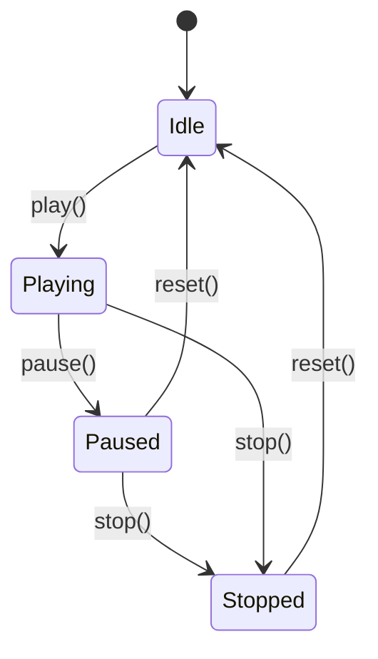
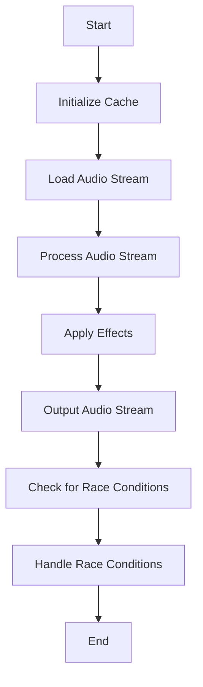

# Advanced Foundation: Djing

## 1. Theoretical Invariants & Formal Frameworks

### 1.1 Temporal Invariants in Digital Audio

In the realm of digital audio processing, time is a fundamental invariant. The sampling theorem, as articulated by Nyquist-Shannon, establishes that a continuous-time signal must be sampled at a rate at least twice the highest frequency component of the signal to avoid aliasing. Formally, if \( f_s \) is the sampling frequency and \( f_m \) is the maximum frequency component of the signal, the Nyquist-Shannon criterion is expressed as:

\[ f_s \geq 2f_m \]

This invariant ensures that the digital representation of the audio signal is faithful to the original analog signal. The proof of this theorem relies on the concept of the Fourier transform, which decomposes a signal into its constituent frequencies. If the sampling rate is insufficient, higher frequency components can fold back into the audible range, leading to aliasing artifacts.

### 1.2 Phase Invariants in Audio Mixing

Phase relationships between audio signals are critical in maintaining the integrity of the audio mix. The phase of a signal is the position of a point in time within a waveform cycle. In digital audio, phase invariance is crucial for maintaining the coherence of the audio signal across different channels and layers. The phase difference between two signals can be expressed as:

\[ \phi = \theta_2 - \theta_1 \]

where \( \theta_1 \) and \( \theta_2 \) are the phases of the two signals. Phase invariance is particularly important in the context of beatmatching and synchronization, where the phase alignment of two tracks is essential for a seamless transition.

### 1.3 Frequency Invariants in Audio Filtering

Frequency invariants in audio filtering refer to the preservation of specific frequency components across different processing stages. Filters are used to modify the frequency content of an audio signal, and the design of filters must adhere to certain invariants to ensure that the desired frequency components are preserved or attenuated. For example, in a low-pass filter, the cutoff frequency \( f_c \) is a critical invariant, and the filter's response must satisfy:

\[ H(f) = \begin{cases} 
1 & \text{if } f < f_c \\
0 & \text{if } f > f_c 
\end{cases} \]

where \( H(f) \) is the frequency response of the filter. The design of the filter must ensure that the transition between the passband and the stopband is smooth and meets the specified requirements.

## 2. Low-Level Invariant Taxonomy

### 2.1 Memory Models and Data Structures

In digital audio processing, memory models and data structures play a critical role in ensuring efficient and reliable processing of audio signals. The choice of data structures and memory models can significantly impact the performance and stability of a DJing system. For example, circular buffers are commonly used in audio processing to efficiently manage audio data streams. A circular buffer is a fixed-size buffer that overwrites old data with new data as it fills up. The circular buffer can be mathematically modeled as:

\[ \text{buffer}[i] = \text{buffer}[(i \mod N)] \]

where \( N \) is the size of the buffer. The circular buffer ensures that audio data is processed in a continuous and efficient manner.

### 2.2 Hardware Constraints and Axiomatic Definitions

Hardware constraints are critical in the design and implementation of DJing systems. The performance and capabilities of a DJing system are limited by the hardware it runs on. For example, the processing power of a CPU, the memory capacity of RAM, and the I/O bandwidth of the audio interface are all critical factors that must be considered in the design of a DJing system. Axiomatic definitions are used to establish the fundamental principles and assumptions that underpin the design of a DJing system. For example, the axiomatic definition of a digital audio signal is a sequence of discrete samples that represent the amplitude of the audio signal at regular intervals. This axiomatic definition ensures that all digital audio processing is based on a common foundation.

## 3. Micro-Architecture & Concurrency Dynamics

### 3.1 State Machines and Cache Dynamics

State machines are used to model the behavior of digital audio processing systems. A state machine is a mathematical model of computation that consists of a set of states, a set of input symbols, a set of output symbols, a transition function, and an output function. The state machine model is used to describe the behavior of a DJing system in terms of its states and transitions. For example, a state machine can be used to model the behavior of a DJing system in terms of its playback states (e.g., play, pause, stop) and transitions (e.g., play to pause, pause to stop).

Cache dynamics are critical in the design and implementation of digital audio processing systems. Caches are used to store frequently accessed data in a faster and more efficient manner. The cache dynamics of a DJing system can be modeled using a state machine. For example, a state machine can be used to model the behavior of a cache in terms of its states (e.g., hit, miss) and transitions (e.g., hit to miss, miss to hit).

### 3.2 Concurrency and Race Conditions

Concurrency is a critical aspect of digital audio processing systems. Concurrency refers to the ability of a system to perform multiple operations simultaneously. In a DJing system, concurrency is used to manage multiple audio streams and effects. Race conditions are a critical issue in concurrent systems. A race condition occurs when the behavior of a system depends on the relative timing of events. Race conditions can lead to unpredictable and unstable behavior in a DJing system. To avoid race conditions, it is essential to use synchronization mechanisms such as locks and semaphores.

## 4. Subtle Failure Modes & Boundary Conditions

### 4.1 Aliasing Artifacts

Aliasing artifacts are a critical issue in digital audio processing. Aliasing occurs when a continuous-time signal is sampled at a rate that is too low, leading to the folding of higher frequency components into the audible range. Aliasing artifacts can be mitigated by using anti-aliasing filters. Anti-aliasing filters are low-pass filters that attenuate frequencies above the Nyquist frequency. The design of anti-aliasing filters must adhere to certain invariants to ensure that the desired frequency components are preserved or attenuated.

### 4.2 Quantization Noise

Quantization noise is a critical issue in digital audio processing. Quantization noise occurs when a continuous-time signal is converted to a discrete-time signal, leading to a loss of information. Quantization noise can be mitigated by using higher bit depths. Higher bit depths provide a larger dynamic range and reduce the quantization noise. The quantization noise can be modeled using a probability distribution. For example, the quantization noise can be modeled using a uniform distribution with a variance of:

\[ \sigma^2 = \frac{1}{12} \left( \frac{1}{2^{b}} \right)^2 \]

where \( b \) is the bit depth. The design of digital audio processing systems must adhere to certain invariants to ensure that the quantization noise is minimized.

### 4.3 Buffer Overflows and Underruns

Buffer overflows and underruns are critical issues in digital audio processing. Buffer overflows occur when data is written to a buffer faster than it can be read, leading to data loss. Buffer underruns occur when data is read from a buffer faster than it can be written, leading to gaps in the audio stream. Buffer overflows and underruns can be mitigated by using circular buffers and synchronization mechanisms. Circular buffers ensure that data is processed in a continuous and efficient manner, and synchronization mechanisms ensure that data is read and written at the correct times.

## 5. Master Socratic Inquiries

### 5.1 Theoretical Foundations of Digital Audio Processing

What are the theoretical foundations of digital audio processing, and how do they ensure the integrity and fidelity of digital audio signals?

### 5.2 Design and Implementation of Digital Audio Processing Systems

How do the design and implementation of digital audio processing systems impact the performance and stability of DJing systems?

### 5.3 Concurrency and Synchronization in Digital Audio Processing

How do concurrency and synchronization mechanisms impact the behavior and performance of digital audio processing systems?

### 5.4 Failure Modes and Error Handling in Digital Audio Processing

What are the critical failure modes and error handling mechanisms in digital audio processing, and how do they ensure the reliability and robustness of DJing systems?

### 5.5 Mathematical Models and Formal Proofs in Digital Audio Processing

How do mathematical models and formal proofs ensure the correctness and reliability of digital audio processing systems?
