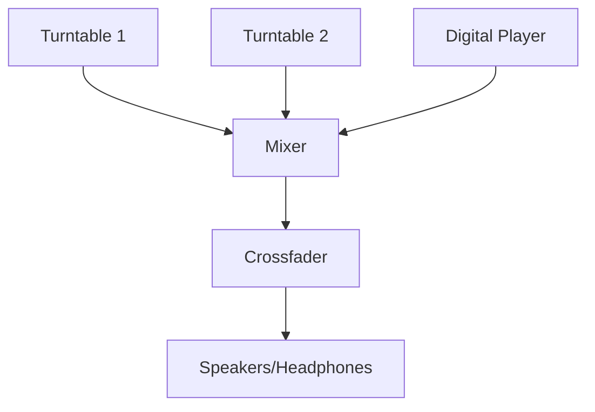

# Beginner Foundation: Djing

## 1. Everyday Intuition & First Principles

Imagine you are a conductor of a symphony, but instead of an orchestra, you have a collection of recorded music. Your role is to seamlessly blend these recordings, creating a continuous flow of sound that captivates your audience. Just as a conductor uses baton movements to guide musicians, a DJ uses turntables, mixers, and digital controllers to manipulate and combine music tracks. This art form, known as Djing, is not just about playing music; it's about storytelling through sound, creating transitions, and engaging with your audience in real-time.

## 2. Foundational Vocabulary & Glossary

### Turntable
A turntable is the primary instrument used in Djing. It consists of a motorized platter that spins vinyl records, allowing the DJ to control the playback speed and direction. Modern turntables often include digital features like pitch control, cueing, and digital outputs.

### Mixer
A mixer is used to blend audio signals from different sources. In Djing, it typically has two or more channels, each corresponding to a turntable or digital audio player. The mixer allows the DJ to adjust the volume, apply effects, and crossfade between tracks.

### Crossfader
The crossfader is a slider on the mixer that controls the balance between two audio channels. By moving the crossfader, the DJ can smoothly transition from one track to another, creating seamless blends and transitions.

### Beatmatching
Beatmatching is the technique of aligning the beats of two tracks so that they play in sync. This allows the DJ to create seamless transitions and maintain a consistent rhythm throughout the set.

### Cueing
Cueing is the process of setting a specific point in a track to start playing. DJs use cueing to prepare for transitions, allowing them to jump to a particular section of a song without starting from the beginning.

### Pitch Control
Pitch control allows the DJ to adjust the speed of a track without affecting its pitch. This is crucial for beatmatching, as it enables the DJ to match the tempo of two tracks while keeping their pitches in harmony.

## 3. Visual System Flow

### ASCII Diagram
```
+-------------------+       +-------------------+       +-------------------+
|   Turntable 1     |       |   Turntable 2     |       |   Digital Player  |
+-------------------+       +-------------------+       +-------------------+
          |                           |                           |
          +---------------------------+---------------------------+
                                      |
                                      v
                      +-------------------+
                      |       Mixer       |
                      +-------------------+
                                      |
                                      v
                      +-------------------+
                      |     Crossfader    |
                      +-------------------+
                                      |
                                      v
                      +-------------------+
                      |     Speakers/     |
                      |     Headphones    |
                      +-------------------+
```

### Mermaid Flowchart


## 4. Common Beginner Misconceptions & Mental Traps

### Misconception: Djing is just about playing music.
**Reality:** Djing involves a deep understanding of music theory, timing, and audience engagement. It's about creating a seamless and engaging experience.

### Misconception: You need expensive equipment to start Djing.
**Reality:** While professional equipment can enhance your experience, you can start Djing with basic turntables, a mixer, and digital audio software on a computer.

### Misconception: Beatmatching is too difficult to learn.
**Reality:** Beatmatching is a skill that improves with practice. Start with simple techniques and gradually work your way to more complex transitions.

### Misconception: You need to memorize every song's beat.
**Reality:** While knowing the structure of your tracks is helpful, you can also rely on visual cues and your ears to find the right beats for transitions.

## 5. Socratic Discussion Starters

1. **What is the primary goal of a DJ in terms of audience engagement?**
2. **How does beatmatching contribute to the overall flow of a DJ set?**
3. **What are the advantages and disadvantages of using digital audio software versus traditional turntables?**
4. **How can you use cueing to prepare for seamless transitions between tracks?**
5. **What role does pitch control play in Djing, and why is it important?**

By exploring these questions, you can deepen your understanding of Djing and develop a strong foundation for your musical journey.
