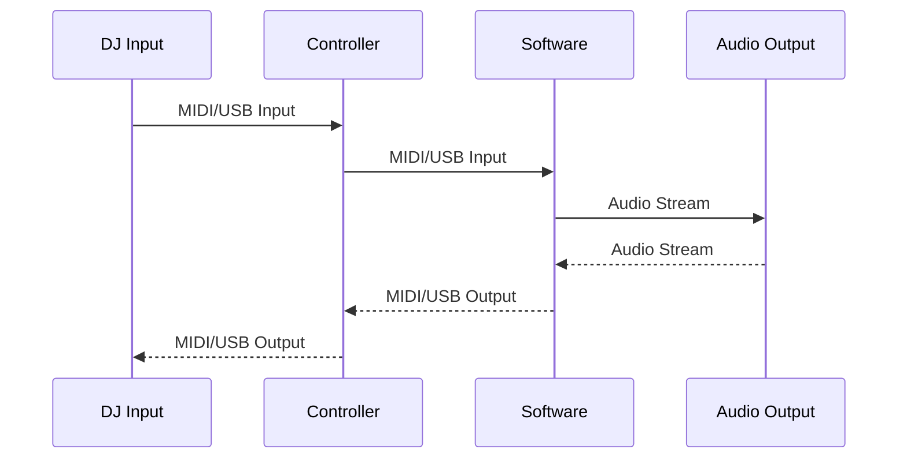

# Intermediate Foundation: Djing

## 1. Architectural Mental Model

In the realm of Djing, the architectural mental model transcends the basic operations of mixing and scratching. It encompasses a sophisticated system of components that interact to create a seamless and dynamic performance. At its core, Djing is a form of live audio processing and manipulation, where the DJ serves as the conductor of a complex audio orchestra. This system is built upon a foundation of hardware and software components that work in tandem to deliver a high-fidelity, real-time audio experience.

The primary components of a Djing system include:

- **Controllers**: These are the physical interfaces that the DJ uses to manipulate audio. They can range from simple CDJs (CD players with digital control) to advanced MIDI controllers and touchpads.
- **Software**: Digital Djing software, such as Serato DJ, Ableton Live, or Traktor, provides the digital environment for mixing, scratching, and effects processing.
- **Audio Interfaces**: These devices handle the conversion of digital audio signals to analog signals that can be sent to speakers or headphones.
- **Speakers and Headphones**: The output devices that deliver the audio to the audience or the DJ.
- **Computers**: In many modern setups, computers serve as the central processing unit, running the Djing software and managing audio streams.

The architecture of a Djing system is modular and flexible, allowing for a wide range of configurations. DJs can choose from various hardware and software options to create a setup that meets their specific needs and preferences. The key to a successful Djing system is the seamless integration of these components, enabling the DJ to focus on performance rather than technical issues.

## 2. Systems Taxonomy & Component Protocols

### Standard Interfaces

- **MIDI**: A widely used protocol for controlling electronic musical instruments and other related equipment. MIDI messages can control various parameters such as pitch, velocity, and effects.
- **USB**: A standard interface for connecting controllers and other peripherals to computers. USB 2.0 and 3.0 offer high-speed data transfer, ensuring smooth and responsive control.
- **HID (Human Interface Device)**: A protocol used for communication between human input devices (such as controllers) and computers. HID devices can send and receive data in real-time, making them ideal for Djing applications.

### Protocols

- **ASIO (Audio Stream Input/Output)**: A low-latency audio interface protocol used on Windows systems. ASIO is designed to minimize audio latency, ensuring that audio signals are processed and delivered in real-time.
- **Core Audio**: A framework for audio and video processing on macOS. Core Audio provides a high-level interface for managing audio streams and effects processing.
- **ALSA (Advanced Linux Sound Architecture)**: A sound architecture for the Linux operating system. ALSA provides a flexible and powerful interface for audio processing, supporting a wide range of hardware and software configurations.

### Data Models

- **Audio Streams**: Continuous streams of audio data that are processed and manipulated in real-time. Audio streams can be mono, stereo, or multichannel, depending on the system configuration.
- **MIDI Messages**: Data packets that contain control information for electronic musical instruments and other devices. MIDI messages can control various parameters such as pitch, velocity, and effects.
- **Waveforms**: Digital representations of audio signals. Waveforms can be manipulated in real-time using various effects and processing techniques.

## 3. Multi-Component Interaction Flow

### ASCII Sequence Diagram

```
+---------+          +---------+          +---------+          +---------+
|  DJ     |          |  Controller |          |  Software |          |  Audio  |
|  Input  |          |             |          |             |          |  Output |
+---------+          +---------+          +---------+          +---------+
      |                      |                      |                      |
      |  MIDI/USB Input      |                      |                      |
      +---------------------->                      |                      |
      |                      |  MIDI/USB Input      |                      |
      |                      +---------------------->                      |
      |                      |                      |  Audio Stream        |
      |                      |                      +----------------------> 
      |                      |                      |                      |
      |  MIDI/USB Output     |                      |                      |
      <----------------------+                      |                      |
      |                      |  MIDI/USB Output     |                      |
      |                      <----------------------+                      |
      |                      |                      |  Audio Stream        |
      |                      |                      <----------------------+
      |                      |                      |                      |
```

### Mermaid Sequence Diagram



## 4. Architectural Trade-offs & Production Pitfalls

### Trade-offs

- **Latency vs. Quality**: Lower latency is crucial for real-time audio processing, but it can sometimes come at the cost of audio quality. DJs must balance these two factors to achieve the best possible performance.
- **Flexibility vs. Simplicity**: A highly flexible system can offer a wide range of features and capabilities, but it can also be more complex to set up and use. DJs must weigh the benefits of flexibility against the need for simplicity.
- **Cost vs. Performance**: High-quality hardware and software can offer superior performance, but they can also be more expensive. DJs must consider their budget when choosing components for their system.

### Production Pitfalls

- **Inconsistent Audio Levels**: Inconsistent audio levels can disrupt the flow of a performance. DJs should use gain staging and compression to maintain consistent audio levels across all tracks.
- **Latency Issues**: Latency can cause audio signals to be delayed, disrupting the timing and synchronization of a performance. DJs should use low-latency audio interfaces and drivers to minimize latency.
- **Software Crashes**: Software crashes can be disruptive and can cause a performance to come to a halt. DJs should use reliable software and regularly back up their projects to prevent data loss.

## 5. Socratic Discussion Starters

1. **How does the choice of audio interface impact the overall performance of a Djing system?**
2. **What are the advantages and disadvantages of using a computer-based Djing system versus a hardware-based system?**
3. **How can DJs optimize their setup to minimize latency and maximize audio quality?**
4. **What are the best practices for managing audio levels and gain staging in a Djing system?**
5. **How can DJs use MIDI and other protocols to create a more flexible and dynamic performance?**
6. **What are the key considerations when choosing controllers and other hardware components for a Djing system?**
7. **How can DJs use software and plugins to enhance their performance and create unique soundscapes?**
8. **What are the best practices for backing up and managing projects in a Djing system?**
9. **How can DJs use real-time effects and processing techniques to create a more engaging and dynamic performance?**
10. **What are the key considerations when designing a multi-component Djing system that integrates hardware and software components?**

By exploring these questions, DJs can deepen their understanding of the architectural principles and design patterns that underpin modern Djing systems. This knowledge will enable them to create more sophisticated and dynamic performances, while also minimizing technical issues and maximizing their creative potential.
