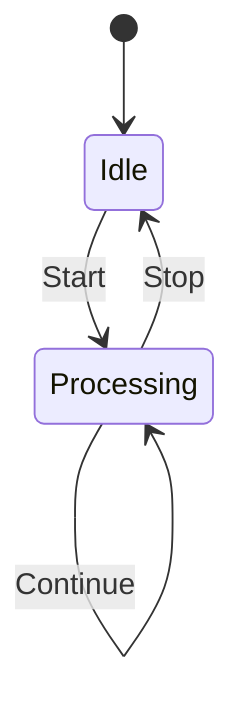
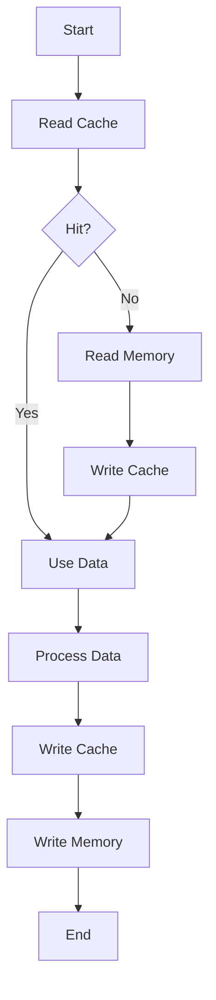

# Advanced Foundation: Dynamics Processing
## 1. Theoretical Invariants & Formal Frameworks

### Formal Proofs
Dynamics processing in music production involves the manipulation of audio signals to control their amplitude over time. The theoretical foundation of dynamics processing is rooted in signal processing and control theory. A formal proof of the invariance of a dynamics processor can be constructed by defining the processor's operation as a function \( f \) that maps input signals \( x(t) \) to output signals \( y(t) \). The invariance property can be expressed as:

\[ f(x(t) + c) = f(x(t)) + c \]

where \( c \) is a constant. This property ensures that the dynamics processor does not introduce any bias in the signal amplitude.

### Kernel or Physical Invariants
In the context of digital signal processing, the kernel of a dynamics processor can be defined as the impulse response of the processor. The physical invariants of a dynamics processor include the conservation of energy and the principle of causality. The conservation of energy ensures that the total energy of the output signal is equal to the total energy of the input signal plus the energy added by the processor. The principle of causality ensures that the output signal at any time \( t \) depends only on the input signal up to time \( t \).

## 2. Low-Level Invariant Taxonomy

### Deep Registers
In the context of digital audio processing, deep registers refer to the memory locations used to store intermediate results during the processing of audio signals. The invariance of deep registers can be defined as the property that the values stored in the registers do not change unexpectedly during the processing of audio signals. This property is crucial for ensuring the stability and reliability of dynamics processors.

### Memory Models
The memory model of a dynamics processor defines the way in which memory is accessed and managed during the processing of audio signals. The invariance of memory models can be defined as the property that the memory model does not introduce any unexpected behavior during the processing of audio signals. This property is crucial for ensuring the efficiency and reliability of dynamics processors.

### Hardware Constraints
Hardware constraints refer to the limitations imposed by the hardware on which the dynamics processor is implemented. The invariance of hardware constraints can be defined as the property that the dynamics processor does not violate any hardware constraints during the processing of audio signals. This property is crucial for ensuring the compatibility and reliability of dynamics processors.

### Axiomatic Definitions
Axiomatic definitions provide a formal basis for the design and analysis of dynamics processors. The invariance of axiomatic definitions can be defined as the property that the dynamics processor satisfies all axiomatic definitions. This property is crucial for ensuring the correctness and reliability of dynamics processors.

## 3. Micro-Architecture & Concurrency Dynamics

### Mermaid and ASCII State Machines
The micro-architecture of a dynamics processor can be modeled using state machines. A state machine is a mathematical model of computation that consists of a set of states, a set of input symbols, a set of output symbols, a transition function, and an output function. The state machine can be represented using Mermaid or ASCII diagrams.

### Cache and Race Condition Diagrams
The micro-architecture of a dynamics processor can also be modeled using cache and race condition diagrams. Cache diagrams show the way in which data is stored and accessed in the cache memory. Race condition diagrams show the way in which multiple threads or processes access shared resources.

## 4. Subtle Failure Modes & Boundary Conditions

### Subtle Failure Modes
Subtle failure modes in dynamics processing can include issues such as quantization errors, aliasing, and phase distortion. These issues can arise due to the limitations of digital signal processing and the way in which audio signals are represented and processed.

### Boundary Conditions
Boundary conditions in dynamics processing can include issues such as clipping, distortion, and noise. These issues can arise due to the limitations of the hardware and the way in which audio signals are processed.

## 5. Master Socratic Inquiries

### Research-Grade Discussion Questions
1. How can the invariance of a dynamics processor be formally proven?
2. What are the physical invariants of a dynamics processor and how can they be ensured?
3. How can the micro-architecture of a dynamics processor be modeled using state machines, cache diagrams, and race condition diagrams?
4. What are the subtle failure modes and boundary conditions in dynamics processing and how can they be addressed?
5. How can the design and analysis of dynamics processors be based on axiomatic definitions?
