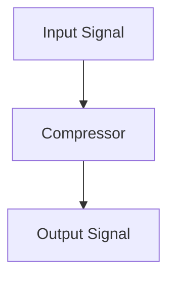

# Beginner Foundation: Dynamics Processing
## 1. Everyday Intuition & First Principles
Imagine you're in a room with a group of musicians. Sometimes, the drummer is too loud, drowning out the delicate piano melody. Other times, the singer's voice is barely audible. Dynamics processing is like a set of tools that help you adjust the volume of different instruments and voices so that they all blend together harmoniously, creating a balanced and engaging musical experience. Just like how you might turn up the volume on your radio to hear a song better or turn it down to avoid disturbing others, dynamics processing allows you to fine-tune the volume of each element in your music.

## 2. Foundational Vocabulary & Glossary
- **Dynamics:** The variation in loudness or volume within a piece of music.
- **Compression:** A process that reduces the volume of loud sounds and increases the volume of quiet sounds, making the overall dynamic range smaller.
- **Threshold:** The level at which compression begins to work. Sounds below this level are not affected.
- **Ratio:** The degree of compression applied. A 4:1 ratio means that for every 4 decibels (dB) of signal above the threshold, the output will only increase by 1 dB.
- **Attack Time:** The time it takes for the compressor to start reducing the gain once the signal exceeds the threshold.
- **Release Time:** The time it takes for the compressor to stop reducing the gain once the signal falls below the threshold.

## 3. Visual System Flow
### ASCII Diagram
```
[Input Signal] -> [Compressor] -> [Output Signal]
```
### Mermaid Flowchart


## 4. Common Beginner Misconceptions & Mental Traps
- **Misconception:** Compression always makes music louder. **Reality:** Compression can make music louder, but its primary purpose is to even out the dynamic range, which can sometimes result in a more subtle, balanced sound.
- **Misconception:** More compression is always better. **Reality:** Overusing compression can lead to a "squashed" sound, where the music loses its natural dynamics and character.
- **Misconception:** Compression is only for loud sounds. **Reality:** Compression can be used to control both loud and quiet sounds, helping to create a more balanced mix.

## 5. Socratic Discussion Starters
- What is the difference between dynamics and compression in music production?
- How does the threshold setting on a compressor affect the sound?
- Can you explain the role of attack and release times in compression?
- Why is it important to use compression in music production?
- How can you avoid overusing compression and maintain the natural dynamics of a track?
