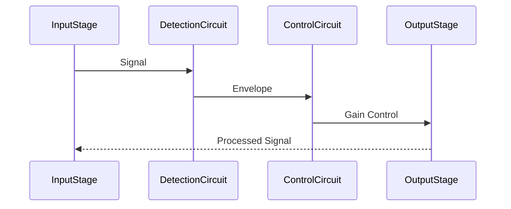

# Intermediate Foundation: Dynamics Processing
## 1. Architectural Mental Model
In music production, dynamics processing is a critical component that allows engineers to control the volume and amplitude of audio signals. Building on the foundational knowledge of basic dynamics processors like compressors, limiters, expanders, and gates, this section delves into the architectural design of dynamic processing systems.

### Key Concepts:
- **Dynamic Range:** The difference between the loudest and quietest parts of a signal.
- **Signal Flow:** The path an audio signal takes through a processing system.
- **Modulation:** The process of varying one signal with another to achieve desired effects.

### System Architecture:
A typical dynamics processing system consists of several key components:
- **Input Stage:** Captures the audio signal.
- **Detection Circuit:** Analyzes the signal to determine its amplitude.
- **Control Circuit:** Modulates the gain based on the detection circuit's output.
- **Output Stage:** Delivers the processed signal.

## 2. Systems Taxonomy & Component Protocols
Understanding the taxonomy of dynamics processors and their component protocols is essential for designing robust and scalable systems.

### Taxonomy:
- **Compressors:** Reduce the dynamic range of a signal.
- **Limiters:** Prevent signals from exceeding a specified threshold.
- **Expanders:** Increase the dynamic range of a signal.
- **Gates:** Reduce noise by attenuating signals below a certain threshold.
- **De-essers:** Specifically target and reduce sibilant frequencies.

### Standard Interfaces & Protocols:
- **VST (Virtual Studio Technology):** A standard for audio plugins.
- **AU (Audio Unit):** Apple's standard for audio plugins.
- **WASAPI (Windows Audio Session API):** Microsoft's standard for low-latency audio processing.
- **Core Audio:** Apple's audio framework.
- **ASIO (Audio Stream Input/Output):** A low-latency audio interface protocol.

### Data Models:
- **Envelope Detection:** Models the amplitude envelope of a signal.
- **Sidechain Processing:** Models the interaction between a signal and a sidechain signal.
- **Threshold, Ratio, Attack, Release (TRAR):** Models the parameters of a compressor.

## 3. Multi-Component Interaction Flow
Understanding the interaction between components in a dynamics processing system is crucial for effective design and troubleshooting.

### ASCII Sequence Diagram:
```
+----------------+     +----------------+     +----------------+     +----------------+
|    Input       |---->| Detection      |---->| Control        |---->| Output         |
|    Stage       |     | Circuit        |     | Circuit        |     | Stage          |
+----------------+     +----------------+     +----------------+     +----------------+
         |                        |                        |                        |
         |                        |                        |                        |
         |                        |                        |                        |
         +------------------------+------------------------+------------------------+
```

### Mermaid Sequence Diagram:


## 4. Architectural Trade-offs & Production Pitfalls
Designing a dynamics processing system involves making trade-offs between performance, flexibility, and complexity.

### Trade-offs:
- **Performance vs. Flexibility:** High-performance systems may sacrifice flexibility in terms of parameter customization.
- **Complexity vs. Simplicity:** More complex systems can offer advanced features but may be harder to use and maintain.
- **Latency vs. Quality:** Lower latency systems may compromise on audio quality due to reduced processing time.

### Production Pitfalls:
- **Improper Calibration:** Incorrectly calibrated detection circuits can lead to poor signal processing.
- **Over-Compression:** Excessive compression can result in a "squashed" sound.
- **Inadequate Sidechain Filtering:** Poorly filtered sidechains can introduce unwanted artifacts.

## 5. Socratic Discussion Starters
These questions are designed to bridge the gap between architectural design and low-level implementation.

- **How does the choice of detection circuit (e.g., peak vs. RMS) affect the overall sound of a dynamics processor?**
- **What are the implications of using different data models (e.g., envelope detection vs. sidechain processing) in a dynamics processing system?**
- **How can one balance the trade-offs between performance, flexibility, and complexity in designing a dynamics processing system?**
- **What are the best practices for calibrating detection circuits to ensure accurate signal processing?**
- **How can one avoid the pitfalls of over-compression and inadequate sidechain filtering in a dynamics processing system?**

By exploring these questions, engineers and practitioners can deepen their understanding of dynamics processing and develop more effective systems.
