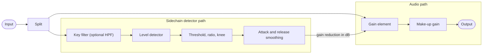
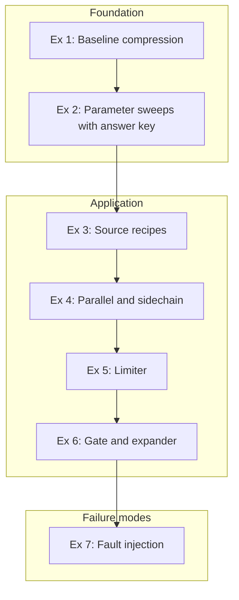
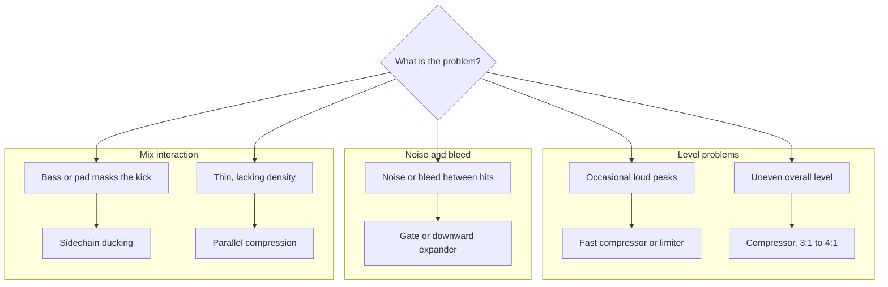

# Dynamics Processing Lab: Compression, Limiting, Gating, and Sidechain Control

## Objective

By the end of this lab you will be able to:

- Set threshold, ratio, attack, release, knee, and make-up gain by ear and by meter, and predict the gain reduction (GR) you will see before you hear it.
- Match the release time to the tempo of the track.
- Level-match A/B comparisons so you judge the compression, not the loudness.
- Apply compression to drums, bass, and vocals using a repeatable starting recipe.
- Use limiting, parallel compression, sidechain ducking, and gating.
- Trigger common failures on purpose (pumping, low-frequency distortion, gate chatter) and fix them.

The lab is DAW-agnostic. Parameter names are mapped for Reaper (ReaComp, free), Ableton Live, Logic Pro, and FabFilter Pro-C 2.

## Lab Setup

### Requirements

| Item | Requirement |
|---|---|
| DAW | Any. Reaper's stock ReaComp, ReaXcomp, and ReaGate cover every exercise. |
| Compressor | Stock DAW compressor or FabFilter Pro-C 2. Set it to its clean, transparent style. |
| Limiter | Stock DAW limiter or any true-peak limiter. |
| Loudness meter | DAW LUFS meter or Youlean Loudness Meter (free edition). Needs short-term LUFS and true peak. |
| Spectrum analyzer | Any (used in Exercise 7). |
| Python | Python 3.9+ with `numpy`, to generate test signals and an answer key. |
| Monitoring | Headphones or monitors at a fixed volume. Do not touch the volume knob during A/B tests. |

A note on the 1176-style plugins (Waves CLA-76, UAD 1176). They have no threshold knob: the Input knob sets how hard you drive the detector, and Ratio is a button set (4, 8, 12, 20, All). Attack runs from roughly 20 to 800 microseconds, and **7 is the fastest setting, 1 the slowest**. A 20 ms attack is not available on these plugins, so use a stock compressor or Pro-C 2 for the numeric exercises.

### Session

1. Sample rate 48 kHz, 24-bit.
2. Project tempo 100 BPM, loop region 4 bars.
3. Master fader at 0 dB. Turn off any plugin's **Auto Gain / Auto Make-up** option. You need to control make-up yourself.
4. For recorded material, trim each track so its average level sits near -18 dBFS RMS (peaks around -6 dBFS). This leaves headroom and puts the plugin in the range it was designed for.

### Test material

Save this as `dynlab.py`. It generates a synthetic drum loop, a level-step tone, and a reference compressor that gives you the "answer key" numbers to compare against your DAW plugin.

```python
#!/usr/bin/env python3
"""dynlab.py: test-signal generator and reference compressor for the dynamics lab.
Requires Python 3.9+ and numpy. Reads and writes 16-bit PCM WAV (stereo is summed to mono).
The detector is a 2 ms RMS-style envelope; the gain smoother works in dB."""
import argparse
import wave

import numpy as np

SR = 48000
EPS = 1e-12


def db(x):
    return 20.0 * np.log10(np.maximum(np.abs(x), EPS))


def write_wav(path, x, sr=SR):
    pcm = (np.clip(x, -1.0, 1.0) * 32767.0).astype("<i2")
    with wave.open(path, "wb") as w:
        w.setnchannels(1)
        w.setsampwidth(2)
        w.setframerate(sr)
        w.writeframes(pcm.tobytes())


def read_wav(path):
    with wave.open(path, "rb") as w:
        if w.getsampwidth() != 2:
            raise SystemExit("Only 16-bit PCM WAV is supported. Re-export as 16-bit.")
        ch, sr, n = w.getnchannels(), w.getframerate(), w.getnframes()
        data = np.frombuffer(w.readframes(n), dtype="<i2").astype(np.float64) / 32768.0
    if ch > 1:
        data = data.reshape(-1, ch).mean(axis=1)
    return data, sr


def gen_drums(bpm, bars, noise_db=None, sr=SR, seed=1):
    rng = np.random.default_rng(seed)
    beat = 60.0 / bpm
    n = int(sr * beat * 4 * bars)
    out = np.zeros(n)

    def add(sig, t):
        i = int(t * sr)
        if i >= n:
            return
        j = min(n, i + len(sig))
        out[i:j] += sig[: j - i]

    t = np.arange(int(0.40 * sr)) / sr
    sweep = 50.0 + 90.0 * np.exp(-t * 35.0)
    kick = 0.9 * np.sin(2 * np.pi * np.cumsum(sweep) / sr) * np.exp(-t * 9.0)

    ts = np.arange(int(0.25 * sr)) / sr
    snare = (0.6 * rng.standard_normal(len(ts)) * np.exp(-ts * 22.0)
             + 0.3 * np.sin(2 * np.pi * 190.0 * ts) * np.exp(-ts * 30.0))

    th = np.arange(int(0.06 * sr)) / sr
    hat = np.diff(0.25 * rng.standard_normal(len(th)) * np.exp(-th * 90.0), prepend=0.0)

    for b in range(bars * 4):
        t0 = b * beat
        if b % 4 == 0:
            add(kick, t0)
        if b % 4 == 2:
            add(kick * 0.6, t0)              # softer second kick
        if b % 4 in (1, 3):
            add(snare, t0)
            add(snare * 0.2, t0 - beat / 4)  # ghost note a 16th early
        add(hat, t0)
        add(hat * 0.7, t0 + beat / 2)

    out *= 10 ** (-3.0 / 20.0) / np.max(np.abs(out))  # peak at -3 dBFS
    if noise_db is not None:
        out += rng.standard_normal(n) * 10 ** (noise_db / 20.0)  # white-noise floor (RMS)
    return out


def gen_steps(freq=1000.0, sr=SR, seg=1.5):
    """Tone at -30 dBFS, then -10 dBFS, then -30 dBFS, 1.5 s each (whole cycles per segment)."""
    t = np.arange(int(seg * sr)) / sr
    tone = np.sin(2 * np.pi * freq * t)
    return np.concatenate([tone * 10 ** (-30 / 20), tone * 10 ** (-10 / 20), tone * 10 ** (-30 / 20)])


def detector_db(x, sr, tau_ms=2.0):
    c = np.exp(-1.0 / (sr * tau_ms / 1000.0))
    sq = x * x
    p = np.empty_like(x)
    m = 0.0
    for i in range(len(x)):
        m = c * m + (1.0 - c) * sq[i]
        p[i] = m
    return 10.0 * np.log10(2.0 * p + EPS)  # a sine reads as its peak level in dBFS


def gain_computer(level_db, thr, ratio, knee):
    over = level_db - thr
    slope = 1.0 - 1.0 / ratio
    if knee > 0:
        soft = slope * (over + knee / 2.0) ** 2 / (2.0 * knee)
        return np.where(over <= -knee / 2.0, 0.0,
                        np.where(over >= knee / 2.0, slope * over, soft))
    return np.where(over > 0.0, slope * over, 0.0)


def smooth_gr(target, sr, attack_ms, release_ms):
    a = np.exp(-1.0 / (sr * max(attack_ms, 0.01) / 1000.0))
    r = np.exp(-1.0 / (sr * max(release_ms, 0.01) / 1000.0))
    out = np.empty_like(target)
    g = 0.0
    for i, t in enumerate(target):
        k = a if t > g else r
        g = k * g + (1.0 - k) * t
        out[i] = g
    return out


def compress(x, sr, thr, ratio, attack, release, knee=0.0, makeup=0.0):
    target = gain_computer(detector_db(x, sr), thr, ratio, knee)
    gr = smooth_gr(target, sr, attack, release)
    return x * 10 ** ((makeup - gr) / 20.0), gr


def stats(x):
    pk = float(db(np.max(np.abs(x))))
    rms = float(10 * np.log10(np.mean(x * x) + EPS))
    return pk, rms, pk - rms


def cmd_process(a):
    x, sr = read_wav(a.infile)
    y, gr = compress(x, sr, a.thr, a.ratio, a.attack, a.release, a.knee, a.makeup)
    write_wav(a.outfile, y, sr)
    for name, sig in (("input ", x), ("output", y)):
        pk, rms, cf = stats(sig)
        print(f"{name}  peak {pk:6.2f} dBFS   RMS {rms:6.2f} dBFS   crest {cf:5.2f} dB")
    print(f"gain reduction  max {gr.max():.2f} dB   mean {gr.mean():.2f} dB")


def cmd_measure(a):
    sr = SR
    n = int(1.5 * sr)
    x = gen_steps(sr=sr)
    _, gr = compress(x, sr, a.thr, a.ratio, a.attack, a.release, a.knee)
    expected = float(gain_computer(np.array([-10.0]), a.thr, a.ratio, a.knee)[0])
    steady = float(gr[2 * n - 1])
    print(f"settings: thr {a.thr} dB, ratio {a.ratio}:1, attack {a.attack} ms, "
          f"release {a.release} ms, knee {a.knee} dB")
    print(f"steady GR at -10 dBFS input: expected {expected:.2f} dB, measured {steady:.2f} dB, "
          f"output level {-10 - steady:.2f} dBFS")
    if steady > 0.05:
        up = np.nonzero(gr[n:2 * n] >= 0.632 * steady)[0][0] / sr * 1000.0
        down = np.nonzero(gr[2 * n:] <= 0.368 * steady)[0][0] / sr * 1000.0
        print(f"time to 63% of final GR after level step up:   {up:6.1f} ms (attack)")
        print(f"time to 63% recovery after level step down:    {down:6.1f} ms (release)")
        marks = [1, 5, 10, 20, 50, 100]
        print("GR after step up: " + "  ".join(f"{m} ms={gr[n + int(m * sr / 1000)]:.2f}" for m in marks))
    else:
        print("No gain reduction at this threshold, so there is no attack or release to measure.")


def main():
    p = argparse.ArgumentParser(description=__doc__)
    sub = p.add_subparsers(dest="cmd", required=True)

    d = sub.add_parser("gen-drums", help="write a synthetic drum loop")
    d.add_argument("--bpm", type=float, default=100.0)
    d.add_argument("--bars", type=int, default=4)
    d.add_argument("--noise-db", type=float, default=None, help="add a noise floor at this RMS dBFS")
    d.add_argument("--out", default="drums.wav")

    s = sub.add_parser("gen-steps", help="write a -30/-10/-30 dBFS step tone")
    s.add_argument("--freq", type=float, default=1000.0, help="use 60 for the bass-distortion test")
    s.add_argument("--out", default="steps.wav")

    def comp_args(sp):
        sp.add_argument("--thr", type=float, default=-20.0)
        sp.add_argument("--ratio", type=float, default=4.0)
        sp.add_argument("--attack", type=float, default=20.0)
        sp.add_argument("--release", type=float, default=100.0)
        sp.add_argument("--knee", type=float, default=0.0)

    pr = sub.add_parser("process", help="compress a WAV file")
    pr.add_argument("infile")
    pr.add_argument("outfile")
    comp_args(pr)
    pr.add_argument("--makeup", type=float, default=0.0)

    m = sub.add_parser("measure", help="print the reference GR numbers for the step tone")
    comp_args(m)

    a = p.parse_args()
    if a.cmd == "gen-drums":
        write_wav(a.out, gen_drums(a.bpm, a.bars, a.noise_db))
    elif a.cmd == "gen-steps":
        write_wav(a.out, gen_steps(a.freq))
    elif a.cmd == "process":
        cmd_process(a)
    else:
        cmd_measure(a)


if __name__ == "__main__":
    main()
```

Generate the files:

```bash
pip install numpy
python3 dynlab.py gen-drums --bpm 100 --bars 4 --out drums.wav
python3 dynlab.py gen-steps --out steps.wav
python3 dynlab.py gen-drums --bpm 100 --bars 4 --noise-db -45 --out drums_noisy.wav
python3 dynlab.py gen-steps --freq 60 --out steps_60hz.wav
```

### Metering and level matching

Compression lowers peaks, and make-up gain then raises everything. A louder signal almost always sounds better, so an unmatched A/B tells you nothing about the compressor.

1. Put a short-term LUFS meter on the master.
2. Play the bypassed loop and note the LUFS-S reading.
3. Enable the compressor and adjust **Make-up Gain** until the reading matches within 0.5 LU.
4. Only now judge the sound.

## How a Compressor Works

A compressor measures the signal level, compares it to the threshold, and turns the signal down by an amount set by the ratio. Above the threshold, gain reduction is `GR = (input level - threshold) x (1 - 1/ratio)`, all in dB. A -10 dBFS input with a -20 dB threshold and 4:1 ratio is 10 dB over, so GR = 10 x 0.75 = 7.5 dB and the output is -17.5 dBFS. Attack and release smooth how quickly that GR value rises and falls, so a slow attack lets the first part of a transient pass through. A knee rounds the corner at the threshold so compression eases in instead of switching on. Everything else in this lab is the practical use of that one rule.



### Parameter map across plugins

| Concept | ReaComp | Ableton Compressor | Logic Compressor | FabFilter Pro-C 2 |
|---|---|---|---|---|
| Threshold | Thresh | Threshold | Threshold | Threshold |
| Ratio | Ratio | Ratio | Ratio | Ratio |
| Attack | Attack | Attack | Attack | Attack |
| Release | Release | Release (or Auto) | Release (or Auto) | Release |
| Knee | Knee size | Knee | Knee | Knee |
| Make-up | Output gain (leave Auto make-up off) | Output | Gain (leave Auto Gain off) | Gain (leave Auto Gain off) |
| Detector | RMS size (0 = peak) | Peak, RMS, Expand | Peak or RMS | Style (Clean) |
| Parallel mix | Wet / Dry | Dry/Wet | Mix | Mix |
| Sidechain | Detector input | Sidechain section | Side Chain | Side Chain |

## Lab Progression



## Exercise 1: Baseline Compression on a Drum Loop

**Goal:** get 4 to 6 dB of gain reduction on the loudest hits, with the meter recovering between hits, and a level-matched A/B.

1. Import `drums.wav` on a new track. Project tempo 100 BPM, loop 4 bars.
2. Insert the compressor and set: **Ratio** 4:1, **Attack** 20 ms, **Release** 150 ms (a 16th note at 100 BPM), **Knee** 0 dB, **Make-up** 0 dB, **Mix** 100%, detector on peak (or RMS size 0).
3. Start with **Threshold** at 0 dB. Lower it slowly while the loop plays until the GR meter moves on the kick and snare. Stop when the kick peaks show 4 to 6 dB of GR. With this loop (peaks at -3 dBFS) the threshold lands around -10 dBFS.
4. Level-match with Make-up Gain as described above. Write down the Make-up value that matched.
5. A/B at the loop point: listen to the snare crack and the hat level between hits.

**Check against the reference:**

```bash
python3 dynlab.py process drums.wav drums_ref.wav --thr -10 --ratio 4 --attack 20 --release 150
```

The script prints peak, RMS, and crest factor (peak minus RMS) for input and output. Your DAW plugin should show crest factor falling by a similar amount. Import `drums_ref.wav` on a second track to compare against your plugin by ear.

**Pass criteria:**

- Kick peaks show 4 to 6 dB GR.
- The GR meter returns near 0 before the next kick or snare.
- Level-matched A/B loudness is within 0.5 LU.
- You can hear a difference in the snare body with the compressor enabled.

## Exercise 2: Parameter Sweeps with an Answer Key

**Goal:** predict gain reduction numerically, then verify on your plugin.

Import `steps.wav` (1 kHz tone: 1.5 s at -30 dBFS, 1.5 s at -10 dBFS, 1.5 s at -30 dBFS). Set Knee to 0 and Make-up to 0. Read the plugin's GR meter at the end of the loud section.

### Threshold sweep (ratio 4:1, attack 20 ms, release 100 ms)

Lowering the threshold increases gain reduction. Raising it decreases gain reduction.

| Threshold | Expected GR | Output level at -10 dBFS input |
|---|---|---|
| -30 dB | 15.0 dB | -25.0 dBFS |
| -20 dB | 7.5 dB | -17.5 dBFS |
| -10 dB | 0.0 dB | -10.0 dBFS |

### Ratio sweep (threshold -20 dB)

| Ratio | Expected GR | Output level |
|---|---|---|
| 2:1 | 5.0 dB | -15.0 dBFS |
| 4:1 | 7.5 dB | -17.5 dBFS |
| 8:1 | 8.75 dB | -18.75 dBFS |
| 20:1 (near limiting) | 9.5 dB | -19.5 dBFS |

Verify the answer key and your plugin together:

```bash
python3 dynlab.py measure --thr -20 --ratio 8
```

Plugin meters typically agree within about 1 dB. If your plugin reads far off, check that Knee is 0, the detector is not in a program-dependent style, and Auto Gain is off.

### Attack and release measurement

Bounce the compressed `steps.wav` (threshold -20 dB, ratio 4:1). Zoom into the waveform at the 1.5 s step. During the attack time the tone passes at nearly the original -10 dBFS level before settling at -17.5 dBFS. That overshoot is what a slow attack lets through.

```bash
python3 dynlab.py measure --thr -20 --ratio 4 --attack 5  --release 100
python3 dynlab.py measure --thr -20 --ratio 4 --attack 50 --release 300
```

The script prints the time to reach 63% of final GR (attack), the time to recover 63% (release), and GR at 1, 5, 10, 20, 50, and 100 ms. Expect values near your settings. Plugin vendors define attack and release differently (63% versus 10 to 90%), so the same number on two plugins will not sound identical.

### Attack effect on the drum loop

Set threshold for about 5 dB GR on the kick, ratio 4:1, release 150 ms. Change only Attack:

| Attack | What you hear |
|---|---|
| 1 ms | Snare crack and kick beater click are flattened. Sound is dull and thick. |
| 10 ms | Slightly softened transient. |
| 30 ms | Transient passes, body is tightened. Typical for punch. |
| 80 ms | Almost no control over the transient. Compression acts on the sustain. |

### Release drill (tempo-synced)

Release time in milliseconds for a note value is `60000 / BPM` for a quarter note, half for an 8th, a quarter for a 16th.

| Tempo | Quarter | 8th | 16th |
|---|---|---|---|
| 80 BPM | 750 ms | 375 ms | 188 ms |
| 100 BPM | 600 ms | 300 ms | 150 ms |
| 120 BPM | 500 ms | 250 ms | 125 ms |
| 140 BPM | 429 ms | 214 ms | 107 ms |

Drill: loop `drums.wav` and set the project tempo to 80 BPM. Adjust Release until the GR meter returns to about 0 just before the next snare. Repeat at 100 BPM and 120 BPM (generate a matching loop with `gen-drums --bpm 120`). Rules of thumb:

- Release too short: the compressor lets the level rise in the gaps and you hear the tail pump up.
- Release too long: the meter never recovers and the whole loop sounds flat and squashed.

**Pass criteria:** your measured GR is within 1 dB of the table in all six threshold and ratio cases, and you set a release that recovers before the next hit at all three tempos.

## Exercise 3: Source Recipes

Apply each recipe, then adjust threshold to reach the target GR on the loudest phrases. Always level-match before judging.

| Source | Ratio | Attack | Release | Knee | Target GR (peaks) | Notes |
|---|---|---|---|---|---|---|
| Lead vocal | 3:1 | 10 to 30 ms | 80 to 150 ms | 6 dB | 3 to 6 dB | For more control, use two compressors at 3 dB each instead of one at 6 dB. |
| Bass guitar (DI) | 4:1 | 30 ms | 100 ms | 3 dB | 4 to 8 dB | Slower attack keeps the finger or pick attack. Too fast distorts low notes (see Exercise 7). |
| Kick or snare | 4:1 | 20 to 40 ms | 80 to 150 ms | 0 dB | 3 to 6 dB | Release near the 16th-note value of the tempo. |
| Drum bus | 2:1 | 30 ms | 150 to 250 ms (or Auto) | 3 dB | 1 to 3 dB | "Glue" setting. If it pumps, raise the threshold. |
| Acoustic guitar (strummed) | 3:1 | 15 ms | 120 ms | 6 dB | 2 to 4 dB | Slower attack keeps pick definition. |

Procedure per source:

1. Set the recipe values and start with threshold at 0 dB.
2. Lower threshold until the GR meter reaches the target on the loudest phrase.
3. Level-match with Make-up.
4. Raise Attack by 10 ms. If the transient gets louder, you were over-controlling it. Keep the slower setting if the part sits better.
5. Adjust Release until the GR meter recovers before the next note or word.

**Pass criteria:** GR on the loudest phrase falls in the target range, and A/B at matched loudness sounds more consistent without a pumping tail.

## Exercise 4: Parallel Compression and Sidechain Ducking

### Parallel compression on the drum loop

1. Duplicate the drum track (or send it to an aux bus).
2. On the duplicate or bus, set: Ratio 10:1, Attack 5 ms, Release 80 ms, Knee 0 dB. Lower threshold until the kick and snare show 10 to 15 dB of GR.
3. Blend the compressed signal underneath the uncompressed track until the room tail and hats lift without the transients getting dull.
4. Check latency. If the compressor has lookahead, enable your DAW's plugin delay compensation. Confirm with a polarity flip on one track: at unity levels you should hear cancellation, not a hollow comb sound.

Alternatively, use the plugin's own **Mix** knob at 30 to 50%.

### Sidechain ducking (kick ducks a bass or pad)

1. Put the compressor on the bass (or pad) track.
2. Set the sidechain input to the kick track (Ableton: Sidechain section; Logic: Side Chain; Reaper: Detector input, Auxiliary input; Pro-C 2: Side Chain, External).
3. Set Ratio 4:1, Attack 1 ms, Release 120 ms at 100 BPM, Knee 0 dB. Lower threshold until the bass drops 4 to 8 dB on each kick.
4. Tune Release so the bass swells back before the next kick.

### Key filter (HPF in the sidechain) on a bus compressor

If the kick makes the whole drum bus pump, set the detector's high-pass (sidechain filter) to 100 to 150 Hz. The kick then triggers less GR and the compression responds more to snare and cymbals.

**Pass criteria:** the parallel blend raises the room tail without softening the snare, and the bass ducks on every kick and recovers before the next one.

## Exercise 5: Limiting and Output Ceiling

A limiter is a compressor with a very high ratio and a lookahead, so peaks never pass the ceiling.

1. Place a limiter at the end of the master chain, then a true-peak meter after it.
2. Set **Ceiling** to -1.0 dBTP, **Lookahead** to the plugin default, and **Release** to Auto (or 50 to 100 ms). Turn on **True Peak** or oversampling if available.
3. Play a drum loop with the compressor from Exercise 1 enabled. Raise the limiter's input gain in 2 dB steps (0, 2, 4, 6, 8, 10 dB). At each step note the GR meter and the integrated LUFS.
4. Find the first step where you hear dulling or distortion.

**Rules of use:**

- The limiter gets 1 to 3 dB of GR on average. More than 4 dB of GR on a dense mix generally dulls transients.
- Streaming services normalize loudness; a common reference is about -14 LUFS integrated. Check the current spec for your target platform, because values change.
- Never boost make-up gain after the limiter.

**Pass criteria:** true peak reads at or below -1.0 dBTP at every step, and you can name the input gain at which artifacts begin.

## Exercise 6: Gate and Downward Expander

Gates remove noise or bleed between hits. Use `drums_noisy.wav` (noise floor at -45 dBFS RMS).

1. Insert a gate (ReaGate, Ableton Gate, Logic Noise Gate, or Pro-G).
2. Settings: **Threshold** -30 dB, **Attack** 0.5 ms, **Hold** 40 ms, **Release** 120 ms, **Range** -20 dB, **Hysteresis** 5 dB (close threshold about -35 dB).
3. Play the loop. The noise floor between hits should drop from about -45 dBFS to about -65 dBFS.
4. Switch to expander mode (or Range -12 dB with a 2:1 ratio) for a more natural decay.

Troubleshooting:

| Symptom | Cause | Fix |
|---|---|---|
| Gate flutters during tails | Threshold sits on the decay level | Add hysteresis (4 to 6 dB) and hold (40 to 80 ms) |
| Clicks at the gate opening | Attack too short on low frequencies | Raise Attack to 1 to 3 ms |
| Tails cut off abruptly | Release too short | Raise Release to 150 to 300 ms or use an expander |
| Quiet hits are muted | Threshold too high | Lower the threshold below the quietest wanted hit |

**Pass criteria:** the floor between hits drops by at least 15 dB and no hit or tail is chopped.

## Exercise 7: Fault Injection and Stress Testing

**Goal:** trigger each failure mode on purpose, name the cause, and confirm you can recover.

### 7a. Extreme settings

Set Threshold -40 dB, Ratio 10:1, Make-up 0 dB on the drum loop. Expected result: GR of 15 to 25 dB on every hit, the loop sounds small and flat, and the noise between hits rises relative to the hits if you add make-up gain. If clipping occurs after you add make-up, the compressor's output stage is hitting 0 dBFS; lower make-up.

### 7b. Pumping with 1 ms release

Set Attack 1 ms, Release 1 ms, ratio 4:1, threshold for 6 dB GR. The gain returns to unity almost instantly after every transient, so the tail of each note jumps up in level. On the drum loop the hats and room noise audibly "breathe" after each hit.

### 7c. Low-frequency distortion

Compressors with very fast time constants follow the waveform of a low note instead of its envelope, which creates harmonics. Import `steps_60hz.wav` (a 60 Hz tone, standing in for a bass note).

```bash
python3 dynlab.py process steps_60hz.wav fast_60.wav --thr -20 --ratio 8 --attack 0.1 --release 1
python3 dynlab.py process steps_60hz.wav slow_60.wav --thr -20 --ratio 8 --attack 10  --release 100
```

Open both files in a spectrum analyzer. The fast version shows extra odd-harmonic content (around 180 Hz and 300 Hz) next to the 60 Hz fundamental. The slow version stays much cleaner. Fix in a real session: slow the attack and release, or high-pass the detector at 80 to 100 Hz.

### 7d. 1:1 ratio and null test

Set Threshold -10 dB, Ratio 1:1, Make-up 0 dB. There should be no gain reduction. To confirm, duplicate the track, flip the polarity on the copy, and play both. A properly transparent 1:1 compressor nulls to silence. If it does not, check for plugin latency, oversampling filters, or a non-zero Make-up.

### 7e. Recovery

Reset the plugin to default, or bypass it. Play the loop and confirm: GR meter at 0, level equal to the bypassed track, no clipping, no leftover automation, and polarity null against the original. Do this check at the end of every session.

**Pass criteria:** you reproduced 7a through 7c, explained each in one sentence, and 7d and 7e both null.

## Troubleshooting

| Symptom | Likely cause | Fix |
|---|---|---|
| Whole mix pumps with the kick | Kick drives the bus detector | HPF in the sidechain at 100 to 150 Hz, raise threshold, lengthen release |
| Dull, lifeless drums | Attack too fast, ratio too high | Attack 20 to 40 ms, lower ratio |
| Vocal sounds boxy or squashed | Too much GR, release too slow | Aim for 3 to 6 dB peaks, set release near the phrase rhythm |
| Bass sounds distorted | Attack and release too fast for low frequencies | Attack 30 ms, release 100 ms, or HPF the detector |
| Compressed version sounds "better" in A/B | Louder, not better | Level-match with a LUFS meter within 0.5 LU |
| Noise rises in quiet passages | Large make-up gain after heavy GR | Lower the ratio, use parallel compression, or gate before the compressor |
| Inter-sample clipping after export | Peaks above 0 dBTP | Limiter ceiling at -1.0 dBTP with true-peak mode |
| Parallel compression sounds hollow | Latency mismatch between tracks | Enable plugin delay compensation, verify with a polarity flip |

## Practical Cheat Sheet and Quick Reference

### Core definitions

- **Threshold:** the level above which gain reduction starts.
- **Ratio:** input change divided by output change above the threshold. 4:1 turns 4 dB of overshoot into 1 dB.
- **Attack:** how fast gain reduction rises after the signal crosses the threshold.
- **Release:** how fast gain reduction falls after the signal drops below the threshold.
- **Knee:** how gradually compression engages around the threshold.
- **Make-up gain:** gain added after compression to restore loudness.
- **Gain reduction (GR):** `(input dB - threshold dB) x (1 - 1/ratio)` above the threshold.

### Starting settings

| Task | Ratio | Attack | Release | Target GR |
|---|---|---|---|---|
| Vocal control | 3:1 | 10 to 30 ms | 80 to 150 ms | 3 to 6 dB |
| Bass | 4:1 | 30 ms | 100 ms | 4 to 8 dB |
| Drum transient shaping | 4:1 | 20 to 40 ms | 80 to 150 ms | 3 to 6 dB |
| Bus glue | 2:1 | 30 ms | 150 to 250 ms | 1 to 3 dB |
| Parallel crush | 10:1 | 5 ms | 80 ms | 10 to 15 dB |
| Limiter | N/A | N/A | Auto or 50 to 100 ms | 1 to 3 dB average |
| Gate | N/A | 0.5 ms | 120 ms | Range -15 to -20 dB |

### Release in milliseconds by tempo

| BPM | Quarter | 8th | 16th |
|---|---|---|---|
| 80 | 750 | 375 | 188 |
| 100 | 600 | 300 | 150 |
| 120 | 500 | 250 | 125 |
| 140 | 429 | 214 | 107 |

### Which tool for which problem



### Session checklist

1. Gain-stage first: average level near -18 dBFS RMS.
2. Auto make-up off. Set Knee, Ratio, Attack, Release from the recipe.
3. Lower threshold to the target GR.
4. Set Release by tempo so GR recovers before the next hit.
5. Level-match to the bypassed signal within 0.5 LU, then judge.
6. Limiter last, ceiling -1.0 dBTP.
7. Reset and null-test when finished.
