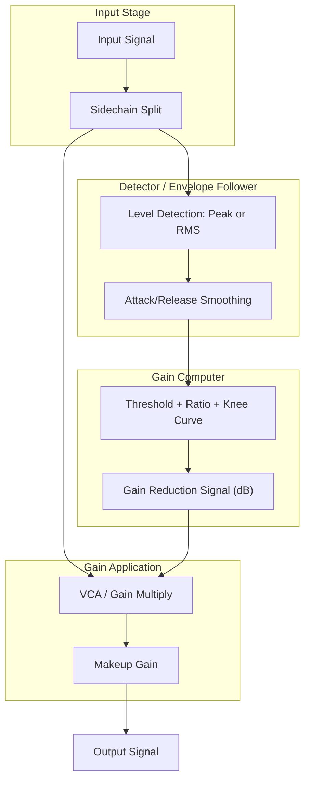
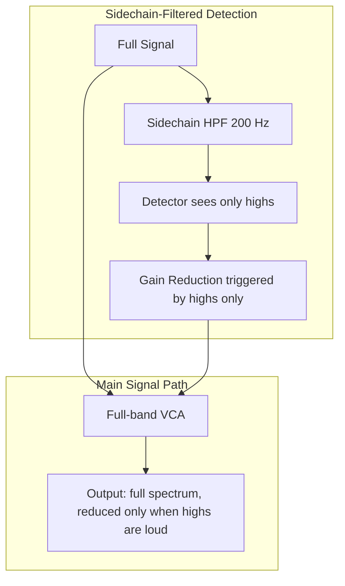

# Dynamics Processing — Compressors, Limiters, Gates, and Expanders

## 1. The One Physical Fact That Explains Every Control

Dynamic range is the gap between the loudest and quietest moments of a signal. A snare crack can peak at -3 dBFS while the room tone between hits sits at -50 dBFS — a 47 dB swing that's unmanageable on a car speaker, a phone, or a broadcast chain with loudness regulations. Dynamics processors exist to control that swing on purpose, not to "fix" the track generically. Every knob answers one of three questions: *how loud is too loud, how hard do I pull it down, and how fast?*

The only physics you need before touching a plugin: gain changes under ~1 ms are heard as clicks or distortion (they inject audible high-frequency energy into the waveform). Gain changes spread over 50–200 ms are heard as a smooth volume pull. That's it. Fast gain changes = artifact. Slow gain changes = mix move. Attack and release settings are really just choosing where on that spectrum you want to sit, and everything else in this lesson is a consequence of that one line.

---

## 2. The Four Core Tools and When to Reach for Each

| Tool | What it does | Reach for it when |
|---|---|---|
| **Compressor** | Reduces gain *above* a threshold, ratio-controlled | Peaks poke out, you want glue/control, dynamic range is too wide for the medium |
| **Limiter** | Compressor with ratio ≥ 10:1 (often ∞:1), fast/lookahead attack | You need a hard ceiling — mastering, broadcast, stopping clipping |
| **Expander** | Reduces gain *below* a threshold, gently | Signal needs more punch/contrast, or a noise floor needs subtle suppression without a hard cutoff |
| **Gate** | Hard-mutes signal below threshold | Bleed, hiss, or hum needs to be fully silenced between hits |

Signal flow, labeled with the actual control path:

The detail most tutorials skip: the detector and the audio path are *separate circuits*. The sidechain decides how much gain reduction to apply; the main path is where that reduction actually gets multiplied onto the audio. This split is why sidechain filtering, external sidechain inputs, and de-essing all exist — you can make the detector listen to something other than what's being gain-reduced.

---

## 3. Compressor Controls — What Each Knob Does to the Waveform

### Threshold
The level, in dBFS, above which gain reduction begins. Set it by ear against the meter: solo the track, watch the gain-reduction (GR) meter, and pull threshold down until you see 3–6 dB of GR *only on the loudest moments*. If the GR needle is active constantly, your threshold is too low — you're compressing the whole performance, not shaving the peaks.

### Ratio
The slope of reduction above threshold. A 4:1 ratio means every 4 dB the input rises above threshold produces only 1 dB of output rise.

- **1.5:1–2:1** — glue compression, nearly inaudible, mix bus and instrument buses.
- **3:1–6:1** — standard vocal/instrument leveling, audible but musical.
- **8:1–10:1** — aggressive pumping/"squashed" effect, intentional (EDM sidechain, punchy drum bus).
- **∞:1** — limiting. Nothing above threshold passes.

### Attack Time
How fast the gain reducer reaches full reduction once the signal crosses threshold.

- **Fast (0.1–3 ms):** catches the transient itself — flattens the snap off a drum hit. Use to tame an overly spiky snare crack or to catch sibilance.
- **Slow (10–30 ms):** lets the initial transient through uncompressed before gain reduction engages. This is how you *preserve* punch while still controlling sustain — critical on drums and bass, where the attack transient is the perceptual "hit." Compress it and you kill the impact.

**Rule of thumb:** want punch → let the transient leak through, slow attack. Want control/safety (limiting, de-essing) → catch it instantly, fast attack.

### Release Time
How fast gain returns to 0 dB reduction once the signal drops back below threshold.

- **Fast (50–150 ms):** responsive, can audibly pump if too fast relative to tempo — sometimes the goal (sidechain duck), sometimes a flaw (breathing on sustained bass).
- **Slow (300 ms–1 s+):** smoother and more transparent, but risks still reducing gain when the next transient lands, dulling the following hit.

**Tempo-sync trick:** for a pumping/ducking effect, match release to the beat. At 120 BPM a quarter note is 500 ms — set release near there (400–500 ms) so the gain recovers right as the next beat lands.

### Knee
Hard knee = reduction starts abruptly exactly at threshold (surgical, obvious). Soft knee = reduction ramps in gradually over a few dB around threshold (transparent, musical). Soft knee on vocals and buses; hard knee on drums and limiting where you want a predictable, defined ceiling.

### Makeup Gain
Compression always lowers average level — you're cutting the peaks. Makeup gain restores perceived loudness so you can A/B fairly. **Always gain-match before judging whether compression "sounds better."** Compressed audio almost always wins a naive A/B simply because louder sounds more exciting — this is the single most common self-deception in mixing. Loudness-match the bypass before trusting your ears.

---

## 4. Detector Modes: Peak vs. RMS

- **Peak detection** reacts to the instantaneous sample value. Fast, catches every transient, used in limiters where any overshoot is unacceptable (brickwall).
- **RMS detection** reacts to short-term average energy (a window from a few ms to tens of ms). Smoother, closer to how the ear perceives loudness, ignores single-sample spikes — used in program compressors (vocal bus, master bus) for musical, non-jumpy behavior.

**Practical consequence:** a peak-detecting compressor on a bass guitar will react to every fret-buzz click. An RMS-detecting compressor largely ignores the click and responds to sustained note energy instead. If a compressor is pumping erratically on a plucked instrument, switch detector mode to RMS before touching attack or release.

---

## 5. Sidechain Filtering — What It Actually Buys You

The detector doesn't have to "hear" the full-spectrum signal. Insert a high-pass filter in the sidechain path only (most plugins expose a small "SC HPF" knob), so the detector ignores low frequencies while gain reduction still applies to the full-band audio.

**Concrete case — bass bus compression:** without a sidechain HPF, kick drum low-end bleeding into the bass bus triggers heavy, unwanted gain reduction every time the kick hits. Set the bass compressor's sidechain HPF around 150–250 Hz and it stops overreacting to kick thump while still compressing the bass signal normally.

**De-essing is the inverse application:** a de-esser is a compressor whose detector is band-pass or high-pass filtered to listen only to the 4–9 kHz sibilance range, while gain reduction is applied either full-band or — better — only to that filtered band (a split-band de-esser), so the "ess" is tamed without dulling the rest of the vocal.

---

## 6. Parallel Compression ("New York Compression") — Step by Step

Instead of squashing the direct signal, blend a *heavily* compressed copy underneath the clean signal. You get the thickness and sustain of heavy compression without losing the dry signal's transient punch.

**DAW-agnostic procedure:**
1. Duplicate the drum bus (or any track) to a new aux/bus.
2. On the duplicate, set an aggressive compressor: threshold 15–20 dB below average level, ratio 8:1–10:1, fast attack (1–5 ms), medium release (100–200 ms).
3. Apply heavy makeup gain on the duplicate — in isolation it should sound obviously squashed and loud.
4. Blend the duplicate under the dry bus, raising its fader until the sustain/body thickens without burying the original transient snap. Typical level: the parallel bus sits 6–12 dB below the dry bus.
5. Bypass the parallel bus only and A/B — the dry track's transients should stay untouched throughout.

---

## 7. Limiters — Brickwall Mechanics and Mastering-Chain Practice

A limiter is a compressor with an effectively infinite ratio and, critically, **lookahead**. Lookahead buffers the audio by a few milliseconds (typically 1–5 ms) so the gain reduction can be applied *before* the peak arrives rather than reacting after it — reacting after always lets some overshoot through. This buffering is why limiters add a small, fixed amount of latency, a non-issue in mixing/mastering but a real consideration in live sound.

**Mastering-chain limiter settings (starting point, tune by ear):**
- Ceiling: -0.3 to -1.0 dBFS. Never 0.0 dBFS — leaves headroom for lossy codec encoding, which can reconstruct peaks above 0 dBFS between samples ("true peak" overshoot).
- Attack: fastest available — often fixed on true brickwall limiters.
- Release: 10–50 ms for transparent limiting; 100 ms+ risks audible pumping on sustained material.
- Target gain reduction: no more than 1–3 dB for a mastering limiter used as a safety net rather than a loudness tool. Pushing 6+ dB flattens transients — a deliberate loudness-war choice, not a transparency choice.

**Failure mode — inter-sample peaks (ISP):** a signal can measure exactly 0.0 dBFS at the sample points but reconstruct, via D/A conversion or lossy encoding, to a peak above 0 dBFS between samples. True-peak limiting oversamples internally (4x or 8x) to catch these before they clip downstream. Mandatory on anything headed for streaming — Spotify, YouTube, and Apple Music all apply loudness normalization and codec conversion that can expose ISP clipping that wasn't audible in your DAW.

---

## 8. Gates and Expanders — Cleaning Without Killing

### Noise Gate
Mutes the signal entirely below threshold.

- **Threshold:** just above the noise floor, below the quietest wanted signal.
- **Attack:** fast (sub-1 ms) so the gate opens before the transient — too slow chops the front off every hit.
- **Hold:** minimum time the gate stays open once triggered. Prevents chatter on signals with a decaying tail (toms, snare).
- **Release:** how long the gate takes to close after the signal drops below threshold. Too fast sounds like an abrupt cutoff (the classic "gated" artifact); too slow lets noise bleed through before closing.

**Classic use case — live drum gating:** gate the tom mics so they're silent except when that specific tom is struck, eliminating cymbal/snare bleed in the tom channel. Set threshold just above the bleed level captured when every *other* drum hits but not this tom; set hold to cover the tom's natural decay tail so the gate doesn't choke the ring mid-note.

### Downward Expander
A gentler alternative to gating — a compressor working in reverse below threshold. A 2:1 downward-expansion ratio pulls quiet signal down gradually, not to silence. Use it when a hard gate's on/off artifact is too aggressive but you still want the noise floor suppressed — dialogue/podcast cleanup and classical recordings where you want room tone subtly present, not abruptly chopped.

---

## 9. Practice Drill Sequence — Ear Training for Dynamics

Run these in your DAW on a single vocal or bass DI track, with bypass mapped to a key for instant A/B.

1. **Threshold-only drill:** ratio fixed at 4:1, attack 10 ms, release 100 ms. Sweep threshold from 0 dB down to -30 dB in 5 dB steps, noting how much of the performance shows GR activity at each step. Goal: correlate what the GR meter shows to what you actually hear.
2. **Attack-time drill:** fixed threshold/ratio, sweep attack 0.1 ms → 1 ms → 10 ms → 30 ms → 100 ms on a percussive source. Find the exact point the transient "snap" disappears — usually 3–10 ms depending on source. This trains your ear to hear transient smearing.
3. **Release-time drill:** fixed threshold/ratio/attack, sweep release 50 ms → 150 ms → 400 ms → 1000 ms on a sustained bass note. Listen for pumping/breathing at the fast end and "stuck," dulled sustain at the slow end.
4. **Gain-matched A/B drill:** compress a track by 6 dB GR, apply exactly 6 dB of makeup gain, then bypass-compare. Train yourself to judge tone and dynamics only, not loudness — this discipline separates professional ears from beginner ones.
5. **Metronome-locked release drill:** at 90 BPM, set release to exactly one eighth note (333 ms) on a sidechain-ducked pad under a kick, then detune to 150 ms and 600 ms. Learn to hear "tight," "pumping," and "sluggish" as distinct release-to-tempo relationships.

---

## 10. Real-Time Engineering: Latency, CPU, and Multichannel Scaling

For live sound and low-latency monitoring (tracking a vocalist through a compressor in their headphone mix), total system latency must stay under roughly 10 ms before the performer perceives an uncomfortable delay between singing and hearing themselves. Budget the chain accordingly:

- **Zero-lookahead compressors/gates:** no inherent added latency beyond sample-by-sample processing (sub-1 ms on modern hardware/DSP).
- **Lookahead limiters:** add their lookahead window directly to total latency (1–5 ms typical) — fine for mix bus/mastering, borderline for live in-ear chains, avoid on live vocal limiting for latency-sensitive performers.
- **Linear-phase multiband compressors:** can add 10–50+ ms due to the FIR filtering required for phase linearity. Never put these in a live monitoring path; reserve for mastering/post.

**Multichannel scaling:** a console or DAW running 64 channels, each with a gate + compressor + limiter instance, needs the DSP engine to process roughly 192 dynamics instances per audio buffer. This is where buffer size trade-offs become concrete: smaller buffers (64–128 samples) minimize round-trip latency for live tracking but raise CPU overhead per block; larger buffers (512–1024 samples) reduce CPU load for mixing/mastering sessions where added latency doesn't matter. Set buffer size per task — small for tracking/monitoring, large for mixing/rendering — not one fixed value for the whole session.

---

## 11. Worked Example: Building a Vocal Dynamics Chain From Scratch

A concrete order of operations for a lead vocal, with settings you can type in directly and adjust by ear.

1. **Gate/expander (optional, only if there's audible room noise or headphone bleed):** threshold set 3–4 dB above the visible noise floor, attack 1 ms, release 150 ms, ratio 2:1 (expander) rather than a hard gate — vocals breathe, and a hard gate chops breath sounds unnaturally.
2. **Compressor 1 — leveling (slow, musical):** ratio 3:1, threshold set for 3–5 dB GR on average phrases, attack 15–20 ms (let consonant transients through), release 120 ms or set to auto-release if the plugin offers it. Job: even out phrase-to-phrase level differences.
3. **Compressor 2 — peak control (fast, surgical):** ratio 4:1, threshold set higher than compressor 1 so it only catches the occasional loud word, attack 3 ms, release 80 ms. Job: catch what compressor 1's slower attack lets through.
4. **De-esser:** band-pass detector centered 5–8 kHz (sweep to find the vocalist's specific sibilance frequency), threshold set so GR only activates on "s"/"t" sounds, split-band mode if available so the rest of the spectrum is untouched.
5. **Makeup gain / final trim:** gain-match the chain's output to the dry input level using a loudness meter, then A/B with ears only — not level.

Running two gentler compressors in series instead of one aggressive one is standard studio practice: each stage does a smaller, more specific job, so neither one needs extreme settings that introduce audible artifacts.

---

## 12. Troubleshooting Reference

| Symptom | Likely Cause | Fix |
|---|---|---|
| Compressor pumping obviously on sustained notes | Release too fast relative to program material | Lengthen release, or switch to auto-release if available |
| Transients feel dead/squashed after compression | Attack too fast, catching the transient itself | Slow attack to 10–30 ms to let the transient pass before GR engages |
| Gate chops the start off every hit | Gate attack too slow | Set gate attack to fastest available (< 1 ms) |
| Gate chatters open/closed on a decaying tail | Hold time too short, threshold too close to signal level | Increase hold time, lower threshold slightly |
| Bass/kick compressor reacts wildly to the other instrument | Sidechain picking up bleed/crosstalk, or mono-summed low end triggering unexpectedly | Apply sidechain HPF to ignore frequencies below the detector's intended range |
| Mix "sounds louder" after compression but muddier on critical listening | Makeup gain not level-matched for an honest A/B | Gain-match before judging; confirm with a loudness meter (LUFS) |
| Master sounds clean in the DAW but distorts after upload to streaming | Inter-sample peaks exceeding true 0 dBFS after lossy encoding | Use true-peak limiting with ceiling at -1 dBFS, oversampled detection |
| De-esser dulls the whole vocal, not just sibilance | Full-band gain reduction triggered by the sibilance detector | Switch to split-band de-esser, reduce only the filtered high band |
| Vocal chain sounds fine solo but fights for space in the mix | Compression decided in isolation, not against the track | Re-check attack/release and GR amount with the full mix playing, not solo |
| Parallel compression buries the dry track's punch | Parallel bus pushed too loud relative to dry | Pull the parallel bus down to 6–12 dB below the dry bus and re-check transients |
