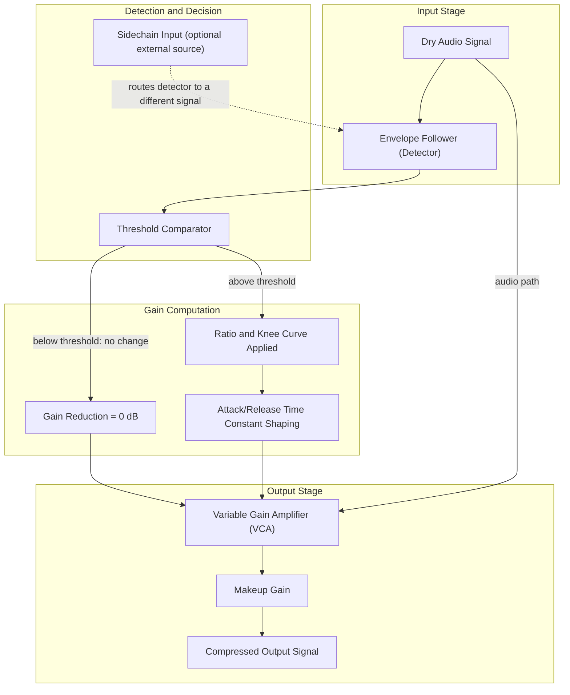
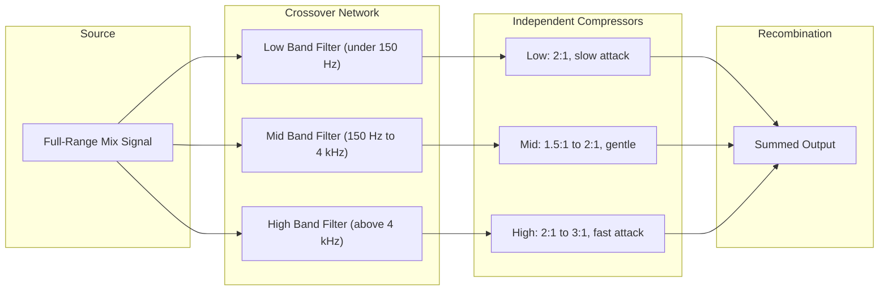

# Dynamics Processing: Compression, Sidechain, and Multiband Mastery

## 1. First-Principles Intuition: What Compression Actually Does to Sound

A compressor is an automatic fader hand riding the volume knob faster and more consistently than any human mixer could. It listens to the signal, and whenever the level crosses a threshold you set, it turns the signal down, then releases it back up when the level drops. That is the entire mechanism. Attack, release, ratio, knee, and sidechain are all about controlling *how* and *how fast* that automatic turning happens — because the speed and shape of the gain change is what determines whether compression sounds invisible, punchy, pumping, or squashed.

The one piece of math worth keeping in your head: with a 4:1 ratio, a signal that peaks 8 dB over threshold comes out only 2 dB over. The compressor is not a switch, it is a slope-changer above threshold. A 1:1 ratio is no compression at all; infinity:1 is a hard wall (limiting). Everything between is a spectrum from gentle leveling to slamming.

What matters for your ears, not your calculator:

- **Threshold** sets *how much* of the signal gets touched. Lower threshold = gain reduction happens more often and on quieter material.
- **Ratio** sets *how hard* it gets pushed down once it crosses threshold.
- **Attack** sets whether the compressor catches the transient (fast, 1–5 ms) or lets it through before clamping (slow, 15–30 ms). This is your most powerful tone-shaping control — it decides whether a snare hits like a crack or a thud.
- **Release** sets how the compressor lets go — fast release (50–100 ms) pumps and breathes with the material; slow release (200–800 ms) smooths things out but can smear fast passages.
- **Knee** controls how abruptly the ratio kicks in around the threshold. Hard knee = ratio engages instantly at threshold (surgical, aggressive). Soft knee = ratio ramps in gradually over a few dB on either side of threshold (gentler, more forgiving, favored on vocals and mix bus).
- **Makeup gain** restores the loudness you removed so you can judge tone fairly against the dry signal. Always A/B at matched loudness, never at matched fader position — your ears will call the louder option "better" even when it is only louder.

**The 15% physics you need, no more:** gain reduction is computed from an *envelope* of the signal, not the instantaneous waveform. Raw audio crosses zero and swings wildly thousands of times per second; chasing every zero-crossing would make the gain stage buzz and distort. The envelope follower smooths the signal into something resembling perceived loudness over a few milliseconds. That is why attack/release exist as controls separate from threshold/ratio: threshold and ratio decide *how much* gain reduction a given level deserves; attack/release decide *how fast the detector is allowed to see it change.*

---

## 2. Compressor Types and Their Sonic Signatures

Different circuit topologies behave differently at the extremes of speed and gain-cell linearity, which is why more than one compressor exists.

| Type | Behavior | Best For |
|---|---|---|
| **VCA** (dbx 160, SSL Bus Comp) | Fast, clean, punchy, precise ratio control | Drums, bus glue, aggressive vocal control |
| **FET** (1176-style) | Very fast attack (down to 20 µs), aggressive, adds harmonic edge/grit | Rock vocals, snare, bass DI, "in your face" sources |
| **Opto** (LA-2A style) | Slow, program-dependent attack/release tied to light-cell response, smooth and musical | Vocals, bass, anything you want "glued" without pumping |
| **Tube/Variable-Mu** (Fairchild style) | Soft knee, gentle harmonic coloration, slow and forgiving | Mix bus, mastering, vintage warmth |
| **Digital/Software (clean)** | Transparent, surgical, precise numeric control, often with lookahead | Mastering, broadcast loudness control, mix bus when transparency matters |

Rule of thumb: if a source needs *speed and control*, reach for VCA or FET. If it needs *smoothness and forgiveness*, reach for opto or tube-style. Learn one plugin deeply from each family before chasing more options — the knobs are identical everywhere; the character is what differs.

---

## 3. Hands-On Lab: Setting Up Compression by Source

### Lab A — Vocal Compression (Clarity Without Pumping)

**Goal:** even out performance dynamics so the vocal sits consistently in the mix without audible gain-riding artifacts.

1. Insert compressor on the vocal track, ratio **3:1**, soft knee if available.
2. Set attack to **10 ms** — lets the consonant transient through for intelligibility, catches the body of the note.
3. Set release to **Auto** if available, or manually to **150 ms** as a starting point.
4. Lower threshold until you see **3–6 dB of gain reduction** on loud phrases, with quiet phrases barely touching the meter.
5. Add makeup gain to match perceived loudness with bypass. A/B repeatedly.
6. **Listening test:** sing the loudest phrase in the song. If sibilants ("s", "t") sound grabbed or lispy, attack is too fast — slow it to 15–20 ms.
7. **Serial compression trick:** instead of pulling 8 dB from one compressor (which sounds squeezed), use two compressors in series, each doing 3–4 dB. Stage 1 (FET-style, fast) catches peaks; Stage 2 (opto-style, slow) does gentle overall leveling. No single detector/gain-cell combination stays clean across a full 8 dB range — this is standard practice on professional vocal chains.

### Lab B — Snare Drum: Attack Time as a Tone Knob

This is the fastest way to *hear* what attack does — the difference is dramatic and immediate.

1. Loop a snare hit. Insert a VCA-style compressor, ratio **6:1**, threshold low enough for 8–10 dB of gain reduction on the hit.
2. Set release to **80 ms**.
3. Sweep attack slowly from **0.1 ms to 30 ms** while the loop plays.
   - **0.1–1 ms:** the compressor clamps the initial stick transient immediately — the snare sounds dull, squashed, the crack is gone.
   - **10–15 ms:** the transient punches through uncompressed, then the compressor grabs the sustain/body — the snare sounds *bigger and punchier* than dry, because the transient-to-body ratio shifted in the transient's favor.
   - **25–30 ms:** almost no compression on the hit itself; you're mostly compressing room tone/bleed.
4. **Target for punchy rock snare:** attack 8–12 ms, release 60–100 ms, ratio 4:1–6:1, 6–8 dB gain reduction.

### Lab C — Bass Guitar / Bass Synth: Consistency Without Losing Groove

1. Ratio **4:1**, attack **fast (1–3 ms)** — bass needs transient control to stop note-to-note level jumps caused by inconsistent plucking or picking.
2. Release tied to tempo. At 120 BPM, a quarter note = 500 ms. Set release around **100–150 ms** (roughly a sixteenth to eighth note) so the compressor recovers between notes instead of still pumping when the next note hits.
3. Threshold for **4–6 dB** gain reduction on the loudest notes.
4. **Failure mode to listen for:** if the compressor audibly "breathes" in time with the bassline unintentionally, release is too fast relative to tempo — lengthen it until the pumping disappears, or switch to program-dependent/auto release.

### Lab D — Drum Bus / Mix Bus Glue (The 2 dB Rule)

The classic SSL-bus-compressor move for cohesion, not control.

1. Ratio **2:1** or **4:1**, attack **slow (30 ms)**, release **Auto** or **300–400 ms**.
2. Threshold set so the gain reduction meter shows **no more than 2 dB** on the loudest hits.
3. The slow attack is deliberate: it lets every transient through uncompressed, keeping drum punch intact, and only glues the sustain/decay portions together — cohesion rather than audible squashing.
4. **Diagnostic:** if the drum bus starts sounding smaller or loses punch, you are pulling too much gain reduction (over 3–4 dB) or attack is too fast for this application. Back off threshold.

---

## 4. Parallel Compression ("New York Compression")

**The problem it solves:** heavy compression (10+ dB reduction) controls dynamics but kills the exciting transient peaks that make drums and vocals feel alive. Parallel compression keeps the natural dynamic signal on the main channel and blends in a *separately, heavily compressed* version underneath to add density and sustain without smothering the transients.

**Setup (works in any DAW with a bus/send structure):**

1. Create an aux/bus track. Route a send (not insert) from your drum bus to this aux at unity gain.
2. On the aux track, insert a compressor set aggressively: ratio **10:1** or higher, fast attack (1–3 ms), fast release (50 ms), threshold pulled down for **15–20 dB** of gain reduction. In isolation it should sound obviously crushed and loud — that is correct.
3. Raise the aux fader under the dry drum bus until you hear the sustain and "glue" thicken without flattening the transients. The parallel bus typically sits **6–12 dB below** the dry signal.
4. A/B with the parallel bus muted — you should hear added weight and sustain in the kick/snare tails, not a change in the attack character of the dry signal.

Standard on drum busses, full mixes ("bus smash"), and vocals that need density without losing dynamic performance nuance.

---

## 5. Sidechain Compression — Ducking for Space, Not Just EDM Pumping

Sidechaining routes the *detector* input from a different signal than the one being compressed. The compressor gain-reduces track A based on the level of track B.

**Use #1 — Kick/bass ducking (low-end clarity):**
1. Insert a compressor on the bass track.
2. Set its sidechain input to the kick drum track.
3. Ratio **4:1**, fast attack (**1–5 ms**), release tuned to groove (**100–200 ms**), threshold set so the kick triggers **3–6 dB** of ducking on the bass.
4. Result: every kick hit makes the bass duck out of its way for a few milliseconds, then return — removes low-end masking without EQ carving, and the two instruments stay rhythmically locked and audible.

**Use #2 — EDM pump effect (the deliberately audible version):**
Same setup, but push ratio to **8:1–20:1** and gain reduction to **10–15 dB**, with release matched to the beat subdivision (eighth or sixteenth note at the track's BPM) so the "breathing" becomes a rhythmic, musical pulse rather than a correction.

**Use #3 — De-essing (frequency-selective sidechain):**
A de-esser is a compressor whose sidechain is fed by a band-pass/EQ'd version of the same signal, tuned to 4–8 kHz (sibilance range). It only triggers gain reduction when harsh "s"/"sh" energy spikes, leaving the rest of the vocal untouched. Most vocal chains need one after the main compressor, because compression tends to *increase* perceived sibilance — it raises the average level, which brings up the relative loudness of high-frequency consonants riding above it.

---

## 6. Multiband Compression — Independent Control Per Frequency Range

A single-band compressor reacts to total signal energy — a loud bass note can trigger gain reduction that unfairly ducks the highs riding along with it. Multiband compression splits the signal into bands (typically 3–4: low/low-mid/high-mid/high) via crossover filters, compresses each band independently, then sums them back.

**Practical mastering-chain setup (3-band):**
- **Low band (20–150 Hz):** ratio 2:1, slow attack (30 ms), medium release (150 ms) — tames loose bass energy without touching vocal clarity.
- **Mid band (150 Hz–4 kHz):** ratio 1.5:1–2:1, gentle, mostly for overall glue — this band carries most perceived loudness and vocal presence, so compress lightly.
- **High band (4 kHz+):** ratio 2:1–3:1, fast attack, tames harshness/cymbal wash without affecting body.

**When to reach for multiband instead of single-band + EQ:** when a *specific frequency range* has inconsistent dynamics that a broadband compressor cannot fix without affecting unrelated frequencies — e.g., a bass-heavy mix where boomy low notes trigger overall gain reduction, flattening the vocal every time the bass gets loud.

---

## 7. Metering and Decision-Making: Reading Gain Reduction Correctly

Stop setting compressors by eye on a generic plugin GUI. Read the **gain reduction meter** — the needle/bar showing how many dB are currently being pulled down — not the output level meter.

- **0–3 dB GR:** subtle leveling, mostly inaudible, good for transparent mix-bus glue or mastering.
- **3–6 dB GR:** audible control, the professional-polish zone for vocals/bass/full mixes.
- **6–10 dB GR:** obvious, intentional dynamic control — drums, aggressive vocal chains.
- **10+ dB GR:** character/effect territory — parallel compression sends, pumping EDM effects, deliberately smashed sounds.

If the gain reduction meter sits at a constant number with no movement, your threshold is too low — the compressor is acting as a static attenuator, doing no dynamic work at all. The needle should **move with the music**, settling back toward 0 dB in quiet passages.

---

## 8. Signal Flow Architecture

Read this left to right: the dry signal splits into a detection path, which only decides *how much* gain reduction is needed in dB, and a gain-application path, the actual VCA that multiplies the audio by the computed gain. This split is why sidechain compression is possible at all — the detector can listen to a completely different signal than the one being turned up and down.

---

## 9. Multiband Routing Reference

---

## 10. Common Failure Modes and Fixes

| Symptom | Cause | Fix |
|---|---|---|
| Vocal sounds "grabbed" or pumps on every word | Attack too fast combined with release too fast for the phrasing | Slow release to 150–250 ms, or switch to auto-release |
| Snare loses its crack | Attack under 2 ms on a punchy source | Open attack to 8–15 ms to let the transient pass before clamping |
| Mix sounds alive in solo but flat against the full mix | Over-compressed bus holding 8+ dB constant GR | Reduce threshold-induced GR to 2–3 dB; use parallel compression for density instead |
| Audible "zipper" or stepped gain changes | Low-resolution gain computer, or extreme ratio with instant attack | Use a higher-quality compressor model; soften the knee; raise attack above 0.5 ms |
| Bass disappears when the kick hits | No sidechain relationship, masking in the low end | Add sidechain ducking from kick into the bass compressor, 3–6 dB GR |
| Sibilance got worse after compression | Compression raised average level, exposing high-frequency consonant energy | Insert a de-esser (frequency-triggered sidechain compressor) after the main compressor |
| Mastering chain sounds pumpy and tired after limiting | Too much broadband gain reduction forcing the limiter to overwork | Use multiband compression upstream to tame problem frequency ranges before brickwall limiting |
| Gain reduction meter never returns to 0 dB | Threshold set too low, acting as static attenuation | Raise threshold until the needle rests at 0 dB during quiet passages |

---

## 11. Practice Routine for Developing Your Ear

Compression is a skill trained by ear, the same way you train rhythm or pitch. Weekly drill:

1. **Bypass test (5 min/day):** On any reference track, insert a compressor, set arbitrary settings, and bypass/engage repeatedly at matched loudness. Write one sentence describing what changed — punchier, smoother, smaller, bigger. This builds vocabulary linking what you hear to what the knob did.
2. **Attack sweep drill (10 min):** Repeat Lab B on five different drum samples. Train your ear to identify attack time within ±5 ms by sound alone.
3. **Gain-reduction blind test:** Have a friend or tool randomize threshold on a vocal compressor to produce 0, 3, 6, and 12 dB of GR. Identify which is which by ear only, then check yourself against the meter.
4. **Genre reference matching:** Pick a commercial track in your genre, solo the drum bus (or best approximation), and try to match its punch and glue character using Labs B and D. Compare against the reference at matched loudness.

**Progress target:** within 4–6 weeks of daily 15-minute drills, you should identify ratio, approximate attack time, and gain reduction amount on an unfamiliar compressed track within one listen.
