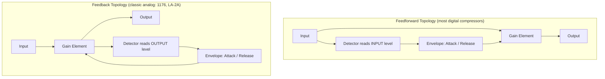
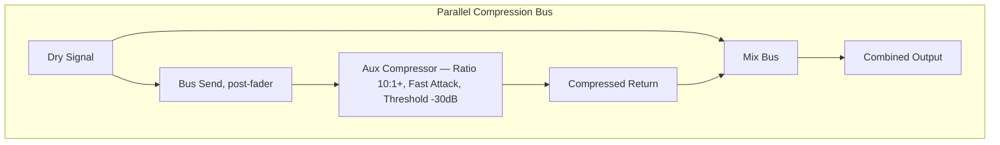
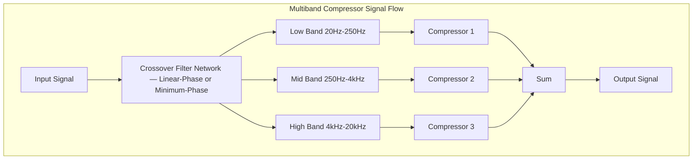
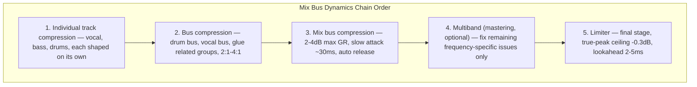

# Lesson 4: Dynamics Processing — Compression, Limiting, and Multiband Control

## 1. Why Compression Works: The Four Knobs That Run the Machine

A compressor is an automatic fader hand. It listens to the signal, and when the level crosses a **threshold**, it pulls gain down by a **ratio**, following **attack** and **release** time constants. That's the entire machine. Every mix decision you make with a compressor is some combination of those four controls plus knee shape and makeup gain.

Why it sounds musical instead of mechanical comes down to timing against the ear. Human hearing integrates loudness over roughly 200–400ms windows — this is why a brickwall-limited track can measure the same RMS as a dynamic one but "feel" louder: more consistent energy per unit time reads as louder even at identical peak level. Attack and release interact directly with the signal's own envelope:

- **Attack time** — how fast gain reduction engages once level crosses threshold. Sub-5ms catches transients: use it to tame pick attack, kick click, slap pop. 20–50ms lets the transient through before gain reduction grabs, preserving punch while still controlling the sustain tail.
- **Release time** — how fast gain climbs back to unity once level drops below threshold. Too fast on program material and it pumps audibly in time with the bass. Tempo-synced release (an 1/8 note at the song's BPM) makes that pumping feel intentional instead of broken.
- **Ratio** — how much reduction happens above threshold. 2:1–4:1 is gentle leveling. 8:1+ starts to feel like limiting. Above ~20:1 the device IS a limiter — output essentially stops rising no matter how hard you drive the input.
- **Knee** — hard knee engages the full ratio instantly at threshold: surgical, obvious. Soft knee ramps the ratio up gradually over a few dB around threshold, hiding the onset of gain reduction — the default choice for vocals and bus compression.

The one formula worth keeping in your head:

**Gain reduction (dB) = (dB above threshold) × (1 − 1/ratio)**

A signal 12dB over threshold at 4:1 gets pulled down 12 × (1 − 0.25) = 9dB. No Fourier transform needed to run a compressor well — that math matters later for multiband crossover design (Section 4), not for basic gain riding.

## 2. Ear-Training Drill: Hearing Attack and Release Before You Read a Number

Do this on any compressor plugin — stock is fine — on a solo mono vocal or bass take, before you ever dial in a mix setting from a preset.

**Drill (15 minutes):**
1. Ratio 4:1. Threshold low enough to see 6–8dB of gain reduction on peaks.
2. Release fixed fast (~50ms). Sweep attack from fastest (0.1ms) to slowest (100ms) while soloed. Listen for the transient "poking through" as attack slows — that's what engineers mean by "letting the transient breathe."
3. Attack fixed at 10ms. Sweep release from 50ms to 1000ms. Listen for pumping (audible breathing locked to the rhythm) at short releases, and "stuck," flattened dynamics (gain reduction never fully recovers between notes) at long releases on fast material.
4. Settle release by ear where gain reduction recovers fully between phrases but doesn't pump on individual notes — then nudge it 20% faster. That controlled pump is usually what makes bus compression feel "glued" rather than clamped.

Repeat across kick, snare, bass, and vocal. This builds the ear-to-knob mapping that no chart substitutes for.

**Metronome-anchored version**, once you can hear it: at a given BPM, set release to the 1/8-note value (120 BPM → 250ms, 100 BPM → 300ms, 140 BPM → 214ms) and A/B against a free-running release you set purely by ear. Most mixers land within 10–15% of the tempo-synced value once their ear is trained — which is the point of the drill: the math is a shortcut to where your ear already wants to go.

## 3. Core Architecture: Feedback vs. Feedforward, and the Detector Path

Every compressor has a **detector path** (decides how much gain reduction to apply) and a **gain path** (where that reduction actually happens to the signal). Two classic topologies:

**Feedforward** reacts to the input directly — precise, predictable, fast, the standard for brickwall limiting and most plugins. **Feedback** reacts to the already-reduced output, a self-correcting loop that produces smoother, more program-dependent gain reduction — why 1176- and LA-2A-style circuits "glue" a mix without feeling clamped. Neither wins outright: feedforward for surgical control, feedback for musical smoothing. Many plugins (UAD 1176, Waves CLA-2A) expose a topology switch so you can A/B both on the same source.

### Parallel Compression ("New York Compression")

Blend a heavily compressed copy of a signal under the uncompressed (or lightly compressed) original. The squashed layer fills in low-level detail and sustain; the dry layer keeps the original transient and dynamic life.

**Practical recipe (drums, vocals, bass — all respond well):**
1. Send the track to an aux bus. Don't insert the heavy compressor directly on the track — you need the dry signal to survive untouched in parallel.
2. On the aux: threshold -30 to -40dB (almost everything gets caught), ratio 8:1–20:1, fast attack (1–3ms), medium release (100–150ms), heavy makeup gain to bring the squashed signal back up to audible level.
3. Bring the aux fader up until sustain and body increase without the attack transient's character changing. Starting point: dry at unity, parallel bus 6–12dB under — tune by ear from there.
4. On drum buses specifically, this is the mechanism behind "big and alive" overheads without squashing the overhead or room mics directly.

## 4. Multiband Compression: When and How to Split the Spectrum

Single-band compression makes one decision for the whole spectrum: bass energy triggering gain reduction pulls the highs down with it even though they didn't need it. **Multiband compression** splits the signal into frequency bands with crossover filters so each band's dynamics get controlled independently.

**Crossover filter choice is audible.** Linear-phase crossovers (FFT-based — FabFilter Pro-MB, iZotope Ozone) introduce no phase shift between bands but add latency, several ms up to tens of ms depending on FFT window: fine for mastering, risky for tracking or live. Minimum-phase crossovers (classic analog-style — SSL G-Series bus compressor's multiband mode) have near-zero latency but introduce phase shift at crossover points that can cause mild cancellation when bands recombine — usually inaudible unless you're pushing extreme band-specific gain reduction.

**Reach for multiband instead of single-band + EQ when:**
- A boomy low-end resonance appears only on certain notes and you need to tame it without touching the rest of the mix's bass — classic mastering move.
- De-essing: literally single-band, high-frequency-only compression. A dedicated de-esser is a specialized multiband compressor with one active band.
- Bass guitar has uneven string-to-string loudness (G string louder than E string): compress just the 150–400Hz "boxy" band hard, leave sub and highs untouched.
- A vocal has sibilance AND inconsistent chest-voice level. Two separate problems, two separate bands, two separate settings — don't make one broadband compressor solve both.

**Multiband mastering starting point (3-band, mix bus):**

| Band | Crossover | Threshold | Ratio | Attack | Release |
|---|---|---|---|---|---|
| Low | 20Hz–120Hz | -18dB | 2:1 | 30ms | 150ms |
| Mid | 120Hz–5kHz | -14dB | 1.5:1 | 15ms | 100ms |
| High | 5kHz–20kHz | -20dB | 2:1 | 5ms | 80ms |

Start with 1–2dB of gain reduction max per band on a mix bus. Multiband over-processing is the most common cause of "lifeless, over-polished" masters — every band independently flattened strips out the micro-dynamics that make a mix feel alive.

## 5. Limiting: The Compressor at the End of Its Ratio Dial

A limiter is a compressor with a very high ratio (∞:1 in a "brickwall" design) and usually a lookahead-based attack, built to catch peaks that must never cross a ceiling — critical for preventing digital clipping and for loudness-matching masters to streaming targets.

**Lookahead** solves the core problem with fast attack: a limiter reacting only after a peak occurs always lets some of that peak through, because attack time is never zero. Lookahead delays the audio by a few milliseconds while the detector analyzes the delayed-but-not-yet-output signal, applying gain reduction slightly *before* the peak reaches the output. This is why mastering limiters (Pro-L 2, Ozone Maximizer) advertise lookahead in ms — typically 1–10ms — as a transparency spec.

**Streaming loudness targets (practical reference):**

| Platform | Target |
|---|---|
| Spotify | -14 LUFS integrated |
| YouTube | -14 LUFS integrated |
| Apple Music | -16 LUFS integrated |
| Club / DJ masters | -8 to -6 LUFS (genre convention, accepts audible limiting) |

**Gain-staging drill before touching a limiter:**
1. Mix so the loudest peak sits around -6dBFS on the master bus with no limiter active.
2. Insert the limiter. Set ceiling to -0.3dBFS, using True Peak metering, not sample peak — this leaves headroom for lossy codec overshoot (MP3/AAC can overshoot a hard 0dBFS ceiling by 0.5–1dB after encoding).
3. Pull input gain up until you reach your target LUFS.
4. If you need more than 6–8dB of gain reduction to hit -14 LUFS, the pre-limiter mix is too quiet or too dynamic for the target. Fix gain staging upstream — adding more limiting is what produces pumping, distortion, and the flat, exhausted sound associated with "loudness war" mixing.

## 6. Failure Modes and Field Fixes

| Symptom | Cause | Fix |
|---|---|---|
| Audible pumping, rhythmic breathing | Release too fast for the program material, or ratio/gain-reduction too aggressive | Lengthen release, reduce ratio, or raise threshold to cut the amount of gain reduction |
| Vocal sounds "sucked out" after loud consonants | Fast attack + fast release on wide-ratio compression chasing every syllable | Slow attack to 10–20ms so the transient passes; consider parallel compression instead of one heavy insert |
| Sibilance gets worse after compression | Broadband makeup gain raises sibilant energy along with everything else | Insert a dedicated de-esser after the broadband compressor, not before |
| Multiband master sounds glued but lifeless, no punch | Gain reduction exceeding 3–4dB on any single band, flattening micro-dynamics | Cut gain reduction per band to 1–2dB; let the limiter do final loudness work, not the multiband stage |
| Low end disappears when the compressor engages | Sidechain detector reacting to full-bandwidth signal, over-triggered by sub-bass inaudible on small speakers | High-pass the sidechain input at 80–100Hz so sub-bass doesn't trigger gain reduction meant for midrange |
| Clicks or pops at gain-reduction onset/release | Hard knee plus very fast attack/release creating a discontinuous gain step | Switch to soft knee; raise attack/release to a few ms minimum to smooth the envelope |
| Phase smear, hollow sound after multiband processing | Linear-phase pre-ringing, or minimum-phase cancellation at band edges | A/B crossover type; narrow the overlap region; for mastering use linear-phase and accept the latency |
| Limiter distorts on transient-heavy material (drums, brass) | Lookahead too short for fast transients, or ceiling set too close to true peak | Increase lookahead 2–5ms; set ceiling using True Peak metering to catch inter-sample overshoot |

## 7. Sidechain Compression — Practical Recipe

Sidechaining routes a *different* signal's level to trigger gain reduction on the signal being processed. Classic use: ducking a bass synth every time the kick hits, so the two never collide in the low end.

**Setup (Ableton, Logic, Pro Tools — mechanics are identical):**
1. Insert a compressor on the bass track.
2. Enable the compressor's sidechain input. Route the kick drum's pre-fader send into that sidechain input.
3. Fast attack (1–5ms) catches the kick transient immediately. Release timed to tempo — roughly one 1/8 note at the track's BPM (120 BPM → 250ms) — makes the ducking feel rhythmic, not glitchy.
4. Threshold low enough that the kick reliably triggers 4–8dB of reduction on the bass. Too much and the bass vanishes on every hit; too little and the ducking is inaudible and pointless.
5. Used musically and locked to tempo, this is the EDM "pumping" sidechain sound and defines a genre convention. Used carelessly on non-dance material, it just sounds like a broken compressor.

## 8. Signal Flow Checklist for a Mix Bus Dynamics Chain

Order matters. A practical, battle-tested chain for a full mix:

1. **Individual track compression** — shape each source's own dynamics first.
2. **Bus compression** — glue related groups, light ratio (2:1–4:1), slow-ish attack to preserve transients, auto or tempo-synced release.
3. **Mix bus compression** — 2–4dB max gain reduction, slow attack ~30ms, auto release. The "glue" compressor across the whole mix, run gently.
4. **Multiband compression** (optional, mastering stage) — fix specific frequency-dependent dynamics issues only if they still exist after steps 1–3.
5. **Limiter** (final stage) — true-peak ceiling -0.3dB, lookahead 2–5ms. Catches remaining peaks and sets final loudness.

Never place the limiter anywhere but last, and never ask it to fix a dynamics problem a well-placed compressor earlier in the chain should have solved. By the time the signal reaches the limiter it should already sit close to its target loudness, with the limiter doing only the final 1–3dB of peak control.
