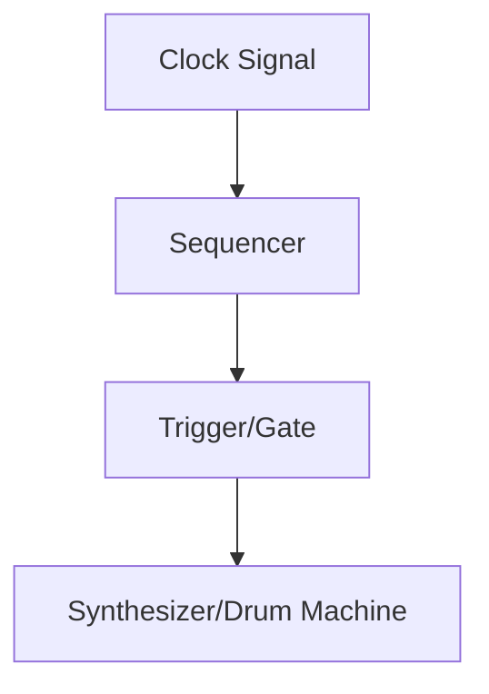

# Beginner Foundation: Hardware Sequencing

## 1. Everyday Intuition & First Principles

Imagine you are a chef in a bustling kitchen, and you need to prepare a series of dishes in a specific order. Instead of trying to remember each step and the timing, you write down the instructions on a card and place it in a timer. When the timer reaches each step, it triggers the next action. Hardware sequencing works similarly in music. It is a device that stores a series of musical instructions (notes, rhythms, and control signals) and plays them back in a specific order, allowing musicians to focus on other aspects of their performance or composition. Just as a chef uses a timer to manage the cooking process, a musician uses a hardware sequencer to manage the musical process, ensuring that each note and rhythm is played at the right time.

## 2. Foundational Vocabulary & Glossary

- **Step:** A single unit of time in a sequence, often corresponding to a beat or a fraction of a beat. For example, in a 4/4 time signature, each step might represent a quarter note.
- **Pattern:** A series of steps that form a musical idea, such as a rhythm or a melody. Patterns can be looped to create a continuous sequence.
- **Track:** A separate channel within a sequencer that can hold its own pattern. For example, one track might contain a drum pattern, while another contains a bassline.
- **Trigger:** A signal that starts or stops a pattern or a track. Triggers can be generated by the sequencer itself or by external sources.
- **Gate:** A type of trigger that indicates the duration of a note. A gate signal opens and closes to control the start and end of a note.
- **Clock:** A timing signal that synchronizes the sequencer with other musical devices. The clock determines the tempo and the division of time within the sequence.

## 3. Visual System Flow

### ASCII Diagram

```
+-------------------+
|   Clock Signal    |
+-------------------+
          |
          v
+-------------------+
|   Sequencer       |
|   (Pattern &      |
|    Tracks)        |
+-------------------+
          |
          v
+-------------------+
|   Trigger/Gate    |
+-------------------+
          |
          v
+-------------------+
|   Synthesizer/    |
|   Drum Machine    |
+-------------------+
```

### Mermaid Flowchart



## 4. Common Beginner Misconceptions & Mental Traps

- **Misconception:** Hardware sequencers are only for electronic music. **Reality:** Hardware sequencers can be used with any instrument that can be triggered by a gate or clock signal, including acoustic instruments with MIDI interfaces.
- **Misconception:** Sequencers are complicated and require advanced technical knowledge. **Reality:** Sequencers can be as simple or complex as you want them to be. Many modern sequencers have user-friendly interfaces and intuitive controls.
- **Misconception:** You need a lot of money to get started with hardware sequencing. **Reality:** There are affordable options available, such as the Korg Volca series or the Teenage Engineering OP-1, that offer powerful sequencing capabilities without a hefty price tag.

## 5. Socratic Discussion Starters

- What is the primary purpose of a hardware sequencer in a musical setup?
- How does a clock signal relate to the tempo of a sequence?
- Can you explain the difference between a trigger and a gate in the context of a sequencer?
- How might you use multiple tracks in a sequencer to create a complex musical arrangement?
- What are some ways to synchronize a hardware sequencer with other musical devices or software?

By understanding these foundational concepts, you can begin to explore the vast possibilities of hardware sequencing and integrate it into your musical practice.
