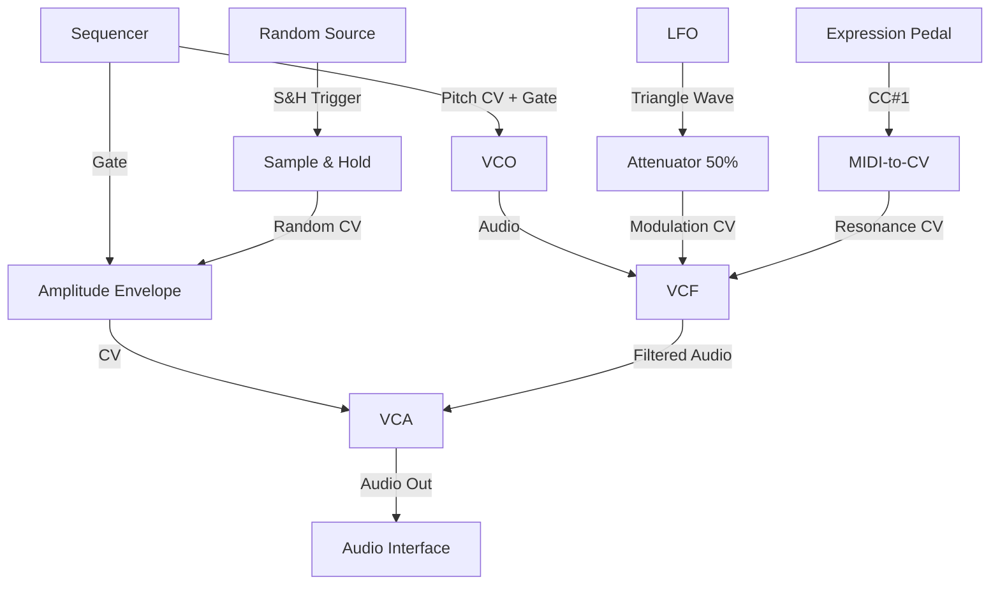

# Operational Verification Labs: Hardware Sequencing

## Objective & DAW / Studio Setup

Hardware sequencing exists at the intersection of temporal control architecture and musical performance execution. Unlike software-based MIDI sequencing, which operates within the abstraction layer of a digital audio workstation, hardware sequencers impose physical constraints that fundamentally reshape compositional thinking: finite step counts, voltage-based pitch control rather than MIDI note numbers, and gate/trigger timing that demands precise attention to clock division and synchronization. This laboratory guide develops your capacity to function as both composer and systems engineer, designing patch routines that exploit the characteristics of hardware sequencers—whether Eurorack step sequencers like the Intellijel Metropolix, standalone groove boxes such as the Elektron Digitakt, or hybrid MIDI-to-CV converters—while maintaining disciplined signal flow across your entire studio environment.

The exercises enforce a practitioner-first methodology. You will physically wire modular synthesizer modules, configure clock synchronization between disparate hardware devices, program polyrhythmic sequences that exploit voltage quantization and scale masking, and perform real-time parameter automation using control voltage modulation. Each exercise concludes with a diagnostic verification protocol using spectrum analyzers, oscilloscopes, and MIDI monitors to confirm that your patch architecture behaves deterministically under stress conditions. You will produce audible, repeatable musical results that demonstrate mastery of hardware sequencing's affordances and constraints.

Your studio configuration requires the following signal chain topology. Designate a master clock source: if you operate a Eurorack modular system, use a dedicated clock module such as the Pamela's New Workout or Tempi; if your workflow centers on a standalone sequencer like the Arturia KeyStep Pro or Elektron Octatrack, configure its internal clock as the master tempo reference. Route this master clock to all receiving devices via MIDI clock messages or analog clock pulses distributed through multiple outputs. Establish a hybrid ecosystem by connecting your hardware sequencer's MIDI output to a MIDI-to-CV converter module—examples include the Expert Sleepers FH-2 or Intellijel Mutant Brain—to bridge the gap between MIDI note data and control voltage pitch signals. Patch the resulting 1V/octave pitch CV and gate outputs into a Eurorack voice module. Use a subtractive synthesizer voice such as the Make Noise 0-Coast, Mutable Instruments Plaits, or any oscillator-filter-VCA signal path. Monitor the audio output through a mixer channel routed into your DAW for spectrum analysis and waveform visualization. Install Voxengo SPAN as a spectrum analyzer plugin on the monitoring channel, and use your DAW's native oscilloscope or a hardware oscilloscope if available. Keep a MIDI monitor application running to observe real-time note data, clock pulses, and CC modulation streams.

Calibrate your system before beginning the exercises. Power on all modules and allow oscillators to thermally stabilize for at least five minutes; temperature drift causes pitch instability in analog VCOs. Verify that your master clock outputs a stable pulse by observing its LED indicator at a moderate tempo of 120 BPM. Confirm MIDI clock synchronization by starting the master clock and observing whether secondary devices lock to the tempo without drift over a two-minute period. Tune your oscillators to concert pitch: send a MIDI note C3 (MIDI note number 60) through your MIDI-to-CV converter, and adjust the oscillator's coarse tuning control until a tuner plugin in your DAW reads exactly 261.63 Hz. If your oscillator includes a quantizer or scale locking feature, disable it initially to observe raw voltage behavior; you will re-enable quantization in later exercises to study its effect on melodic contour.

Establish gain staging discipline across the signal path. Hardware synthesizers output modular-level signals (typically ±5V to ±10V peak-to-peak) that exceed line-level expectations ($-10$ dBV consumer or $+4$ dBu professional). Attenuate the synthesizer's output using a dedicated output module with level control, or reduce the gain at your audio interface's input stage to avoid clipping. Aim for peak levels between $-18$ dBFS and $-12$ dBFS on your DAW's input meters during sustained note passages, preserving headroom for transient peaks during filter resonance sweeps or percussive envelope attacks. Route the monitored signal through SPAN and configure it for 1/24th-octave resolution with a 200ms averaging window to observe harmonic spectra in real time without excessive meter fluctuation.

Document your patch architecture using a signal flow diagram. Draw boxes representing each hardware module, annotate their input and output connections, and label control voltage ranges and audio signal levels. This diagram becomes your troubleshooting reference when diagnosing timing glitches, pitch tracking errors, or modulation routing mistakes. Treat this setup phase as non-negotiable infrastructure; the exercises assume a fully functional, calibrated, and documented signal path before you begin programming sequences.

## Exercise 1: Practical Composition & Voice-Leading Realization

This exercise trains you to compose polyphonic melodic sequences using hardware step sequencers while enforcing voice-leading principles derived from species counterpoint. You will program a two-voice sequence in which a bass line and a melody move in contrary motion, avoid parallel perfect fifths and octaves, and resolve dissonances through stepwise motion. The bass line will occupy a sixteen-step sequence running at quarter-note divisions, while the melody will occupy an eight-step sequence running at eighth-note divisions, creating a polyrhythmic phase relationship. By the end of this exercise, you will have composed a twelve-bar phrase that demonstrates command of hardware sequencing's temporal grid, voltage quantization, and clock division architecture.

Select C natural minor as the working key for this exercise, providing the pitch set $\{C, D, E\flat, F, G, A\flat, B\flat, C\}$. If your hardware sequencer includes a built-in quantizer with selectable scales, configure it to C natural minor by enabling the root note C and selecting the natural minor scale template. If your sequencer outputs raw voltages without quantization, you will manually calculate and dial in the appropriate voltage values for each pitch. Eurorack synthesizers follow the 1V/octave standard, where each semitone increment equals $\frac{1}{12}$ volt, or approximately 0.0833V. For C natural minor starting at C3 (defined as 0V), the voltage values are:

$$
\begin{align*}
C_3 &= 0.0000\text{V} \\
D_3 &= 0.1667\text{V} \\
E\flat_3 &= 0.2500\text{V} \\
F_3 &= 0.4167\text{V} \\
G_3 &= 0.5833\text{V} \\
A\flat_3 &= 0.6667\text{V} \\
B\flat_3 &= 0.8333\text{V} \\
C_4 &= 1.0000\text{V}
\end{align*}
$$

Program the bass line first. Access your sequencer's step programming mode and select a sixteen-step pattern with a clock division ratio of 1:1 (quarter notes at 120 BPM). Compose a bass line that establishes harmonic motion through the tonic, subdominant, and dominant scale degrees. Begin with the tonic C, move stepwise through the scale, and return to C after exploring the fourth and fifth scale degrees. A reference bass line follows this contour: C3-D3-E♭3-F3-G3-F3-E♭3-D3-C3-G2-A♭2-B♭2-C3-D3-E♭3-C3. This sixteen-step pattern spans two octaves and establishes a harmonic foundation for the melody. Input each pitch into your sequencer by dialing the corresponding voltage value or selecting the pitch from a quantized scale grid. Verify the bass line by starting the sequence and monitoring the audio output; adjust tuning if any pitch drifts from the expected frequency.

Configure gate length for the bass line. Hardware sequencers typically express gate length as a percentage of the step duration or as an absolute time value in milliseconds. Set the gate length to 50% of the step duration to create a detached articulation that provides rhythmic clarity. This produces a quarter-note pulse followed by a quarter-note rest, allowing each bass note to breathe without bleeding into the subsequent step. Test the gate timing by observing the envelope of the VCA output in your DAW's oscilloscope view; the waveform should exhibit a clean attack and decay without overlap between successive notes.

Program the melody on a second sequencer track or a separate hardware sequencer if your system supports polyphonic operation. If your sequencer lacks polyphonic capability, you will need to overdub the melody onto a separate synthesizer voice or record the bass line into your DAW and then replace the sequencer pattern with the melody. Select an eight-step pattern with a clock division ratio of 1:2 (eighth notes at 120 BPM), doubling the rhythmic density relative to the bass line. Compose a melody that moves in contrary motion to the bass line: when the bass ascends, the melody descends, and vice versa. A reference melody follows this contour: C5-B♭4-A♭4-G4-F4-G4-A♭4-B♭4. This eight-step pattern occupies the octave above middle C (C4), creating registral separation from the bass line and establishing clear voice independence.

Enforce counterpoint rules during melody composition. Avoid parallel perfect fifths and octaves between the bass and melody by checking the harmonic interval at each step where both voices sound simultaneously. The bass line advances at quarter notes while the melody advances at eighth notes, so the bass and melody align on every second melody step. Calculate the interval between the bass and melody at these alignment points: if the interval is a perfect fifth (7 semitones) or perfect octave (12 semitones), ensure that the next aligned interval is not also a perfect fifth or octave in the same direction. For example, if step 1 produces a perfect fifth between C3 (bass) and G4 (melody), and step 3 produces another perfect fifth between D3 (bass) and A4 (melody), you have committed the error of parallel fifths. Revise the melody to move by contrary or oblique motion.

Resolve dissonances through stepwise motion. Dissonant intervals—seconds, fourths, sevenths, and tritones—create harmonic tension that demands resolution to a consonant interval (thirds, sixths, perfect fifths, or octaves) via stepwise melodic motion. If the melody forms a major second interval with the bass (for example, C3 in the bass against D5 in the melody), the melody should resolve downward to C5 or upward to E♭5 within one or two steps. Scan through your composed sequence and identify dissonant intervals; verify that each dissonance resolves stepwise within a reasonable timeframe. This exercise does not require strict two-part counterpoint adherence, but it enforces the principle that dissonances function as passing tones or neighbor tones rather than structural endpoints.

Configure the polyrhythmic phase relationship between the bass and melody. The bass line repeats every sixteen quarter notes, equivalent to four measures in 4/4 time. The melody repeats every eight eighth notes, equivalent to one measure in 4/4 time. The two sequences will phase align every four measures, creating a cyclical pattern where the same bass-melody combinations recur predictably. Start both sequences simultaneously and record twelve bars (48 quarter notes) into your DAW to capture three complete cycles of the four-bar phase pattern. Listen critically to the harmonic motion and identify moments of consonance and dissonance; the four-bar cycle should exhibit a recurring tension-release contour driven by the interaction of the two voices.

Verify your composition using MIDI monitoring and spectrum analysis. Open your MIDI monitor application and observe the note-on messages transmitted by your hardware sequencer. Confirm that the bass line transmits sixteen unique MIDI note numbers corresponding to the C minor natural scale, and that the melody transmits eight unique MIDI note numbers an octave higher. Check that MIDI note-off messages occur at the expected timing based on your configured gate lengths. Route the audio output into SPAN and observe the harmonic spectrum during playback. The bass line should produce strong fundamental frequencies in the 65-130 Hz range (C2 through C3), while the melody should produce fundamentals in the 260-520 Hz range (C4 through C5). The presence of harmonic overtones confirms that your synthesizer voice is oscillating correctly; a pure sine wave would exhibit only the fundamental frequency, while sawtooth or square waveforms will display odd and even harmonics extending into the 2 kHz-5 kHz range.

Diagnose and correct pitch tracking errors. If a step in your sequence produces a pitch that deviates from the expected frequency by more than 10 cents (one-tenth of a semitone), check the following potential failure points. First, verify that your MIDI-to-CV converter is correctly configured for 1V/octave scaling; some converters offer switchable scaling modes (1.2V/octave for Buchla systems, or Hz/V logarithmic scaling). Second, inspect the cable connections between the MIDI-to-CV converter and the oscillator; a partially disconnected patch cable can introduce voltage sag that detunes the pitch. Third, confirm that your oscillator is not receiving conflicting pitch modulation from another CV source; disconnect all modulation inputs except the sequencer's pitch CV output and retest. Fourth, check whether temperature drift has destabilized the oscillator's tuning; allow the oscillator to warm up for an additional five minutes and retune to C3=261.63 Hz.

Document your composition using standard music notation or a piano roll representation in your DAW. Transcribe both the bass line and melody into MIDI tracks within your DAW, then print a score or export a MIDI file as a reference artifact. This notation serves as a compositional record that you can analyze independently of the hardware sequencer's interface, allowing you to identify voice-leading errors or harmonic weaknesses that are not immediately audible during real-time playback. Store the notation alongside your signal flow diagram as part of your laboratory documentation.

## Exercise 2: Polyrhythmic Clock Division & Euclidean Sequencing

This exercise develops your command of polyrhythmic structures by exploiting clock division ratios and Euclidean rhythm algorithms implemented in hardware sequencers. You will program three independent rhythmic layers—a kick drum pattern in 4/4 time, a snare pattern in 3/4 time, and a hi-hat pattern generated by a Euclidean algorithm—that run simultaneously but at different periodicities, creating a shifting phase relationship across multiple measures. By the end of this exercise, you will understand how hardware clock dividers enable polyrhythmic composition, and you will have produced a sixteen-bar percussive phrase demonstrating metric superimposition.

Establish three distinct clock division ratios for the three rhythmic layers. The kick drum will receive an undivided clock signal, running at quarter-note resolution (clock division ratio 1:1). The snare drum will receive a clock signal divided by a factor of three-quarters, effectively running at 3/4 time while the global tempo remains in 4/4 time. Hardware sequencers typically implement this by adjusting the sequence length rather than altering the clock frequency; configure the snare sequence to loop every three steps while the kick sequence loops every four steps. The hi-hat will receive a clock signal doubled in frequency (clock division ratio 2:1), running at eighth-note resolution. Some hardware sequencers express this as clock multiplication rather than division; in Eurorack clock modules, a ×2 multiplier outputs two pulses per quarter note.

Program the kick drum pattern first. Access a dedicated percussion track on your hardware sequencer or drum machine. If using a Eurorack modular system, route the undivided master clock into a trigger input on a percussion module such as the Erica Synths Drum Sequencer or Hexinverter Électronique Mutant BD. Create a four-step sequence with triggers on steps 1 and 3, producing a steady quarter-note pulse that defines the downbeat and backbeat. This is the archetypal four-on-the-floor pattern common in techno and house music. Set the trigger pulse width to 10ms, which is sufficient to gate most analog drum modules without causing the envelope to retrigger mid-decay. Verify the kick pattern by starting the master clock and confirming that you hear two kick drum hits per measure, spaced evenly.

Program the snare drum pattern on a second percussion track. Route the master clock into a clock divider module configured for a 3:4 division ratio. If your sequencer does not support fractional clock division, achieve the equivalent effect by setting the snare sequence length to three steps and running it at the same clock rate as the kick drum. The snare sequence will complete one cycle in three quarter notes while the kick completes one cycle in four quarter notes, producing a polyrhythmic phase relationship. Place triggers on steps 1 and 3 of the snare sequence, creating a two-hit pattern that repeats every three beats. Over the course of twelve beats (the least common multiple of 3 and 4), the snare pattern will complete four cycles while the kick pattern completes three cycles, returning both to their starting alignment.

Calculate the phase alignment points between the kick and snare. The kick triggers on beats 1, 3, 5, 7, 9, and 11 within a twelve-beat cycle. The snare triggers on beats 1, 3, 4, 6, 7, 9, 10, and 12. The two patterns align on beats 1, 3, 7, and 9, producing moments of rhythmic consonance where both drums hit simultaneously. On beats 4, 6, 10, and 12, the snare triggers alone, creating syncopation. Map this alignment structure over a sixteen-bar phrase (64 beats) to observe how the polyrhythm cycles through multiple phase alignments, creating a complex rhythmic texture that resists predictable repetition over short timescales.

Program the hi-hat pattern using a Euclidean rhythm algorithm. Euclidean rhythms distribute a specified number of events (hits) as evenly as possible across a specified number of steps. The algorithm derives from the Euclidean algorithm for computing the greatest common divisor of two integers, and it produces rhythmic patterns that recur in traditional music across many cultures. Configure your hardware sequencer's Euclidean generator with the following parameters: 5 hits distributed across 8 steps, yielding the pattern $[1,0,1,0,1,0,1,1]$, where 1 represents a trigger and 0 represents silence. This pattern is maximally even, meaning no two hits are separated by more than two steps, and it produces a syncopated rhythm that avoids metronomic regularity.

If your hardware sequencer does not include a built-in Euclidean rhythm generator, manually program the pattern by placing triggers on steps 1, 3, 5, 7, and 8 of an eight-step sequence. Route a doubled clock signal (clock multiplication factor 2:1) into this sequence so that it advances at eighth-note resolution relative to the kick and snare patterns. The hi-hat will complete one full cycle every four beats, while the kick completes one cycle every four beats and the snare completes four-thirds cycles. The hi-hat's faster rhythmic density creates a rhythmic counterpoint that interlocks with the slower kick and snare patterns.

Configure the hi-hat sound synthesis to produce a metallic, high-frequency timbre characteristic of closed hi-hats. If using a Eurorack percussion module, patch a noise source through a bandpass filter tuned to approximately 8 kHz with a narrow resonance, then route the filtered noise through a VCA controlled by a fast envelope generator with an attack time under 1ms and a decay time between 50ms and 100ms. If using a drum machine like the Roland TR-8S or Elektron Digitakt, select a closed hi-hat sample and adjust the decay parameter to taste. Verify the hi-hat timbre by analyzing its spectrum in SPAN; the energy should concentrate in the 6 kHz-12 kHz range with minimal low-frequency content below 200 Hz.

Start all three percussion sequences simultaneously and record a sixteen-bar phrase into your DAW. Monitor the polyrhythmic interaction between the kick, snare, and hi-hat. The kick and hi-hat maintain a consistent phase relationship because both are derived from the master clock (undivided for the kick, doubled for the hi-hat), but the snare drifts in and out of phase due to its 3:4 clock division. Over the course of twelve beats, the snare pattern realigns with the kick, creating a cyclical tension-release structure. Within a sixteen-bar phrase (64 beats), the snare completes 5.33 cycles, so the phrase ends mid-cycle, producing an asymmetric loop that resists the feeling of conclusive resolution. This rhythmic ambiguity is a hallmark of polyrhythmic composition.

Analyze the rhythmic density and syncopation using a MIDI grid visualization. Import the recorded percussion MIDI data into your DAW's piano roll editor and enable a grid resolution of sixteenth notes. Observe the distribution of note-on events across the grid. The kick triggers align precisely with quarter-note boundaries (beats 1 and 3 of each measure). The hi-hat triggers align with eighth-note boundaries due to the clock doubling. The snare triggers fall on both on-beat and off-beat positions depending on the phase alignment with the kick, producing syncopation that shifts over time. Quantify the syncopation by counting the number of snare hits that do not align with kick hits; in a twelve-beat cycle, four snare hits align with kicks and four do not, yielding a 50% syncopation ratio.

Extend the polyrhythm by introducing a fourth layer with a different Euclidean pattern. Program a rimshot or percussion accent using a Euclidean distribution of 3 hits across 7 steps, yielding the pattern $[1,0,0,1,0,0,1]$. This pattern is maximally even for the parameters $(3,7)$ and produces a rhythm that phases across 21 beats before realigning with a 7-step pattern. Route this pattern to a separate percussion module or drum machine track, and trigger it at quarter-note resolution (clock division 1:1). The rimshot will interact with the kick, snare, and hi-hat to create a four-layer polyrhythm with multiple phase relationships cycling at different periodicities.

Verify the polyrhythmic structure by calculating the least common multiple (LCM) of all sequence lengths. The kick repeats every 4 steps, the snare every 3 steps, the hi-hat every 8 steps (adjusted for clock doubling), and the rimshot every 7 steps. The LCM of 4, 3, 8, and 7 is 168, meaning the complete polyrhythmic pattern repeats every 168 quarter-note beats, equivalent to 42 measures in 4/4 time. This 42-measure cycle represents the true period of the polyrhythm; any phrase shorter than 42 measures captures only a partial view of the pattern's full structure. Record a 42-measure phrase to capture the complete polyrhythmic cycle, then loop it to experience the rhythmic resolution when the pattern returns to its starting configuration.

Diagnose timing jitter and clock drift. Polyrhythmic sequences expose synchronization instabilities that remain hidden in monophonic sequences. Open your DAW's MIDI monitor or use a hardware oscilloscope to observe the timing of MIDI clock messages. The master clock should transmit 24 MIDI clock pulses per quarter note (24 PPQN), with a precise inter-pulse interval of $\frac{60}{120 \times 24} = 0.020833$ seconds at 120 BPM. Measure the actual inter-pulse interval using the oscilloscope's time base; deviations exceeding ±1ms indicate clock jitter that will accumulate over multiple measures and cause the polyrhythm to drift out of phase. If clock drift is present, check the USB connection between your master clock device and your computer, disable USB power management features that suspend idle USB ports, and reduce the MIDI buffer size in your DAW's audio settings to minimize latency-induced timing errors.

Document the polyrhythmic structure using a rhythmic notation or a Euclidean circle diagram. Transcribe the kick, snare, hi-hat, and rimshot patterns into standard percussion notation, aligning all four staves to a common timecode reference. Alternatively, draw a Euclidean circle diagram for each pattern: divide a circle into the number of steps in the sequence, mark the positions of the triggered steps, and observe the geometric symmetry of the Euclidean distribution. The $(5,8)$ Euclidean pattern forms a pentagon inscribed within an octagon, visualizing the maximal evenness property. Store this documentation as part of your laboratory records.

## Exercise 3: Voltage Modulation & Real-Time Parameter Automation

This exercise trains you to exploit control voltage modulation as a real-time parameter automation mechanism in hardware sequencing. You will program a monophonic sequence with dynamic timbral evolution driven by CV-controlled filter cutoff frequency, resonance, and envelope decay time. By the end of this exercise, you will understand how to route modulation sources to synthesis parameters, calibrate modulation depth to prevent parameter clipping, and perform live automation using CV faders, joysticks, or expression pedals.

Program a monophonic eight-step sequence as the carrier signal for modulation. Select the Dorian mode rooted on D for this exercise, providing the pitch set $\{D, E, F, G, A, B, C, D\}$. Compose a sequence that emphasizes the characteristic raised sixth scale degree (B natural) distinguishing Dorian from natural minor. A reference sequence follows this contour: D4-E4-F4-G4-A4-B4-C5-D5, ascending stepwise through the octave. Input this sequence into your hardware sequencer and configure it to run at eighth-note resolution (clock division 2:1) at 120 BPM. Route the sequencer's pitch CV and gate outputs into a subtractive synthesizer voice with a voltage-controlled filter (VCF), voltage-controlled amplifier (VCA), and at least two envelope generators (one for amplitude, one for filter cutoff).

Configure the amplitude envelope for a percussive plucked sound. Set the attack time to 1ms, decay time to 200ms, sustain level to 0%, and release time to 10ms. This ADSR envelope shape produces a sharp transient followed by rapid decay, suitable for melodic sequences where note boundaries must remain distinct. Patch the amplitude envelope output to the VCA's CV input and verify that gate signals from the sequencer trigger the envelope correctly. Adjust the gate length on the sequencer to 50% if notes bleed into one another.

Patch a low-frequency oscillator (LFO) as a modulation source for the filter cutoff frequency. Select a triangle waveform for the LFO, which produces smooth, linear voltage transitions between the minimum and maximum excursion points. Set the LFO rate to 0.5 Hz, yielding a two-second modulation period that sweeps the filter cutoff through its full range twice per sequence cycle. Route the LFO output to the VCF's cutoff CV input through an attenuator or a dedicated CV mixer to control modulation depth. Set the attenuator to 50% to prevent the filter cutoff from sweeping into inaudible frequency extremes (below 20 Hz or above 20 kHz).

Calibrate the filter cutoff modulation depth by measuring the frequency response at the modulation extrema. Start the sequence and observe the audio output in SPAN. At the LFO's minimum voltage, the filter cutoff should be low enough to attenuate high-frequency harmonics, producing a dark, muffled timbre. At the LFO's maximum voltage, the filter cutoff should be high enough to pass all harmonics generated by the oscillator, producing a bright, open timbre. The perceived timbral contrast depends on the filter's resonance setting; increase resonance to emphasize the cutoff frequency as a resonant peak that sweeps through the harmonic spectrum. Set the resonance to approximately 70% of maximum to produce audible resonance emphasis without self-oscillation.

Introduce a second modulation source: a CV fader or expression pedal controlling the filter resonance. If your modular system includes a CV input module with faders (such as the Doepfer A-176 or Intellijel Quadrax), patch one fader's output to the VCF's resonance CV input. If using a MIDI expression pedal, configure it to transmit MIDI CC#1 (modulation wheel) and route this CC message through a MIDI-to-CV converter to generate a control voltage. Physically move the fader or expression pedal while the sequence plays, sweeping the resonance from 0% to 100%. Listen for the transition from a smooth, filtered sound (low resonance) to a resonant peak that emphasizes the cutoff frequency (moderate resonance) to self-oscillation where the filter rings as a sine-wave oscillator (maximum resonance).

Record the real-time modulation performance into your DAW. Enable recording on an audio track monitoring the synthesizer output, and simultaneously enable MIDI recording on a track monitoring the expression pedal's CC data. Start the sequence, and perform a resonance sweep: gradually increase resonance from 0% to 80% over the first eight bars, hold at 80% for four bars, then decrease to 0% over the final four bars. This creates a 16-bar phrase with a timbral arc that builds tension through increasing resonance and resolves through decreasing resonance. Verify the recorded CC data by examining the automation lane in your DAW; the CC#1 values should ramp from 0 to 102 (80% of 127) and back to 0.

Add a third modulation layer: a random voltage source modulating the envelope decay time. Patch a sample-and-hold (S&H) module or a random gate module's output to the amplitude envelope's decay time CV input. Configure the S&H module to sample a noise source on every gate trigger from the sequencer, generating a new random voltage for each note. This introduces stochastic variation in the note lengths, creating a humanized, non-mechanical articulation. Attenuate the random CV to prevent extreme decay times that would cause notes to overlap excessively or decay so quickly that they become inaudible.

Calibrate the random modulation depth by measuring the decay time distribution. Record a 32-bar phrase with random decay modulation enabled, then analyze the recorded waveform in your DAW's sample editor. Measure the time from the attack transient to the point where the amplitude falls to -60 dBFS for each note. The decay times should vary within a range of approximately 100ms to 400ms, centered around the unmodulated decay time of 200ms. If the distribution extends beyond this range, reduce the attenuator controlling the random CV depth. If the distribution is too narrow to produce perceptible variation, increase the attenuator.

Combine all three modulation layers simultaneously: LFO modulating filter cutoff, expression pedal modulating filter resonance, and random voltage modulating envelope decay. Record a 32-bar phrase that demonstrates the cumulative effect of these modulation sources. The phrase should exhibit continuous timbral evolution driven by the LFO sweep, dynamic resonance changes responding to your real-time performance via the expression pedal, and subtle rhythmic variation from the randomized decay times. This three-layer modulation architecture transforms a static eight-step sequence into a dynamically evolving musical gesture.

Verify the modulation signal integrity using an oscilloscope. Patch the LFO output, expression pedal CV, and random CV into separate oscilloscope channels, and trigger the oscilloscope on the sequencer's gate output. Observe the voltage waveforms during playback. The LFO should display a clean triangle wave with no DC offset or amplitude drift. The expression pedal CV should display a smooth ramp corresponding to your physical fader motion, without quantization steps or noise. The random CV should display a staircase waveform where each step corresponds to a new sample-and-hold value, with voltage levels distributed across the full range of the S&H module's output.

Diagnose modulation crosstalk and ground loops. If you observe unexpected modulation behavior—such as the filter cutoff responding to the expression pedal, or the envelope decay time responding to the LFO—check for ground loops in your patch cables. Eurorack modules share a common ground reference via the power bus, but long cable runs or daisy-chained power connections can introduce ground potential differences that couple modulation signals between unrelated CV inputs. Disconnect all patch cables except the audio signal path and the master clock, then systematically reconnect modulation sources one at a time while monitoring for crosstalk. If crosstalk persists, use buffered multiples to distribute CV signals rather than passive stackable cables, and ensure that all modules receive clean power from a well-regulated power supply.

Document the modulation architecture using a block diagram with annotated signal flow. Draw boxes representing the sequencer, LFO, expression pedal, random voltage source, filter, and amplitude envelope. Label the CV inputs and outputs with their voltage ranges (typically 0-10V unipolar or ±5V bipolar). Annotate the attenuation factors applied to each modulation source. This diagram serves as a troubleshooting reference and a compositional score that you can recreate in future sessions without relying on memory of patch cable connections.

## Exercise 4: MIDI-to-CV Conversion & Quantization Artifacts

This exercise investigates the technical characteristics and limitations of MIDI-to-CV conversion, focusing on pitch quantization artifacts, voltage slew rate limitations, and the interaction between MIDI velocity data and analog envelope dynamics. You will measure quantization error, diagnose pitch glitches caused by insufficient slew limiting, and optimize velocity-to-dynamics mapping for expressive performance. By the end of this exercise, you will understand the boundary conditions where MIDI-to-CV conversion introduces audible artifacts, and you will have developed diagnostic protocols to identify and mitigate these artifacts.

Configure your MIDI-to-CV converter for maximum pitch resolution. Most MIDI-to-CV converters implement 12-bit or 14-bit digital-to-analog conversion (DAC) for pitch CV generation. A 12-bit DAC divides the 0-10V output range into 4096 discrete steps, yielding a voltage resolution of $\frac{10\text{V}}{4096} \approx 2.44\text{mV}$. Given that one semitone equals approximately 83.33mV in a 1V/octave system, the voltage resolution corresponds to $\frac{2.44\text{mV}}{83.33\text{mV/semitone}} \approx 0.029$ semitones, or approximately 2.9 cents. This resolution is below the threshold of human pitch discrimination (typically 5-6 cents), so quantization error should be inaudible under normal operation. However, rapid pitch changes or large voltage excursions can expose quantization artifacts if the DAC slew rate is insufficient.

Measure the pitch quantization error by generating a chromatic scale and comparing the measured frequencies to the theoretical equal-tempered frequencies. Program a MIDI sequence that ascends chromatically from C3 (MIDI note 60) to C4 (MIDI note 72), with each note sustained for two seconds. Route the MIDI sequence through your MIDI-to-CV converter and patch the resulting pitch CV into a precision voltage-controlled oscillator with high tracking accuracy (such as the Make Noise DPO or Mutable Instruments Plaits in oscillator mode). Record the audio output into your DAW and analyze each note's frequency using a tuner plugin with 0.1-cent resolution (such as Peterson StroboSoft or Celemony Melodyne).

Calculate the deviation between the measured frequency and the theoretical equal-tempered frequency for each note. The theoretical frequency for MIDI note $n$ is given by:

$$
f_n = 440 \cdot 2^{\frac{n - 69}{12}} \text{ Hz}
$$

For C3 (MIDI note 60), the theoretical frequency is:

$$
f_{60} = 440 \cdot 2^{\frac{60 - 69}{12}} = 440 \cdot 2^{-0.75} \approx 261.626 \text{ Hz}
$$

If the measured frequency is 261.65 Hz, the deviation is:

$$
\Delta f = 261.65 - 261.626 = 0.024 \text{ Hz}
$$

Convert this frequency deviation to cents using the formula:

$$
\text{cents} = 1200 \cdot \log_2\left(\frac{f_{\text{measured}}}{f_{\text{theoretical}}}\right) = 1200 \cdot \log_2\left(\frac{261.65}{261.626}\right) \approx 0.16 \text{ cents}
$$

Repeat this measurement for all twelve notes in the chromatic scale and plot the deviation as a function of MIDI note number. The quantization error should remain below 3 cents across the full range. If deviations exceed 5 cents, verify that your MIDI-to-CV converter is correctly configured for 1V/octave scaling and that the oscillator's pitch tracking is calibrated.

Test the MIDI-to-CV converter's slew rate by generating rapid pitch changes and observing glide artifacts. Slew rate refers to the maximum rate of voltage change that the DAC can produce, typically specified in volts per microsecond (V/μs). A slow slew rate causes the pitch CV to transition gradually between MIDI notes, producing an unintentional portamento effect. Program a MIDI sequence with sixteenth-note triplets at 140 BPM, yielding a note duration of approximately 71ms. If the pitch change between consecutive notes spans an octave (1V in a 1V/octave system), and the DAC slew rate is 0.1V/ms, the transition time is:

$$
t_{\text{slew}} = \frac{1\text{V}}{0.1\text{V/ms}} = 10\text{ms}
$$

This 10ms transition occupies 14% of the 71ms note duration, producing audible pitch glide. Record the rapid sequence and analyze the pitch trajectory in your DAW's oscilloscope view. The pitch should transition instantaneously (within 1ms) between notes. If you observe a ramp waveform in the pitch CV, the slew rate is insufficient. Some MIDI-to-CV converters provide a slew limiter control; disable this control to maximize slew rate, or replace the converter with a model offering higher slew rate specifications (≥1V/μs).

Investigate the interaction between MIDI velocity and analog envelope dynamics. MIDI velocity data (0-127) typically maps to the amplitude of the envelope generator's output voltage, but this mapping can introduce dynamic range compression if not calibrated correctly. Program a MIDI sequence with notes at three velocity levels: 32 (pianissimo), 64 (mezzo-forte), and 127 (fortissimo). Route the velocity data through your MIDI-to-CV converter's velocity CV output and patch this CV into the VCA's gain CV input. Record the audio output and measure the peak amplitude for each velocity level using your DAW's meter.

Calculate the dynamic range ratio between the fortissimo and pianissimo levels. If the peak amplitude at velocity 127 is -6 dBFS and the peak amplitude at velocity 32 is -24 dBFS, the dynamic range is:

$$
\Delta L = -6 - (-24) = 18 \text{ dB}
$$

This 18 dB range corresponds to an amplitude ratio of:

$$
10^{\frac{18}{20}} \approx 7.94
$$

Compare this to the MIDI velocity ratio:

$$
\frac{127}{32} \approx 3.97
$$

The amplitude ratio (7.94) is approximately double the velocity ratio (3.97), indicating that the velocity-to-amplitude mapping is non-linear with a curve that emphasizes high velocities. This is often desirable for expressive performance, but it compresses the dynamic range at low velocities. If you require a linear velocity-to-amplitude mapping, configure your MIDI-to-CV converter's velocity curve to linear mode, or insert a voltage processor module (such as an analog function generator or a digital CV processor) to linearize the response.

Diagnose MIDI timing jitter by measuring the inter-onset interval (IOI) between consecutive notes. MIDI timing jitter arises from USB latency, MIDI buffer underruns, or clock drift between the MIDI source and the MIDI-to-CV converter. Program a MIDI sequence with notes on every sixteenth note at 120 BPM, yielding a theoretical IOI of 125ms. Route the gate output from your MIDI-to-CV converter into an oscilloscope and measure the actual IOI using the oscilloscope's time base. The measured IOI should deviate by no more than ±2ms from the theoretical value. If jitter exceeds ±5ms, reduce the MIDI buffer size in your DAW's audio settings, disable USB selective suspend in your operating system's power management settings, and ensure that your MIDI-to-CV converter receives stable 5V power from the USB bus or an external power supply.

Test the gate-to-trigger conversion timing by observing the gate output's pulse width. MIDI note-on and note-off messages define the gate signal's duration, but some MIDI-to-CV converters implement a minimum gate width to ensure reliable triggering of envelope generators. Measure the gate pulse width for notes with varying MIDI durations: a sixteenth note at 120 BPM should produce a gate width of approximately 125ms, while a thirty-second note should produce 62.5ms. If the measured gate widths are longer than expected (e.g., all gates are 100ms regardless of MIDI duration), your converter enforces a minimum gate width. This is acceptable for percussive patches where envelope timing dominates note duration, but it will distort the rhythm in legato patches where overlapping gates are intended.

Document the MIDI-to-CV conversion parameters: DAC resolution, slew rate, velocity curve, gate width, and pitch tracking accuracy. Record these parameters in a reference table for future troubleshooting. When auditioning new MIDI-to-CV converters, repeat these diagnostic measurements to compare performance objectively rather than relying on subjective impressions.

## Exercise 5: Multi-Device Synchronization & Clock Drift Analysis

This exercise trains you to synchronize multiple hardware devices using MIDI clock, DIN sync, or analog clock pulses, and to diagnose clock drift that causes rhythmic phase misalignment over extended playback periods. You will configure a master-slave clock architecture, measure timing drift using oscilloscope analysis, and implement drift compensation techniques to maintain synchronization over multi-hour recording sessions. By the end of this exercise, you will understand the root causes of clock instability and will have developed protocols to achieve sample-accurate synchronization across disparate hardware.

Establish a master-slave clock topology. Designate one device as the master clock source—this should be the device with the most stable internal crystal oscillator, typically a dedicated MIDI clock generator, a DAW running on a computer with USB audio interface clock synchronization, or a high-precision Eurorack clock module. All other devices will function as slaves, receiving clock messages from the master and locking their internal sequencers to the master tempo. Connect the master clock's MIDI output to the MIDI input of the first slave device. If synchronizing multiple slaves, daisy-chain the MIDI connections: master MIDI out → slave 1 MIDI in, slave 1 MIDI thru → slave 2 MIDI in, slave 2 MIDI thru → slave 3 MIDI in. Use MIDI thru ports rather than MIDI out to avoid introducing additional clock jitter from message processing delays.

Configure MIDI clock transmission parameters. MIDI clock operates at a resolution of 24 pulses per quarter note (24 PPQN), meaning a tempo of 120 BPM produces 48 MIDI clock messages per second. Verify that your master clock is transmitting MIDI clock messages by monitoring the MIDI data stream using a MIDI monitor application. You should observe a continuous stream of $\texttt{0xF8}$ status bytes (MIDI clock) at the expected rate. Additionally, the master should transmit start ($\texttt{0xFA}$), stop ($\texttt{0xFC}$), and continue ($\texttt{0xFB}$) messages to control transport across all synchronized devices. Enable these transport messages in your master clock's configuration.

Verify synchronization by starting the master clock and observing whether all slave devices respond within one MIDI clock period (approximately 21ms at 120 BPM). If a slave device exhibits delayed start or fails to synchronize, check the following. First, ensure that the slave device is configured to receive external MIDI clock rather than operating on its internal clock. Second, verify that MIDI cables are connected correctly and are not damaged; swap cables if synchronization issues persist. Third, reduce the MIDI clock transmission rate by lowering the master tempo to 60 BPM and retest; if synchronization succeeds at lower tempos but fails at higher tempos, the slave device cannot process MIDI messages at the required rate, indicating a CPU bottleneck or firmware limitation.

Measure clock drift over an extended playback period. Start the master clock at 120 BPM and let the system run continuously for one hour. Record the audio output from two synchronized devices onto separate tracks in your DAW, ensuring that both recordings start simultaneously. After one hour, stop the recording and analyze the alignment of rhythmic events between the two tracks. If the devices remain perfectly synchronized, rhythmic events (such as kick drum hits) will align sample-accurately throughout the recording. If clock drift has occurred, events will gradually shift out of phase, with the drift accumulating linearly over time.

Quantify the drift rate by measuring the phase offset at multiple time points. Select a rhythmic event that occurs on the downbeat of every measure (for example, a kick drum hit on beat 1). Locate this event in both audio tracks at the 10-minute mark, 30-minute mark, and 60-minute mark. Measure the time difference between the two tracks' event onsets using your DAW's sample-accurate editing tools. If the offset increases from 0ms at 10 minutes to 50ms at 60 minutes, the drift rate is:

$$
\text{drift rate} = \frac{50\text{ms}}{50\text{ minutes}} = 1\text{ms/minute}
$$

Convert this to parts per million (PPM) by expressing the drift as a fraction of the elapsed time:

$$
\text{PPM} = \frac{50\text{ms}}{3600\text{s}} \times 10^6 \approx 13.9\text{ PPM}
$$

This drift rate exceeds the acceptable threshold for professional audio applications (typically < 5 PPM) and indicates that one of the devices has an unstable clock oscillator.

Diagnose the source of clock drift by isolating each device. Disconnect all slave devices except one, and repeat the drift measurement over a one-hour period. If drift disappears, the disconnected device was the source of instability. If drift persists, the master clock or the remaining slave is unstable. Repeat this isolation process for each device until you identify the culprit. Once identified, investigate whether the device offers clock calibration controls; some hardware sequencers and synthesizers provide internal oscillator trimming adjustments that allow you to correct clock frequency drift.

Implement drift compensation using sample-rate conversion or manual tempo adjustment. If the unstable device cannot be calibrated, compensate for drift by adjusting the master clock tempo dynamically to match the slave's drift rate. For example, if the slave device drifts 1ms/minute slower than the master, increase the master tempo by 0.0017 BPM per minute. This requires continuous monitoring and adjustment, making it impractical for long sessions. A more robust solution is to abandon MIDI clock synchronization and instead synchronize devices using a shared word clock or ADAT optical clock signal. If your devices support digital audio clock synchronization, configure them to lock to a common word clock source (such as an audio interface operating in master clock mode) and transmit audio digitally via ADAT or S/PDIF. This eliminates MIDI-induced jitter and drift.

Test alternative clock synchronization protocols. If MIDI clock synchronization proves inadequate, evaluate DIN sync (a 24 PPQN analog clock standard used by vintage drum machines) or Eurorack-compatible analog clock pulses. DIN sync transmits clock pulses as 5V TTL-level square waves over a dedicated cable, avoiding the USB latency and jitter inherent in MIDI-over-USB connections. Eurorack clock pulses operate similarly but may use different voltage levels (0-5V, 0-10V, or ±5V depending on the module). Route an analog clock output from your master clock module to the clock input of each slave device, and verify synchronization by recording multi-hour sessions as described above. Analog clock synchronization typically achieves drift rates below 1 PPM, making it suitable for professional studio applications.

Measure jitter in the clock signal using an oscilloscope. Connect the oscilloscope probe to the master clock's analog clock output and trigger the oscilloscope on the rising edge of the clock pulse. Set the oscilloscope to persistence mode so that multiple clock pulses overlay on the display. If the clock signal is stable, all rising edges will align precisely, producing a single sharp vertical line on the oscilloscope screen. If jitter is present, the rising edges will smear horizontally, indicating timing variance between successive clock pulses. Measure the jitter magnitude by enabling the oscilloscope's jitter analysis function, which calculates the standard deviation of the rising edge timing. Acceptable jitter for professional applications is below 100 nanoseconds (0.1 μs); jitter exceeding 1 μs is audible as rhythmic instability.

Document your synchronization architecture using a connection diagram. Label the master clock device, all slave devices, and the clock signal routing (MIDI clock, DIN sync, analog clock pulses, or word clock). Annotate the measured drift rate for each device pairing and specify the clock protocol used. This documentation enables you to reproduce the configuration in future sessions and serves as a diagnostic reference when troubleshooting synchronization failures.

## Conclusion

Hardware sequencing imposes constraints that software environments abstract away, forcing compositional decisions into the physical domain of voltage, clock timing, and signal routing. This laboratory guide has developed your competence in five core domains: voice-leading composition with step sequencers, polyrhythmic architecture through clock division, real-time modulation via control voltage, MIDI-to-CV conversion diagnostics, and multi-device synchronization. Each exercise demanded not only musical creativity but also technical rigor—calibrating oscillators, measuring quantization error, analyzing clock drift, and documenting signal flow.

The verification protocols embedded within these exercises mirror the diagnostic methodologies used in professional studio engineering. Spectrum analyzers reveal harmonic content that confirms correct synthesis behavior. Oscilloscopes expose timing jitter invisible to the ear but destructive to synchronization. MIDI monitors decode control data streams that would otherwise remain opaque. You have learned to treat hardware sequencing as an empirical discipline where every claim can be verified through measurement.

The competencies developed here extend beyond hardware sequencing into broader domains of electronic music production. Clock synchronization principles apply equally to DAW-based production where multiple software instruments must lock to a common tempo. Modulation routing strategies translate directly to software synthesizers with CV-style modulation matrices. Voice-leading rules govern melodic composition regardless of whether the sequence originates from a Eurorack module or a MIDI piano roll. By mastering hardware sequencing, you have internalized principles that structure all forms of temporal control in music production.

Continue your exploration by combining techniques across exercises. Program a polyrhythmic percussive sequence with real-time filter modulation controlled by an expression pedal. Compose a four-voice counterpoint texture using multiple hardware sequencers synchronized to a master clock, with each voice occupying a different Euclidean rhythm. Design a generative patch where random voltage sources modulate sequence playback direction, step length, and pitch quantization parameters, producing evolving musical material that never repeats. These advanced applications require fluency in the foundational techniques developed within this guide.

Document every patch you create. Photograph your module configuration, record the audio output, and archive the MIDI data and CV recordings. Maintain a laboratory notebook where you annotate signal flow diagrams, modulation architectures, and diagnostic measurements. This documentation transforms ephemeral patches into repeatable compositions and builds a reference library you will consult throughout your career as an electronic musician and audio engineer.

Hardware sequencing rewards patience and precision. Unlike software environments where undo commands erase mistakes, hardware patches demand careful planning and methodical verification. This discipline cultivates attention to detail that distinguishes competent practitioners from dilettantes. Every cable patched incorrectly, every oscillator left untuned, every clock drift left unmeasured diminishes the final musical result. Maintain the rigor demonstrated in these exercises, and your hardware sequencing practice will achieve the same reliability and repeatability expected in professional studio work.
