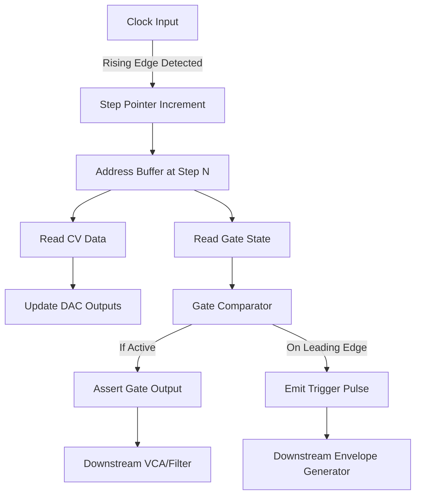
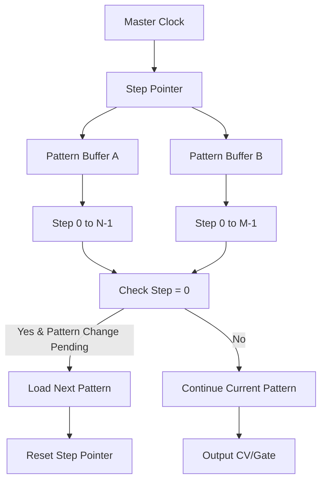
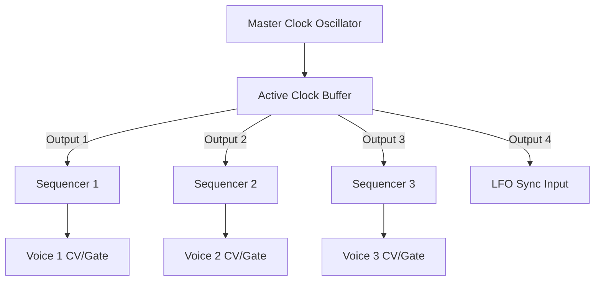
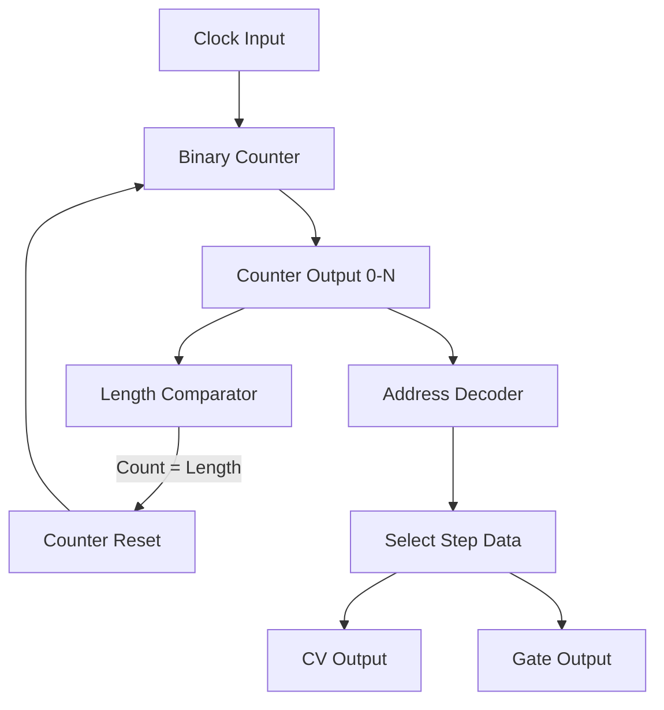
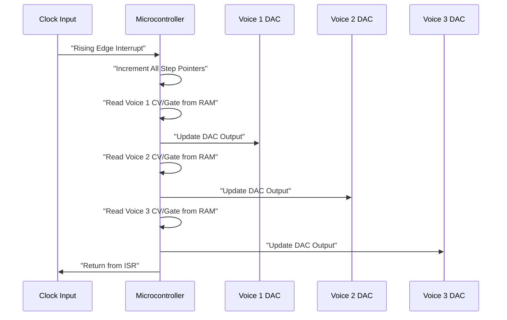

# Lesson 1: Sequencer Architectures, Signal Flow, Clock Distribution

## 1. First-Principles Intuition & Invariants

The hardware sequencer is a deterministic state machine that translates abstract musical time into physical voltage events. Unlike software sequencers that render MIDI streams through interrupt-driven operating system kernels, hardware sequencers operate in hard real-time environments where every clock pulse must trigger state transitions with microsecond-level precision. This distinction carries practical consequences: analog synthesizer envelopes exhibit jitter tolerance typically measured in single-digit microseconds, making hardware sequencers the only architecturally viable solution for controlling modular systems where gate-to-voltage conversion propagation delay must remain below the threshold of human temporal perception.

At its foundation, a sequencer is a circular buffer with programmable read logic. Each position in the buffer holds a control voltage specification and a set of boolean trigger flags. The sequencer's clock input drives an address pointer through this buffer at a rate determined by the incoming pulse train. When the pointer lands on a buffer position, the sequencer's output stage converts the stored data into analog voltages on its CV outputs and discrete gate pulses on its trigger outputs. This architectural model—pointer-driven buffer traversal with stateless output conversion—remains invariant across every hardware sequencer topology, from the simplest eight-step trigger sequencer to polyphonic MIDI-to-CV converters with per-voice envelope followers.

The sequencer's relationship to musical time is mediated entirely through its clock input. Unlike a microprocessor that executes instructions according to an internal crystal oscillator, a hardware sequencer is a passive consumer of an external timing reference. This architectural decision reflects a fundamental constraint of modular synthesis: every module in a patch must synchronize to a single master clock to maintain phase coherence across voices. The sequencer cannot generate its own timing because doing so would introduce drift relative to other modules' LFOs, envelope generators, and sub-oscillator dividers. Instead, the sequencer becomes a clock domain slave, advancing its internal state only when the rising edge of an external pulse crosses a comparator threshold voltage, typically $2.5\text{V}$ on a $0{-}10\text{V}$ scale.

This clock-driven architecture imposes two critical invariants. First, the sequencer's output latency from clock edge to CV update must be deterministic and bounded. Any jitter in this propagation delay manifests as rhythmic imprecision, which becomes audible when multiple sequencers control different voices in the same patch. Second, the sequencer must guarantee that gate outputs transition before CV outputs settle. If a filter's cutoff CV changes while its envelope gate is already high, the filter will glide to the new frequency rather than jumping discretely, destroying the percussive attack profile that defines most synthesizer patches. Hardware sequencers enforce this ordering by routing clock pulses through a delay line before triggering the CV update latch, ensuring that gate comparators have already switched state before the digital-to-analog converters begin their settling transient.

The distinction between triggers and gates is foundational to understanding sequencer signal flow. A trigger is a brief pulse, typically $10{-}15$ milliseconds in duration, that initiates an event in a downstream module without specifying its duration. An envelope generator, for example, responds to a trigger by beginning its attack phase and then proceeding through decay, sustain, and release according to its own internal timing parameters. A gate, by contrast, is a sustained high voltage that persists for the entire duration of a note. A voltage-controlled amplifier receiving a gate signal will hold its gain at the gate voltage's amplitude until the gate falls back to zero. Sequencers generate both signal types from the same underlying boolean state: a step marked "active" drives its gate output high for the entire duration that the sequencer's address pointer rests on that step, while simultaneously emitting a brief trigger pulse on the step's leading edge. This dual-output architecture allows a single sequencer step to control both momentary events like drum triggers and sustained events like held notes, with the downstream module's input impedance and time constant determining which semantic interpretation applies.

Pattern-based sequencers introduce a hierarchical timing abstraction by treating the basic step sequence as a composable unit rather than the atomic element of musical time. Instead of programming individual steps, the musician programs short melodic or rhythmic phrases—typically four to sixteen steps—and then arranges these patterns into longer song structures by specifying pattern playback order, repetition counts, and conditional branching rules. This architectural shift transforms the sequencer from a circular buffer into a two-level state machine: the pattern pointer selects which buffer to read from, while the step pointer traverses the active buffer. The clock input advances the step pointer as before, but a secondary "pattern advance" signal—often derived by dividing the master clock or by detecting the step pointer's return to zero—increments the pattern pointer according to a separate song structure specification stored in non-volatile memory.

The algorithmic complexity of pattern-based sequencing lies in managing state transitions when patterns have different lengths. If pattern A contains sixteen steps and pattern B contains twelve steps, advancing from A to B requires the step pointer to reset mid-phrase, potentially creating rhythmic discontinuities if the transition occurs on a non-quantized boundary. Early hardware sequencers resolved this by forcing all patterns to share a common length, sacrificing musical flexibility for implementation simplicity. Modern sequencers implement pattern-length-aware quantization: when the song structure logic requests a pattern change, the sequencer defers the actual transition until the active pattern's step pointer returns to zero, ensuring that phrase boundaries align with metrical divisions. This deferred transition architecture requires a two-deep pattern queue—one slot for the currently playing pattern, one slot for the pending next pattern—and a synchronization flag that the step pointer checks on every zero-crossing.

Linear sequencers abandon circular buffer topology entirely in favor of a timeline-based model borrowed from multitrack tape recorders. Instead of looping through a fixed-length sequence, a linear sequencer plays through a single contiguous block of events stored in chronological order, stopping when the playhead reaches the end of recorded data. This architecture maps naturally to phrase-based composition workflows where the musician builds complete arrangements rather than looping short ostinatos. The underlying data structure shifts from a fixed-size circular array to a dynamically allocated event list, with each entry containing an absolute timestamp, a CV value, and a gate duration. The sequencer's playhead advances through this list by comparing the current clock count against each event's timestamp, triggering outputs when timestamps match and updating internal state to track which gates are currently active.

The architectural tradeoff inherent in linear sequencing is memory efficiency versus timing precision. A circular sequencer with sixteen steps requires only sixteen storage locations regardless of tempo or pattern complexity, since each step implicitly occupies one clock period. A linear sequencer recording the same musical phrase must store an explicit timestamp for every event, consuming memory proportional to both the number of notes and the timing resolution. If the sequencer quantizes time to sixteenth-note divisions, a four-bar phrase at $120$ BPM contains $4 \times 4 \times 4 = 64$ possible event positions, but only a fraction of these positions typically contain actual note data. Sparse event encoding—storing only active note timestamps rather than allocating memory for every possible grid position—reduces this overhead, but introduces pointer-chasing latency during playback when the sequencer must traverse a linked list to find the next event.

Clock distribution in multi-sequencer patches requires careful consideration of signal integrity and phase alignment. When multiple sequencers drive different voices in the same patch, they must all receive clock pulses at precisely the same instant to maintain rhythmic coherence. Naïve clock distribution using passive signal splitters introduces phase skew proportional to cable capacitance and termination impedance mismatches. A ten-foot cable with $30$ picofarads per foot capacitance feeding a $100\text{k}\Omega$ input impedance exhibits an $RC$ time constant of $\tau = RC = (100 \times 10^3)(300 \times 10^{-12}) = 30\text{ ns}$, which at audio rates translates to less than one degree of phase shift but becomes significant when clock rates approach $1\text{ kHz}$ for high-resolution gate patterns. Active clock distribution using buffered multiple circuits eliminates this issue by regenerating the clock signal at each output with dedicated line drivers that present consistent output impedance regardless of downstream loading.

The electrical characteristics of clock signals impose constraints on sequencer input stage design. A clock pulse must transition between logic levels faster than the sequencer's internal propagation delay to avoid metastability conditions where the step pointer increments unpredictably. Standard Eurorack clock signals swing between $0\text{V}$ and $+5\text{V}$ with rise times under $1\text{ }\mu\text{s}$, well within the $10\text{ }\mu\text{s}$ setup time typical of CMOS counter ICs. However, clock signals derived from audio-rate oscillators or envelope generators may exhibit slower slew rates, particularly when buffered through op-amp stages with limited bandwidth. Sequencer input stages address this by incorporating Schmitt trigger comparators with hysteresis, ensuring that the internal logic sees clean digital transitions even when the input waveform contains noise or slow rise times. The hysteresis window—typically $0.5{-}1.0\text{V}$—prevents multiple triggering on a single clock edge when input noise crosses the threshold voltage repeatedly during the transition.

Clock division and multiplication extend a sequencer's rhythmic palette by allowing it to respond to metrical subdivisions or integer multiples of the master clock. A clock divider implemented as a binary counter emits an output pulse every $N$ input pulses, effectively slowing the sequencer's step rate by a factor of $N$. If the master clock runs at sixteenth notes, a divide-by-four circuit produces quarter-note pulses, causing the sequencer to advance one step per beat rather than four steps per beat. Clock multiplication, conversely, generates multiple output pulses for each input pulse, typically by phase-locking a voltage-controlled oscillator to the input clock and running it at an integer multiple of the input frequency. A multiply-by-three circuit transforms a quarter-note clock into eighth-note triplets, enabling rhythms that subdivide the beat into three rather than two or four. These division and multiplication circuits often reside external to the sequencer itself, living in dedicated clock utility modules that provide multiple simultaneous division and multiplication ratios from a single master clock input.

Swing and shuffle introduce controlled timing deviations that transform mechanically precise sequences into grooves with human-like rhythmic feel. A straight sixteenth-note pattern spaces each step at exactly $t/16$ intervals where $t$ is the measure duration, producing the rigid timing characteristic of early drum machines. Swing delays every other sixteenth note by a programmable offset, typically expressed as a percentage where $50\%$ swing means no delay and $67\%$ swing delays even-numbered steps by two-thirds of a thirty-second note. The resulting rhythm preserves the overall tempo but creates a "long-short-long-short" pattern that mimics the rhythmic inflection of jazz drummers and funk bassists. Hardware implementation requires the sequencer to maintain two separate step advancement rates: odd steps advance on the master clock, while even steps advance on a delayed clock generated by an analog monostable circuit whose pulse width is modulated by the swing control voltage. This approach preserves hard real-time behavior while introducing humanizing timing variations that make looped sequences sound less robotic.

## 2. Hardware Sequencing

Hardware sequencers implement their core functionality through a combination of digital logic for state management and analog circuitry for signal generation. The canonical architecture consists of a binary counter that maintains the current step address, a bank of potentiometers or digital storage elements that hold CV values for each step, a multiplexer or sample-and-hold array that routes the selected step's CV to the output, and a set of comparators that generate gate and trigger signals based on boolean state flags associated with each step. This modular decomposition allows sequencer designers to trade off cost, flexibility, and user interface complexity by substituting different implementations of each functional block while preserving the overall signal flow topology.

The step counter forms the sequencer's temporal spine. In analog sequencers, this counter is typically a 4-bit or 5-bit binary ripple counter implemented with CD4000-series CMOS logic, providing sixteen or thirty-two discrete steps. The counter increments on the rising edge of the clock input and wraps back to zero when it reaches the programmed sequence length, which may be less than the counter's maximum count to support patterns shorter than the hardware's physical step capacity. A sequence-length control—often a rotary switch or a set of jumpers—feeds a comparator that monitors the counter's output and issues a reset pulse when the count matches the programmed length. This reset pulse propagates through the counter's asynchronous clear input, forcing all counter stages to zero on the next clock cycle and restarting the sequence. The counter's binary output drives address lines that select which step's CV and gate data reach the sequencer's outputs.

CV storage and retrieval in analog sequencers uses one of two approaches: direct potentiometer readout or sample-and-hold banks. In the direct readout architecture, each step connects to a dedicated potentiometer wired as a voltage divider across a precision reference voltage, typically $+10\text{V}$ derived from a temperature-compensated zener diode. The counter's address output drives a multiplexer that connects one potentiometer at a time to the sequencer's CV output buffer. This approach provides continuous voltage adjustment and requires no calibration beyond setting the reference voltage, but limits the sequencer to as many steps as there are physical potentiometers on the front panel. Sample-and-hold architectures, by contrast, store CV values in analog memory cells—typically JFET-input op-amps with polystyrene or polypropylene hold capacitors—that can be programmed through a single shared CV input. The user selects a step using a dedicated address control, adjusts the CV input to the desired voltage, and presses a "write" button that closes a CMOS analog switch, transferring the input voltage to the selected step's hold capacitor. This architecture supports larger step counts within a fixed panel footprint but requires more complex calibration to compensate for sample-and-hold droop and charge injection.

Gate and trigger generation relies on a parallel array of boolean state flags, one per step, that determine whether each step is active or muted. In hardware implementations, these flags take the form of toggle switches, capacitive touch sensors, or latching LED buttons mounted on the front panel. The counter's address output feeds a decoder that activates one of $N$ output lines corresponding to the current step. This output line then feeds through the step's gate switch and into a buffer that drives the gate output jack. When the sequencer advances to a step whose gate switch is closed, the decoder's output pulls the gate buffer high, sustaining the gate voltage for the entire duration of that step. Simultaneously, the rising edge of the decoder output triggers a monostable multivibrator (one-shot) that generates a brief pulse on the trigger output regardless of the step's duration. The one-shot's pulse width, typically $10{-}15\text{ ms}$, is set by an RC time constant chosen to reliably trigger envelope generators while remaining short enough to avoid retriggering if the sequencer's tempo increases.

Digital sequencers replace analog counters and multiplexers with microcontrollers or FPGAs that maintain step state in RAM and update DAC outputs on each clock pulse. This architectural shift eliminates the component count and calibration overhead of analog multiplexers and sample-and-hold circuits, but introduces quantization noise from the DACs and requires firmware to implement the sequencer's state machine logic. Modern digital sequencers typically use 12-bit or 16-bit DACs with voltage references chosen to produce the Eurorack standard $-5\text{V}$ to $+5\text{V}$ range (or $0{-}10\text{V}$ for older systems), corresponding to a quantization step of $10\text{V}/2^{12} \approx 2.44\text{ mV}$ for 12-bit resolution. At the $1\text{V/octave}$ scaling standard in modular synthesis, this resolution provides $1200\text{ cents}/2.44\text{ mV} \approx 0.29\text{ cents}$ per step, well below the $5{-}10$ cent pitch discrimination threshold of human hearing.

The firmware structure of a digital sequencer centers on an interrupt service routine (ISR) triggered by the clock input's rising edge. When the external clock pulse crosses the microcontroller's input threshold, the hardware generates an interrupt that preempts the main program loop and invokes the ISR. Inside the ISR, the sequencer increments its step counter, wraps the counter if it exceeds the programmed pattern length, retrieves the CV and gate values for the new step from a lookup table stored in RAM, writes these values to the DAC and GPIO registers, and returns control to the main loop. The entire ISR must complete in less time than the minimum clock period to avoid missing subsequent clock pulses, imposing strict latency requirements on the firmware. For a sequencer supporting clock rates up to $1\text{ kHz}$ (corresponding to thirty-second notes at $120$ BPM), the ISR must complete within $1\text{ ms}$, easily achievable on modern ARM Cortex-M microcontrollers running at $48{-}168\text{ MHz}$ but requiring careful optimization on older 8-bit AVR processors.

Polyphonic sequencers extend the single-voice architecture by maintaining multiple independent step pointers, CV arrays, and output DACs, one set per voice. The clock input advances all voice pointers simultaneously, ensuring that all voices remain synchronized even when they play different patterns. Each voice's CV and gate data reside in separate memory banks, allowing the musician to program distinct melodies, rhythms, or articulations for each voice while maintaining overall phase coherence. The firmware structure mirrors the single-voice design but iterates over all voices within the clock ISR, updating each voice's DAC outputs before returning from the interrupt. This parallel update approach preserves the hard real-time guarantee that all voices respond to the clock edge within a deterministic latency bound, critical for patches where multiple voices feed additive or FM synthesis topologies that require precise phase alignment.

MIDI-to-CV conversion represents a specialized sequencer architecture where the step data source is an external MIDI stream rather than internal memory. A MIDI-to-CV converter listens on its MIDI input for Note On and Note Off messages, maintains an internal table of currently active notes, and updates its CV and gate outputs to reflect the most recently received note. When a Note On message arrives, the converter extracts the note number (a 7-bit integer from $0$ to $127$ representing the MIDI note scale), converts it to a voltage using the formula $V_{\text{CV}} = (n - 60) \times (1\text{V}/12)$ where $n$ is the note number and $60$ corresponds to middle C, writes this voltage to the CV output DAC, and raises the gate output. When the corresponding Note Off message arrives or when a new Note On message supersedes the previous note, the converter lowers the gate output. Polyphonic MIDI-to-CV converters maintain separate note tables and output DACs for each voice, implementing voice allocation policies such as round-robin (cycle through voices sequentially), low-note priority (assign the lowest active note to voice 1), or high-note priority (assign the highest active note to voice 1).

The voice allocation policy profoundly affects the musicality of polyphonic MIDI-to-CV conversion when playing legato passages or chords with overlapping note timing. Consider a four-voice converter receiving a chord of six notes. The converter must decide which four notes to play and which two to drop, and this decision changes dynamically as notes are released and new notes arrive. A round-robin policy distributes notes evenly across voices but may cause abrupt voice stealing when the chord exceeds the voice count. A priority-based policy ensures that the lowest or highest notes always sound but creates audible discontinuities when priority shifts from one voice to another mid-chord. Sophisticated converters implement note-stealing algorithms that track each voice's envelope state and preferentially steal voices that have reached the release phase of their envelope, minimizing audible artifacts. These algorithms require the converter to monitor gate durations and estimate envelope timings, adding firmware complexity but substantially improving musical results.

Trigger sequencers simplify the general-purpose sequencer architecture by omitting CV outputs entirely and focusing exclusively on rhythmic pattern generation. Each step stores only a boolean trigger state rather than a continuous voltage value, and the output stage consists solely of trigger pulse generators with no DAC components. This architectural reduction makes trigger sequencers significantly cheaper to manufacture and easier to program than full CV/gate sequencers, leading to their widespread use in drum machine and percussion controller applications. Many hardware drum machines implement trigger sequencers as a grid of illuminated buttons where each button corresponds to a step and an instrument, with the button's lit state indicating whether that instrument fires on that step. The musician programs patterns by pressing buttons to toggle trigger states, building up drum parts one instrument at a time across a sixteen-step grid.

The electrical implementation of trigger outputs mirrors gate generation but with timing derived from a fixed one-shot rather than step duration. When the sequencer advances to a step with an active trigger flag, the decoder output fires a monostable multivibrator that generates a $10{-}15\text{ ms}$ pulse regardless of tempo. This pulse drives a buffer that presents the trigger voltage on the output jack, and the one-shot's timing capacitor ensures that the pulse returns to zero before the next step begins even if the sequencer's tempo exceeds the one-shot period. The trigger pulse width must be long enough to reliably fire downstream envelope generators, which typically require input pulses exceeding $5{-}10\text{ ms}$ to guarantee that internal comparators transition cleanly, but short enough to allow retriggering at high tempos without pulses overlapping. At a sixteenth-note rate of $32$ steps per beat and $120$ BPM, steps occur every $(60\text{ s})/(120 \times 32) \approx 15.6\text{ ms}$, leaving minimal margin for trigger pulse widths, which explains why many high-speed drum machines reduce trigger pulse widths to $5\text{ ms}$ or implement adaptive one-shot timing that scales inversely with tempo.

Probability and randomness introduce controlled unpredictability into sequencer patterns, allowing musicians to create evolving variations on static sequences without explicitly programming every deviation. A probability control assigns each step a likelihood of firing, expressed as a percentage from $0\%$ (never fires) to $100\%$ (always fires). On each pass through the sequence, the sequencer generates a random number for each step and compares it to the step's probability threshold, firing the step only if the random number falls below the threshold. This mechanism creates rhythmic variations that remain anchored to the underlying pattern structure while introducing syncopations and dropped beats that prevent the sequence from sounding mechanically repetitive. Hardware implementations generate random numbers using linear-feedback shift registers (LFSRs), which produce pseudo-random bit sequences by XORing selected bits of a shift register and feeding the result back into the register's input. An LFSR's sequence length—the number of unique states before the pattern repeats—depends on the register width and feedback tap positions, with maximal-length sequences achieving $2^n - 1$ states for an $n$-bit register.

Quantization constrains CV outputs to discrete voltage levels corresponding to musical scales, ensuring that random or modulated CV values produce recognizable melodic intervals rather than microtonal glissandos. A quantizer implemented in firmware reads the incoming CV value from the DAC or an external input, rounds this voltage to the nearest value in a lookup table of scale degrees, and outputs the quantized result. The lookup table stores voltage offsets for each scale degree at $1\text{V/octave}$ resolution, with entries such as $[0.0, 0.167, 0.333, 0.5, 0.667, 0.833, 1.0]\text{ V}$ for a major scale spanning one octave in semitone increments $[0, 2, 4, 5, 7, 9, 11]$ semitones. The firmware finds the closest table entry by computing the absolute difference between the input voltage and each table value, selecting the entry with the minimum difference. This nearest-neighbor search runs in $O(n)$ time for a table of $n$ entries, but most scales contain fewer than twelve degrees per octave, keeping the computational overhead well within the clock ISR's latency budget. More sophisticated quantizers implement octave folding, where input voltages outside the table's span are wrapped modulo $1\text{V}$ to bring them within range, allowing a single-octave scale table to quantize arbitrary voltage inputs across the full CV range.

The interaction between sequencers and external modulation sources such as LFOs and envelope generators enables dynamic timbral and rhythmic evolution that transcends static pattern playback. An LFO modulating a sequencer's clock input introduces tempo variations that accelerate and decelerate the sequence in sync with the LFO's waveform, creating rhythmic breathing effects. An envelope generator modulating the sequence length control causes the pattern to expand and contract over time, with shorter envelopes producing stuttering repetitions of the first few steps and longer envelopes allowing the full sequence to play through. These modulation routings exploit the sequencer's voltage-controlled parameters, which accept external CV inputs that sum with or override the front-panel control settings. The underlying circuit topology routes external CV through a precision summing amplifier that adds the external voltage to the internal control voltage before feeding the result into the parameter's input stage, preserving the full dynamic range of both control sources.

Ratcheting generates rapid note repetitions within a single step by subdividing the step's duration into multiple retriggered events. When a step's ratchet control is set to a value greater than one, the sequencer emits multiple gate and CV updates during that step rather than holding the step's output constant for the full clock period. A ratchet value of four, for example, divides the step into four equal subdivisions and fires the gate output at the beginning of each subdivision, creating a thirty-second-note roll effect when the main clock runs at sixteenth notes. Hardware implementation requires the sequencer to maintain an internal high-frequency clock derived by multiplying the external clock input, typically using a phase-locked loop or a crystal oscillator that runs at a multiple of the expected input clock frequency. The firmware tracks both the external step clock and the internal ratchet clock, advancing the step pointer on external clock edges and emitting ratchet pulses on internal clock edges when the current step's ratchet count exceeds one. This dual-clock architecture preserves synchronization with external modules while introducing internal subdivisions that remain phase-locked to the master tempo.
