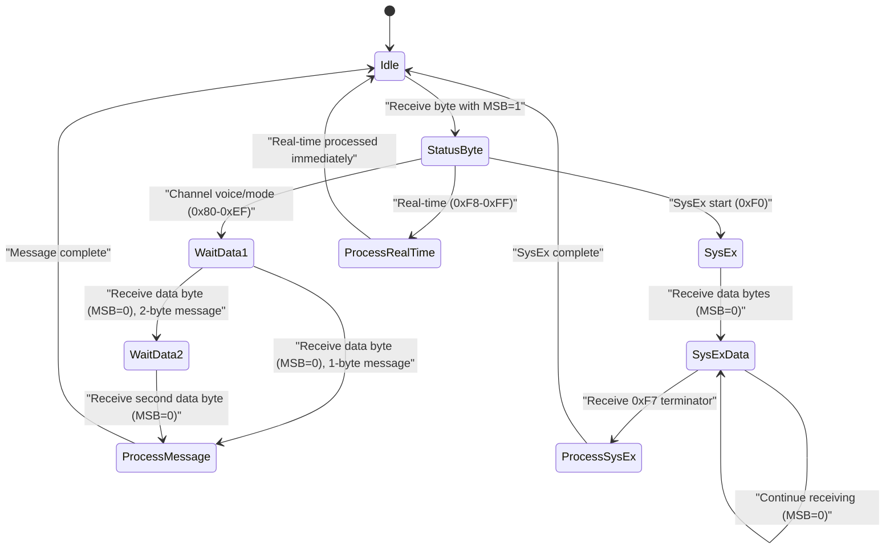

# Lesson 2: MIDI Protocol Implementation in Hardware Sequencers

## 1. First-Principles Intuition & Invariants

The Musical Instrument Digital Interface emerged in 1983 as a solution to a fundamental problem in electronic music production: manufacturers had created synthesizers with incompatible control voltage standards, and musicians needed a universal protocol to coordinate timing and parameter changes across heterogeneous gear. Dave Smith of Sequential Circuits and Ikutaro Kakehashi of Roland negotiated a treaty that prioritized pragmatism over elegance. MIDI is not a high-fidelity audio transport—it is a command stream designed to fit through a narrow serial pipe at 31.25 kilobaud, transmitting discrete performance gestures as terse byte sequences.

Understanding MIDI at the implementation level requires recognizing its historical constraints. The protocol was finalized when RAM cost thousands of dollars per megabyte and microcontrollers ran at single-digit megahertz. Every design decision reflects this scarcity economy. MIDI messages are variable-length structures with a status byte followed by zero to two data bytes, never more. Status bytes have their most significant bit set to one; data bytes have it set to zero. This distinction allows receivers to resynchronize on status bytes if transmission errors corrupt the stream, a critical fault-tolerance mechanism in the pre-error-correction era of RS-232 derivative protocols.

The fundamental invariant of MIDI is that it models music as a sequence of discrete events distributed across sixteen independent channels, each carrying note articulations, continuous controller adjustments, and program change commands. Channels are not physical connections but logical multiplexing slots within a single serial cable. A hardware sequencer's core responsibility is to maintain sixteen independent event queues, each with microsecond-precision timestamp resolution, and serialize these queues into the 31.25 kbps bottleneck without introducing jitter that would destroy rhythmic coherence.

MIDI's timing model is deceptively simple. The protocol defines a 24-pulses-per-quarter-note clock signal broadcast on all channels simultaneously, establishing a shared temporal grid. Hardware sequencers lock their internal high-resolution counters to this external clock or generate it themselves when operating as master. The mismatch between MIDI's coarse 24 PPQN resolution and the sequencer's internal 960 or 1920 PPQN resolution creates a quantization problem: events scheduled between MIDI clock ticks must be transmitted immediately before or after the nearest tick, introducing sub-millisecond timing errors that accumulate across long sequences. Professional sequencers implement look-ahead buffers and predictive transmission algorithms to minimize this jitter, but the fundamental constraint remains—MIDI clock is a synchronization heartbeat, not a precision timing reference.

The second invariant governing MIDI implementation is bandwidth scarcity. At 31.25 kbps, the protocol can transmit approximately 1000 three-byte messages per second, assuming zero overhead. A dense polyphonic passage with sixteen voices playing legato across all sixteen channels, each voice generating note-on, note-off, velocity, aftertouch, and modulation wheel data, can easily saturate this bandwidth. Hardware sequencers must implement priority queues that discard or defer low-priority messages like active sensing keepalives when the transmission buffer approaches capacity. The protocol provides no flow control mechanism—if the sender transmits faster than the receiver processes, data loss is silent and catastrophic.

System Exclusive messages break the tidy structure of channel-voice commands by introducing variable-length vendor-specific data blocks that can span thousands of bytes. A SysEx message begins with `0xF0`, followed by a manufacturer ID, arbitrary payload data, and terminates with `0xF7`. Hardware sequencers must dynamically allocate buffer space for incoming SysEx dumps, often containing entire synthesizer patch banks or sequencer configuration snapshots. The lack of length prefixes means the receiver cannot pre-allocate memory; it must consume the stream byte-by-byte until encountering the terminator. This design forces implementations to choose between preallocating worst-case buffers (wasting precious RAM) or dynamically growing buffers (risking fragmentation and allocation failures mid-stream).

The electrical layer of MIDI reveals another set of constraints inherited from 1980s component availability. The original DIN-5 specification uses a current loop topology with opto-isolators at the receiver to eliminate ground loops that would inject hum into analog audio paths. The transmitter sources 5 milliamps through a 220-ohm resistor into pins 4 and 5 of the DIN connector; the receiver's opto-isolator translates this current into logic-level signals for the UART. This galvanic isolation makes MIDI immune to ground potential differences but limits cable runs to approximately 15 meters before signal degradation corrupts the bit stream. Hardware sequencers implementing DIN MIDI must carefully manage the opto-isolator's propagation delay, typically 1-2 microseconds, which compounds with UART frame timing to produce measurable latency in the tens of microseconds per hop through a MIDI chain.

USB MIDI, standardized in 1999, wraps MIDI messages in USB packets but introduces its own latency characteristics. USB operates on a polled interrupt model with 1-millisecond frame intervals at full speed. A MIDI message generated mid-frame must wait until the next poll before transmission, adding 0-1 ms of variable latency. Worse, USB hosts batch multiple MIDI messages into single packets to amortize overhead, and the reassembly logic at the receiver must buffer and deserialize these packets, adding another layer of jitter. Professional hardware sequencers that support USB MIDI must implement adaptive buffering strategies that trade latency for throughput stability, dynamically adjusting buffer depths based on observed jitter in the USB host's scheduling.

The channel routing architecture in hardware sequencers mirrors the design of a sixteen-port ethernet switch, but instead of MAC address learning, it performs channel number matching. Incoming MIDI messages are demultiplexed by their channel nybble (the low four bits of the status byte) into sixteen independent input queues. The sequencer's pattern memory stores events with channel tags, and the playback engine merges these tagged event streams into a single time-ordered output sequence. Channel remapping—transposing an incoming channel 1 message to outgoing channel 5—is a simple lookup table operation, but it must occur in the critical path of the real-time scheduler, making it a frequent target for optimization in assembly-level implementations.

Running status is a bandwidth optimization that allows the transmitter to omit redundant status bytes when sending consecutive messages of the same type on the same channel. After transmitting a Note On message (`0x90` followed by note number and velocity), the sender can immediately transmit another note number and velocity pair without repeating the `0x90` status byte. The receiver maintains a state machine that remembers the most recent status byte and applies it to subsequent data byte pairs until a new status byte arrives. This optimization reduces bandwidth consumption by approximately 33% in typical polyphonic sequences, but it introduces state that must be carefully managed across message boundaries and explicitly reset when switching between record and playback modes.

## 2. Message Structure and Parsing State Machines

MIDI's byte-level encoding follows a strict grammar that hardware sequencers must parse in real time without backtracking. The protocol distinguishes three message classes: channel voice messages, channel mode messages, and system messages. Channel voice messages occupy status bytes `0x80` through `0xEF`, with the upper nybble encoding message type and the lower nybble encoding channel number. Channel mode messages use status byte `0xBn` (Control Change) with specific controller numbers in the first data byte to trigger mode changes like All Notes Off or Local Control. System messages occupy status bytes `0xF0` through `0xFF` and do not carry channel information.

The parsing state machine must differentiate between these classes without lookahead. When a status byte arrives, the parser examines the upper nybble to determine message length: Note Off (`0x8n`), Note On (`0x9n`), Polyphonic Key Pressure (`0xAn`), Control Change (`0xBn`), Pitch Bend (`0xEn`) each expect two data bytes; Program Change (`0xCn`) and Channel Pressure (`0xDn`) expect one data byte; System Exclusive (`0xF0`) has variable length delimited by `0xF7`; and System Real-Time messages (`0xF8` through `0xFF`) carry no data bytes and must be processed immediately, even if they interrupt multi-byte messages in progress.

Real-time messages pose a unique parsing challenge. The MIDI specification mandates that System Real-Time messages like Timing Clock (`0xF8`), Start (`0xFA`), Continue (`0xFB`), and Stop (`0xFC`) must be processed immediately upon arrival, even if they arrive between the status byte and data bytes of a channel voice message. A compliant parser must implement a split-state architecture where real-time messages bypass the main state machine entirely. The typical implementation uses a two-stage input buffer: a hardware UART interrupt handler scans each incoming byte, immediately dispatches real-time messages to the clock subsystem, and enqueues all other bytes into a FIFO for the main parser. This split path ensures that a Timing Clock message arriving between a Note On status byte and its note number data byte does not corrupt the partially assembled message.

The parser must also handle malformed input gracefully. If a data byte arrives when the state machine expects a status byte, the parser should discard it and remain in the idle state. If a new status byte arrives while waiting for data bytes to complete a previous message, the parser should abandon the incomplete message and begin processing the new status byte. This error recovery strategy, known as status byte resynchronization, allows the receiver to recover from single-bit transmission errors that corrupt a status byte into a data byte or vice versa.

Running status complicates the parser because it introduces implicit state that persists across message boundaries. When running status is active, the parser must remember the most recent channel voice status byte and automatically prepend it to incoming data byte pairs. The state machine extends with a "running status active" mode that transitions back to explicit status mode whenever a new status byte arrives or a System Real-Time or System Common message interrupts the stream. System Common messages like Song Position Pointer (`0xF2`) explicitly cancel running status, forcing the transmitter to send a full status byte for the next channel voice message.

Hardware sequencers typically implement the parser as a tight polling loop or interrupt-driven UART handler written in assembly for microcontrollers or C for ARM-based systems. The critical path—the code executed for every incoming byte—must complete within the inter-byte arrival time of approximately 320 microseconds (10 bits at 31.25 kbps). On an 8 MHz 6502 processor, this leaves roughly 2500 clock cycles per byte, enough for a hand-optimized parser but too tight for high-level language overhead. Modern ARM Cortex-M processors running at 120 MHz provide ample headroom, but the real-time constraint remains: the parser must never block, allocate memory, or perform I/O that could introduce unbounded latency.

## 3. Timestamp Resolution and Clock Synchronization

Hardware sequencers maintain an internal timebase with resolution far exceeding MIDI's 24 PPQN clock standard. Typical implementations use 960 PPQN or 1920 PPQN, providing 40 or 80 ticks per MIDI clock pulse respectively. This high-resolution timebase allows the sequencer to represent timing nuances like swing quantization, where alternate sixteenth notes are delayed by a few ticks to create a shuffle feel, or micro-timing adjustments borrowed from the performance of a live drummer whose timing drifts slightly ahead and behind the beat.

The sequencer's master clock derives from a hardware timer clocked by a crystal oscillator, typically 8 MHz or 12 MHz for vintage designs, or the system clock divided down for modern microcontrollers. The timer generates periodic interrupts at the internal PPQN rate, and the interrupt handler increments a 32-bit or 64-bit tick counter. At 1920 PPQN and 120 BPM, the interrupt fires at a rate of:

$$f_{\text{int}} = \frac{1920 \times 120}{60} = 3840 \text{ Hz}$$

This 260-microsecond interrupt period is fast enough to dominate the CPU budget on an 8-bit microcontroller running at 8 MHz, leaving approximately 2000 cycles per interrupt for all sequencer tasks: event queue management, MIDI transmission, user interface polling, and display updates. Designers must carefully balance timer resolution against interrupt overhead, often choosing 960 PPQN as a compromise that provides acceptable musical resolution while leaving sufficient CPU headroom.

When the sequencer operates as a MIDI clock slave, it must synchronize its internal timebase to incoming MIDI Timing Clock messages. The naive approach—simply incrementing the tick counter by 40 or 80 ticks on every received clock pulse—fails catastrophically because MIDI clock jitter, introduced by the 31.25 kbps serialization delay and transmission latency, causes the internal timebase to drift. A hardware sequencer transmitting a steady 120 BPM clock at 24 PPQN sends clock pulses every 20.833 milliseconds. The serialization time for a single-byte MIDI clock message (`0xF8`) is 320 microseconds, and additional latency from opto-isolators and UART buffering adds another few hundred microseconds. If the receiver naively locks to each incoming clock pulse, this sub-millisecond jitter accumulates into audible timing errors.

Professional sequencers implement phase-locked loop algorithms to smooth MIDI clock jitter. The PLL measures the interval between consecutive clock pulses, computes a running average over the last 8 or 16 pulses, and adjusts the internal timer frequency to match this averaged interval. The control loop uses a proportional-integral filter that gradually pulls the internal clock toward the external reference without introducing abrupt jumps. The PLL's time constant—the number of clock pulses over which it averages—trades responsiveness against jitter rejection. A short time constant allows the sequencer to quickly track tempo changes, but amplifies high-frequency jitter. A long time constant provides smooth playback but responds slowly to tempo ramps.

The mathematics of the PLL follow classical control theory. Let $T_{\text{measured}}$ denote the measured interval between consecutive MIDI clock pulses, and let $T_{\text{target}}$ denote the current estimate of the true clock period. The PLL updates the estimate using an exponential moving average:

$$T_{\text{target}} \leftarrow \alpha \cdot T_{\text{measured}} + (1 - \alpha) \cdot T_{\text{target}}$$

where $\alpha \in [0, 1]$ controls the filter's responsiveness. The internal timer period is then adjusted to $T_{\text{target}} / N$, where $N$ is the ratio between internal PPQN and MIDI's 24 PPQN (e.g., $N = 40$ for 960 PPQN). Typical implementations use $\alpha \approx 0.125$ (averaging over 8 samples) for a good balance between stability and tracking speed.

MIDI clock does not carry absolute timing information—it provides only a relative pulse train with no indication of measure boundaries or beat positions. The sequencer must infer bar and beat alignment from MIDI Start, Stop, and Continue messages. When a MIDI Start message (`0xFA`) arrives, the sequencer resets its internal position counter to beat one, measure one, and begins incrementing this counter in lockstep with the incoming clock pulses. A MIDI Continue message (`0xFB`) resumes playback from the position indicated by the most recent Song Position Pointer message (`0xF2`), which encodes a 14-bit position value measured in MIDI beats (sixteenth notes). The sequencer must convert this coarse position into its internal high-resolution tick representation, typically by multiplying by $6 \times 960 / 24 = 240$ ticks per MIDI beat for a 960 PPQN timebase.

Latency compensation becomes critical when the sequencer both receives and transmits MIDI. If the sequencer records incoming notes while simultaneously playing back a pre-programmed sequence, the recorded notes will appear delayed relative to the playback timeline because MIDI transmission is not instantaneous. The one-way latency for a three-byte MIDI message is approximately 1 millisecond (3 bytes × 320 microseconds per byte plus opto-isolator delay). To maintain synchronization, the sequencer must timestamp each incoming note with the current tick value minus a latency offset computed from the known transmission and processing delays. This compensation is particularly important for looped recording workflows where the musician overdubs new parts while listening to previously recorded material—without latency correction, each overdub layer shifts later in time, creating a cumulative timing drift that destroys the groove.

## 4. Event Queue Management and Priority Scheduling

The sequencer's event queue is a time-ordered list of pending MIDI messages, each tagged with a 32-bit or 64-bit timestamp representing the absolute tick at which the message should be transmitted. The fundamental operations are insertion (adding a newly recorded or loaded event), extraction (removing and transmitting the next event due for playback), and deletion (removing a note-off corresponding to a note-on that was muted mid-note). The queue must support these operations with bounded worst-case latency suitable for real-time execution, ruling out naive implementations like unsorted arrays that require linear-time insertion.

The classic data structure for event queues is a min-heap indexed by timestamp. A binary heap provides $O(\log n)$ insertion and $O(\log n)$ extraction, with the smallest timestamp always at the root. For a sequencer with 10,000 events per pattern, this yields worst-case insertion times of approximately 14 comparisons, easily achievable within a single interrupt period on even an 8 MHz processor. The heap is typically implemented as a flat array with implicit parent-child relationships: the parent of element at index $i$ resides at index $\lfloor i/2 \rfloor$, and its children reside at $2i$ and $2i+1$. This array representation maximizes cache efficiency and avoids the pointer overhead of explicit tree structures.

The main sequencer loop operates as a priority-driven scheduler. On each tick interrupt, the loop compares the current tick counter against the timestamp of the root event in the heap. If the current tick equals or exceeds the event's timestamp, the loop extracts the event, serializes it into MIDI bytes, and pushes those bytes into the UART transmit buffer. The loop then extracts the next root event and repeats until either the heap is empty or the root event's timestamp lies in the future. This extraction loop must bound its execution time: if a dense chord contains sixteen simultaneous notes across multiple channels, the loop must transmit all sixteen note-on messages within a single interrupt period to avoid jitter. To ensure bounded latency, the scheduler limits the number of events extracted per tick to a fixed maximum, deferring excess events to the next tick. This introduces quantization error for chords exceeding the per-tick event limit, but prevents the worst-case burst from monopolizing the CPU and starving other interrupt handlers.

Polyphonic sequencing introduces a complication: the sequencer must track which notes are currently sounding on each channel to correctly generate note-off messages. When the user deletes or truncates a note in the pattern editor, the sequencer must immediately send a note-off if that note is currently active. This requires maintaining a 16-channel by 128-note bitmap (16 × 128 bits = 256 bytes) indicating which notes are on. Whenever a note-on event is transmitted, the corresponding bit is set; when a note-off event is transmitted, the bit is cleared. The "all notes off" panic function iterates through this bitmap, sending note-off messages for every active bit, ensuring that stuck notes caused by transmission errors or user edits are silenced.

Priority inversion occurs when high-priority real-time messages are blocked behind low-priority data in the transmit queue. MIDI's bandwidth limitation means that a single three-byte note-on message occupies the UART for approximately 960 microseconds. If a Song Position Pointer message (three bytes) is being transmitted when a Timing Clock pulse arrives, the clock message must wait until the SPP transmission completes, introducing up to 1 millisecond of jitter. Hardware sequencers mitigate this by implementing separate transmit queues for real-time and non-real-time messages, with the UART interrupt handler always checking the real-time queue first. This dual-queue architecture ensures that timing-critical messages like Clock, Start, and Stop preempt lower-priority channel voice messages, minimizing clock jitter even under heavy MIDI traffic.

The sequencer must also handle "note-off zero velocity" semantics. The MIDI specification allows note-off messages to be encoded as either explicit Note Off commands (`0x8n`) or as Note On commands (`0x9n`) with velocity zero. The latter encoding exploits running status more effectively because a sequence of note-on and note-off events on the same channel can share a single status byte. Hardware sequencers typically normalize incoming messages to a canonical internal representation (separate note-on and note-off events with explicit velocity values) but generate the running-status-optimized encoding when transmitting. This normalization simplifies the event queue logic because the scheduler does not need to track running status state—it merely passes events to a separate transmission layer responsible for running status compression.

## 5. Channel Voice Message Implementation

Channel voice messages encode the expressive gestures of musical performance: note articulations, continuous controller movements, pitch bends, and pressure modulations. Each message type has specific encoding rules and real-time processing requirements that hardware sequencers must implement with microsecond precision.

Note On messages (`0x9n`) carry three pieces of information: channel (low nybble of status byte), note number (first data byte, 0-127), and velocity (second data byte, 0-127). The note number encodes pitch using MIDI's equal-tempered chromatic scale where middle C is note 60. Velocity encodes how hard the key was struck, with 0 traditionally interpreted as note-off and 1-127 representing a logarithmic intensity curve. Hardware sequencers must maintain a note-on velocity table for each channel because subsequent Polyphonic Key Pressure messages may modulate the brightness or filter cutoff of individual notes based on their original velocity. A dense polyphonic passage with velocity-sensitive filter envelopes can generate note-on velocities spanning the full 1-127 range, and the sequencer must preserve this resolution without quantization that would destroy expressive dynamics.

Note Off messages (`0x8n`) include a release velocity parameter (second data byte) that few synthesizers implement. Most instruments ignore release velocity entirely, but the MIDI specification defines it as the speed at which the key was released, intended to control the decay rate of the note's envelope. Hardware sequencers must store and transmit release velocity even though it rarely affects synthesis, because some advanced instruments like the Yamaha TX802 and modern software synthesizers interpret it. Omitting release velocity would create a compliance hazard where sequences edited on the sequencer sound different when played back on a fully MIDI-compliant instrument.

Polyphonic Key Pressure messages (`0xAn`), also called aftertouch, encode per-note pressure applied after the initial key strike. Each message targets a specific note number and pressure value (both data bytes, 0-127). Polyphonic aftertouch is expensive to implement in hardware because a 61-key keyboard with continuous pressure sensing generates up to 61 simultaneous aftertouch streams, each potentially updating at 100 Hz or faster. At three bytes per message and 61 keys updating at 100 Hz, the data rate approaches 18 kilobytes per second—far exceeding MIDI's 3.125 kilobyte per second bandwidth. Hardware sequencers must aggressively thin polyphonic aftertouch streams, transmitting updates only when pressure changes by more than a threshold amount (typically 4-8 MIDI units) or when a minimum time has elapsed since the last update (typically 10-20 milliseconds). This thinning trades resolution for bandwidth, but preserves the gestural contour of the performance.

Control Change messages (`0xBn`) occupy the most complex region of MIDI's message space. The first data byte identifies one of 128 possible controllers, and the second data byte provides the controller value (0-127). The MIDI specification standardizes assignments for common controllers: controller 1 is modulation wheel, controller 7 is channel volume, controller 10 is pan, controller 64 is sustain pedal, and controller 123 is All Notes Off. Controllers 0-31 provide the most significant seven bits of 14-bit high-resolution controllers, with controllers 32-63 providing the least significant seven bits. For example, pitch bend wheel position can be encoded as controller 0 (coarse) and controller 32 (fine), yielding 14-bit resolution for smooth, zipper-free pitch sweeps.

The distinction between continuous controllers (like modulation wheel and expression pedal) and switch controllers (like sustain pedal and soft pedal) is semantic rather than structural—all control change messages carry a 0-127 data value, but switch controllers interpret values 0-63 as off and 64-127 as on. Hardware sequencers must respect this convention when quantizing or manipulating controller data. A sequencer that linearly interpolates between two sustain pedal events (one with value 0 and another with value 127) would generate intermediate values that cause the pedal to toggle rapidly between on and off states, creating audible artifacts. Correct interpolation must snap sustain pedal values to their nearest valid state rather than sweeping through the full range.

Pitch Bend messages (`0xEn`) encode the pitch wheel position as a 14-bit signed value split across two data bytes: the least significant seven bits in the first data byte and the most significant seven bits in the second. The center position (no bend) is encoded as 0x2000 (8192), with negative bends ranging from 0x0000 to 0x1FFF and positive bends from 0x2001 to 0x3FFF. This encoding provides 8192 steps of pitch bend resolution in each direction, sufficient to avoid audible quantization artifacts even during slow, continuous pitch sweeps. Hardware sequencers must decode this two-byte representation into a single 14-bit integer for internal processing, and re-encode it when transmitting. The bit-packing arithmetic is straightforward:

$$\text{pitch\_bend} = (\text{MSB} \ll 7) | \text{LSB}$$

where MSB is the second data byte and LSB is the first data byte, and the result is offset by 0x2000 to convert from unsigned to signed representation.

Program Change messages (`0xCn`) instruct the receiving instrument to switch to a different preset patch. The single data byte encodes program numbers 0-127, though most instruments display these as 1-128 in their user interfaces. Hardware sequencers often allow users to insert program change events at the beginning of a pattern to ensure that the correct sounds are loaded before notes begin playing. The challenge is that program change messages are not instantaneous—many synthesizers require tens or hundreds of milliseconds to load a new patch from internal memory or perform DSP reconfiguration. If a program change message is followed immediately by a note-on message, the note may trigger using the old patch before the new patch finishes loading, causing the first note to sound wrong. Professional sequencers implement program change pre-roll, transmitting program change messages a fixed time interval (typically 100-500 milliseconds) before the first note event that uses the new patch. This pre-roll delay is user-configurable and depends on the specific synthesizers in the studio.

Channel Pressure messages (`0xDn`), also called channel aftertouch or mono aftertouch, encode the average pressure across all currently held keys on a channel. Unlike polyphonic aftertouch, which tracks each key independently, channel pressure transmits a single pressure value representing the overall force applied to the keyboard. This reduced data rate makes channel pressure feasible to transmit continuously without overwhelming MIDI bandwidth, but at the cost of expressive resolution. Hardware sequencers must decide whether to record polyphonic aftertouch or channel pressure based on the capabilities of the target instrument. Modern MIDI 2.0 instruments often support polyphonic aftertouch, while vintage synthesizers typically implement only channel pressure.

## 6. System Exclusive and Bulk Data Transfer

System Exclusive messages break MIDI's tidy fixed-length structure by introducing arbitrary-length binary payloads encapsulated between `0xF0` and `0xF7` delimiters. SysEx was designed to allow manufacturers to extend MIDI with device-specific commands for patch editing, configuration, and bulk data dumps. A typical SysEx message begins with `0xF0`, followed by a manufacturer ID (one or three bytes), a device ID, a command byte, arbitrary payload data, and terminates with `0xF7`. The payload can range from a few bytes for a parameter change to tens of kilobytes for a complete patch bank dump.

Hardware sequencers must buffer incoming SysEx messages because the message length is unknown until the `0xF7` terminator arrives. The naive approach—preallocating a fixed-size buffer large enough to hold the worst-case SysEx dump—wastes precious RAM. A Yamaha DX7 voice dump is 4096 bytes; a Korg M1 combination dump exceeds 8 kilobytes. Preallocating 16 kilobytes per channel to handle worst-case SysEx would consume 256 kilobytes, exceeding the total RAM of many vintage hardware sequencers. The practical solution is dynamic allocation: the sequencer maintains a small initial buffer (typically 128-256 bytes) and grows it exponentially as data arrives. When the buffer fills, the sequencer allocates a new buffer twice the size, copies the existing data, and continues reception. This approach caps memory usage at twice the final message size, with logarithmic overhead for reallocation.

The buffer growth strategy must avoid fragmentation. Repeatedly allocating and freeing variable-size buffers fragments the heap, leading to allocation failures even when sufficient total memory exists. Professional sequencers implement object pools for common buffer sizes (128, 256, 512, 1024, 2048 bytes) and fall back to general-purpose allocation only for unusually large messages. When a SysEx message completes, the sequencer returns the buffer to its pool rather than freeing it, allowing the pool to be reused for subsequent messages without heap fragmentation.

SysEx transmission presents a timing challenge because many synthesizers require inter-byte delays during patch dumps to allow their internal processors to write data to non-volatile memory. The Yamaha DX7, for example, requires at least 10 milliseconds between consecutive SysEx bytes when receiving voice data. If the sequencer transmits SysEx at full MIDI bandwidth (approximately 3000 bytes per second), the DX7's buffer overflows and the patch dump corrupts. The MIDI specification provides no standardized flow control, so hardware sequencers must implement device-specific SysEx throttling. The sequencer maintains a database of known synthesizer models and their required inter-byte delays, and the user selects the target device before initiating a bulk dump. The transmission routine then inserts configurable delays between bytes, reducing effective throughput to match the receiver's capabilities.

Bidirectional SysEx creates additional complexity. Some synthesizers respond to query messages with their own SysEx dumps. For example, a sequencer can request the current patch from a synthesizer by sending a SysEx query message; the synthesizer responds with a SysEx dump containing the patch data. The sequencer must track which outgoing query corresponds to which incoming response, especially when multiple devices are chained on the same MIDI bus. The typical solution is a request-response matching system where each outgoing query is tagged with a timestamp, and incoming responses are correlated based on manufacturer ID and device ID fields. If a response does not arrive within a timeout period (typically 5 seconds), the sequencer reports a communication error and allows the user to retry.

Universal SysEx messages provide a standardized extension mechanism for device-agnostic functions like MIDI Tuning Standard and Sample Dump Standard. Universal SysEx messages begin with `0xF0`, followed by either `0x7E` (Non-Real-Time) or `0x7F` (Real-Time), a device ID, a sub-ID defining the message category, and payload data. The MIDI Tuning Standard allows microtuning of individual notes to support non-equal temperaments like just intonation, Pythagorean tuning, or Arabic maqam scales. A tuning message specifies the precise frequency for each of the 128 MIDI notes using high-resolution frequency values, and the receiving synthesizer adjusts its oscillators accordingly. Hardware sequencers that support alternate tunings must store tuning tables and insert tuning messages into the event stream at pattern boundaries.

The Sample Dump Standard defines a protocol for transferring audio samples between hardware samplers and sequencers. A sample dump encodes sample rate, bit depth, loop points, and PCM audio data in a series of SysEx packets. Each packet contains a sequence number and a checksum to detect transmission errors, and the receiver sends acknowledgment messages to confirm successful reception. The protocol is slow—transferring a one-second 16-bit 44.1 kHz sample requires approximately 88,000 bytes, occupying the MIDI bus for nearly 30 seconds at full bandwidth. Modern hardware sequencers rarely implement Sample Dump Standard because USB and Ethernet provide vastly superior bulk transfer speeds, but vintage samplers like the Akai S1000 relied on it exclusively.

## 7. Multi-Port Routing and MIDI Merge Architectures

Professional hardware sequencers provide multiple MIDI output ports to overcome the sixteen-channel limitation of a single MIDI cable. A four-port sequencer can drive 64 independent channels (four cables × sixteen channels), allowing complex studio setups with dozens of synthesizers, drum machines, and effects processors. Each port operates as an independent 31.25 kbps serial stream with its own transmit buffer and timing state, and the sequencer's internal routing matrix determines which channels are assigned to which ports.

The routing matrix is typically a 16 × N lookup table, where N is the number of output ports. Each of the sixteen internal channel queues has a port assignment stored in the table. When the event scheduler extracts a note from channel 5's queue, it consults the routing table to determine which physical port should transmit the message. Port assignment is configurable per pattern, allowing different songs to distribute channels differently based on the available instruments. A user might assign channels 1-4 to port A (drum machine), channels 5-8 to port B (bass synthesizer), and channels 9-16 to port C (polyphonic string machine), reconfiguring the assignment when switching between studio and live performance setups.

MIDI merge logic allows the sequencer to combine incoming MIDI streams with its own playback output. A typical use case is overdub recording: the musician plays along with a pre-programmed backing track, and the sequencer merges the incoming performance with the playback, routing both to the synthesizer while simultaneously recording the incoming notes. The naive merge—simply interleaving bytes from the input and playback streams—fails because it can corrupt multi-byte messages. If the input stream is transmitting a Note On message (status byte + two data bytes) and the playback stream has a Timing Clock message ready, the merge must buffer the clock message until the input message completes, or insert the clock between messages rather than between bytes.

Correct MIDI merge operates at the message level, not the byte level. The merge logic maintains two input FIFOs: one for incoming MIDI from external sources, and one for playback events extracted from the event queue. A message decoder parses each FIFO to identify complete messages, and a priority scheduler interleaves these complete messages into the output stream. System Real-Time messages always preempt other messages, ensuring that Timing Clock pulses are not delayed. Channel voice messages are interleaved in timestamp order, with ties broken by input source priority (user performance typically takes precedence over playback). This message-level merge guarantees that output is always a valid MIDI stream with no corrupted messages.

MIDI thru ports complicate the timing picture. A MIDI thru port copies the input stream to an output with minimal latency, allowing devices to be daisy-chained. The thru port is traditionally implemented as a hardwired connection between the input opto-isolator and an output driver, bypassing the microcontroller entirely to minimize delay. However, this hardwired approach prevents the sequencer from filtering or processing the thru data. Modern sequencers implement "soft thru" where the microcontroller buffers incoming bytes and retransmits them after minimal processing. Soft thru adds approximately 1-2 milliseconds of latency (the time to receive, buffer, and retransmit a three-byte message), but enables features like channel remapping, velocity scaling, and note transposition on the thru path.

The cumulative latency of chained MIDI devices becomes significant in large setups. Each device in a chain adds opto-isolator delay (1-2 microseconds), UART buffering delay (320 microseconds per byte), and processing delay (variable, but typically a few hundred microseconds). A chain of five devices accumulates approximately 5-10 milliseconds of one-way latency, enough to create audible flamming between the first and last device. Professional studios mitigate this by using MIDI thru boxes that split the input to multiple outputs in parallel rather than daisy-chaining devices serially.

## 8. Real-Time Performance Constraints and Optimization

Hardware sequencers operate under stringent real-time constraints inherited from the physical demands of musical performance. Human rhythmic perception can detect timing deviations as small as 5-10 milliseconds, and deviations beyond 20 milliseconds are perceived as distinct events rather than a cohesive ensemble. The sequencer's scheduler must maintain clock stability within a few hundred microseconds to avoid perceptible jitter, while simultaneously handling MIDI I/O, user interface updates, and storage operations.

The interrupt architecture determines how these competing demands are satisfied. Vintage hardware sequencers built around 8-bit microcontrollers like the Zilog Z80 or MOS 6502 use a two-level interrupt hierarchy. The highest-priority interrupt, driven by the hardware timer, increments the tick counter and checks whether events are due for transmission. This interrupt must complete within a few dozen microseconds to avoid missing the next timer tick. Lower-priority interrupts handle UART receive and transmit, user interface scanning, and display updates. These lower-priority handlers can be interrupted by the timer, ensuring that clock jitter is never introduced by I/O waits.

Modern ARM-based sequencers use similar priority schemes but with deeper interrupt nesting. The ARM NVIC (Nested Vectored Interrupt Controller) supports up to 256 priority levels, allowing designers to finely tune which operations can preempt which others. A typical priority assignment: timer interrupt (highest), MIDI receive (high), MIDI transmit (medium), user interface (low), background storage (lowest). This hierarchy ensures that incoming MIDI is never lost due to transmission or display updates, and clock generation is never delayed by I/O.

The main loop operates as a background task scheduler that executes between interrupts. When no interrupt is active, the main loop polls for events that require non-real-time processing: rendering the LCD display, scanning the button matrix, writing pattern data to flash memory, handling network communication over MIDI-over-USB or OSC-over-Ethernet. These tasks must be written cooperatively—each yields control after a small increment of work (typically a few milliseconds) to allow high-priority interrupts to preempt cleanly. A blocking operation like writing a 64-kilobyte pattern to serial flash could take tens of milliseconds and would cause the sequencer to drop incoming MIDI and skip playback events.

Memory management is equally constrained. Dynamic allocation is generally avoided in real-time code paths because malloc() can block for unbounded time, introduce heap fragmentation, and occasionally fail due to memory exhaustion. Instead, sequencers preallocate fixed-size pools for common structures like event records and SysEx buffers, and use lock-free ring buffers for passing data between interrupt handlers and the main loop. A lock-free ring buffer allows one interrupt handler to write events (producer) while the main loop reads and processes them (consumer) without mutex synchronization that could introduce priority inversion.

Cache coherency becomes relevant on modern ARM processors with data caches. If an interrupt handler writes events into a ring buffer stored in cached memory, and the main loop reads from that buffer, stale cache lines could cause the main loop to miss updates. Hardware sequencers targeting ARM Cortex-M processors with data caches must either place ring buffers in uncached memory regions or explicitly flush/invalidate cache lines after writes. The cache management overhead adds a few dozen cycles per cache line, negligible compared to the cost of a cache miss, but it must be carefully audited to avoid subtle race conditions.

Power management interacts with real-time performance in battery-powered sequencers. ARM Cortex-M processors support multiple sleep modes that reduce power consumption by gating clocks and peripherals. However, waking from deep sleep introduces latency (typically 10-100 microseconds) that could cause the sequencer to miss a timer interrupt. Hardware sequencers must either avoid deep sleep entirely during playback, or use wake-ahead interrupts that transition to active mode slightly before the next real-time deadline. The wake-ahead time must account for the worst-case wakeup latency plus a safety margin, reducing power savings but preserving timing guarantees.

## 9. Error Detection, Recovery, and Fault Tolerance

MIDI's serial transport layer provides no error detection or correction mechanisms beyond the implicit start-stop framing of the UART. A single-bit error caused by noise, ground loop interference, or marginal signal levels can corrupt a status byte into a data byte or vice versa, causing the receiver to desynchronize from the message stream. Hardware sequencers must implement robust error recovery strategies that detect corruption and resynchronize quickly without losing subsequent valid messages.

The primary error detection mechanism is status byte validation. When the parser receives a byte with the MSB set, it knows a new message is beginning. If this status byte arrives when the parser expects a data byte to complete the previous message, the parser abandons the incomplete message and begins processing the new status byte. This strategy, known as implicit synchronization, allows the receiver to recover from single-byte errors within one message time. The cost is that the corrupted message is lost, but subsequent messages are correctly decoded.

Running status complicates error recovery because the absence of an explicit status byte means the parser cannot detect mid-message corruption as easily. If a noise spike corrupts the second data byte of a Note On message into a value with MSB set, the parser misinterprets the corrupted byte as a new status byte, and the subsequent valid data bytes are treated as belonging to a phantom message. Running status errors cascade—one bit flip generates multiple spurious messages before the parser resynchronizes on the next explicit status byte. To mitigate this, some sequencers implement running status timeouts: if a data byte does not arrive within a threshold time (typically 10-50 milliseconds) after the previous byte, the parser assumes transmission is idle and clears the running status state, forcing the transmitter to send an explicit status byte for the next message.

Active Sensing (`0xFE`) provides a heartbeat mechanism to detect cable disconnection and transmitter failure. A MIDI transmitter that supports Active Sensing sends a `0xFE` byte at least once every 300 milliseconds. If the receiver detects Active Sensing, it starts a watchdog timer. If the timer expires without receiving any MIDI message (including another Active Sensing byte), the receiver assumes the cable is disconnected or the transmitter has crashed, and automatically sends All Notes Off on all channels to silence stuck notes. Active Sensing is optional and somewhat controversial—some manufacturers argue that it consumes bandwidth and introduces failure modes (if the transmitter is slightly delayed in sending Active Sensing, the receiver might panic unnecessarily). Modern hardware sequencers typically disable Active Sensing by default but allow users to enable it for legacy compatibility.

Electrical noise rejection relies on the opto-isolator's noise immunity and the UART's framing error detection. UART receivers detect framing errors when the stop bit is not in the expected state, indicating that the byte boundary is misaligned due to noise or baud rate mismatch. Hardware sequencers typically discard bytes flagged with framing errors and increment an error counter visible in the diagnostic menu. If the framing error rate exceeds a threshold (e.g., one error per second), the sequencer warns the user of a possible cable fault or ground loop problem.

Ground loops are the most common source of MIDI errors in real-world studio installations. When two devices are connected both via MIDI cable and via audio cables plugged into the same mixer, a ground loop forms if the devices have different ground potentials. Current flows through the MIDI cable's shield, inducing noise on the signal lines that corrupts data. The MIDI specification's opto-isolation was designed to prevent ground loops, but poor-quality cables that connect the shield to chassis ground at both ends reintroduce the problem. Hardware sequencers cannot eliminate ground loops, but they can implement hysteresis in the opto-isolator's receiver comparator to reject small-amplitude noise spikes.

Buffer overflow is a catastrophic failure mode that occurs when the sequencer's receive buffer fills because the main loop cannot process incoming data fast enough. On vintage sequencers with small receive buffers (32-128 bytes), a burst of dense MIDI data like a SysEx dump can overflow the buffer in tens of milliseconds. When overflow occurs, the UART hardware either overwrites the oldest data (dropping messages) or discards new data until the buffer drains. Either outcome causes silent data loss with no indication to the transmitter. Modern sequencers with kilobytes of RAM implement large circular buffers and flow control heuristics: if the buffer fills beyond a threshold, the sequencer stops processing low-priority background tasks and dedicates all CPU time to draining the buffer, preventing overflow at the cost of temporary UI unresponsiveness.
