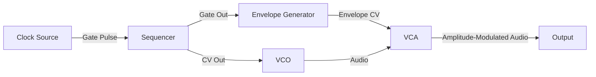
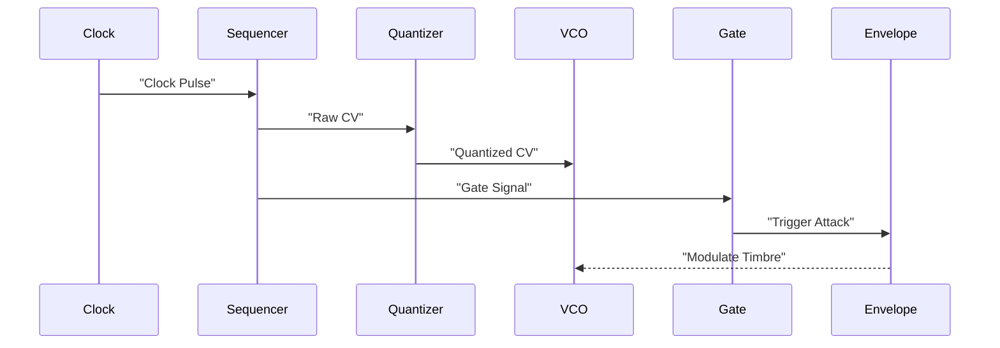

# Lesson 3: CV/Gate Systems, Modular Sequencing Paradigms

## 1. First-Principles Intuition & Invariants

The modular synthesizer represents a fundamentally different computational paradigm from the digital audio workstation or firmware-embedded groovebox. Where a digital sequencer stores MIDI note numbers in addressable memory banks and fires events through interrupt-driven clocks, the analog modular system achieves temporal control through continuous voltage flows across patch cables, treating pitch, rhythm, and timbre as raw electrical quantities. This voltage-centric architecture predates the microprocessor by decades, emerging from the 1960s research studios of Robert Moog, Don Buchla, and the Columbia-Princeton Electronic Music Center, where composers manually patched oscillator control inputs to external DC sources to achieve reproducible melodic sequences.

At the heart of this paradigm lies the control voltage standard, an interface specification that defines how one module's output voltage maps to another module's perceptual parameter space. The dominant convention, established by Moog and later codified across the Eurorack ecosystem, is the **1 volt per octave logarithmic pitch scale**, abbreviated as 1V/Oct. Under this standard, a voltage differential of exactly one volt doubles the output frequency of a voltage-controlled oscillator. A 0V input might produce A3 at 220 Hz, 1V yields A4 at 440 Hz, 2V generates A5 at 880 Hz, and so forth across the audible spectrum. This exponential frequency response mirrors the Western equal-tempered tuning system, where each octave spans a 2:1 frequency ratio subdivided into twelve logarithmically equal semitones. Consequently, each semitone step corresponds to approximately 83.33 millivolts—derived from dividing one volt by twelve—a precision tolerance that directly impacts the tuning stability of analog oscillator cores.

The physical implementation of 1V/Oct tracking depends on the exponential voltage-to-current converter buried inside the oscillator's core circuitry, typically realized through matched transistor pairs or specialized integrated circuits like the CEM3340 (now AS3340 from Alfa), SSM2210, or the modern V2164. These analog computation blocks accept linear voltage inputs and generate exponentially scaled currents that charge timing capacitors, thereby modulating the oscillator's fundamental frequency according to the required logarithmic transfer function. Temperature drift, component aging, and power supply ripple all introduce subtle calibration errors that manifest as pitch instability across octaves, which is why professional modular synthesizers incorporate trimmer potentiometers for per-oscillator scale adjustment. A well-calibrated system maintains octave tracking accuracy within ±5 cents across a five-octave range, but cheaper designs may drift by 10–20 cents in the upper registers, producing audibly sour intervals when multiple oscillators are stacked in unison.

An alternative control voltage standard, historically associated with Yamaha and Korg equipment from the 1970s, is the **Hz/V linear frequency scale**, where voltage directly scales frequency in a proportional one-to-one relationship rather than an exponential mapping. Under Hz/V conventions, a 1V increase raises the oscillator frequency by a fixed amount regardless of the starting pitch, producing equal frequency deltas rather than equal musical intervals. This linear architecture simplifies certain types of FM synthesis cross-modulation and allows for straightforward voltage summation when creating additive harmonic stacks, but it fundamentally breaks compatibility with Western harmonic structures. A melody patched under Hz/V control voltage will sound increasingly compressed as it ascends in pitch, because the perceptual distance between adjacent semitones shrinks while the human cochlea responds logarithmically to frequency. Modern modular systems almost universally adopt 1V/Oct as the interface standard, relegating Hz/V to niche experimental contexts or legacy equipment interfacing.

Parallel to the pitch control voltage runs the **gate signal**, a binary voltage pulse that communicates note onset and duration to envelope generators, VCAs, and other dynamic processors. Gate voltage exists in two discrete states: high and low, typically encoded as +5V for the active state and 0V for the inactive state in most Eurorack modules, though the informal standard defines any voltage above +2.5V as logically high and below +0.8V as logically low. The rising edge of a gate pulse triggers the attack phase of an ADSR envelope, while the falling edge initiates the release phase, creating the amplitude contour that shapes each note's temporal evolution. Unlike MIDI's note-on and note-off message pairs transmitted over serial data lines, the gate signal occupies a dedicated physical cable and remains continuously high for the entire duration of a sustained note, allowing real-time control over legato articulations and envelope retriggering behaviors that would require complex firmware logic in a digital system.

A closely related signal type is the **trigger pulse**, a momentary voltage spike typically lasting 1–10 milliseconds that communicates instantaneous events rather than sustained states. Triggers fire drum modules, advance clock dividers, and reset sequencer playheads to their initial positions, functioning as the modular equivalent of an edge-triggered interrupt in embedded systems. The distinction between gates and triggers centers on duration semantics: a gate's pulse width encodes note length and enables envelope sustain stages, while a trigger's fixed duration simply marks a temporal event boundary without carrying additional timing information. Some modules implement gate-to-trigger conversion through differentiator circuits that detect rising edges and emit calibrated pulses, or trigger-to-gate conversion via sample-and-hold blocks that latch the trigger state until explicitly reset, allowing interoperability between modules that expect different timing signal formats.

Voltage ranges in modular synthesis extend beyond the ±5V control domains into bipolar modulation territory, where audio-rate signals swing across ±8V peaks to drive speakers at line level, and low-frequency oscillators generate slow triangular or sinusoidal sweeps across ±5V to animate filter cutoffs and pulse widths. The distinction between control-rate and audio-rate signals blurs intentionally in modular systems, as any sufficiently fast voltage variation—typically above 20 Hz—becomes audible when patched directly to a speaker output or used to frequency-modulate another oscillator. This voltage universality enables techniques like audio-rate filter modulation, where an oscillator's output directly drives a lowpass gate's control input to produce percussive plucked timbres, or cross-patched envelope feedback, where the output of one envelope generator controls the decay time of another, creating chaotic amplitude trajectories that evolve organically across multiple note cycles.

The mathematical relationship between voltage and frequency in the 1V/Oct standard can be expressed as:

$$f(V) = f_0 \cdot 2^V$$

where $f(V)$ is the output frequency in Hz, $f_0$ is the reference frequency at 0V (commonly tuned to C2 at 65.41 Hz or A3 at 220 Hz), and $V$ is the control voltage in volts. This exponential function directly encodes the equal-tempered scale's frequency ratios into linear voltage increments, allowing straightforward arithmetic operations on pitch space through voltage summation and attenuation.

For example, transposing a melody up by a perfect fifth requires adding a constant offset voltage of $\frac{7}{12}$ volts (approximately 583 mV) to the incoming pitch CV, since a perfect fifth spans seven semitones and each semitone corresponds to $\frac{1}{12}$ volt. Quantizer modules exploit this linear-in-voltage, exponential-in-frequency relationship by rounding arbitrary input voltages to the nearest semitone grid position, snapping microtonal glides or random voltage sources to conventional Western scale degrees. The quantization operation can be modeled as:

$$V_{\text{quantized}} = \frac{1}{12} \left\lfloor 12 \cdot V_{\text{input}} + 0.5 \right\rfloor$$

where the floor function discretizes the continuous input voltage to the nearest 83.33 mV increment, effectively imposing chromatic pitch constraints on any voltage source.

The sequencer occupies a central role in the modular ecosystem, functioning as the primary source of temporal structure and melodic content. Unlike a MIDI sequencer that transmits discrete note events over a serial protocol, the analog hardware sequencer generates continuous voltage staircase waveforms synchronized to an external clock signal. Each step in the sequence corresponds to a voltage level stored in a bank of capacitors or potentiometer settings, and the clock input advances the sequencer's internal state machine to the next step, updating the CV and gate outputs accordingly. The Buchla 252 Polyphonic Rhythm Generator and the Moog 960 Sequential Controller represent canonical implementations of this architecture, using rotary switches and trim pots to define per-step voltages and gate states across 8 to 16 step sequences.

Modern Eurorack sequencers extend this foundation with voltage-controllable step lengths, per-step probability gates, and multiple independent CV output channels, allowing polyphonic sequences or parallel modulation lanes to run in lockstep from a single clock source. The Make Noise René and Intellijel Metropolix exemplify this evolution, incorporating Cartesian grid interfaces where X and Y axes represent melodic contour and rhythmic density, and auxiliary CV inputs dynamically reshape the sequence topology in real time. These modules transform the sequencer from a static pattern generator into a dynamic compositional instrument, where the performer navigates multidimensional state spaces rather than programming linear note lists.

The gate output of a sequencer typically derives from a per-step switch or probability comparator, generating a high pulse whenever the current step is marked active and a low state otherwise. Gate length can be modulated through a dedicated pulse-width control or by layering the gate signal with an envelope follower that tracks the CV output's velocity, creating dynamically accented rhythmic patterns. Some sequencers, like the Doepfer A-155, provide independent gate outputs for each step, allowing rhythmic polyrhythms where the melodic sequence length differs from the percussive pattern length, a technique commonly exploited in generative ambient music and industrial techno.

Clock division and multiplication modules provide the temporal scaffolding for complex polymetric sequences. A clock divider accepts a master clock pulse and emits derivative clocks at integer subdivisions—half-time, quarter-time, eighth-time—while a clock multiplier generates faster derivative clocks at integer multiples. Patching a sequencer to a divided clock while driving a drum module from the undivided clock creates rhythmic counterpoint where the melodic phrase unfolds at a slower cadence than the percussive pulse, establishing the metric tension characteristic of downtempo electronica and dub techno. Modules like the 4MS Rotating Clock Divider extend this concept with voltage-controllable division ratios and rotating output assignments, allowing the temporal grid itself to evolve as a dynamic compositional parameter.

The interaction between sequencer, quantizer, and sample-and-hold modules illustrates the modular synthesizer's strength as a compositional tool for generative music. A typical patch might route a random voltage source through a sample-and-hold module clocked at a slower rate than the main sequence, generating a slowly evolving pitch offset that transposes the entire melodic loop across different tonal centers. Adding a quantizer after the sample-and-hold ensures that these transpositions remain diatonic, constraining the random walk to a predefined scale. The result is a self-varying harmonic progression that drifts through chord changes without human intervention, exhibiting the long-form structural coherence of algorithmic composition while retaining the timbral warmth and timing imperfections of analog circuitry.

Synchronization across multiple sequencers and modulation sources requires a shared clock reference and reset protocol. The clock signal establishes the global tempo, while a reset pulse forces all sequencers to jump back to step one simultaneously, ensuring that polyrhythmic patterns realign at regular metric boundaries. Some systems, like the Roland System-100M, implement a master-slave clock distribution architecture where a single master clock module broadcasts pulses to multiple slave sequencers over a dedicated sync bus, while others rely on external MIDI-to-CV converters or USB-to-CV interfaces to derive clock signals from a digital audio workstation's transport.

## 3. Clock Distribution, Jitter & Transmission Impedance

The bandwidth limitations of analog voltage transmission impose practical constraints on sequencer design. A fast-moving CV staircase waveform excites parasitic capacitance and inductance in patch cables, causing voltage sag and slew-rate limiting that smears sharp transients into rounded glides. Short cables minimize these effects, but patches spanning more than a meter may require buffered distribution amplifiers to maintain signal integrity. Gate signals face similar challenges, as contact bounce in mechanical switches and propagation delays through trigger conversion circuits can introduce timing jitter on the order of microseconds to milliseconds, audibly shifting the phase relationship between rhythmic elements in tightly synchronized polyrhythmic sequences.

Despite these analog imperfections—or perhaps because of them—the CV/gate paradigm remains the dominant interface for modular synthesis in the 2020s, embraced by manufacturers ranging from boutique Eurorack builders to legacy firms like Moog and ARP. The tactile immediacy of patching physical cables, the absence of menu-diving and firmware updates, and the unpredictable emergent behaviors that arise from voltage feedback loops continue to attract composers, sound designers, and electronic musicians seeking alternatives to the deterministic precision of software sequencers. The modular synthesizer endures not as a nostalgic artifact, but as a living creative platform where electrical physics and musical intuition converge in real time.
