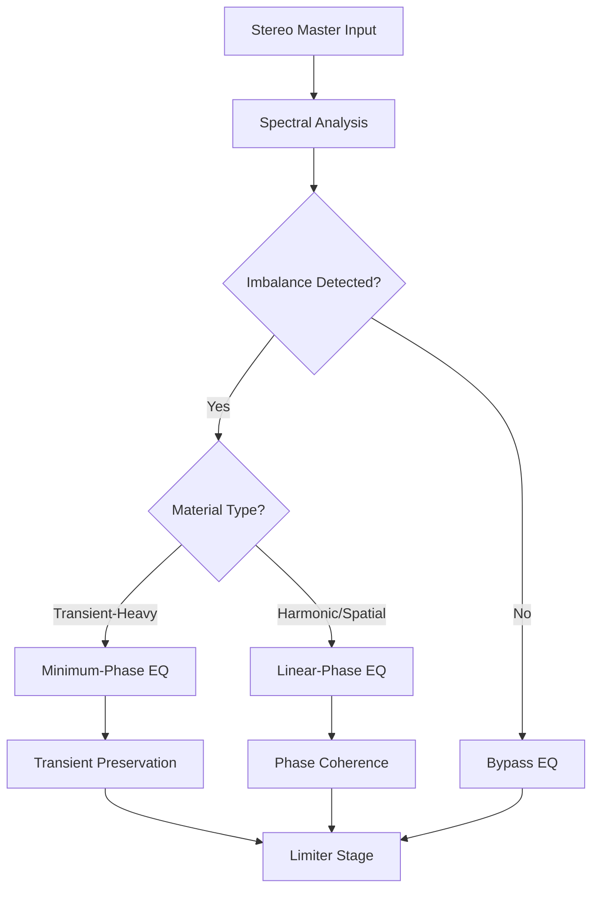

# Lesson 2: Tonal Balance Correction

## 1. First-Principles Intuition & Invariants

Every mastering engineer inherits a mix they did not build, and their first job is diagnostic, not creative. This distinction carries more weight than its simplicity suggests. The entire philosophy of corrective equalization rests on understanding that a mix engineer reaches for an EQ to sculpt a sound into existence: carving a scoop into a guitar to make room for a vocal, pushing air into a synth pad to make it shimmer. These are additive, aesthetic decisions made with full knowledge of every individual track in isolation. A mastering engineer has none of that access. You receive a two-channel stereo bus, already summed, already a fait accompli, and your job is to identify where the frequency balance of that summed signal deviates from a target curve that makes the record competitive and translatable across playback systems. You are not deciding what the song should sound like. You are correcting measured deviation from an implicit or explicit reference. This invariant should govern every EQ move in this lesson: if you cannot articulate what problem a boost or cut is solving, you are mixing, not mastering, and you are in the wrong signal chain stage.

This invariant survives contact with reality for economic and physical reasons, not merely philosophical ones. A mastering EQ move is global. It touches the vocal, the kick, the cymbals, and the bass guitar simultaneously, because they are all now one signal. A one-decibel boost at 3 kHz to brighten a dull vocal will also brighten every cymbal hit and every string pluck that happens to live in that band. Contrast this with a mix engineer's parametric EQ on an isolated vocal track, where a 3 kHz boost touches nothing else. The blast radius of a mastering EQ move is the entire record, so every move must be small, deliberate, and justified by an actual measured or perceived imbalance rather than a stylistic impulse. Professional mastering moves are frequently measured in fractions of a decibel with wide bandwidths, while mix moves can be aggressive and narrow. The invariant of corrective rather than additive processing is really a statement about gain staging risk tolerance under conditions of total signal entanglement.

To correct intelligently you need a reference, and this is where spectral balancing against a target curve enters the picture. The ear is a poor absolute measuring instrument but an excellent comparative one. If you solo a mix and ask whether it is bright enough, you will get an unreliable answer, because perception of brightness drifts with fatigue, with the loudness of your monitors, with the frequency response of the room, and with whatever you listened to five minutes earlier. If instead you A/B against three or four well-mastered commercial records in the same genre, matched for loudness, your ear becomes a null detector: it listens for difference, not absolute quality, and humans are dramatically better at detecting difference than at making absolute judgments. This is the same principle behind A/B differential measurement in analog circuit design, where you null a bridge rather than trying to read an absolute voltage off a noisy scale.

Loudness matching before comparison is not optional. Human hearing exhibits equal-loudness contour behavior described by the Fletcher-Munson and later ISO 226 curves, meaning perceived bass and treble balance shifts with playback level. A track that sounds bass-light at low volume will sound deceptively full at higher volume because the ear's low-frequency sensitivity increases with SPL. If you are not loudness-matching your reference comparisons to within roughly half a dB using an LUFS meter or careful gain trim, you are measuring your monitor's volume knob, not your mix's tonal balance.

The next invariant concerns phase, and it is where engineers coming from a software or systems background will find the most immediate purchase, because it maps directly onto concepts of causality and group delay that exist identically in control theory and in digital filter design. Every equalizer, analog or digital, is a filter, and every filter that alters magnitude response necessarily alters phase response too, with one crucial exception class: linear-phase filters, which are achievable only in the digital domain through non-causal convolution with a symmetric FIR kernel.

A minimum-phase filter, which describes virtually all analog EQ circuits and most "musical" digital EQ emulations, has a causal impulse response: it reacts only to past and present input, which is a physical requirement for anything built from real resistors, capacitors, and op-amps. The cost of this causality is a predictable, frequency-dependent phase shift and group delay that clusters tightly around the frequencies where you are applying gain. Boost at 100 Hz with a minimum-phase bell and you introduce phase rotation and delay concentrated near 100 Hz, decaying as you move away from that center frequency. This phase behavior is not a flaw to be eliminated. It is the same mechanism that gives analog EQ its perceived musicality, because the ear is relatively insensitive to phase distortion in isolation but highly sensitive to the transient smearing that accompanies steep minimum-phase moves, which is why minimum-phase EQs tend to sound more aggressive and alive per decibel of boost than their linear-phase counterparts.

A linear-phase filter sidesteps this entirely by applying identical delay to every frequency, meaning the waveform's relative phase relationships are preserved perfectly, at the structural cost of pre-ringing: energy appearing before a transient in the time domain, a direct and unavoidable consequence of the filter's kernel needing to see into the future, which in an offline render is simply a buffer look-ahead but which nonetheless produces an audible smearing artifact especially on percussive low-end material like kick drums. This gives you the core engineering trade-off of this lesson's first half: minimum-phase EQ preserves transient punch at the cost of introducing phase shift that can thin out summed low end or cause subtle smearing when stacked across multiple corrective bands, while linear-phase EQ preserves time-domain transient integrity and is phase-coherent across the band, at the cost of pre-ringing artifacts that become audible on transient-heavy low-frequency correction.

The invariant to internalize is this: phase linearity is not free. It is a different allocation of the same underlying distortion budget, and the correct choice depends on what in your signal is more perceptually fragile, the transient or the phase relationship. For genre contexts where low-end punch and transient attack define the aesthetic—hip-hop, EDM, metal—minimum-phase processing typically wins because the phase rotation is perceptually secondary to maintaining the impact of the initial transient. For material where harmonic clarity and stereo imaging precision matter more than percussive impact—orchestral recordings, jazz, ambient—linear-phase processing becomes the default because preserving phase relationships across the stereo field and across overlapping frequency bands is perceptually dominant.

The transfer function of a minimum-phase bell filter centered at frequency $f_0$ with gain $G$ and quality factor $Q$ can be expressed as:

$$H(s) = \frac{s^2 + \frac{G \cdot \omega_0}{Q} s + \omega_0^2}{s^2 + \frac{\omega_0}{Q} s + \omega_0^2}$$

where $\omega_0 = 2\pi f_0$ and $s$ is the complex frequency variable. This second-order IIR structure is causal by construction, meaning its impulse response is zero for $t < 0$. The phase response $\phi(\omega)$ is then deterministically coupled to the magnitude response $|H(\omega)|$ through the Hilbert transform relationship that defines minimum-phase systems. You cannot independently specify magnitude and phase; altering one forces a corresponding change in the other.

Linear-phase FIR filters break this coupling by using a symmetric impulse response of length $N$:

$$h[n] = h[N - 1 - n]$$

This symmetry forces the phase response to be exactly linear: $\phi(\omega) = -\omega \tau$, where $\tau$ is the group delay, which is constant across all frequencies. The cost is that the impulse response must be centered at $n = \frac{N-1}{2}$, meaning the filter responds to input samples that have not yet arrived, producing the characteristic pre-ringing artifact. The group delay is $\tau = \frac{N-1}{2}$ samples, which at 96 kHz with a typical mastering EQ FIR length of 8192 taps translates to approximately 42.6 ms of latency. This is imperceptible in playback but becomes a workflow issue in real-time monitoring during tracking or mixing.

## 2. Core Architecture & Mechanics

The minimum-phase versus linear-phase decision tree functions as an actual signal flow architecture, not merely an abstract filter design choice. Reasoning about it in isolation misses the practical reality of where these artifacts live in your session and how they interact with downstream processing.

Start with spectral analysis using a high-resolution FFT analyzer with at least 8192 points and a window overlap of 75% or greater. The goal is not to stare at the spectrum and look for bumps—every mix has bumps, because every mix has instruments, and instruments have formants and resonances—but rather to compare the long-term averaged spectrum of your mix against reference tracks. Use a pink noise reference as a rough sanity check: pink noise has equal energy per octave, so its spectrum falls at -3 dB per octave when viewed on a linear frequency axis. A well-balanced mix in most contemporary genres will roughly follow this slope in the midrange, deviating in the low end depending on genre conventions (more energy below 100 Hz in electronic and hip-hop, less in acoustic and jazz) and in the high end depending on the presence of cymbals and air.

Load your mix and three reference tracks into your DAW. Insert a gain trim plugin on the reference tracks and adjust until the integrated LUFS measurement matches your mix within ±0.5 dB. Disable all processing on your master bus temporarily. Solo your mix and take a snapshot of its long-term averaged spectrum over a representative 30-second section that includes all major elements. Do the same for each reference. Overlay the spectra and look for systematic deviation, not individual peaks. A 2-3 dB deficit across the 2-5 kHz range relative to all three references suggests a mix that will sound dull or distant. A 4-5 dB excess across 200-400 Hz relative to references suggests muddiness or boxiness. These are the imbalances you correct.

Insert your corrective EQ as the first plugin in the mastering chain, before any compression or limiting. This ordering is critical. Compression and limiting respond to peak and RMS levels, so if you EQ after them, you are effectively changing the tonal balance of an already gain-reduced signal, which can produce unpredictable results and often necessitates re-tweaking the compressor's threshold and ratio. EQ first, then compress, then limit. This is the standard signal flow for good reason: you want your dynamics processors to respond to the tonally corrected signal, not to a signal you are going to alter afterward.

For the minimum-phase case, reach for a parametric EQ with bell and shelf filters. Most professional options—FabFilter Pro-Q 3, Kirchhoff EQ, Weiss EQ1—offer both modes, but when in minimum-phase mode, they are emulating the same basic second-order analog prototypes: Baxandall shelves, constant-Q or proportional-Q bells, and sometimes Pultec-style passive EQ curves. The Baxandall shelf is particularly elegant because it was designed in the 1950s by Peter Baxandall specifically to have minimal phase shift away from the corner frequency, making it gentler than a simple first-order high-pass or low-pass filter. Its transfer function for a low-shelf boost is:

$$H(s) = \frac{s^2 + \frac{\omega_0}{\sqrt{G}} s + G \omega_0^2}{s^2 + \sqrt{G} \omega_0 s + \omega_0^2}$$

where $G$ is the linear gain factor and $\omega_0$ is the corner frequency. The key insight is that the poles and zeros are placed symmetrically in the s-plane but scaled by $\sqrt{G}$, which gives the filter its smooth, musical transition. At frequencies far above $\omega_0$, the filter's response flattens to unity gain with minimal phase deviation. At frequencies far below $\omega_0$, the response flattens to $G$ with again minimal phase deviation. The phase shift is concentrated in the transition band, which is musically desirable because it means the rest of the spectrum remains largely untouched.

Begin with broad, gentle moves. If your mix is 2 dB down in the 3-5 kHz presence range relative to references, do not reach for a narrow bell with high Q and slam in 2 dB. Instead, use a wide bell, Q of 0.7 or lower, and apply 1-1.5 dB of boost centered around 4 kHz. Listen in context with the full mix playing, not soloed. Toggle the EQ in and out using the plugin's bypass. The corrected version should sound more present and forward without sounding obviously brighter. If you can hear that you just boosted 4 kHz—if the change sounds like an effect rather than a rebalancing—you have gone too far or too narrow. Pull back the gain or widen the Q.

For low-end correction, the same principle applies but with additional caution because phase shift accumulates more aggressively in the bass region due to the longer wavelengths involved. A 40 Hz sine wave has a wavelength of 8.6 meters at the speed of sound in air. A 90-degree phase shift at 40 Hz corresponds to a group delay of 6.25 ms, which is audible as a time smear when combined with other low-frequency elements. If your mix is bass-light relative to references, apply a low-shelf boost at 80-100 Hz with a gain of 0.5-1 dB rather than a narrow bell at 60 Hz with 2 dB. The shelf distributes the energy more naturally across the bass region and introduces less phase rotation because the filter's pole is lower in frequency and further from the region where most musical low-end energy concentrates.

When correcting harshness in the 2-8 kHz range, cuts are generally safer than boosts because harshness is often the result of resonances or poorly controlled room reflections during mixing, and cutting a resonance is more effective than trying to boost around it. Use a medium-Q bell, around 1.5-2.0, centered on the offensive frequency, and cut by 1-2 dB. Sweep the frequency control slowly while the mix plays to locate the exact center of the harshness. You will know you have found it when the cut provides immediate relief without making the mix sound dull. If a 2 dB cut makes the mix sound muffled, you are cutting too wide or in the wrong spot.

For the linear-phase case, the workflow changes because you are no longer working with second-order IIR filters but with FIR filters whose impulse responses can be thousands of samples long. The benefit is that every frequency component of your signal passes through the filter with identical group delay, so there is no relative phase shift between, say, the fundamental of a bass note at 80 Hz and its second harmonic at 160 Hz. This phase coherence is perceptually significant in material where harmonic relationships define the timbre—acoustic instruments, vocals, string sections—because any phase rotation between harmonics alters the waveform's shape in a way that the ear can detect as a timbral shift even if the magnitude spectrum remains correct.

The cost is pre-ringing. When you apply a +2 dB boost at 100 Hz with a linear-phase bell, the filter's impulse response is symmetric around its center tap, meaning half of the response occurs before the input impulse. In the frequency domain, this is irrelevant; the filter is doing exactly what you asked for. In the time domain, however, this manifests as low-frequency energy appearing several milliseconds before a kick drum or bass note actually hits. For sustained bass tones or harmonic content, this is inaudible. For sharp transients, especially percussive low-end hits, it is audible as a softening or smearing of the attack.

The solution is to use linear-phase EQ selectively. Apply it when correcting midrange and high-frequency imbalances, especially in the 500 Hz to 5 kHz range where phase coherence matters for vocal intelligibility and where pre-ringing is far less audible due to the ear's reduced temporal resolution at higher frequencies. For low-end correction below 150 Hz on transient-heavy material, either use minimum-phase EQ or apply linear-phase EQ with smaller gain adjustments and verify by zooming into the waveform and checking whether the kick drum's initial transient has been smeared. If it has, reduce the gain or switch to minimum-phase for that band only. Many modern mastering EQs allow you to set the phase mode per band, which is the correct architectural approach: linear-phase in the mids and highs, minimum-phase in the lows.

The pre-ringing artifact can be visualized by examining the impulse response of a linear-phase FIR filter. For a filter with $N$ taps, the impulse response is centered at sample $n = \frac{N-1}{2}$. When you apply this filter to a signal, the output at time $t$ depends on input samples from $t - \frac{N-1}{2}$ to $t + \frac{N-1}{2}$. The samples from the future introduce the pre-ringing. The magnitude of the pre-ring scales with the sharpness of the filter's magnitude response transition. A steep, narrow boost or cut generates more pronounced pre-ringing than a gentle, wide adjustment, which is another reason to favor broad, shallow moves in mastering regardless of phase mode.

Dynamic EQ represents a hybrid approach that can mitigate some of the limitations of both static minimum-phase and linear-phase EQ. A dynamic EQ applies gain only when the signal in a specified frequency band exceeds or falls below a threshold, effectively making it a multiband compressor with per-band EQ characteristics. For mastering, dynamic EQ is particularly useful for addressing intermittent problems that do not warrant a static correction. For example, if a mix has occasional harsh cymbal splashes in the 6-8 kHz range but is otherwise well-balanced, a static cut would dull the entire mix. A dynamic EQ configured to reduce gain in the 6-8 kHz band only when that region exceeds a threshold provides surgical correction without global compromise.

The attack and release times of a dynamic EQ band are critical. For mastering, you typically want fast attack times—1-10 ms—to catch transient excesses immediately, and moderate release times—50-200 ms—to allow the gain reduction to decay smoothly without pumping. The threshold should be set so that the EQ engages only on the problematic peaks, not on the average signal level. This requires careful listening and threshold adjustment while the full mix plays. A good starting point is to set the threshold so that the gain reduction meter shows activity on the peaks you want to tame but remains at zero most of the time.

Mid-side EQ extends the tonal balance correction into the spatial domain by allowing independent EQ of the center (mid) and sides channels. The mid channel is derived as $M = \frac{L + R}{2}$ and the sides channel as $S = \frac{L - R}{2}$, where $L$ and $R$ are the left and right channels. After processing, the stereo image is reconstructed as $L = M + S$ and $R = M - S$. This encoding and decoding is lossless and phase-coherent when done correctly, and it provides powerful corrective tools for mixes with tonal imbalances that vary between center and stereo content.

For example, if a mix has a vocal and bass guitar panned center and is well-balanced in the mid channel but has overly bright stereo reverb and synth pads in the sides, a static stereo EQ correction will either under-correct the sides or over-darken the mid. A mid-side EQ allows you to leave the mid channel untouched and apply a high-frequency shelf cut only to the sides, darkening the reverb and pads without affecting the vocal or bass. Conversely, if a mix has a dull, muddy low end concentrated in the center channel—common in mixes with mono kick and bass—you can apply a low-shelf cut to the mid channel only, cleaning up the low end without thinning out any low-frequency stereo information that may exist in pads or room ambience.

Mid-side EQ must be applied with restraint because excessive mid-side imbalance can cause the stereo image to collapse or sound phasey on mono playback. A good rule is to keep mid-side gain differentials within 2-3 dB. If you find yourself needing a 5 dB cut in the sides at 4 kHz to fix harshness, the problem is likely in the mix itself and should be addressed there rather than forced into compliance at the mastering stage.

The workflow for mid-side EQ correction begins with the same spectral analysis used for stereo EQ, but now you analyze the mid and sides channels separately. Most DAWs and mastering EQ plugins offer mid-side metering and visualization. Load your mix, switch your analyzer to mid-side mode, and compare the mid and sides spectra against your reference tracks' mid and sides spectra. Look for deviations that are specific to one channel. If the mid channel is 3 dB down at 3 kHz relative to the reference mid but the sides channel matches, apply a mid-only boost at 3 kHz. If both mid and sides are down, use stereo EQ instead.

Finally, verify all tonal balance corrections on multiple playback systems. Mastering room acoustics are typically more controlled than mixing rooms, but no room is perfect, and no pair of monitors is perfectly flat. After completing your EQ chain, render a test master and play it on studio monitors, on consumer headphones, on a car stereo, and on a laptop or phone speaker. The mix should maintain intelligibility and relative balance across all systems. If the bass disappears on small speakers but sounds fine in the studio, you may have over-corrected the low end. If the mix sounds harsh on headphones but smooth on monitors, you may have under-corrected a 3-5 kHz resonance that your monitors are masking due to a room null. Iterate based on this multi-system feedback until the balance holds across playback environments. This is the final invariant of tonal balance correction: the goal is not to make the mix sound perfect on your monitors but to make it sound balanced everywhere.
