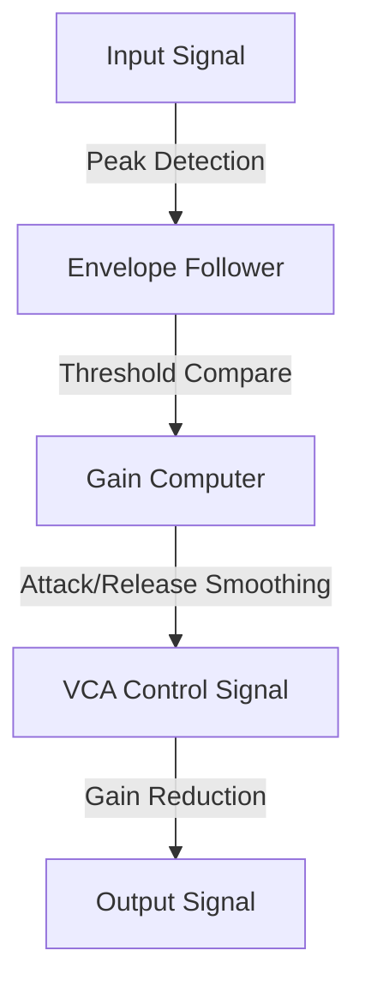

# Lesson 3: Dynamics Glue Compression

## 1. First-Principles Intuition & Invariants

Compression in mastering serves a fundamentally different function than its more aggressive tracking and mixing counterparts. Where individual channel compression sculpts discrete sonic events—the snap of a snare, the attack envelope of a bass guitar pluck—mastering compression operates on the emergent statistical aggregate of an entire stereo mix. The goal is not reduction of peak-to-average ratio for headroom recovery, though that occurs as a side effect, but rather the creation of what audio engineers call "glue": a perceptual binding that makes hundreds of independent sound sources cohere into a unified, dimensionally consistent sonic image.

The physical mechanism underlying compression is deceptively simple. A voltage-controlled amplifier sits in the signal path, its gain coefficient modulated by a sidechain detector that measures the instantaneous or RMS energy of the incoming waveform. When this energy exceeds a threshold voltage, the gain reduction circuit activates according to a ratio parameter that defines the proportional attenuation. A 4:1 ratio means that for every 4 dB the input signal rises above threshold, the output increases by only 1 dB, effectively compressing the dynamic envelope. This feedback loop operates in continuous time, with attack and release time constants governing the detector's response to energy transients.

The critical insight for mastering engineers is that compression fundamentally redistributes energy across time. Consider a sparse orchestral arrangement with isolated timpani strikes punctuating sustained string sections. Without compression, the peak energy of each timpani impact defines the maximum safe playback level before digital clipping, forcing the sustained strings to sit at comparatively low energy to preserve headroom. Compression allows us to attenuate those transient peaks while leaving the lower-energy sustained material untouched, then apply makeup gain to raise the entire program. The result is a denser, more forward presentation where the strings occupy more of the available dynamic window.

This energy redistribution comes with profound perceptual consequences. Human auditory perception integrates energy over roughly 200-millisecond windows, a phenomenon known as temporal integration. When compression reduces the variance of energy across these integration windows, the auditory system perceives increased average loudness even when peak levels remain identical. This is why heavily compressed modern pop masters sound subjectively "louder" than dynamic classical recordings at the same peak normalization—the compressed material sustains higher energy across each perceptual integration window.

The mastering compression chain must preserve three invariants to avoid degrading the mix's original artistic intent. First, transient integrity: percussive attacks and consonant onsets contain critical perceptual information about articulation and rhythm. Compression with insufficiently fast attack times will allow these transients through unattenuated, defeating the loudness goal, while excessively fast attack times will dull the mix's rhythmic impact. Second, spectral balance: broadband compression operating on a full-spectrum sidechain can allow dominant low-frequency energy to trigger gain reduction that inappropriately attenuates midrange and high-frequency content, a phenomenon called "pumping" when the low end rhythmically modulates the entire mix. Third, stereo field coherence: stereo-linked compression must apply identical gain reduction to both channels to prevent image shifting, yet must also handle stereo width variation gracefully to avoid collapsing wide mixes during loud passages.

## 2. Attack and Release: Temporal Response Envelopes

The attack and release time constants define the compressor's temporal response envelope and fundamentally determine its sonic character. Attack time specifies how quickly the gain reduction circuit responds to energy exceeding threshold. In discrete-time digital implementations, this is typically implemented as a one-pole lowpass filter applied to the detected envelope, with the attack time constant $\tau_{\text{attack}}$ determining the filter's cutoff frequency. A 1-millisecond attack time means the detector reaches approximately 63% of its final value within 1 millisecond of a step change in input energy—the classic RC circuit time constant translated to the digital domain.

Release time governs how quickly gain reduction dissipates after the input energy falls below threshold. This parameter interacts critically with the music's rhythmic structure. A release time shorter than the interval between rhythmic events will cause the gain reduction to fully recover between beats, creating a choppy, disconnected feel. A release time longer than several rhythmic periods will cause gain reduction to accumulate across multiple events, potentially over-compressing sustained passages. The optimal release time typically sits in a narrow window around the music's fundamental pulse period—roughly 150-300 milliseconds for 120-140 BPM material—allowing the compressor to "breathe" with the rhythm while maintaining cohesion.

Modern mastering compressors often implement program-dependent release algorithms that analyze the input signal's rhythmic structure in real-time and adjust the release coefficient dynamically. These algorithms typically employ multiple parallel detectors with different time constants, selecting the appropriate release value based on the intervals between detected transient events. This adaptive approach prevents the pathological cases that plague fixed release settings: too fast for sparse material, too slow for dense material.

The relationship between attack time and transient preservation can be quantified through the detector's step response. For a one-pole detector with time constant $\tau$, the response to a step input at time $t = 0$ is:

$$y(t) = 1 - e^{-t/\tau}$$

This means a 1 ms attack time reaches 63% of final value at 1 ms, 86% at 2 ms, and 95% at 3 ms. For percussive transients with durations on the order of 5-10 ms, attack times below 1 ms will significantly attenuate the initial impact, while times above 10 ms will let the entire transient through unprocessed. The mastering sweet spot typically falls between 3-10 ms, allowing just enough of the attack envelope through to preserve articulation while catching the sustained portion for level control.

## 3. Ratio and Knee: Shaping the Compression Curve

The ratio parameter defines the compression curve's slope above threshold and determines the compressor's transparency. Ratios between 1.5:1 and 3:1 are considered gentle enough for mastering applications, providing subtle dynamic control without obvious pumping artifacts. Higher ratios sacrifice transparency for greater loudness potential—useful for pop and electronic genres where dense, forward presentation is desired—while lower ratios below 1.5:1 enter the domain of "parallel compression," a distinct architectural approach where compressed and uncompressed signals blend in parallel rather than series.

The mathematical relationship between input level $x$ (in dB above threshold) and output level $y$ for a hard-knee compressor with ratio $R$ is:

$$y = \begin{cases} 
x & \text{if } x < 0 \\
\frac{x}{R} & \text{if } x \geq 0
\end{cases}$$

where $x = 0$ corresponds to the threshold. A 2:1 ratio means that 6 dB of input signal above threshold produces 3 dB of output, a 4:1 ratio produces 1.5 dB, and so forth. The gain reduction $\text{GR}$ in dB is:

$$\text{GR}(x) = x - \frac{x}{R} = x\left(1 - \frac{1}{R}\right)$$

This linear relationship reveals why ratio selection matters so profoundly: doubling the input overshoot with a 2:1 ratio doubles the gain reduction (from 3 dB to 6 dB), while with a 10:1 ratio it increases tenfold (from 0.9 dB to 9 dB). High ratios create strongly nonlinear responses that can sound abrupt and unmusical on complex program material.

Knee width parameterizes the transition region around the threshold voltage where the compressor transitions from unity gain to full ratio compression. A hard knee implements an abrupt transition—a literal conditional branch in the gain computation—while a soft knee interpolates smoothly across a voltage range typically spanning 6-12 dB. The soft knee approach reduces distortion artifacts by avoiding the discontinuous derivative that a hard knee introduces at the threshold boundary. Most mastering engineers prefer soft knee settings because they provide gentler, more musical compression that integrates smoothly with the program material's natural dynamic contours.

A typical soft knee implementation uses a quadratic interpolation in the transition region. For a knee width $W$ (in dB), the transition zone spans from $(T - W/2)$ to $(T + W/2)$ where $T$ is the threshold. Within this region, the compression curve smoothly transitions from unity gain to the target ratio. One common formulation uses:

$$y = x + \frac{(1/R - 1)(x - T + W/2)^2}{2W}$$

for $T - W/2 \leq x \leq T + W/2$. This creates a parabolic blend that matches the slopes at both boundaries, ensuring $C^1$ continuity—smooth first derivatives—across the entire compression characteristic.

The choice between hard and soft knee is not merely aesthetic. Hard knee compression introduces harmonic distortion at the threshold crossing point because the instantaneous slope discontinuity acts as a time-varying nonlinearity. When the input signal hovers near threshold—as it often does with dynamic program material—this creates intermodulation products that manifest as a subtle grit or harshness. Soft knee compression avoids this artifact by ensuring the compression characteristic remains continuously differentiable, preserving the spectral integrity of the original mix while still achieving the desired dynamic control.
