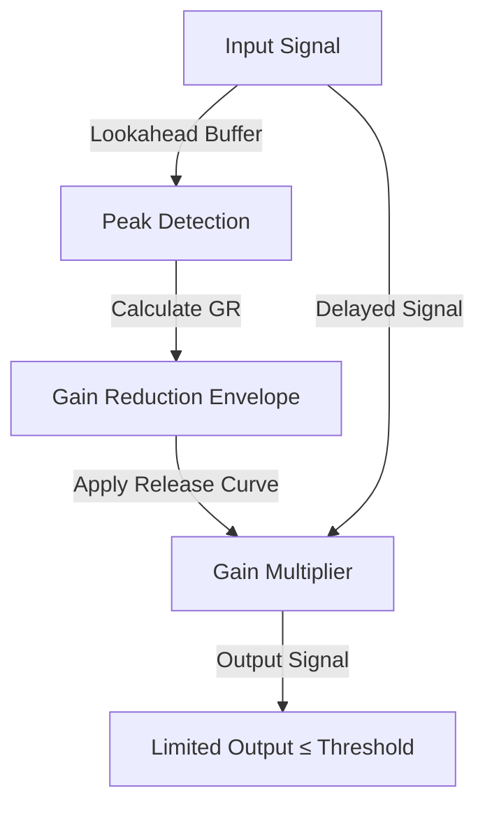
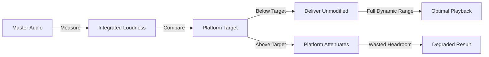

# Lesson 4: Limiting and Loudness Delivery Standards

## First-Principles Intuition and Invariants

The final stage of audio mastering confronts a fundamental physical constraint that has shaped the recorded music industry for over a century: the maximum representable amplitude in any delivery medium is finite. Whether encoding to a vinyl lacquer groove that cannot exceed a physical displacement threshold without skipping, broadcasting through a transmitter with peak power regulations, or quantizing to a 16-bit integer space where +32,767 represents absolute digital full scale, every format imposes a hard ceiling. The brickwall limiter emerged as the algorithmic solution to this constraint, transforming the master engineer's task from merely preventing clipping into a sophisticated negotiation between loudness maximization, transient preservation, and perceptual transparency.

At its core, a brickwall limiter functions as a nonlinear dynamic range compressor with an infinite ratio operating at a precise threshold, typically set between –0.3 dBFS and –0.1 dBFS to provide intersample peak headroom. Unlike traditional compressors that gradually reduce gain as signal level increases, the limiter enforces an absolute ceiling through instantaneous or near-instantaneous gain reduction. The invariant principle is strict: no sample may exceed the threshold under any circumstance, including the analog reconstruction filter's continuous-time interpolation between discrete samples. This requirement immediately reveals the limiter's central architectural challenge—a naive sample-by-sample clipper operating at the Nyquist sampling rate cannot anticipate intersample peaks, those transient excursions in the reconstructed analog waveform that occur between discrete sample points and routinely exceed the digital sample magnitudes by 2 to 4 dB in program material rich with sharp transients.

The solution space bifurcates into two fundamental approaches. The first, time-domain lookahead buffering, delays the output signal by a fixed latency window while analyzing future input samples to detect incoming peaks before they arrive at the threshold. The second, frequency-domain oversampling, upsamples the input signal by a factor of two, four, or eight times the native sample rate, thereby revealing intersample peaks as actual discrete samples in the higher-rate domain where they can be directly attenuated. Both techniques impose computational costs and introduce subtle artifacts, and the mastering engineer's choice between them reflects a deeper understanding of the program material's spectral and temporal characteristics.

## Lookahead Limiting and Release Time Constants

The lookahead buffer establishes a causal prediction window, typically ranging from 0.5 milliseconds to 5 milliseconds depending on program material and desired transparency. During this interval, the limiter scans forward to detect the highest peak magnitude, calculates the required gain reduction to bring that peak precisely to the threshold, and applies the attenuation to the current output sample using a shaped release envelope. The release time constant governs how quickly gain reduction dissipates after the peak passes, and this parameter becomes the primary tool for balancing transient punch against pumping artifacts.

Fast release times, on the order of 10 to 50 milliseconds, restore gain rapidly to preserve dynamic articulation but risk audible modulation distortion when dense transients arrive in rapid succession. The gain reduction envelope effectively amplitude-modulates the program material at rates approaching 20 Hz to 100 Hz, frequencies where the human auditory system exhibits high sensitivity to fluctuation. Slow release times, extending to 200 milliseconds or beyond, produce smoother gain reduction envelopes but can crush micro-dynamics and induce a sustained loudness compression that fatigues the listener. The mastering engineer navigates this tradeoff by adjusting release behavior based on program content density—sparse material with isolated transients tolerates faster release, while dense mixes with continuous high-frequency energy demand longer integration windows to avoid excessive gain modulation.

The gain reduction calculation itself follows a logarithmic domain operation to preserve perceptual linearity. Given a detected peak magnitude $P$ in linear amplitude and a threshold $T$, the required gain reduction in decibels is:

$$\text{GR}_{\text{dB}} = 20 \log_{10}\left(\frac{T}{P}\right)$$

This value is converted back to linear domain as a multiplicative factor $g = 10^{\text{GR}_{\text{dB}}/20}$ and applied to the delayed signal path. The release envelope shapes this gain reduction over time using an exponential decay characterized by the time constant $\tau$:

$$g(t) = 1 - (1 - g_{\text{min}}) \cdot e^{-t/\tau}$$

where $g_{\text{min}}$ represents the maximum gain reduction at the peak instant and $t$ measures elapsed time since the peak.

## Intersample Peak Detection and True Peak Limiting

The intersample peak detection problem demands particular attention because digital audio workstations and plugin hosts process discrete sample sequences while analog playback systems and human auditory systems respond to continuous-time waveforms. A digital sine wave at 18 kHz sampled at 44.1 kHz produces only 2.45 samples per cycle, and the analog reconstruction filter interpolates between these samples using sinc function kernels that can constructively interfere to create peaks substantially higher than any individual sample. Industry convention establishes True Peak limiting as the standard, requiring limiters to detect and prevent peaks in the reconstructed analog domain rather than merely clamping digital sample values.

The ITU-R BS.1770-4 specification codifies True Peak measurement using 4× oversampling with precise finite impulse response filter coefficients that approximate the continuous-time reconstruction performed by high-quality digital-to-analog converters. Compliant limiters must implement equivalent detection to prevent downstream clipping in consumer playback chains. The oversampling process inserts three zero-valued samples between each original sample, then applies a lowpass interpolation filter with stopband attenuation exceeding 100 dB to reconstruct intermediate sample values. Peak detection then operates on this 4× upsampled signal, revealing intersample peaks as actual discrete maxima.

The mathematical foundation rests on the Nyquist-Shannon sampling theorem, which guarantees that a bandlimited signal sampled above twice its highest frequency component can be perfectly reconstructed using sinc interpolation:

$$x(t) = \sum_{n=-\infty}^{\infty} x[n] \cdot \text{sinc}\left(\frac{t - nT}{T}\right)$$

where $x[n]$ represents the discrete sample sequence, $T$ denotes the sampling interval, and $\text{sinc}(x) = \sin(\pi x) / (\pi x)$. The reconstructed continuous-time signal $x(t)$ can exhibit peaks between sample points when high-frequency content near the Nyquist limit combines with appropriate phase relationships. A conservative True Peak limiter must account for worst-case intersample peak overshoot, which can reach +3.01 dB for a full-scale sine wave at the Nyquist frequency, though typical program material exhibits +1.5 to +2.5 dB overshoot on transient percussive content.

## The Loudness War and Its Resolution

The loudness war, that decades-long escalation in average perceived loudness across commercial releases, fundamentally altered mastering practice and forced the development of increasingly sophisticated limiting algorithms. The phenomenon began in earnest during the 1990s compact disc era when engineers discovered that increasing average RMS level through aggressive limiting could make tracks sound subjectively louder on radio and retail playback systems. The psychoacoustic basis for this effect derives from the human auditory system's sensitivity to sustained energy rather than instantaneous peaks—a dense, heavily limited waveform delivers more acoustic power to the cochlea over time than a dynamic waveform with identical peak level but lower average energy.

This discovery triggered an arms race where each year's releases pushed harder against the digital ceiling, sacrificing transient peaks and dynamic range to achieve higher average energy density. Mastering engineers found themselves caught in a prisoner's dilemma: producing a dynamically natural master risked the client's music sounding quiet and weak when played alongside contemporary releases, but aggressive limiting degraded sound quality and induced listening fatigue. By the mid-2000s, popular music releases routinely measured –8 LUFS integrated loudness with crest factors below 6 dB, compressing orchestral swells and drum transients into dense, fatiguing walls of sound. The Red Hot Chili Peppers' "Californication" (1999) and Metallica's "Death Magnetic" (2008) became emblematic casualties, with fans petitioning for remastered versions that restored dynamic range.

The inevitable backlash arrived with streaming platform normalization in the 2010s, fundamentally resetting the economic incentives that had driven the escalation. Streaming services introduced standardized loudness normalization to create consistent playback levels across diverse catalogs, simultaneously removing the competitive advantage of hypercompressed masters and establishing platform-specific target loudness levels. Spotify, Apple Music, YouTube, and Tidal each implemented measurement systems based on the ITU-R BS.1770 standard that analyze uploaded content and apply per-track gain adjustment during playback.

Critically, these platforms do not apply gain increase to quiet content—they only attenuate loud content to match the target level. This asymmetric normalization behavior establishes a new mastering strategy: content mastered below the platform target retains its full dynamic range and peaks, while content exceeding the target suffers both the original limiting distortion and subsequent digital attenuation that wastes headroom. The optimal approach masters to integrated loudness levels within 1 LU of the platform target while preserving maximum transient definition, effectively inverting the loudness war methodology. A master delivered at –14 LUFS for Spotify or –16 LUFS for Apple Music can maintain 12 to 15 dB of crest factor, preserving drum attack transients and orchestral dynamics that would have been obliterated in a –8 LUFS hypercompressed master.

## LUFS Measurement and Psychoacoustic Weighting

The Loudness Units Full Scale (LUFS) measurement standard, defined in ITU-R BS.1770-4 and adopted by the European Broadcasting Union as EBU R128, represents a psychoacoustic integration that correlates more accurately with perceived loudness than simple RMS or peak measurements. The algorithm applies a two-stage filtering process that models the frequency-dependent sensitivity of human hearing, followed by temporal integration to compute sustained loudness over the program duration.

The first stage implements a "K-weighting" filter comprising two cascaded components. A high-frequency shelving filter with +4 dB gain above 2 kHz accounts for the ear's increased sensitivity to presence-range frequencies, while a highpass filter rolling off below 100 Hz at 12 dB per octave models the reduced audibility of subsonic and low-frequency content at moderate listening levels. The combined frequency response approximates the inverse of equal-loudness contours derived from psychoacoustic research. The filtered signal then passes through a mean-square calculation computed over a 400 millisecond sliding rectangular window, converted to logarithmic domain to yield instantaneous loudness in LUFS.

The integrated loudness measurement further processes these instantaneous values using gating logic to exclude silence and very quiet passages that should not contribute to overall loudness perception. An absolute gate at –70 LUFS eliminates digital silence, while a relative gate at –10 LU below the ungated integrated loudness excludes quiet sections that fall more than 10 LU below the program's average level. This gating mechanism prevents sparse classical music with extended silent passages from being measured as artificially quiet, while ensuring pop and rock productions with minimal dynamic contrast receive appropriate loudness estimates.

For multichannel audio, the ITU-R BS.1770-4 specification defines channel weighting factors that account for listener distance and angular positioning. In a standard 5.1 surround configuration, left and right channels receive unity weighting, center channel receives +1.5 dB, and left surround and right surround channels receive +1.5 dB, reflecting the reduced loudness contribution of rear channels in typical home theater geometry. The subwoofer channel (LFE) is excluded from loudness measurement entirely, as its content consists of narrow-band low-frequency effects rather than full-range program material.

The mathematical formulation for integrated loudness begins with the K-weighted mean-square power for channel $i$ at time block $j$:

$$z_{i,j} = \frac{1}{T} \sum_{k} w_i \cdot x_i^2[k]$$

where $T$ represents the 400 ms integration window, $w_i$ denotes the channel weighting factor, and $x_i[k]$ is the K-weighted sample sequence. The multi-channel instantaneous loudness follows:

$$l_j = -0.691 + 10 \log_{10}\left(\sum_{i} z_{i,j}\right) \text{ LUFS}$$

Integrated loudness $L_{\text{integrated}}$ applies the absolute and relative gating thresholds to compute the mean loudness across all ungated blocks. This measurement forms the basis for streaming platform normalization and broadcast loudness compliance.

## Platform-Specific Delivery Targets

Each major streaming platform and broadcast standard specifies target loudness levels, headroom requirements, and True Peak limitations that define the optimal mastering strategy. Understanding these requirements allows engineers to deliver masters that translate consistently across playback environments without unnecessary dynamic range sacrifice.

**Spotify** normalizes to –14 LUFS integrated loudness with three selectable normalization modes: Loud (off), Normal (–14 LUFS target), and Quiet (–23 LUFS target for background listening). The platform applies up to +6 dB of gain increase for content quieter than target but never exceeds 0 dBTP, hard-limiting any transients that would clip after gain adjustment. Masters delivered at –14 LUFS with –1 dBTP True Peak ceiling arrive at playback unmodified in Normal mode, preserving the engineer's artistic intent. Overcompressed masters at –8 LUFS suffer 6 dB of attenuation, effectively wasting the original limiting effort and degrading the already compromised dynamics.

**Apple Music** (formerly iTunes) normalizes to –16 LUFS integrated with Sound Check enabled, applying identical gain adjustment logic to Spotify but with a more conservative target that preserves additional dynamic range. The platform's lossless codec support (ALAC) and high-resolution audio delivery make transient preservation particularly valuable, as audiophile listeners using quality playback systems can perceive limiting artifacts that remain masked on consumer earbuds. Apple recommends –16 LUFS integrated with –1 dBTP True Peak maximum, though the platform accepts any file meeting basic technical specifications.

**YouTube** normalizes to –14 LUFS integrated for music content, with –13 LUFS target for general video content. The platform's widespread use across diverse playback devices—from smartphone speakers to studio monitors—makes consistent loudness particularly important for content creator retention. Unlike audio-focused streaming services, YouTube applies normalization even when content falls significantly below target, using soft-knee limiting to prevent excessive gain increase from introducing clipping. Masters optimized for YouTube benefit from slightly higher integrated loudness (–13 to –14 LUFS) to minimize platform-side processing.

**Broadcast standards** diverge significantly from streaming practice due to regulatory requirements and technical legacy. The European Broadcasting Union's EBU R128 specification mandates –23 LUFS integrated loudness for television and radio broadcast across member states, with permitted deviation of ±1 LU and maximum True Peak of –1 dBTP. This conservative target accommodates the wide dynamic range of film soundtracks, sporting events, and classical music broadcasts while preventing viewer annoyance from volume jumps between programs. The American ATSC A/85 standard for digital television recommends –24 LUFS (equivalent to –85 dB LKFS with DC offset), slightly quieter than the European target but functionally similar. Radio broadcasting maintains separate standards with the CBS Loudness specification targeting –24 LUFS for music programming and –27 LUFS for news and talk content.

The convergence of streaming platform targets around –14 to –16 LUFS represents a historically unprecedented standardization that effectively ended the loudness war for new productions. Engineers who internalize these targets and deliver appropriately integrated masters optimize for the vast majority of listening experiences while preserving artistic intent. The few remaining holdouts delivering hypercompressed masters to streaming platforms sacrifice sound quality with no compensating benefit, as the normalization algorithms negate any perceived loudness advantage.

## Practical Limiting Strategies and Artifact Management

Professional limiting practice balances multiple competing objectives: achieving target integrated loudness, maintaining transient definition, minimizing perceptible distortion, and preserving tonal balance across frequency bands. The mastering engineer's toolbox extends beyond simple threshold and release controls to encompass multiband limiting, transient emphasis, harmonic distortion, and careful listening in representative playback environments.

Multiband limiting divides the frequency spectrum into independent bands—typically three to five ranges covering low (20 to 150 Hz), low-mid (150 Hz to 1 kHz), mid (1 to 4 kHz), high-mid (4 to 10 kHz), and high (10 to 20 kHz) regions—and applies separate limiting to each band before recombining. This architecture prevents bass-heavy program material from triggering excessive gain reduction that would modulate high-frequency content, a common artifact in full-band limiting where kick drum transients cause audible pumping in vocals and cymbals. The crossover filters between bands must exhibit linear phase response to avoid temporal smearing of transients, typically implemented as FIR filters with several hundred taps and corresponding processing latency.

The gain reduction behavior within each band follows the same lookahead buffering or oversampling principles as full-band limiting, but with band-specific attack and release parameters tuned to the frequency range's perceptual characteristics. Low-frequency limiting benefits from slower attack times (5 to 10 milliseconds) that allow kick drum fundamental frequencies to develop naturally before attenuation, while high-frequency limiting requires faster attack (1 to 3 milliseconds) to catch sharp cymbal transients. Release times similarly scale with frequency content, with bass regions using 100 to 300 millisecond releases to avoid low-frequency pumping, and treble regions employing 30 to 80 millisecond releases to maintain cymbal sustain without excessive brightness modulation.

Transient emphasis techniques address the fundamental tradeoff between loudness and dynamics by applying localized gain boost to short-duration transients before limiting, effectively pre-emphasizing drum attacks and percussive elements. The limiter subsequently reduces overall gain to meet the target threshold, but the transient boost ensures that percussive content maintains articulation relative to sustained material. Implementation typically employs a parallel signal path with a transient detection envelope follower that identifies rapid level increases, applies 2 to 6 dB of gain to the detected transient window (typically 5 to 20 milliseconds), and crossfades back to the unprocessed signal. This localized emphasis preserves the perceptual impact of drum hits and plucked strings even when the limiting stage crushes macro-dynamics, though excessive application introduces unnatural attack exaggeration and metallic timbre.

Harmonic distortion, judiciously applied, can increase perceived loudness without additional limiting by introducing upper harmonics that excite the ear's high-frequency sensitivity. Analog modeled saturation, tape emulation, and subtle triode tube distortion algorithms add second- and third-harmonic content that enriches timbre while making the mix sound denser and louder at identical measured LUFS levels. The distortion must remain below perceptual threshold to avoid obvious coloration—typically 0.5 to 2 percent total harmonic distortion weighted toward lower-order harmonics—and should not extend into the highest audible frequencies where harmonic artifacts become harsh and fatiguing. This technique proves particularly effective on bass-heavy electronic music and hip-hop productions where moderate harmonic richness enhances warmth and body without compromising the genre's aesthetic.

Critical listening evaluation closes the mastering loop, exposing limiting artifacts that measurement alone cannot reveal. The engineer should audition the limited master on multiple playback systems ranging from high-end reference monitors to consumer earbuds and laptop speakers, specifically listening for pumping (gain reduction modulation audible as breathing or sucking artifacts), transient crushing (loss of drum attack snap and immediacy), harmonic distortion (added grittiness or harshness in sustained tones), and frequency balance shifts (changes in tonal character as limiting affects different spectral regions unequally). A/B comparison against the pre-limited mix at matched loudness using pink noise level calibration allows direct assessment of limiting's impact independent of loudness bias. Material exhibiting obvious artifacts requires revised limiting parameters or multiband processing to distribute gain reduction more transparently.

The final delivery master should meet platform specifications while preserving maximum artistic intent, encoded in appropriate formats with proper metadata. High-resolution streaming services accept 24-bit, 96 kHz masters that preserve full frequency bandwidth and dynamic resolution, while CD-quality 16-bit, 44.1 kHz remains the baseline standard for universal compatibility. Dithering with TPDF (triangular probability density function) noise shaping when downsampling from higher bit depths to 16-bit prevents quantization distortion from degrading low-level detail. The master should include embedded metadata specifying integrated loudness, True Peak maximum, and dynamic range to facilitate automated quality control and format conversion in distribution pipelines.

Mastering for loudness delivery standards ultimately demands that engineers understand both the technical constraints and psychoacoustic principles governing perceived loudness, applying that knowledge to craft masters that sound consistently powerful, clear, and fatigue-free across the diverse playback environments where modern listeners encounter music. The streaming era's standardized loudness targets ended the destructive escalation of the loudness war, returning dynamic range and transient definition to the mastering engineer's arsenal of expressive tools. Those who embrace these standards deliver superior results that serve both artistic vision and listener experience.
