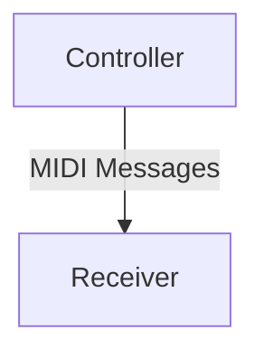

# Beginner Foundation: MIDI
## 1. Everyday Intuition & First Principles
Imagine MIDI (Musical Instrument Digital Interface) as a special kind of musical telegraph. Just as a telegraph sends messages through wires, MIDI sends musical instructions from one device to another. This allows musicians to control synthesizers, drum machines, and other electronic instruments without physically playing them. It's like having a secret code that lets you tell your instruments exactly what to play, when to play it, and how to play it.

## 2. Foundational Vocabulary & Glossary
- **MIDI (Musical Instrument Digital Interface):** A protocol that allows electronic musical instruments, computers, and other related devices to communicate with each other.
- **Controller:** A device that sends MIDI messages. Examples include keyboards, drum pads, and control surfaces.
- **Receiver:** A device that receives MIDI messages. This could be a synthesizer, drum machine, or software on a computer.
- **Note On/Off:** MIDI messages that tell an instrument to start or stop playing a note.
- **Velocity:** The intensity of a note, often corresponding to how hard a key is pressed on a keyboard.
- **Channel:** MIDI messages are sent on one of 16 channels, allowing multiple instruments to be controlled simultaneously.
- **Program Change:** A MIDI message that selects a different instrument sound on a synthesizer.
- **Patch:** A specific sound setting on a synthesizer, often selected via a program change.

## 3. Visual System Flow
### ASCII Diagram
```
[Controller] --(MIDI Messages)--> [Receiver]
```
### Mermaid Flowchart


## 4. Common Beginner Misconceptions & Mental Traps
- **MIDI is Sound:** MIDI is not audio. It's a set of instructions that tell instruments what to play. The actual sound comes from the receiver.
- **MIDI is Only for Keyboards:** While keyboards are common MIDI controllers, MIDI can be used with a wide range of devices, including drum pads, control surfaces, and even smartphones.
- **All MIDI Devices are Compatible:** Not all MIDI devices are compatible with each other. It's important to check the specifications of your devices to ensure they can communicate properly.

## 5. Socratic Discussion Starters
- What is the primary purpose of MIDI in music production?
- Can you explain the difference between a MIDI controller and a MIDI receiver?
- How does the concept of channels in MIDI help musicians control multiple instruments at once?
- Why is velocity an important aspect of MIDI messages?
- Can you describe a scenario where you might use a program change in a song?
- How does understanding MIDI help you in creating more complex and layered music productions?
