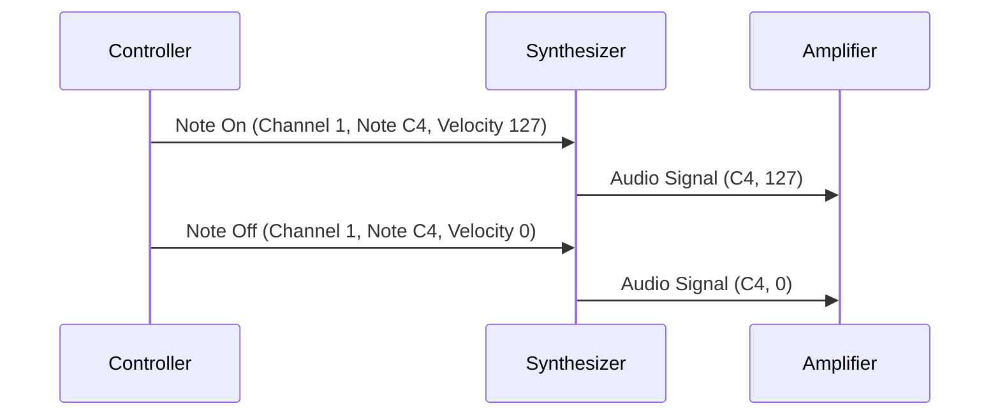

# Intermediate Foundation: MIDI
## 1. Architectural Mental Model
MIDI (Musical Instrument Digital Interface) is a protocol that allows electronic musical instruments, computers, and other related devices to communicate with each other. For intermediate practitioners, it's essential to understand the architecture of MIDI systems to design efficient and scalable setups. MIDI is not a sound format; it transmits control signals and performance data. Here’s a high-level overview of the architecture:

- **MIDI Devices:** These can be controllers (keyboards, drum pads, etc.), synthesizers, samplers, or software applications. Each device can act as a transmitter, receiver, or both.
- **MIDI Ports:** MIDI devices have ports for input (IN), output (OUT), and sometimes through (THRU). The THRU port allows signals to pass through the device to another device.
- **MIDI Cables:** Standard 5-pin DIN cables are used to connect MIDI devices. They carry digital signals over short distances, typically up to 15 meters.
- **MIDI Channels:** MIDI can handle up to 16 channels, allowing multiple instruments to be controlled simultaneously. Each channel can carry different types of messages.
- **MIDI Messages:** These are the data packets sent between devices. Common types include Note On/Off, Control Change, Program Change, and Pitch Bend.

## 2. Systems Taxonomy & Component Protocols
Understanding the taxonomy and protocols of MIDI systems is crucial for designing robust and interoperable setups. Here are some key components and protocols:

- **MIDI Messages:**
  - **Channel Messages:** These are specific to a channel and include Note On/Off, Control Change, Program Change, etc.
  - **System Messages:** These are not channel-specific and include System Exclusive (SysEx) messages, which are used for device-specific commands.
  - **Real-Time Messages:** These are immediate commands that are not affected by timing, such as Start, Stop, and Clock.
  
- **Standard Interfaces:**
  - **MIDI IN/OUT/THRU Ports:** Standard 5-pin DIN ports for connecting devices.
  - **USB MIDI:** Modern USB interfaces that provide MIDI functionality over USB cables.
  - **MIDI Over Ethernet (MIDI-O):** Allows MIDI data to be transmitted over Ethernet networks, enabling longer distances and more complex setups.
  
- **Data Models:**
  - **MIDI Files:** Standard file format for storing MIDI data, including sequences of MIDI messages.
  - **SysEx Data:** Custom data format used for device-specific commands and configurations.

## 3. Multi-Component Interaction Flow
To understand how MIDI components interact, let's look at a detailed interaction flow using ASCII and Mermaid sequence diagrams.

### ASCII Sequence Diagram
```
Controller -> Synthesizer: Note On (Channel 1, Note C4, Velocity 127)
Synthesizer -> Amplifier: Audio Signal (C4, 127)
Controller -> Synthesizer: Note Off (Channel 1, Note C4, Velocity 0)
Synthesizer -> Amplifier: Audio Signal (C4, 0)
```

### Mermaid Sequence Diagram


## 4. Architectural Trade-offs & Production Pitfalls
When designing MIDI systems, there are several trade-offs and pitfalls to consider:

- **Latency:** The delay between sending a MIDI message and receiving an audio response can affect performance. Lower latency is generally preferred for live performances.
- **Cable Length:** Standard MIDI cables have a maximum length of 15 meters. Longer distances can be achieved using MIDI interfaces that support USB or Ethernet.
- **Channel Conflicts:** Using the same channel for multiple devices can lead to conflicts. Proper channel management is essential.
- **SysEx Data:** While SysEx messages are powerful, they can be complex and device-specific. Ensure compatibility and proper handling to avoid issues.
- **Scalability:** As systems grow, managing multiple devices and channels can become challenging. Modular design and clear documentation are crucial.

## 5. Socratic Discussion Starters
To deepen understanding and foster critical thinking, consider these discussion starters:

- **How does the choice of MIDI interface (DIN, USB, Ethernet) affect system performance and scalability?**
- **What are the advantages and disadvantages of using SysEx messages in MIDI setups?**
- **How can you minimize latency in a MIDI system, and what are the trade-offs involved?**
- **What strategies can be employed to manage channel conflicts in complex MIDI setups?**
- **How does the architecture of a MIDI system impact the overall workflow and productivity of a music production environment?**

By exploring these topics, intermediate practitioners can gain a deeper understanding of MIDI architecture and design more effective and efficient systems.
