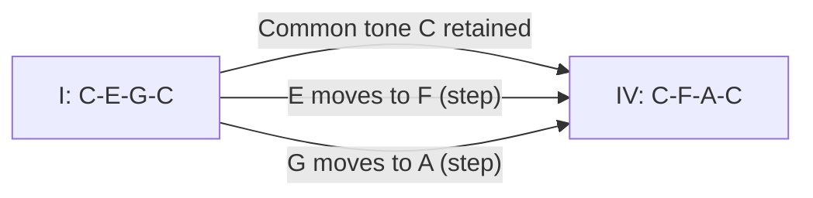

# Operational Verification Labs: MIDI

## Objective & DAW / Studio Setup

MIDI (Musical Instrument Digital Interface) is not audio—it is a control protocol that encodes performance gestures as discrete events: note-on/off commands, velocity values, continuous controller streams, and timing clock signals. This lab sequence trains you to author, route, manipulate, and diagnose MIDI data streams with the precision of a session programmer and the musical intuition of a performing instrumentalist. You will compose polyphonic keyboard parts using voice-leading principles, sculpt synthesizer timbres through CC automation and modulation matrices, and stress-test your productions under tempo variation and timing jitter to expose quantization artifacts and latency bottlenecks.

Before launching your DAW, verify your studio signal chain. Connect your MIDI controller keyboard via USB or 5-pin DIN cable and confirm bidirectional communication in your operating system's MIDI configuration utility (Audio MIDI Setup on macOS, ALSA/JACK utilities on Linux, Device Manager on Windows). Open your primary DAW—Ableton Live, Logic Pro, or REAPER—and create a new project with sample rate set to 48 kHz and buffer size at 256 samples for low-latency monitoring during live input. Instantiate a MIDI monitor plugin on your master bus or as a standalone utility window (REAPER's built-in MIDI monitor, MIDIView by Insert Piz Here, or MIDI-OX on Windows) to observe raw event streams in real time. Load a spectrum analyzer such as Voxengo SPAN on your master output and set FFT size to 8192 with Blackman-Harris windowing for high-frequency resolution. Instantiate a software synthesizer on a new MIDI track—use Ableton's Wavetable, Logic's Alchemy, Bitwig's Polysynth, or the open-source Vital synthesizer if working in REAPER—and arm the track for recording.

Play a single note on your controller and verify that the MIDI monitor displays note-on events (status byte `0x90`–`0x9F` depending on channel), pitch values (`0x00`–`0x7F` for MIDI notes 0–127), and velocity bytes (`0x01`–`0x7F` for struck dynamics). Confirm audio output appears in your spectrum analyzer and that the fundamental frequency matches the expected pitch: A4 (MIDI note 69) should produce a 440 Hz peak, middle C (MIDI note 60) should yield 261.63 Hz. This closed-loop verification—MIDI input, synthesizer rendering, spectral confirmation—establishes the foundation for all subsequent exercises.

Install MuseScore 4 or Dorico SE as your notation frontend for MIDI composition outside the piano roll environment. Both applications export standard MIDI files (SMF) with embedded tempo maps, key signatures, and expression controller data. Download and install VCV Rack 2 Free as your modular synthesis laboratory; this Eurorack simulator allows you to patch virtual cables between oscillators, filters, envelopes, and MIDI-to-CV conversion modules without purchasing hardware. Ensure you have a loudness metering plugin conforming to ITU-R BS.1770-4 standards—Youlean Loudness Meter 2 (free) or the built-in loudness meter in Logic Pro—to measure integrated LUFS during your final mixdown verification.

## Exercise 1: Practical Composition & Voice-Leading Realization

This exercise trains you to think contrapuntally while working within MIDI's discrete event paradigm. You will compose a four-voice chorale phrase in the style of J.S. Bach, respecting species counterpoint prohibitions and functional harmonic progressions, then perform detailed MIDI editing to shape velocity curves and humanize timing for expressive realism. The goal is not mechanical quantization but musical articulation—each voice must breathe independently with phrase-appropriate dynamics and slight temporal displacement to avoid the rigid "machine gun" effect of perfectly aligned attacks.

Open MuseScore 4 and create a new score with four staves: Soprano, Alto, Tenor, Bass, all in treble or bass clef as appropriate. Set the key signature to C major and time signature to 4/4. Compose an eight-measure phrase using the following harmonic progression: I – IV – V⁷ – I in measures 1–2, then ii⁶ – V – vi in measures 3–4, followed by IV – I⁶₄ – V – I for the final cadence in measures 5–8. Write each voice as whole notes in the first draft, ensuring that each chord contains the root, third, fifth, and seventh where applicable, and that the soprano line forms a singable melody with stepwise motion and a single climactic high point around measure 6.

Apply strict voice-leading rules: no parallel fifths or octaves between any voice pair, resolve the seventh of the dominant chord downward by step, and ensure common tones are retained in the same voice between adjacent chords. Once your harmonic skeleton is stable, add rhythmic subdivision in the soprano and alto voices—introduce passing tones, neighbor tones, and suspensions on weak beats to create forward melodic momentum. The bass line should move primarily in quarter notes outlining root motion with occasional scalar passing tones, while the tenor voice sustains longer durations as a harmonic anchor. The following diagram illustrates the typical voice-leading motion from a I chord to a IV chord, with the common tone C retained in the soprano while other voices move by step or common-tone retention:



Export your MuseScore composition as a standard MIDI file (File → Export → MIDI). Import this MIDI file into your DAW by dragging it onto the arrangement view; most DAWs will automatically create four separate MIDI tracks corresponding to the four staves. Solo the soprano track and open the piano roll editor. Zoom in to sixteenth-note resolution and examine the note-on events: every attack will align perfectly to the grid with uniform velocity values around 80 (mezzo-forte default in MuseScore). Select the first four-note phrase (measures 1–2) and apply humanization: in Ableton Live, use the Groove Pool with a subtle swing template and randomize timing by ±10 milliseconds; in Logic Pro, use the MIDI Transform window (Functions → MIDI Transform → Humanize) to add random velocity variation between –5 and +5 and timing variation up to 10 ticks; in REAPER, use the Humanize action (Actions → Show Action List → search "JS: Humanize") with timing variance set to 5 ticks and velocity to ±8. Listen critically to the difference—the slight temporal smearing and dynamic variation should make the phrase sound performed rather than programmed.

Now address voice-leading artifacts that only reveal themselves during playback. Enable all four tracks and listen for balance issues: the bass voice often disappears under dense chords because low frequencies require more energy to achieve perceived equal loudness (Fletcher-Munson equal-loudness contours, ISO 226:2003). Select all bass notes and increase their velocity values by 10–15 points without exceeding 110 to avoid distortion on most virtual instruments. Conversely, the soprano melody should peak dynamically at its highest pitch (the climax in measure 6): select that single note and set its velocity to 105, then create a gradual crescendo leading into it by selecting the preceding four notes and applying a linear velocity ramp from 75 to 105 using your DAW's velocity scaling tool. Repeat this dynamic shaping for the alto and tenor voices, following the natural phrase arcs indicated by melodic contour and harmonic tension-release cycles.

Introduce legato and staccato articulations to differentiate phrase structure. In measures 1–4, extend note durations in the soprano so that each note overlaps the next by approximately one sixteenth note—this creates true legato where one key is depressed before the previous key is released. Select each note in the piano roll, enable the note length tool, and drag the end boundary forward until it extends 60–80 ticks past the start of the next note (assuming 480 PPQN resolution). In measure 5, where the harmonic rhythm accelerates toward the cadence, shorten all soprano and alto notes to approximately 60% of their original length to create a detached, staccato character that propels the phrase forward. The bass voice should remain largely legato throughout except for the final tonic note in measure 8, which should be shortened to a quarter note followed by silence—a standard rhetorical gesture marking formal closure.

Record your MIDI performance of this chorale using a sustain pedal (CC 64, damper pedal) to control legato across phrase boundaries. Arm all four tracks for simultaneous recording, enable your MIDI controller's local-off mode to prevent double-triggering, and perform the entire eight-measure phrase live while depressing the sustain pedal at strategic moments: engage it at the start of each phrase segment (measures 1, 3, 5) and release it just before the final chord to allow the V–I cadence to ring clearly without harmonic blurring. After recording, open the MIDI event list (not the piano roll) and examine the CC 64 messages: you should see value 127 (pedal down) at phrase starts and value 0 (pedal up) at phrase ends. If your pedal technique introduced mid-phrase releases that fragment the legato, manually delete those CC events or use your DAW's MIDI filter to smooth the pedal curve by removing rapid on-off transitions shorter than one beat.

Quantize your live recording selectively to preserve human timing while correcting egregious errors. Use a 50% quantize strength (also called "magnetic" or "iterative" quantization) that pulls notes halfway toward the grid rather than snapping them perfectly. Apply this to the alto and tenor voices, which should maintain steady harmonic support, but leave the soprano and bass unquantized to retain their rhythmic character. Ableton Live's Quantize Settings dialog allows you to set quantize amount to 50% and specify note lengths to be preserved; Logic Pro's Q-Strength parameter in the Region Inspector achieves the same effect; REAPER's "Quantize notes to grid (relative)" action with strength 0.5 accomplishes this. After quantization, zoom into the piano roll at 1/64 note resolution and verify that notes are no longer perfectly aligned—residual timing variation of ±5–20 ticks should remain visible.

Export your edited MIDI file (File → Export → MIDI) and re-import it into a fresh DAW session with a different synthesizer loaded—switch from Wavetable to Alchemy, or from Vital to TAL-U-NO-LX. The velocity shaping, articulation edits, and CC 64 automation should translate correctly across instruments, though timbral differences will emphasize different aspects of your arrangement. If the bass voice still lacks presence, route it to a separate MIDI track with a dedicated bass synthesizer (Moog Model D, Diva, or Trilian) that emphasizes sub-bass frequencies below 100 Hz. Insert a spectrum analyzer on this bass track and confirm that the fundamental frequencies of your bass notes (MIDI notes 36–48, corresponding to C1–C2, with frequencies 65.4–130.8 Hz) are clearly visible without excessive harmonic distortion above 500 Hz.

## Exercise 2: Continuous Controller Automation & Modulation Matrix Programming

MIDI's continuous controller (CC) messages allow real-time manipulation of synthesizer parameters beyond discrete note events. This exercise focuses on CC 1 (modulation wheel), CC 7 (channel volume), CC 10 (pan position), CC 11 (expression), and CC 74 (filter cutoff or brightness), the most widely supported controllers across hardware and software synthesizers. You will author CC automation curves in your DAW's automation lanes, map these controllers to synthesizer parameters via modulation matrices, and analyze the resulting timbral transformations in both time-domain waveforms and frequency-domain spectrograms.

Create a new MIDI track and load a synthesizer with a rich harmonic spectrum—Serum, Omnisphere, or Pigments are ideal, but the free Surge XT synthesizer offers comparable modulation routing. Initialize the patch to a basic sawtooth wave with no effects, filter cutoff fully open (127), and resonance at 0. Play a sustained two-octave C major scale (MIDI notes 60, 62, 64, 65, 67, 69, 71, 72) as whole notes spanning eight measures at 120 BPM. Record this performance into your DAW, then open the automation view and create separate automation lanes for CC 1, CC 7, CC 10, CC 11, and CC 74.

Draw automation curves for each controller using the following patterns. For CC 1 (modulation wheel), create a sinusoidal curve that oscillates between values 0 and 127 over the course of each whole note—this will modulate the vibrato depth or filter cutoff depending on your synthesizer's modulation routing. In Ableton Live, hold Alt (Option on macOS) while drawing automation to create curved segments; in Logic Pro, select the automation curve and choose Transform → Curve from the Edit menu; in REAPER, right-click an automation point and select "Set point shape" → "Bezier". For CC 7 (channel volume), draw a linear crescendo from value 80 to 110 over measures 1–4, then a decrescendo back to 80 over measures 5–8—this creates a dynamic arch spanning the entire phrase. For CC 10 (pan position), alternate between hard left (value 0) and hard right (value 127) on each successive note to create a ping-pong stereo effect. For CC 11 (expression), mirror the CC 7 curve but with steeper slopes: crescendo from 50 to 127 in measures 1–4, then decrescendo to 50 in measures 5–8. For CC 74 (filter cutoff), draw a sawtooth wave pattern that ramps from 127 to 30 over the duration of each whole note, then jumps back to 127 at the start of the next note—this creates a characteristic "wah" filter sweep on each pitch.

Open your synthesizer's modulation matrix or routing page—in Serum, this is the "Matrix" tab; in Surge XT, click the modulation routing icon in the bottom-left corner; in Vital, open the "Routing" view. Assign CC 1 as a modulation source and route it to both oscillator pitch (vibrato) and filter cutoff (timbral brightness). Set the modulation depth for pitch to approximately ±0.2 semitones (20 cents) and the depth for filter cutoff to 50%—this creates a moderate vibrato and simultaneous brightness swell when the modulation wheel is engaged. Assign CC 74 directly to the filter cutoff parameter with 100% depth, confirming that your automation lane overrides any internal LFO or envelope modulation. Verify that CC 7 and CC 11 control overall output gain—most synthesizers respond to both, with CC 11 typically affecting pre-gain signal level while CC 7 controls post-fader volume. If your synthesizer does not respond to CC 11, you may need to enable "Expression" mode in its MIDI settings or manually map CC 11 to the master gain parameter.

The modulation matrix in modern synthesizers allows multiple controllers to target the same destination parameter with independent depth scaling. The combined modulation amount $M_{\text{total}}$ for a given parameter is computed as:

$$M_{\text{total}} = \sum_{i=1}^{N} d_i \cdot v_i$$

where $d_i$ is the depth coefficient for modulation source $i$ (ranging from –1.0 to +1.0), $v_i$ is the normalized controller value (0.0 to 1.0), and $N$ is the number of active modulation sources. When CC 1 and CC 74 both modulate filter cutoff, their contributions sum linearly before being applied to the cutoff frequency parameter. If the sum exceeds the parameter's maximum value, the synthesizer will clip the result—this is why setting CC 74 depth to 100% and CC 1 depth to 50% ensures that maximum modulation (both controllers at value 127) produces a cutoff value near the upper limit without clipping.

Play back your sequence and open a spectrogram plugin to visualize the time-varying frequency content—iZotope RX's Spectrogram View, Voxengo SPAN in spectrogram mode, or the free Spectralissime. Configure the display with a logarithmic frequency axis (20 Hz to 20 kHz), linear amplitude scaling, and a window size of 4096 samples. You should observe the following behaviors: the CC 74 sawtooth automation produces vertical sweeps in the spectrogram as the filter cutoff descends from high to low frequencies on each note; the CC 1 sinusoidal modulation creates subtle pitch wobble visible as horizontal warping of the harmonic partials; the CC 10 pan automation causes the left and right channels to display alternating energy in a stereo spectrogram view; the CC 7 and CC 11 crescendo-decrescendo curves manifest as gradual amplitude growth and decay across all frequency bands.

Introduce modulation rate variation by recording live CC 1 input from your MIDI controller's modulation wheel. Arm your MIDI track for recording, enable overdub mode (most DAWs require holding Shift while clicking the record button), and play the sequence again while manually sweeping the modulation wheel in irregular, expressive gestures—fast flutters during the ascending scale, slow swells on the highest note, and complete disengagement during the descending scale. After recording, your CC 1 automation lane will contain a dense, irregular curve reflecting your hand movements. Zoom in to millisecond resolution and examine the message density: physical modulation wheels typically generate CC messages at 10–50 Hz update rates (one message every 20–100 milliseconds), while drawn automation is sample-accurate up to your DAW's PPQN resolution (typically 960 or 1920 ticks per quarter note). This difference is audible—hand-performed modulation contains micro-variations and non-linear acceleration curves that drawn automation lacks.

Compare the timbral effect of CC 1 modulation applied to filter cutoff versus oscillator pitch. Disable the pitch modulation routing in your synthesizer's modulation matrix, leaving only the filter cutoff target active. Play back the sequence and note the timbral character: the modulation wheel now controls only brightness, producing a vowel-like "wah" effect without pitch variation. Re-enable pitch modulation and disable filter cutoff modulation—the result is pure vibrato with constant timbre. Finally, enable both routings simultaneously and adjust their relative depths: set pitch depth to ±0.5 semitones and filter cutoff depth to 80%. The combined effect should sound more organic and complex than either modulation in isolation, as real acoustic instruments exhibit correlated variations in pitch and spectral centroid during vibrato.

Record a second pass of CC 74 automation using an external MIDI controller mapped to a knob or slider. If your controller supports it, configure the knob to transmit CC 74 messages (consult your controller's manual for MIDI mapping procedures—most require holding a "Learn" button while moving the knob, then selecting the target CC number). Record the sequence again while sweeping the knob in real time, attempting to match the sawtooth pattern you previously drew by hand. After recording, open the MIDI event list and examine the raw CC 74 messages: you will likely see far fewer events than the drawn automation curve (perhaps 20–40 messages per measure versus hundreds of automation points) and the values will not form a perfect ramp due to the physical resolution limits of potentiometer-based knobs (typically 7-bit, yielding 128 discrete steps). This coarse quantization is a fundamental characteristic of MIDI's original 1983 specification, which predates high-resolution 14-bit controllers (using CC pairs 0–31 and 32–63 for MSB and LSB).

Smooth your recorded CC automation using your DAW's MIDI thin/filter tools to remove redundant messages while preserving the overall curve shape. In Logic Pro, select the MIDI region and choose MIDI → Thin Continuous Data with a threshold of 10%; in REAPER, use the MIDI Filter action with "Remove redundant CCs" enabled; in Ableton Live, use the third-party Spitfire Audio LABS plugin's CC Thinner utility or manually delete excess CC events in the MIDI note editor's automation lane. After thinning, the message count should drop by 30–50%, reducing CPU overhead during playback without audible quality loss. Verify that the thinning algorithm preserved the attack and release portions of each sweep—overly aggressive thinning can remove critical inflection points, causing the curve to flatten or overshoot.

Export your MIDI file with embedded CC automation and import it into a different DAW to verify cross-platform compatibility. Standard MIDI files store CC messages as delta-time events interleaved with note-on/off commands, so any compliant MIDI sequencer should reproduce your automation curves identically. Load a different synthesizer in the target DAW and confirm that CC 7 and CC 11 still control volume, CC 10 controls pan, and CC 74 maps to a musically relevant parameter (if the new synthesizer does not respond to CC 74 for filter cutoff, manually assign it in the modulation matrix). This portability is MIDI's greatest strength—the control data remains instrument-agnostic, allowing you to swap synthesizers without re-recording automation.

## Exercise 3: Polyphonic Aftertouch, Pitch Bend, & MPE Expression

Polyphonic aftertouch (also called polyphonic key pressure or poly AT) and MIDI Polyphonic Expression (MPE) represent the most recent extensions to the MIDI standard, enabling per-note expression beyond the channel-wide constraints of traditional MIDI. This exercise requires an MPE-capable controller such as the ROLI Seaboard, Haken Continuum, Expressive E Osmose, or a Sensel Morph with MPE firmware. If you lack such hardware, you can simulate MPE behavior using your DAW's piano roll editor to draw per-note pitch bend and pressure automation, though the tactile feedback and performative nuance will be absent.

Traditional MIDI pitch bend (controller message `0xE0`) applies globally to all notes on a given channel, limiting its usefulness in polyphonic contexts—bending one note bends all simultaneously sounding notes. MPE solves this by allocating each note to a separate MIDI channel (typically channels 2–15, with channel 1 reserved as the "master" channel), allowing per-note pitch bend, CC 74 (timbre), and channel pressure to operate independently. The MPE specification (officially adopted as MIDI 1.0 Addendum in 2018, extended in MIDI 2.0) defines two zones: Lower Zone using channels 1–8 with channel 1 as master, and Upper Zone using channels 9–16 with channel 16 as master. Most MPE controllers default to Lower Zone mode.

Create a new MIDI track and load an MPE-compatible synthesizer—ROLI's Equator2, Madrona Labs Aalto, Arturia Pigments in MPE mode, or the free Surge XT with MPE enabled. In your synthesizer's settings, locate the MPE configuration panel and set the pitch bend range to ±48 semitones (four octaves)—this extended range is standard for MPE controllers and allows for dramatic glissando and portamento effects. If using Surge XT, click the "Tune" tab and set "Pitch Bend Range" to 48 semitones, then open the modulation routing panel and confirm that "Channel AT" (channel pressure) is routed to filter cutoff with moderate depth.

Connect your MPE controller via USB and verify that your DAW recognizes it as an MPE source. In Ableton Live 11.1 or later, the MPE controller should auto-detect and enable MPE mode for any track routed to an MPE-capable device; in Logic Pro 10.7 or later, set the track's input to the MPE controller and enable "MPE Mode" in the Track Inspector; in Bitwig Studio, MPE is enabled by default for all MIDI inputs. If using REAPER, you must manually configure MPE routing: install the ReaControlMIDI plugin on your track, set it to "MPE Mode," and route the controller's MIDI output through it.

Perform a five-note ascending arpeggio (C–E–G–B–D, MIDI notes 60–62–64–67–69) on your MPE controller, applying the following expressive gestures on each note. On the first note (C), play straight without any aftertouch or lateral movement to establish a neutral baseline timbre. On the second note (E), apply moderate downward pressure after the initial attack—this generates channel pressure messages (poly AT, status byte `0xA0` + channel) that should increase filter cutoff or resonance depending on your synthesizer's modulation routing. On the third note (G), slide your finger laterally along the key surface toward the higher pitches—MPE controllers encode this as CC 74 (timbre/brightness) modulation, producing a timbral sweep without pitch change. On the fourth note (B), apply both pressure and lateral motion simultaneously, creating a complex timbral transformation. On the fifth note (D), bend the pitch upward by approximately one semitone using vertical finger pressure or forward key tilt (depending on your controller's mechanics)—this generates per-note pitch bend messages that affect only the D note while leaving the others unchanged.

After performing this arpeggio, open your DAW's MIDI event list and examine the message structure. You should see note-on events distributed across multiple MIDI channels (e.g., note 60 on channel 2, note 62 on channel 3, note 64 on channel 4, and so on), with pitch bend messages (status byte `0xE0` + channel) and CC 74 messages appearing on the same channel as their corresponding note-on. Channel pressure messages (`0xD0` + channel) should appear on the channel assigned to the second note (E) during the sustained portion after the attack. This per-channel isolation is the defining characteristic of MPE—each note receives its own independent expression stream.

Quantify the expressive range of your MPE controller by examining the raw data values in the MIDI monitor. Pitch bend messages are transmitted as 14-bit values (two 7-bit bytes: LSB and MSB) ranging from 0 to 16383, with 8192 representing the center (no bend) position. A bend range of ±48 semitones means that pitch bend value 0 corresponds to –48 semitones (four octaves down) and value 16383 corresponds to +48 semitones (four octaves up). The relationship between pitch bend value $v_{\text{bend}}$ and pitch shift $\Delta p$ in semitones is:

$$\Delta p = \left( \frac{v_{\text{bend}} - 8192}{8192} \right) \times r_{\text{bend}}$$

where $r_{\text{bend}}$ is the configured pitch bend range in semitones. For a one-semitone upward bend with $r_{\text{bend}} = 48$, solve for $v_{\text{bend}}$:

$$1 = \left( \frac{v_{\text{bend}} - 8192}{8192} \right) \times 48$$

$$v_{\text{bend}} = 8192 + \frac{8192}{48} \approx 8363$$

Verify this calculation by examining your recorded pitch bend value for the fifth note (D) in the MIDI event list—it should read approximately 8350–8400 if you achieved a one-semitone bend. The 14-bit resolution provides pitch accuracy of $\frac{96 \text{ semitones}}{16384} \approx 0.0059$ semitones per step, well below the threshold of human pitch discrimination (approximately 0.05 semitones for trained listeners at middle frequencies).

Record a polyphonic phrase where multiple notes sustain simultaneously with independent expression. Play a C major triad (C–E–G, MIDI notes 60–64–67) as whole notes starting at the downbeat, then apply different expressive gestures to each note while all three sustain: vibrato on the C (rapid pitch bend oscillation), pressure swell on the E (gradual increase of channel pressure from 0 to 127), and lateral timbral sweep on the G (CC 74 modulation from 0 to 127 over two beats). The resulting audio should exhibit three distinct timbral trajectories superimposed in a single chord—the fundamental bass note wobbles in pitch, the third of the chord grows brighter due to filter opening, and the fifth undergoes a timbral morph from dark to bright. This level of polyphonic control is impossible with traditional MIDI, where pitch bend and CC 74 would affect all three notes identically.

Open a spectrogram plugin and observe the three-note chord during playback. The C note's vibrato should appear as horizontal sinusoidal wobble of all its harmonic partials (fundamental at 261.63 Hz, second harmonic at 523.25 Hz, third harmonic at 784.88 Hz, and so on). The E note's pressure swell should manifest as vertical growth in the amplitude of high-frequency partials above 2 kHz as the filter cutoff rises. The G note's timbral sweep should produce a diagonal trajectory in the spectrogram as the spectral centroid shifts from low to high frequencies. These three independent behaviors confirm that your MPE controller and synthesizer are correctly isolating per-note expression to separate MIDI channels.

If you lack an MPE controller, simulate MPE behavior by manually editing per-note expression in your DAW's piano roll. Create a MIDI clip containing a C major triad as described above, then enable MPE mode for your synthesizer and manually reassign each note to a different MIDI channel (in most DAWs, select a note in the piano roll and change its channel via a dropdown menu or inspector panel). Open the automation lane for pitch bend and draw a sinusoidal curve that aligns temporally with the C note (channel 2); in a separate automation lane for channel pressure, draw a linear ramp from 0 to 127 that aligns with the E note (channel 3); in a third automation lane for CC 74, draw a ramp that aligns with the G note (channel 4). This manual approach is tedious but pedagogically valuable—it demystifies MPE's channel-per-note architecture and reveals that MPE is simply a structured allocation protocol built atop standard MIDI 1.0 messages.

Compare the timbral results of MPE expression versus traditional monophonic expression by disabling MPE mode in your synthesizer and replaying the same MIDI clip. With MPE disabled, the synthesizer will sum all pitch bend and CC messages across channels, applying the combined modulation to all notes simultaneously. The vibrato intended for the C note will now affect the E and G notes as well, the pressure swell will brighten the entire chord, and the timbral sweep will smear across all voices. This demonstration clarifies why MPE is essential for expressive polyphonic performance on touch-sensitive controllers—without per-note channel isolation, gestural expression becomes incoherent in polyphonic contexts.

Export your MPE MIDI file and inspect its structure using a hex editor or MIDI parser utility such as Mido (Python library) or Sekaiju (Windows MIDI editor). MPE MIDI files contain standard note-on/off messages interleaved with pitch bend, CC 74, and channel pressure events, all tagged with channel numbers. The file header should declare the MPE zone configuration via an RPN (Registered Parameter Number) message on channel 1: RPN 6 sets the number of member channels in the Lower Zone (typically 15, excluding the master channel). This RPN message is critical for MPE-compatible DAWs and plugins to automatically configure their channel allocation behavior upon file import.

## Exercise 4: Latency Measurement, Jitter Diagnosis, & Real-Time Performance Optimization

MIDI timing precision degrades under several conditions: high CPU load, buffer underruns, driver overhead, and physical USB bus contention. This exercise trains you to measure round-trip MIDI latency using loopback testing, diagnose timing jitter through statistical analysis of event timestamps, and optimize your system configuration for real-time performance. You will stress-test your setup by recording high-velocity drum patterns at 180 BPM with thirty-second-note hi-hat rolls, then analyze the timing deviation of recorded events relative to the theoretical grid.

Configure a MIDI loopback connection by routing your controller's MIDI output back to its input. On macOS, open Audio MIDI Setup, select your MIDI interface, and create an IAC (Inter-Application Communication) driver by clicking the plus icon in the "MIDI Studio" window, then set your controller's output to route to the IAC input. On Windows, install loopMIDI (a virtual MIDI port driver by Tobias Erichsen) and configure your controller to transmit to the loopMIDI port, which then routes back to your DAW's MIDI input. On Linux, use ALSA's `aconnect` utility or JACK's `qjackctl` connection manager to create a loopback path.

Open your DAW and create a new MIDI track with a percussive virtual instrument loaded—Native Instruments Battery, FXpansion Geist, or the free MT Power Drum Kit. Arm the track for recording and set your DAW's tempo to 120 BPM. Launch a MIDI latency tester plugin on the track—the free MIDI Loopback Test by Insert Piz Here or the open-source MIDILatencyTest by Oblique Audio. These plugins generate a MIDI note-on message, measure the time until the corresponding note-off returns via the loopback, and report the round-trip latency in milliseconds. Run the test ten times and record the results. Typical round-trip latencies range from 10–30 milliseconds at 256-sample buffer size, increasing to 40–80 milliseconds at 1024-sample buffer size.

The round-trip MIDI latency $L_{\text{RTT}}$ consists of four components:

$$L_{\text{RTT}} = L_{\text{out}} + L_{\text{driver}} + L_{\text{in}} + L_{\text{buffer}}$$

where $L_{\text{out}}$ is the output path latency from DAW to physical MIDI port (typically 1–5 milliseconds), $L_{\text{driver}}$ is the USB or DIN driver overhead (5–15 milliseconds), $L_{\text{in}}$ is the input path latency from MIDI port back to DAW (1–5 milliseconds), and $L_{\text{buffer}}$ is the audio buffer latency given by:

$$L_{\text{buffer}} = \frac{2 \times N_{\text{buffer}}}{f_s} \times 1000$$

where $N_{\text{buffer}}$ is the buffer size in samples, $f_s$ is the sample rate in Hz, and the factor of 2 accounts for round-trip (output plus input buffer). At 48 kHz sample rate with 256-sample buffer:

$$L_{\text{buffer}} = \frac{2 \times 256}{48000} \times 1000 \approx 10.67 \text{ ms}$$

If your measured round-trip latency is 25 milliseconds, the driver and port overhead accounts for approximately $25 - 10.67 = 14.33$ milliseconds. This overhead varies by operating system and USB controller chipset—Intel USB 3.0 controllers typically exhibit lower latency than third-party ASMedia or VIA chipsets.

Reduce your audio buffer size to 128 samples and rerun the latency test. The round-trip latency should drop to approximately 15–20 milliseconds. Further reduce the buffer to 64 samples and test again—latency should now be 10–15 milliseconds, but you may encounter audio dropouts or clicks if your CPU cannot sustain the required throughput. Buffer underruns occur when the DAW's audio engine cannot fill the next buffer before the sound card depletes the current one, producing audible glitches. Monitor your DAW's CPU meter during the test: if it exceeds 80% at 64-sample buffer, increase the buffer to 128 or 256 samples to restore stability. The optimal buffer size balances latency (smaller is better) against reliability (larger is better).

Record a high-velocity MIDI drum pattern to expose timing jitter under load. Set your DAW's tempo to 180 BPM and create a two-measure pattern with the following elements: kick drum on beats 1 and 3, snare drum on beats 2 and 4, and hi-hat thirty-second notes (eight notes per quarter note) running continuously. Program this pattern in your DAW's piano roll editor with perfect quantization—all events aligned to the grid—and copy it to create a sixteen-measure loop. Insert a CPU-intensive plugin on your master bus—FabFilter Pro-Q 3 with 32 processing bands, Valhalla VintageVerb with maximum density, or iZotope Ozone 9 with all modules active—to artificially increase system load. Set your audio buffer to 256 samples and begin playback.

While the loop plays, use your operating system's activity monitor or task manager to observe CPU usage. If your DAW's process consumes less than 60% CPU, add more plugin instances to the master bus until CPU usage reaches 75–85%. At this threshold, timing jitter becomes measurable. Record the MIDI output from your virtual drum instrument by routing its MIDI output to a new MIDI track (in most DAWs, this requires setting the source track's MIDI output destination to the target track's input, then arming the target track for recording). Record sixteen measures of the looping pattern onto this new track while the CPU-intensive plugins remain active.

After recording, open the MIDI event list for the recorded track and examine the timestamps of the hi-hat thirty-second notes. In a perfectly quantized, jitter-free system, these notes should appear at precise intervals of $\frac{60000}{180 \times 8} = 41.67$ milliseconds (since 180 BPM yields a quarter note duration of $\frac{60000}{180} = 333.33$ milliseconds, and thirty-second notes are eight per quarter note). Export the MIDI event list as a CSV file (most DAWs support this via "Export MIDI Events" or similar command) and import it into a spreadsheet or Python script for statistical analysis.

Calculate the inter-onset interval (IOI) for each consecutive pair of hi-hat notes by subtracting the timestamp of note $n$ from the timestamp of note $n+1$. Compute the mean IOI $\mu_{\text{IOI}}$, standard deviation $\sigma_{\text{IOI}}$, and maximum deviation $\Delta_{\text{max}}$ from the theoretical 41.67-millisecond interval. A well-configured system under moderate CPU load should exhibit $\sigma_{\text{IOI}} < 2$ milliseconds and $\Delta_{\text{max}} < 5$ milliseconds. If your results exceed these thresholds, timing jitter is affecting playback quality—fast rhythmic figures will sound uneven or "flamming," especially on percussive transients where the human ear is most sensitive to timing deviations.

Reduce CPU load by disabling the master bus plugins and rerun the recording test. The standard deviation $\sigma_{\text{IOI}}$ should decrease significantly, confirming that CPU saturation causes timing jitter. Now test the effect of USB bus contention by connecting multiple USB devices (external hard drive, webcam, game controller) to the same USB hub as your MIDI controller, then rerun the recording test with plugins active. USB bandwidth sharing and interrupt latency increase when multiple devices compete for the same host controller, degrading MIDI timing precision. USB 2.0 hubs are particularly susceptible—if possible, connect your MIDI controller directly to a USB 3.0 port dedicated to audio/MIDI peripherals.

Compare MIDI timing precision across different MIDI transport protocols by recording the same drum pattern via traditional 5-pin DIN MIDI versus USB MIDI. If your controller supports both, connect it via 5-pin DIN cable to a hardware MIDI interface (such as MOTU MIDI Express or Roland UM-ONE), then record the sixteen-measure loop and analyze the IOI statistics. Traditional DIN MIDI operates at a fixed baud rate of 31.25 kbaud, yielding a transmission time of approximately 1 millisecond per three-byte MIDI message (note-on requires three bytes: status, pitch, velocity). USB MIDI encapsulates MIDI messages in USB bulk transfer packets with lower per-message overhead but introduces variable latency due to USB polling intervals (typically 1 millisecond for full-speed USB 1.1, 125 microseconds for high-speed USB 2.0). In practice, USB MIDI exhibits lower average latency but higher jitter variance compared to DIN MIDI, especially under CPU load.

Optimize your operating system for real-time MIDI performance by disabling unnecessary background processes and power management features. On Windows, disable Windows Update automatic downloads, antivirus real-time scanning, and Cortana/search indexing; set your power plan to "High Performance" to prevent CPU frequency throttling. On macOS, disable Spotlight indexing, iCloud sync, and background app refresh; enable "Reduce Motion" and "Reduce Transparency" in Accessibility preferences to lower GPU overhead. On Linux, configure a low-latency kernel (RT-PREEMPT patch) and add your user account to the `audio` group to grant real-time scheduling priority. After applying these optimizations, rerun the latency test and CPU load recording—you should observe a 10–20% reduction in round-trip latency and a 20–40% decrease in timing jitter under load.

Measure MIDI clock jitter when syncing your DAW to an external hardware sequencer or drum machine. Set your DAW to receive MIDI clock (also called MIDI Beat Clock or MBC) from an external device such as an Elektron Digitakt, Arturia BeatStep Pro, or Roland TR-8S. MIDI clock transmits 24 pulses per quarter note (PPQN), so at 120 BPM, the expected clock interval is $\frac{60000}{120 \times 24} = 20.83$ milliseconds per clock pulse. Record the incoming MIDI clock messages to a MIDI track while the external device runs for thirty seconds, then export the event list and calculate the IOI statistics for consecutive clock pulses. Hardware sequencers with crystal oscillator-based timing circuits typically exhibit $\sigma_{\text{IOI}} < 0.5$ milliseconds, whereas software-based MIDI clock sources may exceed 2 milliseconds due to operating system scheduling jitter.

If your DAW's MIDI clock sync drifts over time (gradual tempo offset accumulating across multiple bars), the issue likely stems from sample rate mismatch between your audio interface and the DAW's internal clock. Open your audio interface's control panel and verify that its sample rate matches your DAW's project sample rate (typically 44.1 kHz or 48 kHz). Enable "word clock" synchronization if your interface supports it, using either an external word clock generator or setting the interface to sync to your DAW's internal clock. After correcting the sample rate mismatch, the MIDI clock drift should disappear, maintaining perfect tempo alignment between your DAW and external sequencer over extended sessions.

## Exercise 5: Generative MIDI Algorithms, Euclidean Rhythms, & Probabilistic Sequencing

This exercise shifts from performance-driven MIDI workflows to algorithmic composition using generative techniques. You will implement Euclidean rhythm generation, Markov chain pitch selection, and velocity humanization via probability distributions, all coded as MIDI processor scripts or plugins within your DAW. The goal is to produce musically coherent, evolving sequences that exhibit human-like variation without repetitive looping.

Euclidean rhythm algorithms distribute a given number of pulses $k$ across a total number of steps $n$ as evenly as possible, producing rhythmic patterns found in traditional music worldwide—Cuban son clave, West African bell patterns, and Indian talas all conform to Euclidean distributions. The algorithm, formalized by Godfried Toussaint in 2005, generates rhythms by recursively subdividing intervals until all pulses are allocated. For example, a Euclidean rhythm with $k=5$ pulses over $n=8$ steps produces the pattern `[1,0,1,0,1,0,1,1]`, equivalent to a Cuban tresillo rhythm. The algorithm proceeds as follows: represent the $k$ pulses as ones and the remaining $n-k$ silent steps as zeros, then iteratively merge pairs of patterns until no further merging is possible.

Implement a Euclidean rhythm generator using your DAW's scripting environment. Ableton Live supports Max for Live devices (requires Max for Live license or third-party devices like the free Euclidean Sequencer by Sonic Faction); Logic Pro supports Scripter MIDI plugins using JavaScript; REAPER supports JSFX scripts and Python via the ReaScript API; Bitwig Studio supports custom MIDI FX devices using JavaScript or Java. If your DAW lacks built-in scripting, use a standalone MIDI processor such as Pure Data (Pd) with the `pdmidi` external or Max/MSP to generate MIDI output routed to your DAW via virtual MIDI ports.

In Logic Pro's Scripter environment, create a new Scripter instance and enter the following JavaScript code to generate a Euclidean rhythm with user-defined parameters:

```javascript
var PluginParameters = [
  {name: "Pulses", type: "lin", minValue: 1, maxValue: 16, numberOfSteps: 15, defaultValue: 5},
  {name: "Steps", type: "lin", minValue: 1, maxValue: 16, numberOfSteps: 15, defaultValue: 8},
  {name: "Rotation", type: "lin", minValue: 0, maxValue: 15, numberOfSteps: 15, defaultValue: 0},
  {name: "Velocity", type: "lin", minValue: 1, maxValue: 127, numberOfSteps: 126, defaultValue: 100}
];

var pattern = [];
var currentStep = 0;

function euclidean(pulses, steps) {
  if (pulses >= steps) return Array(steps).fill(1);
  if (pulses === 0) return Array(steps).fill(0);
  
  var groups = [];
  for (var i = 0; i < pulses; i++) groups.push([1]);
  for (var i = 0; i < steps - pulses; i++) groups.push([0]);
  
  while (groups.length > 1) {
    var minLen = Math.min(pulses, steps - pulses);
    var newGroups = [];
    for (var i = 0; i < minLen; i++) {
      newGroups.push(groups[i].concat(groups[groups.length - minLen + i]));
    }
    for (var i = minLen; i < groups.length - minLen; i++) {
      newGroups.push(groups[i]);
    }
    groups = newGroups;
    pulses = Math.min(pulses, steps - pulses);
    steps = groups.length;
  }
  
  return [].concat.apply([], groups);
}

function ParameterChanged(param, value) {
  pattern = euclidean(GetParameter("Pulses"), GetParameter("Steps"));
  var rotation = GetParameter("Rotation");
  pattern = pattern.slice(rotation).concat(pattern.slice(0, rotation));
}

function HandleMIDI(event) {
  if (event instanceof NoteOn) {
    var step = pattern[currentStep % pattern.length];
    if (step === 1) {
      event.velocity = GetParameter("Velocity");
      event.send();
    }
    currentStep++;
  } else {
    event.send();
  }
}

function Reset() {
  currentStep = 0;
}
```

This Scripter implements the Euclidean algorithm to generate rhythm patterns based on user-defined pulses and steps, with rotation offset and velocity control. Insert the Scripter on a MIDI track before your virtual instrument, set "Pulses" to 5 and "Steps" to 8, then send a stream of sixteenth-note triggers (MIDI note 60 at constant velocity) from a MIDI clip to feed the Scripter. The output will be a Euclidean-filtered rhythm matching the `[1,0,1,0,1,0,1,1]` pattern, with silent steps removed and active steps transmitted at the specified velocity.

Create four instances of the Euclidean Scripter on separate MIDI tracks, each configured with different pulse/step ratios: Track 1 (kick drum) with $k=4$, $n=16$ producing a four-on-the-floor pattern; Track 2 (snare) with $k=3$, $n=8$ producing a backbeat; Track 3 (hi-hat) with $k=7$, $n=16$ producing a syncopated offbeat pattern; Track 4 (percussion) with $k=5$, $n=13$ producing a quintuplet-based polyrhythm. Route each track to a different drum sound in a multi-output sampler like Battery or Kontakt, then send the same sixteenth-note trigger stream to all four tracks simultaneously. The result is a generative polyrhythmic drum pattern where each voice follows an independent Euclidean distribution.

Extend the Euclidean sequencer to output probabilistic triggers rather than deterministic patterns. Modify the `HandleMIDI` function to generate a random number between 0 and 1 on each step, and transmit the note only if the random value is less than a user-defined probability threshold (e.g., 0.75 for 75% probability). This introduces controlled randomness, causing the rhythm to vary subtly on each pass through the pattern while maintaining its Euclidean structure. Add a second probability parameter to control "ghost notes"—additional low-velocity triggers on silent steps with 10–20% probability, simulating the quiet grace notes commonly played by percussionists.

Implement a Markov chain pitch generator to create melodic sequences with controlled statistical behavior. A first-order Markov chain selects the next pitch based solely on the current pitch, using a transition probability matrix $P$ where element $P_{ij}$ represents the probability of transitioning from pitch $i$ to pitch $j$. For a diatonic C major scale (pitches 60, 62, 64, 65, 67, 69, 71, 72), a simple transition matrix that favors stepwise motion might assign high probabilities ($P_{i,i+1} = 0.4$, $P_{i,i-1} = 0.4$) to adjacent pitches, moderate probabilities ($P_{i,i} = 0.1$) to repetitions, and low probabilities ($P_{i,i+2} = 0.05$, $P_{i,i-2} = 0.05$) to leaps.

In REAPER's JSFX scripting environment, implement a Markov pitch generator as follows. Create a new JSFX script (File → New → JSFX) and enter:

```text
desc: Markov Pitch Generator

slider1:60<0,127,1>Starting Pitch
slider2:0.4<0,1,0.01>Step Probability
slider3:0.1<0,1,0.01>Repeat Probability
slider4:0.05<0,1,0.01>Leap Probability

@init
scale = {60, 62, 64, 65, 67, 69, 71, 72};
current_pitch = slider1;

function get_next_pitch(current) local(r, cumulative) (
  r = rand();
  cumulative = 0;
  
  cumulative += slider3;
  r < cumulative ? current :
  
  cumulative += slider2;
  r < cumulative ? scale[(this.find_index(current) + 1) % 8] :
  
  cumulative += slider2;
  r < cumulative ? scale[(this.find_index(current) - 1 + 8) % 8] :
  
  cumulative += slider4;
  r < cumulative ? scale[(this.find_index(current) + 2) % 8] :
  
  scale[(this.find_index(current) - 2 + 8) % 8];
);

function find_index(pitch) local(i) (
  i = 0;
  loop(8,
    scale[i] == pitch ? (
      return(i);
    );
    i += 1;
  );
  0;
);

@block

@sample

while (midirecv(offset, msg1, msg2, msg3)) (
  (msg1 & 0xF0) == 0x90 ? (
    current_pitch = get_next_pitch(current_pitch);
    midisend(offset, 0x90, current_pitch, msg3);
  ) : (
    midisend(offset, msg1, msg2, msg3);
  );
);
```

This JSFX receives incoming MIDI note-on events and replaces their pitch values with Markov-generated pitches constrained to the C major scale. Insert the JSFX on a MIDI track before your synthesizer, then send a stream of trigger notes at a fixed pitch (e.g., sixteenth notes at middle C). The output melody will exhibit stepwise motion with occasional leaps and repetitions, producing a statistically coherent but non-repetitive melodic line.

Combine the Euclidean rhythm generator and Markov pitch generator into a single generative sequencer. Route the Euclidean Scripter's output to the Markov JSFX input, so that rhythmic triggers are first filtered by the Euclidean pattern, then have their pitches assigned by the Markov chain. Add a third MIDI processor to humanize velocity values using a Gaussian probability distribution: for each note-on event, sample a random velocity from a normal distribution with mean $\mu_v = 90$ and standard deviation $\sigma_v = 10$, clamped to the valid MIDI range [1, 127]. This three-stage pipeline—rhythm generation, pitch selection, velocity humanization—produces fully autonomous melodic sequences that sound performed rather than programmed.

Analyze the statistical properties of your generative sequence by recording its MIDI output over one hundred measures, then exporting the note data for analysis. Calculate the pitch class histogram (count of occurrences for each of the twelve chromatic pitch classes) to verify that your Markov chain favors diatonic pitches—the seven scale degrees (C, D, E, F, G, A, B) should dominate, with chromatic neighbors (C♯, D♯, F♯, G♯, A♯) rarely or never appearing. Compute the inter-onset interval histogram for rhythmic events to confirm that the Euclidean algorithm produces the expected distribution—for a five-pulse, eight-step pattern, IOIs should cluster around specific multiples of the step duration. If your histograms deviate significantly from theoretical predictions, diagnose the cause: incorrect probability values in the transition matrix, quantization errors in the Euclidean algorithm, or velocity clamping that biases the Gaussian distribution.

Extend the Markov model to second-order (considering the previous two pitches) or higher to create more complex melodic structures with longer-range dependencies. A second-order Markov chain requires a three-dimensional transition tensor $P_{ijk}$, where the next pitch $k$ depends on the current pitch $j$ and the previous pitch $i$. This dramatically increases the parameter space—a twelve-tone chromatic model requires $12^3 = 1728$ transition probabilities—but allows you to encode stylistic preferences such as "after an ascending major third, favor descending stepwise motion" or "avoid repeating the same interval direction more than twice." Implement this by maintaining a two-element pitch history buffer in your JSFX script and indexing the transition tensor accordingly.

Export your generative MIDI sequence as a standard MIDI file and import it into a notation program (MuseScore, Dorico, Sibelius) to visualize the melodic contour and rhythmic density. Generative sequences often reveal compositional patterns invisible in the piano roll—repeated pitch motifs, rhythmic cells, and implied harmonic progressions that emerge from the statistical constraints. If the notation reveals excessive repetition or lack of phrase structure, adjust your Markov transition probabilities to favor goal-directed motion: increase the probability of returning to the tonic pitch at phrase boundaries (every four or eight measures) and reduce the probability of large leaps to encourage stepwise melodic continuity.

## Exercise 6: System Exclusive Messages, Synthesizer Programming, & Patch Management

MIDI System Exclusive (SysEx) messages provide manufacturer-specific data transfer for deep synthesizer programming, patch librarian functions, and firmware updates. This exercise focuses on capturing, editing, and transmitting SysEx messages to program hardware synthesizers from your DAW, with emphasis on checksum validation, data structure parsing, and bidirectional patch synchronization. You will extract a synthesizer patch as SysEx data, modify its parameter values in a hex editor, recalculate the checksum, and upload the modified patch back to the hardware.

SysEx messages begin with status byte `0xF0` (SysEx start), followed by a manufacturer ID (one or three bytes), device-specific data, and terminate with `0xF7` (SysEx end). The manufacturer ID is assigned by the MIDI Manufacturers Association—Roland uses `0x41`, Yamaha uses `0x43`, Korg uses `0x42`, and Moog uses `0x04`. Most modern synthesizers embed additional identifiers (model ID, device ID) immediately after the manufacturer ID to route messages to specific instruments in a MIDI chain. For example, a Roland JD-Xi SysEx patch dump begins with the sequence `F0 41 10 00 00 00 0E 12` where `41` is Roland's manufacturer ID, `10` is the device ID, and `00 00 00 0E 12` is the model ID and command code for data transmission.

Connect a hardware synthesizer to your computer via MIDI (5-pin DIN or USB) and verify bidirectional communication by sending a SysEx identity request. Open your DAW's MIDI monitor or use a standalone SysEx utility such as MIDI-OX (Windows), SysEx Librarian (macOS), or `amidi` command-line tool (Linux). Transmit the universal SysEx identity request message: `F0 7E 7F 06 01 F7`. The synthesizer should respond with a SysEx identity reply containing its manufacturer ID, device family, family member, and software revision. For example, a Moog Subsequent 37 responds with `F0 7E 00 06 02 04 00 19 00 00 00 xx xx xx xx F7` where `04` is Moog's ID, `00 19` is the model ID, and the trailing bytes represent firmware version.

Request a patch dump from your synthesizer by sending a SysEx patch request message. The exact format varies by manufacturer—consult your synthesizer's MIDI implementation chart (usually found in the appendix of the user manual or downloadable as a separate PDF). For a Roland Juno-DS, a single patch request is structured as: `F0 41 10 00 00 00 1A 11 01 00 xx xx 00 00 00 01 cc F7`, where `xx xx` represents the patch memory address (e.g., `00 00` for preset patch A-1), and `cc` is a checksum byte calculated as `128 - ((sum of data bytes) & 0x7F)`. For a Yamaha Reface CS, patch dumps are initiated by pressing the synthesizer's front-panel "Memory" button while MIDI transmission is enabled in the settings menu.

Capture the incoming SysEx patch dump in your DAW by arming a MIDI track for recording and setting the input filter to accept SysEx messages (some DAWs disable SysEx recording by default to reduce data overhead). Alternatively, use MIDI-OX or SysEx Librarian to capture the patch to a `.syx` file on disk. After receiving the patch dump, examine the data structure: open the `.syx` file in a hex editor such as HxD (Windows), Hex Fiend (macOS), or `xxd` (Linux). The file will contain a long string of hexadecimal bytes between `F0` and `F7`, representing all parameter values for the patch—oscillator waveforms, filter cutoff and resonance, envelope attack/decay/sustain/release times, LFO rates, effect settings, and so on.

Decode the patch structure by cross-referencing the hex data with the synthesizer's parameter map documented in the MIDI implementation chart. For example, in a Moog Subsequent 37 patch, byte offset 0x10 controls oscillator 1 waveform (values 0–4 representing triangle, sawtooth, square, narrow pulse, and wide pulse), byte offset 0x15 controls filter cutoff (values 0–127), and byte offset 0x16 controls filter resonance (values 0–127). Locate the filter cutoff byte in your hex editor and note its current value—suppose it reads `0x40` (decimal 64, representing a mid-range cutoff). Change this byte to `0x7F` (decimal 127, fully open) and save the modified `.syx` file.

Recalculate the SysEx checksum to ensure the synthesizer accepts the modified patch. Many manufacturers embed a checksum byte at the end of the SysEx message (immediately before `F7`) to detect data corruption during transmission. The checksum algorithm varies by manufacturer—Roland uses a two's complement sum of all data bytes, Yamaha uses an XOR of all data bytes, and Korg often omits checksums entirely. For a Roland JD-Xi patch, the checksum is computed as:

$$\text{checksum} = 128 - \left( \left( \sum_{i} \text{data}_i \right) \bmod 128 \right)$$

where the sum includes all data bytes between the address bytes and the checksum position. If the sum of data bytes is 0x3FA2, then $0x3FA2 \bmod 128 = 0x22$, and the checksum is $128 - 0x22 = 0x6E$. Replace the original checksum byte in your `.syx` file with the recalculated value.

Transmit the modified SysEx patch back to the synthesizer using your DAW's SysEx send function or a standalone utility. In Ableton Live, use the Max for Live device "SysEx Send" (requires Max for Live) or the third-party M4L device "Patchbase" to load and transmit `.syx` files. In Logic Pro, use the SysEx Fader environment object to manually construct and send SysEx messages byte-by-byte. In REAPER, use the MIDI ReaControlMIDI plugin with SysEx injection capability. Ensure your synthesizer is in "receive" mode (consult the manual—some synthesizers require enabling SysEx receive in a settings menu) and that the device ID matches the ID in your SysEx message header. After transmission, the synthesizer should load the modified patch, and you should hear the filter cutoff now fully open when playing notes.

Create a patch librarian workflow to batch-export all patches from your synthesizer and organize them on disk for version control and backup. Send a bulk dump request SysEx message (format varies by manufacturer—Roland uses command `0x19` for bulk dump, Yamaha uses `0x04`) to retrieve all patches in one transmission. The resulting `.syx` file will contain multiple concatenated patch data structures, each beginning with `F0` and ending with `F7`. Parse this bulk dump file using a Python script with the `mido` library to split it into individual patch files:

```python
import mido

def extract_patches(sysex_file, output_dir):
    patches = []
    current_patch = []
    
    with open(sysex_file, 'rb') as f:
        for msg in mido.read_syx_file(sysex_file):
            current_patch.extend(msg.data)
            if msg.data[-1] == 0xF7:
                patches.append(current_patch)
                current_patch = []
    
    for i, patch in enumerate(patches):
        filename = f"{output_dir}/patch_{i:03d}.syx"
        with open(filename, 'wb') as f:
            f.write(bytes([0xF0] + patch[:-1] + [0xF7]))
    
    print(f"Extracted {len(patches)} patches to {output_dir}")

extract_patches('bulk_dump.syx', 'patches/')
```

This script reads the bulk SysEx file, splits it at `F7` terminators, and writes each patch as a separate `.syx` file with zero-padded numeric filenames for sequential organization. Organize these files in a Git repository to track patch evolution over time—commit changes after each sound design session to maintain a version-controlled patch library.

Compare SysEx patch data across different synthesizer models to understand manufacturer-specific encoding conventions. Export a patch from a Moog synthesizer (uses ASCII-encoded parameter names and floating-point values in some models) and a Roland synthesizer (uses 7-bit integer encoding for all parameters, with multi-byte values split across two SysEx bytes). Moog's implementation includes human-readable strings like `OECILATOR1WAVE=SAWTOOTH` embedded in the SysEx stream, whereas Roland uses compact binary encoding where `0x40 0x00` represents a 14-bit value of $64 \times 128 + 0 = 8192$. These structural differences make cross-manufacturer patch conversion impossible without deep knowledge of both synthesizers' parameter ranges and scaling factors.

Automate synthesizer parameter changes via SysEx during live performance by embedding SysEx messages in your DAW's MIDI clips. Record a four-bar MIDI performance into a clip, then insert SysEx parameter change messages at specific beat positions to create filter sweeps, oscillator detuning, or effect bypass toggling synchronized to the musical timeline. For example, to sweep the filter cutoff of a Roland JD-Xi from fully closed to fully open over four beats, insert SysEx messages at each sixteenth-note position with incrementally increasing cutoff values: `F0 41 10 00 00 00 1A 12 01 00 xx xx 00 00 00 01 cc F7` where `xx xx` increments from `00` to `7F` across the messages. This technique requires precise timing—SysEx messages have variable transmission times depending on message length (approximately 320 microseconds per byte at 31.25 kbaud DIN MIDI), so stagger message insertion by a few milliseconds to avoid buffer overflow.

## Conclusion: Integration, Documentation, & Advanced Topics

You have now traversed the operational depth of MIDI: from compositional voice-leading and controller automation through latency measurement, generative algorithms, and low-level SysEx programming. These exercises establish fluency with MIDI's event-driven architecture and its integration into modern production workflows. To consolidate this knowledge, you should undertake a capstone project combining multiple techniques—compose a sixteen-bar generative polyrhythmic sequence using Euclidean and Markov processes, perform live CC automation over the sequence using an MPE controller, measure and document the round-trip MIDI latency under CPU load, export the final sequence as a standard MIDI file with embedded SysEx patch dumps, and analyze the spectral characteristics of the rendered audio to confirm that dynamic modulation and timbral automation are correctly reproduced.

Document your MIDI workflows using precise technical language: when describing latency measurements, report numerical values with units (milliseconds) and confidence intervals (mean ± standard deviation); when describing SysEx patch modifications, include hexadecimal offsets, byte values, and checksum calculations; when analyzing generative sequences, compute and report statistical metrics such as pitch class distributions, interval histograms, and velocity variance. This level of documentation rigor is essential for reproducible research, collaborative sound design, and troubleshooting intermittent MIDI issues in complex multi-device studio setups.

Advanced topics beyond this lab's scope include MIDI 2.0 property exchange (bidirectional parameter inquiry and device discovery), MIDI Manufacturer Specific protocols (NRPN messages, Roland's proprietary MIDI implementation for ACB modeling engines), multi-client MIDI routing matrices for large-scale live performance rigs, and MIDI over Ethernet using RTP-MIDI (Apple's network MIDI protocol) or IP-MIDI (Kenton's UDP-based implementation). For practitioners working in film scoring, game audio, or interactive installations, real-time MIDI control of DAW transport (MIDI Time Code, MIDI Machine Control) and synchronization with video timecode (SMPTE LTC/VITC) represent critical competencies. Consult the official MIDI 1.0 and MIDI 2.0 specifications (available from midi.org) for normative definitions of all message types, and refer to manufacturer MIDI implementation charts for device-specific parameter maps and SysEx command structures.

Finally, cultivate an empirical mindset toward MIDI programming: measure latency rather than assuming defaults, analyze recorded timing data rather than relying on auditory perception alone, validate SysEx checksums before transmission, and archive all patches and settings in version-controlled repositories. MIDI's longevity—forty years since the 1983 specification—derives from its parsimony and extensibility, but exploiting these properties demands operational precision and systematic verification at every layer of the signal chain.
