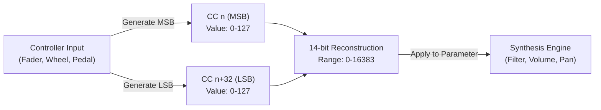
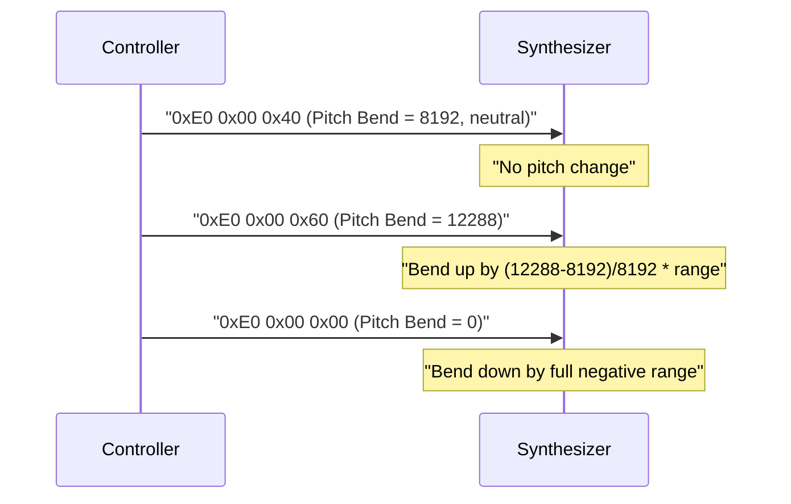
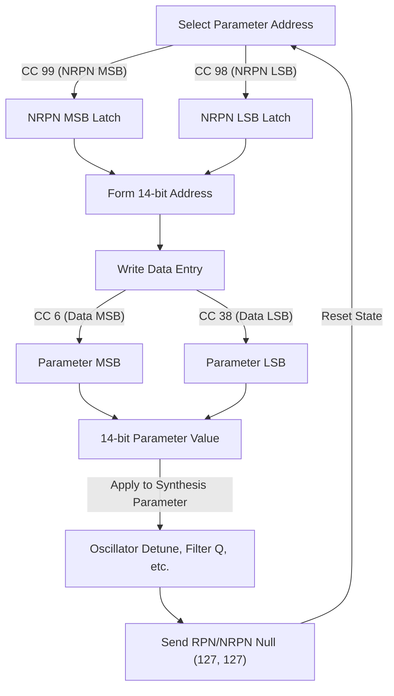
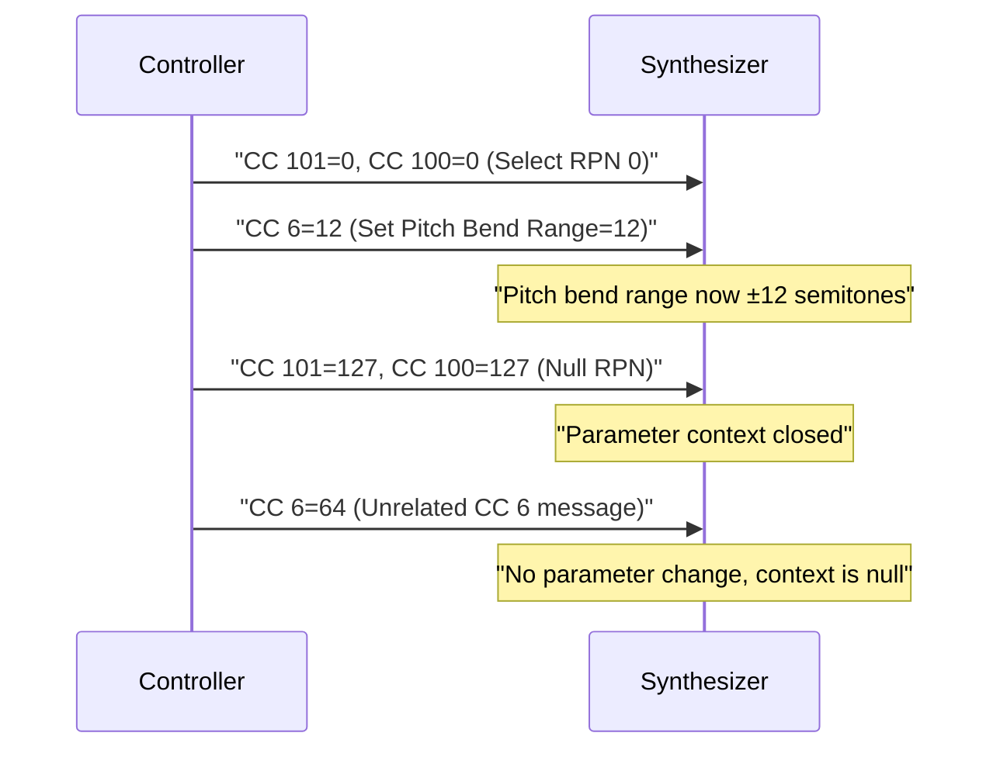
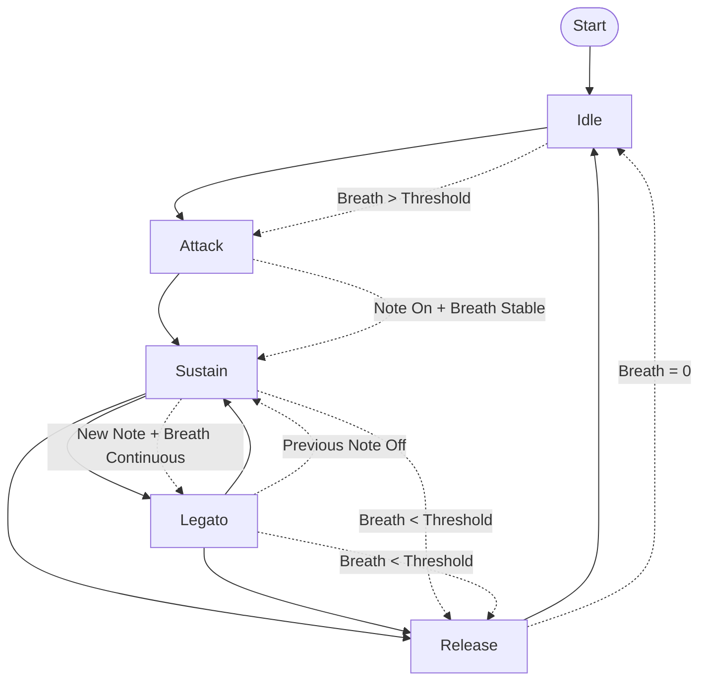

# Lesson 2: Controllers, Automation, Expression

## 1. First-Principles Intuition & Invariants

MIDI's true power lies not in its note-on trigger events but in its continuous control architecture—the capacity to sculpt sound across time with gestural nuance. When we press a piano key, we commit to a fixed hammer velocity; the note rings and decays according to physical acoustics. Synthesizers possess no such constraint. A voltage-controlled filter cutoff can sweep continuously from 20 Hz to 20 kHz; an oscillator's pitch can bend smoothly across octaves; an amplitude envelope can be dynamically compressed mid-sustain. These parameters demand a control vocabulary richer than discrete on/off triggers, and MIDI provides that vocabulary through its controller message architecture.

At the protocol's heart lies a fundamental trade-off between temporal resolution and parametric precision. MIDI operates at 31,250 baud—a serial rate that permits roughly one three-byte message every 960 microseconds. This seemingly generous bandwidth becomes constrictive when we recognize that a single controller sweep from minimum to maximum spans 128 discrete steps (7-bit resolution) and that musical gestures often modulate multiple parameters simultaneously. A vibrato gesture on a brass instrument, for instance, simultaneously modulates pitch (via pitch bend), brightness (via breath controller affecting filter cutoff), and volume (via expression pedal or aftertouch). Each modulation stream competes for the same serial bottleneck, and the resulting interleaving determines whether our synthetic performance feels mechanically quantized or organically fluid.

The MIDI specification allocated 128 controller numbers (CC 0–127) as continuous parameter addresses, each transmitting 7-bit values (0–127) via status byte `0xBn` where `n` encodes the channel (0–15). This design choice embedded several critical invariants. Controller messages are channel-specific—CC 7 (volume) on channel 1 operates independently from CC 7 on channel 2, permitting per-instrument mix automation in multitimbral environments. The 7-bit resolution creates perceptible quantization artifacts when sweeping slowly; a filter cutoff moving from fully open to fully closed in four beats at 120 BPM traverses roughly 32 steps per second, yielding audible "zipper noise" as the discrete jumps modulate harmonic content. Certain controller numbers carry semantic weight by convention (CC 1 for modulation wheel, CC 7 for volume, CC 64 for sustain pedal), while others remain freely assignable, creating a namespace collision problem when multiple devices assert conflicting interpretations.

The specification addressed the resolution limitation through high-resolution controller pairs, designating CC 0–31 as Most Significant Byte (MSB) controllers and CC 32–63 as their corresponding Least Significant Byte (LSB) partners. A 14-bit controller value emerges by transmitting two messages: first the MSB (coarse), then the LSB (fine), yielding 16,384 discrete steps—sufficient to eliminate perceptible quantization in most musical contexts. However, this doubling of message traffic exacerbates bandwidth constraints, and many implementations ignore LSB messages, relying solely on 7-bit coarse control. This creates a subtle interoperability failure mode: a meticulously programmed automation curve with smooth 14-bit transitions may degrade to stepped 7-bit zipper noise on a receiver that discards LSB data.



Pitch bend occupies a privileged position in the controller hierarchy, allocated its own dedicated message type (status `0xEn`) with native 14-bit resolution transmitted as two 7-bit bytes (LSB first, then MSB—note the reversal from controller MSB/LSB ordering). This architectural decision reflects pitch bend's acoustic primacy: human hearing exhibits acute sensitivity to pitch deviations, detecting tuning errors as small as 5–10 cents (0.5–1% frequency shift). A 7-bit pitch bend would quantize the ±2 semitone default range into 256 steps, yielding ~1.5-cent granularity—marginal but perceptible during slow vibratos. The 14-bit allocation provides 16,384 steps across the bend range, reducing granularity to ~0.012 cents and ensuring imperceptible quantization even during extreme bends across octaves.

The pitch bend range itself remains a soft parameter, configurable via Registered Parameter Numbers (RPN), another layer of the control hierarchy we will examine shortly. This configurability introduces semantic ambiguity: a pitch bend value of +8192 (maximum positive deflection) might represent +2 semitones on one device, +12 semitones on another, and +24 semitones on a third, depending on each device's internal RPN 0 setting. The neutral position sits at 8192 ($2^{13}$), with negative deflections spanning 0–8191 and positive deflections spanning 8193–16383. Sequencers and controllers cannot assume universal bend range semantics, and proper interoperation requires explicit RPN initialization messages at the start of each MIDI session—an often-neglected best practice that leads to transposition bugs when moving projects between systems.



Aftertouch—the pressure applied to a key after its initial strike—exists in two variants with fundamentally different architectural implications. Channel aftertouch (also called monophonic aftertouch) transmits a single pressure value (status `0xDn`, one data byte) representing the average or maximum pressure across all currently held keys on that channel. This one-to-many mapping sacrifices per-note control for bandwidth efficiency: a dense chord of six notes generates one aftertouch message stream rather than six. Polyphonic aftertouch (status `0xAn`, two data bytes: note number and pressure) transmits independent pressure per key, enabling per-note vibrato or brightness modulation—essential for expressive leads but bandwidth-intensive. A six-note chord with polyphonic aftertouch generates six interleaved message streams, consuming roughly 18 bytes per update cycle versus 2 bytes for channel aftertouch. Most keyboard controllers implement only channel aftertouch due to hardware cost and bandwidth pragmatism, while high-end controllers (Roli Seaboard, Haken Continuum) prioritize polyphonic expressivity.

Non-Registered Parameter Numbers (NRPN) and Registered Parameter Numbers (RPN) extend the controller namespace beyond the 128 fixed CC addresses, permitting access to thousands of device-specific synthesis parameters. The mechanism operates as a two-stage pointer indirection: first, transmit CC 99 (NRPN MSB) and CC 98 (NRPN LSB) to specify a 14-bit parameter address; second, transmit CC 6 (Data Entry MSB) and optionally CC 38 (Data Entry LSB) to write a 14-bit value to that address. This indirect addressing scheme allows a synthesizer to expose arbitrary internal parameters—oscillator detuning, filter resonance Q factor, envelope decay time—without exhausting the fixed CC namespace. RPN uses the same mechanism but via CC 101/100 (RPN MSB/LSB), with standardized parameter addresses: RPN 0 for pitch bend range, RPN 1 for fine tuning, RPN 2 for coarse tuning. The distinction between RPN and NRPN reflects a governance boundary: RPN addresses are reserved for standardized, cross-manufacturer parameters, while NRPN addresses remain manufacturer-specific.

The RPN/NRPN protocol introduces a stateful layer atop MIDI's otherwise stateless message stream. Once an RPN or NRPN address is selected via CC 101/100 or CC 99/98, subsequent Data Entry messages (CC 6/38) continue to modify that parameter until a new RPN/NRPN selection occurs. This statefulness creates a subtle race condition: if two controllers attempt to modify different NRPN parameters simultaneously on the same channel, their address-selection messages may interleave, causing Data Entry values to target the wrong parameters. The specification recommends transmitting a null parameter selection (RPN 127, 127) after each RPN/NRPN transaction to explicitly close the parameter context, but many implementations omit this step, leading to intermittent corruption in dense automation scenarios.



## 2. Core Controller Types and Semantic Conventions

MIDI's controller namespace divides into three architectural categories: continuous controllers (sliders, wheels, pedals), switch controllers (sustain, sostenuto, soft pedal), and mode controllers (local control, all notes off, omni mode). Understanding this taxonomy clarifies the semantic expectations and implementation constraints for each controller type.

Continuous controllers occupy CC 0–31 (MSB) and CC 32–63 (LSB), with CC 1 (modulation wheel) serving as the archetypal example. The modulation wheel traditionally routes to vibrato depth on synthesizers, but its target parameter remains unspecified by the MIDI standard—a design choice that balances flexibility with interoperability risk. A General MIDI device assumes CC 1 modulates vibrato, but a custom synthesizer patch might route CC 1 to filter cutoff, tremolo rate, or sample start point. This semantic flexibility enables creative routing at the cost of predictable behavior across devices. When designing a MIDI controller surface, assigning CC 1 to anything other than vibrato-like modulation violates user expectations and degrades ergonomics.

CC 7 (channel volume) and CC 11 (expression) form a hierarchical volume control pair. Channel volume sets the maximum amplitude ceiling for a given channel, typically controlled by a hardware mixer fader or DAW channel strip. Expression acts as a real-time multiplier within that ceiling, controlled by a foot pedal or breath controller, enabling dynamic swells and fade-outs without permanently altering the mix balance. The mathematical relationship follows:

$$
\text{Output Amplitude} = \text{Note Velocity} \times \frac{\text{CC 7}}{127} \times \frac{\text{CC 11}}{127}
$$

This factorization permits independent control of static mix levels (CC 7) and performative dynamics (CC 11), a distinction lost when both parameters target the same internal gain stage. Poorly designed synthesizers conflate CC 7 and CC 11, treating them as redundant volume controls and breaking the intended semantic hierarchy.

CC 10 (pan) encodes stereo position as a 7-bit value, with 0 representing hard left, 64 representing center, and 127 representing hard right. The specification does not mandate a particular panning law (constant power, constant amplitude, or linear), leaving amplitude balance across the stereo field implementation-dependent. A constant power pan law maintains perceived loudness as sound moves across the stereo field by applying the transformations:

$$
L = \cos\left(\frac{\pi}{2} \times \frac{\text{pan}}{127}\right), \quad R = \sin\left(\frac{\pi}{2} \times \frac{\text{pan}}{127}\right)
$$

where $L$ and $R$ represent left and right channel gain coefficients. This ensures that $L^2 + R^2 = 1$, preserving total acoustic power. Devices implementing linear panning ($L = 1 - \text{pan}/127$, $R = \text{pan}/127$) suffer a 3 dB center attenuation, creating a perceptual hole when sounds pan through center.

Switch controllers occupy CC 64–69, with CC 64 (sustain pedal, also called damper pedal) being the most performance-critical. The sustain pedal operates as a binary switch: values 0–63 represent off, and values 64–127 represent on. This hysteresis region provides noise immunity for analog pedal sensors that might flicker near the threshold. When the sustain pedal transitions to on, all currently sounding notes enter a sustained state, ignoring subsequent note-off messages until the pedal releases. This requires the receiving synthesizer to maintain a per-note sustain flag, complicating voice management. A naive implementation that simply ignores note-off messages while the pedal is down will leak voices when the pedal is released: the synthesizer must retroactively apply any note-off messages that arrived during the sustained period.

CC 66 (sostenuto) and CC 67 (soft pedal) mirror the acoustic piano's middle and left pedals, respectively. Sostenuto sustains only the notes held at the moment the pedal is pressed, allowing subsequent notes to decay normally—a musically subtle distinction with substantial implementation complexity. The soft pedal reduces note velocity or brightness, typically by 10–20%, emulating the una corda mechanism that shifts piano hammers to strike fewer strings. Neither controller enjoys universal support in synthesizers, and their presence or absence often distinguishes professional-grade instruments from consumer models.

Mode controllers (CC 120–127) control channel-wide voice management and routing behavior. CC 120 (all sound off) immediately silences all voices on the channel, ignoring release envelopes and sustain pedal state—a panic button for stuck notes. CC 123 (all notes off) triggers note-off messages for all active notes, respecting envelopes and sustain, providing a gentler reset. The distinction matters in live performance: all sound off creates an audible transient as envelopes truncate, while all notes off permits graceful decay. CC 121 (reset all controllers) returns all controller values to their default states (typically 0, except pitch bend at 8192 and volume at 100), useful for clearing residual modulation at the start of a new song section.

Local control (CC 122) disconnects a keyboard controller's physical keys from its internal sound engine, routing key presses only to MIDI out. This enables a common studio configuration: a master keyboard sends MIDI to a DAW, which routes the processed MIDI back to the keyboard's sound engine, allowing software processing (quantization, transposition, arpegiation) to occur in the signal path. With local control on, the keyboard would produce doubled notes—one directly from the keys, one from the MIDI loop—creating phase cancellation and timing smear. Omni mode (CC 124–127) controls whether a device responds to MIDI messages on all channels (omni on) or only its assigned channel (omni off), a feature primarily relevant to multitimbral synthesizers.

## 3. Controller Mapping and Automation Design Patterns

Translating human gestural input—continuous, high-bandwidth, multi-dimensional—into MIDI's discrete, bandwidth-limited, one-dimensional controller streams requires careful mapping design. The central challenge lies in dimensionality reduction: a saxophonist's breath pressure, embouchure tension, and finger motion constitute a three-dimensional control space, but MIDI controllers operate as independent one-dimensional channels. Naive mapping strategies project each physical dimension onto a separate controller, ignoring the perceptual interdependencies between parameters. Expert mapping exploits these interdependencies to create compound modulations that feel unified rather than mechanically independent.

Consider a breath controller (CC 2) driving both filter cutoff and amplitude. A linear mapping—breath pressure linearly scales both parameters—produces an unmusical result: soft breaths yield a muted, dark tone, while hard breaths produce a loud, bright tone, with no intermediate combinations (soft-bright, loud-dark). Human wind instruments exhibit nonlinear coupling: embouchure changes alter brightness independently of volume, and breath pressure affects both parameters with frequency-dependent transfer functions. A perceptually accurate mapping requires non-linear transformations and cross-modulation:

$$
\text{Cutoff} = C_0 + C_1 \times \text{Breath}^{1.5} + C_2 \times \text{Velocity}
$$

$$
\text{Amplitude} = A_0 \times \text{Breath}^{0.8} \times \left(1 + A_1 \times \frac{\text{Cutoff} - C_0}{C_{\text{max}}}\right)
$$

where $C_0$, $C_1$, $C_2$, $A_0$, $A_1$ are calibration constants and the exponents shape the parameter response curves. The cutoff equation incorporates velocity to capture the attack transient brightness, while the amplitude equation includes a cutoff-dependent term to compensate for perceived loudness changes due to spectral energy shifts—a psychoacoustic phenomenon known as Fletcher-Munson loudness contours.

Implementing such compound mappings within MIDI's constraints requires careful architecture. One approach places the mapping logic in the controller: the physical breath sensor outputs to an onboard microcontroller that applies the nonlinear transformations and transmits multiple, coordinated MIDI controller messages (CC 2, CC 74, CC 7) representing breath, cutoff, and volume. This distributes processing but creates a black-box opacity—users cannot inspect or modify the mapping without firmware hacking. The alternative places mapping logic in the receiver (synthesizer or DAW): the controller transmits raw sensor data as a single MIDI stream, and the receiver applies the transformations. This centralizes mapping flexibility but requires receiver-side scripting capabilities, absent in many hardware synthesizers.

DAW automation systems expose this mapping layer explicitly through MIDI Learn and controller assignment matrices. Ableton Live's MIDI Effect Rack, for instance, permits arbitrary mathematical transformations between incoming MIDI controllers and outbound synthesis parameters, expressed as graphical envelopes or mathematical expressions. A typical automation workflow proceeds as follows: assign a hardware controller to a DAW parameter via MIDI Learn, record a gestural performance as automation data, then refine the automation curve via breakpoint editing. The automation data resides in the DAW's internal representation (often 32-bit floating point, vastly exceeding MIDI's 7-bit or 14-bit resolution) and undergoes quantization only at the moment of transmission to external MIDI devices. This quantization step reintroduces zipper noise if the automation curve sweeps rapidly, a failure mode mitigated by transmitting 14-bit controller pairs or using higher MIDI transmission rates (MIDI over USB operates at 125 µs latency, roughly 8× faster than DIN MIDI).

Modulation matrices in synthesizers generalize the controller-to-parameter mapping into a crossbar architecture. A typical matrix provides $N$ sources (MIDI controllers, LFOs, envelopes, velocity) and $M$ destinations (oscillator pitch, filter cutoff, amplifier gain), with $N \times M$ routing slots, each specifying source, destination, and modulation depth. The modulation depth scales the source's output before summing into the destination:

$$
\text{Parameter}_{\text{final}} = \text{Parameter}_{\text{base}} + \sum_{i=1}^{N} \text{Depth}_i \times \text{Source}_i
$$

This additive summing permits multiple modulation sources to influence a single parameter, enabling complex, layered expressions. However, additive summing creates range overflow risks: if multiple sources simultaneously drive a parameter to its maximum, the summed value exceeds the parameter's physical range (e.g., a filter cutoff exceeding Nyquist frequency). Synthesizers handle overflow via clipping (hard limit at maximum) or scaling (proportional reduction of all modulation contributions), each producing different musical artifacts. Clipping preserves the relative modulation shapes but introduces discontinuities when overflow occurs; scaling preserves smooth transitions but compresses modulation depth, reducing expressiveness.

## 4. RPN and NRPN Parameter Architecture

The RPN (Registered Parameter Number) and NRPN (Non-Registered Parameter Number) systems extend MIDI's controller namespace from 128 fixed addresses to 16,384 addressable parameters per category, enabling deep access to synthesizer internals without exhausting the limited controller number space. The mechanisms operate identically at the message level but differ in semantic governance: RPN addresses are standardized across all MIDI devices, while NRPN addresses remain manufacturer-specific.

An RPN transaction consists of four controller messages transmitted sequentially on the same MIDI channel:

1. CC 101 (RPN MSB): Most significant byte of parameter address
2. CC 100 (RPN LSB): Least significant byte of parameter address
3. CC 6 (Data Entry MSB): Most significant byte of parameter value
4. CC 38 (Data Entry LSB, optional): Least significant byte of parameter value

For example, setting the pitch bend range to ±12 semitones requires addressing RPN 0 (pitch bend sensitivity) with a value of 12:

```text
0xB0 0x65 0x00   // CC 101 (RPN MSB) = 0
0xB0 0x64 0x00   // CC 100 (RPN LSB) = 0 → RPN address = 0
0xB0 0x06 0x0C   // CC 6 (Data Entry MSB) = 12 semitones
0xB0 0x26 0x00   // CC 38 (Data Entry LSB) = 0 cents fine adjustment
```

The parameter address formed by RPN MSB and LSB follows: $\text{Address} = \text{RPN MSB} \times 128 + \text{RPN LSB}$. The 14-bit parameter value follows: $\text{Value} = \text{Data Entry MSB} \times 128 + \text{Data Entry LSB}$, yielding 16,384 discrete levels (0–16383).

The MIDI specification defines five standardized RPN addresses:

- RPN 0: Pitch Bend Sensitivity (range in semitones, MSB) and fine adjustment (cents, LSB)
- RPN 1: Fine Tuning (deviation in cents from equal temperament, ±8192 = ±100 cents)
- RPN 2: Coarse Tuning (deviation in semitones, 64 = A440, each step = 1 semitone)
- RPN 3: Tuning Program Select (switch between stored tuning tables)
- RPN 4: Tuning Bank Select (select tuning table bank before program select)

RPN 0 (pitch bend sensitivity) directly influences the interpretation of pitch bend messages. With RPN 0 set to 2 (default), a pitch bend value of 16383 (maximum) deflects pitch upward by 2 semitones. With RPN 0 set to 12, the same pitch bend value deflects upward by 12 semitones (one octave). The relationship:

$$
\text{Pitch Deviation (semitones)} = \frac{\text{Pitch Bend Value} - 8192}{8192} \times \text{RPN 0 Value}
$$

This configurability enables genre-appropriate pitch bend behaviors: small ranges (±2 semitones) for subtle vibrato in classical contexts, large ranges (±12 semitones) for dramatic dive bombs in guitar emulation. The LSB of RPN 0 provides cent-level fine adjustment, permitting ranges like 2.5 semitones, though few controllers exploit this granularity.

RPN 1 (fine tuning) adjusts the global tuning of a MIDI channel in cent increments, where 100 cents = 1 semitone. The value range centers at 8192, with:

$$
\text{Tuning Offset (cents)} = \frac{\text{RPN 1 Value} - 8192}{8192} \times 100
$$

This permits tuning adjustments of ±100 cents (±1 semitone) around the A440 reference. Applications include matching a synthesizer to a slightly detuned piano (common in jazz contexts where pianos are intentionally tuned sharp for brightness) or implementing historical temperaments that deviate from equal temperament. RPN 2 (coarse tuning) provides semitone-level transposition across a ±64 semitone range, useful for octave shifts or key transposition without rewriting MIDI note data.

RPN 3 and 4 address microtuning systems, enabling non-equal temperaments such as just intonation, Pythagorean tuning, or Wendy Carlos's alpha and beta scales. The mechanism operates as a two-level hierarchy: RPN 4 selects a tuning bank (128 banks available), RPN 3 selects a tuning program within that bank (128 programs per bank), yielding 16,384 possible tuning tables. Each tuning table specifies the frequency offset for all 128 MIDI notes, stored in the synthesizer's memory. The tuning table format remains unstandardized, but the MIDI Tuning Standard (MTS) extension specifies a transmission protocol for uploading tuning tables via System Exclusive messages, a topic we will cover in detail in Lesson 4.

NRPN operates identically to RPN but uses CC 99 (NRPN MSB) and CC 98 (NRPN LSB) for parameter addressing, reserving the same Data Entry controllers (CC 6/38) for value transmission. The lack of standardization means NRPN addresses vary across manufacturers: Yamaha synthesizers use NRPN 1 for filter cutoff, while Roland synthesizers use NRPN 1 for reverb send level. This manufacturer-specificity limits portability—NRPN-heavy MIDI sequences transfer poorly between hardware ecosystems—but enables deep, instrument-specific control. A Yamaha Montage synthesizer exposes over 500 parameters via NRPN, including individual operator levels in FM synthesis, envelope stage times, and LFO waveform selection, effectively providing a complete remote control interface over MIDI.

The statefulness of RPN/NRPN introduces a persistent hazard: after selecting an RPN or NRPN address, subsequent Data Entry messages continue to modify that parameter until a new selection occurs. If a sequencer transmits RPN 0 (pitch bend sensitivity) at measure 1, then transmits unrelated CC 6 messages at measures 2, 3, and 4 (intending to modulate synthesizer volume via a different mapping), those CC 6 messages will instead repeatedly re-write the pitch bend sensitivity, producing erratic behavior. The specification recommends transmitting a null parameter selection—RPN 127, 127 or NRPN 127, 127—after each parameter edit to explicitly close the parameter context:

```text
0xB0 0x65 0x00   // RPN MSB = 0
0xB0 0x64 0x00   // RPN LSB = 0
0xB0 0x06 0x0C   // Data Entry = 12 (set pitch bend range)
0xB0 0x65 0x7F   // RPN MSB = 127 (null)
0xB0 0x64 0x7F   // RPN LSB = 127 (null) → parameter context closed
```

Many implementations omit the null selection, relying on implicit context switching when a new RPN/NRPN selection arrives. This works until two automation streams interleave, producing race conditions where Data Entry messages target the wrong parameters.



## 5. Automation Curves and Interpolation Strategies

MIDI automation data recorded in a DAW typically captures controller messages at irregular time intervals determined by the physical gesture: a rapid fader sweep generates dense, closely-spaced messages, while a slow volume swell produces sparse, widely-spaced messages. When a DAW plays back this automation, it must interpolate between the recorded controller values to generate a continuous parameter trajectory. The interpolation strategy—step, linear, or curved—profoundly affects the musical result.

Step interpolation (also called zero-order hold) maintains each controller value until the next message arrives, producing a staircase trajectory. This matches MIDI's transmission semantics—a synthesizer holds a parameter value until a new controller message updates it—but creates audible discontinuities when automating smooth parameters like filter cutoff or volume. Step interpolation suits parameters that semantically represent discrete states (sustain pedal, bank select) but degrades continuously-swept parameters.

Linear interpolation (first-order hold) connects consecutive controller values with straight line segments, producing a continuous but kinked trajectory. The parameter value at time $t$ between messages at times $t_1$ and $t_2$ with values $v_1$ and $v_2$ follows:

$$
v(t) = v_1 + (v_2 - v_1) \times \frac{t - t_1}{t_2 - t_1}
$$

This eliminates discontinuities but preserves sharp corners at each data point, producing a mechanical, segmented feel. The corner sharpness depends on the message density: densely-recorded automation (100+ messages per second) approximates smooth curves even with linear interpolation, while sparse automation (10 messages per second) exhibits pronounced kinks.

Curved interpolation (Bézier splines, Catmull-Rom splines, or cubic Hermite interpolation) fits smooth curves through the controller data points, eliminating both discontinuities and corners. A cubic Hermite spline interpolates between two points $(t_1, v_1)$ and $(t_2, v_2)$ with tangent slopes $m_1$ and $m_2$ via the formula:

$$
v(t) = h_{00}(u) \cdot v_1 + h_{10}(u) \cdot (t_2 - t_1) \cdot m_1 + h_{01}(u) \cdot v_2 + h_{11}(u) \cdot (t_2 - t_1) \cdot m_2
$$

where $u = \frac{t - t_1}{t_2 - t_1}$ and $h_{00}(u) = 2u^3 - 3u^2 + 1$, $h_{10}(u) = u^3 - 2u^2 + u$, $h_{01}(u) = -2u^3 + 3u^2$, $h_{11}(u) = u^3 - u^2$ are the Hermite basis functions. The tangent slopes $m_1$ and $m_2$ are computed from neighboring points to ensure $C^1$ continuity (continuous first derivative) across the entire curve. This produces the smooth, organic trajectories expected in musical automation.

However, curved interpolation introduces a subtle semantic mismatch with MIDI transmission: when the DAW sends the interpolated curve to an external MIDI device, it must quantize the smooth curve back into discrete controller messages. The quantization density determines how well the transmitted MIDI stream approximates the smooth curve. A 14-bit controller updated at 100 Hz (one message every 10 ms) approximates most musical gestures accurately, but a 7-bit controller at 30 Hz produces noticeable zipper noise during fast sweeps. DAWs typically provide a "controller thinning" parameter that balances MIDI bandwidth consumption against automation fidelity, automatically removing messages that contribute less than a perceptual threshold (e.g., 1 LSB change) to the curve.

A further complication arises from timing quantization. MIDI messages carry no internal timestamp—they are interpreted as occurring at the moment of reception. A DAW transmitting automation data via MIDI thus faces a temporal aliasing problem: if the playback tempo or sample rate changes, the controller message density shifts, potentially creating perceptual artifacts. Professional DAWs address this by maintaining automation data in a tempo-relative or sample-accurate timeline and dynamically resampling the controller stream during playback to match the current transport state.

The interaction between automation interpolation and RPN/NRPN statefulness creates a further subtlety. If a DAW automates an RPN parameter (e.g., pitch bend sensitivity swept from 2 to 12 semitones across four bars), it must transmit RPN selection messages (CC 101/100) followed by Data Entry messages (CC 6/38) at each automation update point. If the DAW naively transmits only the Data Entry changes without re-selecting the RPN address, the automation will fail whenever another RPN/NRPN transaction occurs on the same channel between update points. Robust automation implementations re-transmit the full RPN selection and Data Entry sequence at each automation point, accepting the bandwidth overhead to ensure correctness.

## 6. Controller Bandwidth Optimization and Message Throttling

The finite bandwidth of DIN MIDI (31,250 baud) creates a hard upper limit on controller message density. A three-byte controller message (status byte `0xBn`, controller number, value) requires approximately 960 µs to transmit, yielding a theoretical maximum throughput of 1,041 messages per second per MIDI port. However, this theoretical maximum ignores running status—a bandwidth optimization where consecutive messages with the same status byte omit redundant status bytes, reducing three-byte messages to two-byte messages and increasing throughput to 1,562 messages per second.

Running status operates via implicit state: when a transmitter sends a status byte, all subsequent data-only messages (data bytes lacking a status byte MSB) are interpreted as belonging to the most recent status. For example:

```text
0xB0 0x07 0x64   // CC 7 = 100 (volume), channel 0, 3 bytes
0x07 0x65        // CC 7 = 101 (volume), channel 0, 2 bytes (running status)
0x07 0x66        // CC 7 = 102 (volume), channel 0, 2 bytes (running status)
```

Running status breaks when a new status byte arrives (e.g., switching to pitch bend `0xE0`) or when a System Real-Time message (`0xF8` clock, `0xFE` active sensing) interleaves. System Real-Time messages do not cancel running status, permitting them to interject without disrupting controller streams—a subtle but critical protocol feature that enables MIDI clock synchronization without throttling automation bandwidth.

Despite running status, dense controller automation can saturate MIDI bandwidth. Consider a scenario: four channels simultaneously automate CC 7 (volume) and CC 10 (pan) at 60 updates per second each. Without running status: $4 \text{ channels} \times 2 \text{ controllers} \times 60 \text{ updates/s} \times 3 \text{ bytes} = 1440 \text{ bytes/s} \times 10 \text{ bits/byte} = 14,400 \text{ bps}$—well within the 31,250 baud limit. With running status: $4 \times 2 \times 60 \times 2 = 960 \text{ bytes/s} \times 10 = 9,600 \text{ bps}$. But add polyphonic aftertouch on a six-note chord at 60 Hz: $6 \text{ notes} \times 60 \text{ updates/s} \times 3 \text{ bytes} = 1,080 \text{ bytes/s} \times 10 = 10,800 \text{ bps}$ without running status, bringing total bandwidth to $14,400 + 10,800 = 25,200 \text{ bps}$—approaching saturation.

When bandwidth saturation occurs, messages queue at the transmitter, introducing latency. A queue containing 10 messages induces approximately 9.6 ms of latency (10 messages $\times$ 960 µs), perceptible in low-latency monitoring scenarios. DAWs employ several throttling strategies to mitigate saturation:

**Message coalescing** merges redundant controller updates within a time window. If CC 7 receives three updates within 5 ms (values 100, 101, 102), only the final value (102) is transmitted, reducing message count by 66%. The coalescing window trades bandwidth for temporal fidelity: a 5 ms window imposes a maximum 5 ms latency, acceptable for most musical contexts, while a 20 ms window risks audible timing smear.

**Perceptual thinning** eliminates updates that contribute less than a just-noticeable difference (JND) to the parameter. For volume (CC 7), psychoacoustic research establishes a JND of approximately 1 dB, corresponding to roughly 3 controller steps (since 127 steps span ~40 dB, each step represents ~0.3 dB). A thinning algorithm discards updates that move less than 3 steps from the previous transmitted value, reducing message density by 70–90% on smooth automation curves while preserving perceptual integrity.

**Priority-based scheduling** assigns priority levels to controller types: pitch bend and aftertouch receive high priority (low latency), volume and pan receive medium priority, and NRPN receive low priority. Under bandwidth contention, low-priority messages delay or drop, preserving performance-critical modulation at the expense of less time-sensitive parameter changes.

**Channel-splitting** distributes automation across multiple MIDI ports or virtual MIDI buses. A 16-channel multitimbral setup with dense automation on all channels exceeds single-port bandwidth, but splitting channels 1–8 to port A and channels 9–16 to port B halves the per-port load. Modern MIDI over USB supports up to 16 virtual ports per device, effectively multiplying bandwidth by 16× compared to DIN MIDI, but introducing latency from USB polling (typically 1 ms).

High-resolution (14-bit) controllers exacerbate bandwidth consumption: a 14-bit CC update requires two messages (MSB, then LSB), doubling bandwidth versus 7-bit. Many implementations transmit only the MSB during fast parameter sweeps, deferring LSB transmission until the parameter stabilizes—a dynamic resolution adaptation that balances smoothness and bandwidth. The transition logic:

$$
\text{Send LSB if } \left|\frac{dv}{dt}\right| < \text{threshold}
$$

where $\frac{dv}{dt}$ represents the parameter's rate of change. Fast sweeps exceed the threshold, triggering MSB-only mode; slow movements or stationary values drop below the threshold, triggering 14-bit mode. This heuristic produces perceptually optimal results: fast sweeps tolerate 7-bit quantization (the ear time-averages rapid changes, masking granularity), while slow movements and held values require 14-bit precision to avoid zipper noise.

## 7. Case Study: Expressive MIDI Performance with Wind Controller

Wind controllers—electronic instruments that translate breath pressure, bite pressure, and fingering into MIDI messages—exemplify the challenge of mapping continuous, multi-dimensional human gesture into MIDI's discrete, bandwidth-limited protocol. A professional wind controller like the Akai EWI5000 or Roland Aerophone outputs six simultaneous parameter streams: note-on/off (triggered by fingering), breath pressure (CC 2), bite pressure (CC 11 or aftertouch), pitch bend (via embouchure sensors or dedicated keys), vibrato (via bite oscillation or breath modulation), and articulation (via tongue-sensing or key slap detection). Coordinating these streams to produce an organically expressive performance requires deep understanding of MIDI's architectural constraints.

Breath pressure (CC 2) traditionally modulates both amplitude and brightness, mimicking the acoustic coupling in wind instruments where increased breath raises both volume and harmonic content. A naive linear mapping—breath linearly scales CC 2, which linearly scales amplitude and filter cutoff—produces an unmusical one-to-one relationship: louder always means brighter. Acoustic wind instruments exhibit more complex behavior: the fundamental frequency's amplitude grows linearly with breath, but harmonic amplitudes grow superlinearly, and the spectral centroid (perceptual brightness) shifts nonlinearly due to formant interactions and reed/embouchure nonlinearities.

A perceptually calibrated mapping introduces nonlinear transfer functions and cross-parameter modulation:

$$
\text{Amplitude} = A_{\text{base}} \times \left(\frac{\text{Breath}}{127}\right)^{0.7}
$$

$$
\text{Cutoff Frequency} = f_{\text{min}} + (f_{\text{max}} - f_{\text{min}}) \times \left(\frac{\text{Breath}}{127}\right)^{1.4}
$$

The amplitude exponent (0.7) produces a slight compression, preventing excessive dynamic range that would bury soft passages. The cutoff exponent (1.4) creates a superlinear brightness curve, ensuring soft passages remain harmonically rich while loud passages achieve desired brilliance. These exponents derive from empirical calibration against acoustic instruments, measured via spectral analysis of professional performances.

Vibrato introduces additional complexity. Acoustic vibrato arises from periodic modulation of breath pressure, embouchure tension, or both, producing simultaneous pitch and amplitude modulation with phase-coupled envelopes. MIDI wind controllers capture this via bite pressure oscillation (detected as high-frequency CC 11 or aftertouch fluctuations) or dedicated vibrato sensors. The controller firmware extracts vibrato depth and rate via real-time Fourier analysis or zero-crossing detection, then outputs modulation wheel (CC 1) messages encoding the vibrato depth and pitch bend messages encoding the pitch modulation.

The relationship between vibrato depth (CC 1) and pitch bend amount requires calibration. Human vibrato typically spans ±20–50 cents (0.2–0.5 semitones) at 5–7 Hz, but pitch bend range defaults to ±200 cents (2 semitones), requiring a 1:4 to 1:10 depth scaling. The mapping:

$$
\text{Pitch Bend Value} = 8192 + \left(\text{Vibrato Depth} \times \sin(2\pi f_{\text{vib}} t)\right) \times \frac{8192}{\text{Pitch Bend Range (cents)}} \times \text{Vibrato Amount (cents)}
$$

where $f_{\text{vib}}$ represents vibrato rate (Hz) and $t$ represents time. The firmware updates pitch bend at 100–200 Hz to ensure smooth vibrato contours, consuming significant MIDI bandwidth (200–400 messages per second) but essential for expressive realism.

Articulation detection—distinguishing legato (smooth transitions between notes) from staccato (detached, percussive attacks)—requires temporal analysis of fingering and breath patterns. A legato transition exhibits overlapping note events (new note-on before previous note-off) and continuous breath pressure, while staccato exhibits breath re-attacks (pressure drops to near-zero, then re-rises) between notes. The controller firmware implements a finite state machine:



In the Legato state, the controller transmits only note-on for the new note, omitting note-off for the previous note until breath pressure drops, creating seamless pitch transitions. In the Release state, note-off is transmitted immediately, creating staccato separation. This state logic operates within the controller firmware before MIDI message generation, demonstrating how gestural interpretation occurs at the sensor-to-MIDI translation layer rather than within the MIDI protocol itself.

Bandwidth management in wind controller applications becomes critical during rapid passages with dense vibrato and articulation. A worst-case scenario: 16th notes at 180 BPM (12 notes per second), each with vibrato-modulated pitch bend (200 messages per second), breath pressure updates (100 messages per second), and bite pressure (100 messages per second). Total message count: $12 + 200 + 100 + 100 = 412$ messages per second—well within MIDI bandwidth. However, adding polyphonic aftertouch for multiphonic techniques (wind controller playing chords) multiplies message count by the chord cardinality, potentially saturating bandwidth. Professional wind controllers mitigate this by dynamically disabling polyphonic aftertouch during rapid passages, degrading expressivity to preserve timing accuracy—a pragmatic trade-off dictated by MIDI's architectural limits.
