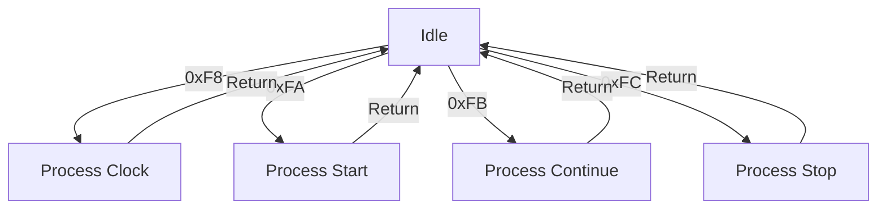

# Lesson 3: Sequencing, Timing, Synchronization

## 1. First-Principles Intuition & Invariants

When a drummer counts off a song, when a conductor raises the baton, when a sequencer's transport button clicks—each represents the same universal problem: establishing a shared temporal reference frame across multiple agents who must act in coordinated lockstep. Acoustic ensembles achieve this through auditory feedback loops and anticipatory listening, with human nervous systems compensating for the 10–30 millisecond round-trip latency between perception and motor response. Electronic music systems strip away biological middleware and confront the raw physics of clock distribution, sample-accurate scheduling, and deterministic event ordering.

MIDI timing is not a single protocol but a layered coordination architecture solving three distinct temporal problems. The first is beat clock distribution: transmitting a shared pulse that all devices subdivide into musical durations. The second is absolute time synchronization: locking MIDI event streams to external timecode references like film frames or multitrack tape. The third is event scheduling: maintaining sample-accurate placement of discrete note events within a continuous flow of clock pulses while compensating for transmission latency, processing jitter, and buffer quantization.

These three layers map to three distinct MIDI message types: MIDI Clock (`0xF8`) for beat-relative timing, MIDI Time Code (MTC, quarter-frame messages `0xF1`) for absolute SMPTE frame addressing, and Song Position Pointer (SPP, `0xF2`) for random-access repositioning within a sequence. Each protocol makes different trade-offs between bandwidth consumption, temporal resolution, and implementation complexity. Understanding when to use each requires reasoning about the fundamental constraints of serial transmission.

### MIDI Clock: Beat-Relative Synchronization

MIDI Clock operates as a 24-pulse-per-quarter-note (PPQN) heartbeat, transmitted as a continuous stream of single-byte `0xF8` messages at a rate determined by the master device's tempo. At 120 BPM, this translates to 48 clock messages per second—one every 20.83 milliseconds. This resolution seems coarse compared to audio sample rates (44.1 kHz yields a 22.67 microsecond tick), but MIDI Clock was never designed for sample-accurate audio triggering. It was designed for synchronizing arpeggiators, drum machines, and step sequencers that already operate on rhythmic grid subdivisions. The 24 PPQN resolution provides exactly one tick per sixteenth-note triplet at any tempo, aligning with the rhythmic subdivisions most electronic instruments use.

The critical invariant of MIDI Clock: tempo changes are communicated implicitly through clock rate modulation. No explicit tempo message exists in the MIDI 1.0 specification. The receiving device must measure inter-arrival time between consecutive `0xF8` bytes and infer the current tempo. This creates a fundamental bandwidth–latency trade-off. Faster tempos require higher message rates (at 240 BPM, we transmit 96 clocks per second), but tempo changes cannot be detected until at least two clock intervals have elapsed. A device averaging over four clock intervals for noise rejection will lag 83 milliseconds behind a tempo change at 120 BPM—musically perceptible and unacceptable for live performance.

The clock rate $f_{\text{clock}}$ relates to tempo $T$ (in BPM) by:

$$f_{\text{clock}} = \frac{T \times 24}{60} = 0.4T \text{ Hz}$$

The inter-clock period becomes:

$$\Delta t_{\text{clock}} = \frac{2500}{T} \text{ ms}$$

At 120 BPM, $\Delta t_{\text{clock}} = 20.83$ ms. At 240 BPM, this halves to 10.42 ms. The receiving device's tempo estimate $\hat{T}$ after measuring $n$ consecutive intervals is:

$$\hat{T} = \frac{60}{24 \cdot \overline{\Delta t}} = \frac{2500}{\overline{\Delta t}}$$

where $\overline{\Delta t}$ is the averaged inter-clock period in milliseconds. The temporal resolution of tempo detection thus scales inversely with averaging window size and directly with tempo. Fast tempos improve detection speed but increase bandwidth consumption and susceptibility to jitter.

### MIDI Time Code: Absolute Frame Addressing

MIDI Time Code takes the opposite approach, sacrificing bandwidth for absolute addressing. MTC divides each SMPTE frame (film runs at 24 fps, NTSC video at 29.97 fps, PAL at 25 fps) into eight quarter-frame messages, each carrying four bits of timecode data. At 30 fps, this yields 240 quarter-frame messages per second, each consuming three bytes including the `0xF1` status byte. The full timecode address—hours, minutes, seconds, and frames—requires eight consecutive quarter-frames to reconstruct, meaning the temporal resolution is inherently one frame delayed. For a 30 fps system, this represents a 33.33 millisecond quantization—acceptable for video post-production where frame boundaries are natural edit points, but too coarse for musical timing at fast tempos where a single frame spans multiple sixteenth notes.

At 120 BPM, a sixteenth note lasts 125 ms. A 30 fps frame (33.33 ms) represents approximately one quarter of a sixteenth note—insufficient resolution for tight rhythmic synchronization. At 240 BPM, a sixteenth note compresses to 62.5 ms, making the frame-level quantization even more problematic. MTC shines in post-production workflows where SMPTE frame boundaries define the temporal grid, not in scenarios requiring sub-beat accuracy.

The genius of MTC lies in its jam-sync capability. Once locked, a device can interpolate between received frames using its internal crystal oscillator, maintaining sub-frame timing accuracy even if occasional MTC messages are dropped. The full eight-quarter-frame sequence acts as a periodic GPS fix, correcting accumulated drift from the local oscillator's frequency error. Crystal oscillators typically exhibit ±50 ppm frequency tolerance, accumulating to ±0.18 seconds per hour in worst case. Periodic MTC full-frame messages or quarter-frame sequences reset this drift, making MTC robust against MIDI cable congestion and interrupt latency spikes.

### Song Position Pointer: Random Access and Seek

Song Position Pointer exists to solve the random-access seek problem that neither MIDI Clock nor MTC addresses efficiently. SPP is a 14-bit value (0–16383) transmitted as two seven-bit data bytes, representing the current position in MIDI beats (sixteenth notes) since the start of the song. The format follows the standard MIDI multi-byte encoding: the status byte `0xF2` followed by least-significant seven bits, then most-significant seven bits.

SPP combined with a Continue message (`0xFB`) allows instant repositioning without fast-forwarding through all intermediate clock ticks. This is essential for DAW-style workflows where producers scrub through arrangements non-linearly. However, SPP introduces a synchronization challenge: it specifies where you are but not when to start playing. The protocol assumes the master will immediately follow SPP with either a Start (`0xFA`) or Continue command, and all slaves must align their playback to the next incoming MIDI Clock tick. This creates a one-clock-tick ambiguity window (20.83 ms at 120 BPM) in absolute timing—a fundamental consequence of separating position addressing from clock distribution.

The SPP value $P$ encodes position in sixteenth notes:

$$P = \frac{T \cdot t}{60 \cdot 0.25}$$

where $T$ is tempo in BPM and $t$ is elapsed time in seconds. The factor 0.25 converts quarter notes to sixteenth notes (four sixteenth notes per quarter note). The maximum representable position of 16383 sixteenth notes corresponds to 4095.75 quarter notes, or approximately 68.26 minutes at 60 BPM—sufficient for most songs but potentially limiting for extended DJ sets or ambient compositions.

### The Fundamental MIDI Timing Invariant

The deepest invariant underlying all MIDI timing protocols: MIDI is a command stream, not a sample-accurate event list. MIDI messages describe intentions ("play this note at this velocity") with timestamp precision limited by serial transmission rate and processing latency, not absolute sample indices like an audio buffer. A MIDI sequencer running at 480 PPQN internal resolution (twenty times finer than MIDI Clock's 24 PPQN) must continuously quantize its high-resolution timeline onto the coarse MIDI Clock grid or pack events into the asynchronous gaps between clock pulses. This quantization is lossy and irreversible. A receiving device cannot distinguish between a note precisely on-beat and one slightly early but rounded forward to the next clock tick.

Modern DAWs circumvent this limitation by never actually transmitting MIDI Clock to software instruments running in the same process space. Internal plugins receive sample-accurate timestamps directly from the host's audio callback scheduler. MIDI Clock is only synthesized when communicating with external hardware over physical MIDI ports, where the 31.25 kbaud serial bottleneck and multi-millisecond transmission latency make sample-accurate timing impossible anyway.

## 2. Protocol Deep Dive: Message Formats and State Machines

### MIDI Clock Messages

MIDI Clock synchronization relies on five single-byte System Real-Time messages:

- **Timing Clock** (`0xF8`): Sent 24 times per quarter note
- **Start** (`0xFA`): Begin playback from song position zero
- **Continue** (`0xFB`): Resume playback from current Song Position Pointer
- **Stop** (`0xFC`): Halt playback immediately
- **Active Sensing** (`0xFE`): Optional keepalive heartbeat

System Real-Time messages have a unique property in MIDI: they can be interleaved within other multi-byte messages without corrupting them. If a device is transmitting a three-byte Note On message (`0x90 3C 64`) and a Timing Clock arrives after the first byte, the output becomes `0x90 0xF8 3C 64`. The receiver must recognize `0xF8` as a Real-Time message, process it immediately, then resume parsing the Note On message. This requires a state machine capable of suspending and resuming multi-byte message assembly.

The minimal MIDI Clock receiver state machine:



Start and Continue differ in their interaction with Song Position Pointer. Start resets the internal beat counter to zero and begins incrementing it with each Timing Clock. Continue assumes the beat counter was set by a preceding SPP message and resumes incrementing from that position. A compliant receiver must maintain this beat counter across Stop/Continue cycles to support pauseable playback.

### MIDI Time Code Quarter-Frame Messages

MTC quarter-frame messages encode SMPTE timecode (hours, minutes, seconds, frames) as eight successive three-byte messages. Each message consists of:

- Status byte: `0xF1`
- Data byte: `0nnn dddd` where `nnn` is the piece number (0–7) and `dddd` is four bits of timecode data

The eight pieces encode:

0. Frame count LS nibble (bits 0–3)
1. Frame count MS nibble (bits 4–7, bit 7 always 0)
2. Seconds count LS nibble (bits 0–3)
3. Seconds count MS nibble (bits 4–5, bits 6–7 always 0)
4. Minutes count LS nibble (bits 0–3)
5. Minutes count MS nibble (bits 4–5, bits 6–7 always 0)
6. Hours count LS nibble (bits 0–3)
7. Hours count MS nibble (bits 4) + frame rate code (bits 5–6, bit 7 always 0)

Frame rate codes in piece 7:
- `00`: 24 fps
- `01`: 25 fps
- `10`: 29.97 fps drop-frame
- `11`: 30 fps

The complete timecode address arrives over eight consecutive frames. At 30 fps, a new quarter-frame arrives every 8.33 ms, but the full timecode updates only every four frames (133.33 ms). This latency is acceptable for video post-production but problematic for real-time musical synchronization. Once locked, receivers interpolate between updates using their local clock to maintain sub-frame accuracy.

MTC also defines a Full Frame message transmitted as a System Exclusive:

```text
0xF0 0x7F 0x7F 0x01 0x01 hr mn sc fr 0xF7
```

This ten-byte message provides immediate timecode without waiting for eight quarter-frames. It is used for initial lock acquisition and after discontinuities like tape fast-forward. The hour byte encodes both timecode hour and frame rate in the same format as quarter-frame piece 7.

### Song Position Pointer Encoding

Song Position Pointer is a three-byte message:

```text
0xF2 <LSB> <MSB>
```

The two data bytes encode a 14-bit position value in MIDI beats (sixteenth notes since song start):

```text
Position = (MSB << 7) | LSB
```

This yields a range of 0–16383 sixteenth notes. The maximum position corresponds to 4095.75 quarter notes. At 120 BPM, this represents:

$$t_{\text{max}} = \frac{4095.75}{120} \times 60 = 2047.875 \text{ seconds} \approx 34.13 \text{ minutes}$$

Longer songs require wrapping or switching to MTC for absolute time reference. The SPP value increases monotonically regardless of time signature—a song in 7/8 still increments in sixteenth-note beats, not in measures or metric subdivisions.

## 3. Jitter, Latency, and Temporal Precision

MIDI Clock's 24 PPQN resolution provides a theoretical timing quantization of:

$$\Delta t_{\text{quant}} = \frac{60000}{24 \cdot T} \text{ ms}$$

At 120 BPM, this is 20.83 ms—perceptibly "late" if a note scheduled at the midpoint between clock ticks must wait for the next tick. Modern sequencers avoid this by using high internal resolution (typically 480–960 PPQN) and transmitting note events immediately without waiting for the next MIDI Clock pulse. The clock provides tempo reference, not event scheduling. Slaves synchronize their internal high-resolution clocks to the incoming MIDI Clock rate through phase-locked loop (PLL) algorithms, then schedule events at their native resolution.

MIDI's 31.25 kbaud serial rate imposes a minimum transmission time per byte:

$$t_{\text{byte}} = \frac{10 \text{ bits}}{31250 \text{ baud}} = 320 \, \mu\text{s}$$

The factor of 10 accounts for start and stop bits in the UART framing. A three-byte Note On message requires 960 microseconds—effectively one millisecond. At 120 BPM with 24 PPQN clock messages, we transmit 48 clocks per second plus musical events. If a dense chord of ten notes (30 bytes) coincides with a clock tick, the entire burst consumes 9.92 ms—half the inter-clock period. This congestion delays subsequent clock messages, introducing jitter.

Real-world MIDI jitter arises from multiple sources:

1. **Transmission serialization**: Dense event clusters delay clock messages
2. **Interrupt latency**: Receiver's UART interrupt handler may be preempted by higher-priority tasks
3. **Processing delay**: Parsing and routing MIDI messages through software layers adds microseconds to milliseconds
4. **Crystal oscillator drift**: Transmitter and receiver clocks run at slightly different frequencies

Professional MIDI interfaces implement hardware timestamping at the UART, capturing the arrival time of each byte relative to a high-resolution system clock (typically 1 MHz or higher). Software then compensates for interrupt latency by scheduling events based on these hardware timestamps rather than software processing time. USB MIDI interfaces add another complexity: USB frames arrive every 1 ms (USB full-speed) or 125 microseconds (USB high-speed), and multiple MIDI messages may be batched within a single USB frame. The driver must reconstruct the original timing from these batched messages.

Modern DAWs compensate for fixed output latency by scheduling MIDI messages earlier than their nominal playback time. If a software synthesizer reports 128-sample buffer latency at 48 kHz (2.67 ms), the DAW schedules Note On messages 2.67 ms early so they emerge from the audio output at the correct time. This lookahead works for pre-sequenced material but breaks down for live MIDI input, where the performer's gesture arrives with unpredictable latency. Round-trip latency (MIDI in → processing → audio out) becomes the critical metric for playability.

## 4. Practical Implementation Patterns

### Building a MIDI Clock Transmitter

A MIDI Clock transmitter maintains an accumulator that increments with each audio sample, generating a clock pulse when the accumulator crosses integer thresholds. At sample rate $f_s$ and tempo $T$:

$$\text{Accumulator increment per sample} = \frac{24 \cdot T}{60 \cdot f_s}$$

At 120 BPM and 48 kHz:

$$\Delta a = \frac{24 \cdot 120}{60 \cdot 48000} = 0.001$$

Every 1000 samples (20.83 ms), the accumulator crosses an integer boundary, triggering a clock pulse. This approach maintains sample-accurate phase even though MIDI messages are byte-quantized. The transmitter must handle tempo changes by updating the increment factor, but the accumulator's fractional component ensures smooth transitions without discontinuities.

```python
class MIDIClockTransmitter:
    def __init__(self, sample_rate, tempo):
        self.sample_rate = sample_rate
        self.tempo = tempo
        self.accumulator = 0.0
        self.ppqn = 24
        
    def set_tempo(self, new_tempo):
        self.tempo = new_tempo
        
    def process_samples(self, num_samples):
        increment = (self.ppqn * self.tempo) / (60.0 * self.sample_rate)
        clock_messages = []
        
        for i in range(num_samples):
            self.accumulator += increment
            if self.accumulator >= 1.0:
                self.accumulator -= 1.0
                clock_messages.append((i, 0xF8))
                
        return clock_messages
```

This code generates a list of `(sample_offset, message)` tuples. The host schedules each MIDI message for transmission at the precise sample when it should be sent. Tempo changes take effect immediately by updating the increment, and the fractional accumulator ensures no phase discontinuity.

### Building a MIDI Clock Receiver with PLL

A receiver cannot assume MIDI Clock arrives with sample accuracy due to serialization jitter and interrupt latency. A phase-locked loop filters these perturbations and reconstructs a stable internal clock:

```python
class MIDIClockReceiver:
    def __init__(self, sample_rate):
        self.sample_rate = sample_rate
        self.phase = 0.0
        self.frequency = 0.0
        self.last_clock_sample = 0
        self.locked = False
        
        # PLL parameters
        self.alpha = 0.1  # Phase correction gain
        self.beta = 0.01  # Frequency correction gain
        
    def on_clock_received(self, current_sample):
        if not self.locked:
            # First clock: initialize
            self.last_clock_sample = current_sample
            self.locked = True
            return
            
        # Measure inter-clock period in samples
        period = current_sample - self.last_clock_sample
        self.last_clock_sample = current_sample
        
        # Expected period based on current frequency estimate
        expected_period = self.sample_rate / self.frequency if self.frequency > 0 else period
        
        # Phase error: how far are we from expected clock arrival?
        phase_error = period - expected_period
        
        # Update frequency estimate (PLL feedback)
        self.frequency = self.sample_rate / period
        self.phase = 0.0  # Reset phase on each clock
        
    def get_internal_phase(self, current_sample):
        if not self.locked or self.frequency == 0:
            return 0.0
            
        samples_since_clock = current_sample - self.last_clock_sample
        expected_period = self.sample_rate / self.frequency
        
        return (samples_since_clock / expected_period) % 1.0
```

The PLL tracks the incoming clock rate and synthesizes a continuous phase that advances smoothly between clock messages. This phase drives internal event scheduling at the receiver's native resolution (480 PPQN or higher), with discrete MIDI Clock pulses serving only to resynchronize and correct drift. The `alpha` and `beta` parameters control the PLL's response speed versus noise rejection trade-off. Higher values respond faster to tempo changes but amplify jitter; lower values filter jitter but lag behind tempo changes.

### Handling Song Position Pointer

When SPP arrives, the receiver must reposition its internal sequencer without audio glitches:

```python
def on_song_position_pointer(self, lsb, msb):
    position_in_beats = (msb << 7) | lsb
    position_in_samples = self.beats_to_samples(position_in_beats)
    
    self.sequencer_position = position_in_samples
    self.accumulated_phase = 0.0
    
    # Flush any pending note events from previous position
    self.stop_all_notes()
    
def on_continue(self):
    # Resume from current SPP position
    self.transport_state = "playing"
    
def beats_to_samples(self, beats):
    # Convert sixteenth-note beats to samples
    seconds_per_beat = 60.0 / (self.tempo * 4)  # Sixteenth note duration
    return int(beats * seconds_per_beat * self.sample_rate)
```

The `stop_all_notes()` call prevents stuck notes when jumping to a new position. Some MIDI devices transmit All Notes Off (`0xB0 0x7B 0x00`) or Reset All Controllers (`0xB0 0x79 0x00`) before SPP to ensure clean state. The receiver must also scan forward through the sequence from the new position to determine which notes are already sounding at that point (a sustaining pad triggered earlier) versus which notes should be silent.

### MIDI Time Code Integration

A complete MTC receiver assembles quarter-frame messages into full timecode, then synchronizes an internal clock to the SMPTE frame rate:

```python
class MTCReceiver:
    def __init__(self, sample_rate):
        self.sample_rate = sample_rate
        self.qf_buffer = [0] * 8
        self.qf_index = 0
        self.current_timecode = None
        self.frame_rate = 30
        self.last_qf_time = 0
        
    def on_quarter_frame(self, data, current_sample):
        piece = (data >> 4) & 0x07
        value = data & 0x0F
        
        self.qf_buffer[piece] = value
        self.qf_index = piece
        
        # After piece 7, we have complete timecode
        if piece == 7:
            self.assemble_timecode()
            
        self.last_qf_time = current_sample
        
    def assemble_timecode(self):
        frames = (self.qf_buffer[1] << 4) | self.qf_buffer[0]
        seconds = (self.qf_buffer[3] << 4) | self.qf_buffer[2]
        minutes = (self.qf_buffer[5] << 4) | self.qf_buffer[4]
        hours = (self.qf_buffer[7] & 0x01) << 4 | self.qf_buffer[6]
        
        rate_code = (self.qf_buffer[7] >> 1) & 0x03
        self.frame_rate = [24, 25, 29.97, 30][rate_code]
        
        self.current_timecode = {
            'hours': hours,
            'minutes': minutes,
            'seconds': seconds,
            'frames': frames,
            'frame_rate': self.frame_rate
        }
        
    def get_current_time_in_samples(self, current_sample):
        if not self.current_timecode:
            return 0
            
        # Convert SMPTE to total samples
        tc = self.current_timecode
        total_seconds = (tc['hours'] * 3600 + 
                        tc['minutes'] * 60 + 
                        tc['seconds'] + 
                        tc['frames'] / tc['frame_rate'])
        
        # Add interpolated samples since last quarter-frame
        samples_since_qf = current_sample - self.last_qf_time
        interpolated_seconds = samples_since_qf / self.sample_rate
        
        return int((total_seconds + interpolated_seconds) * self.sample_rate)
```

The interpolation between quarter-frames assumes constant frame rate. Drop-frame timecode (29.97 fps NTSC) complicates this by skipping frame numbers at regular intervals to compensate for the non-integer frame rate. Properly handling drop-frame requires checking whether the current minute is a multiple of ten and adjusting frame counts accordingly.

## 5. Advanced Topics: Drift Compensation and Multi-Master Scenarios

### Clock Drift and Crystal Oscillator Tolerance

Two independent oscillators running at nominally the same frequency will drift apart due to manufacturing tolerances and temperature variation. A typical crystal oscillator exhibits ±50 ppm frequency error. Two devices with opposite-sign errors (one +50 ppm, one -50 ppm) drift at 100 ppm relative rate:

$$\Delta t_{\text{drift}} = 100 \times 10^{-6} \times t$$

Over one minute (60 seconds), this accumulates to 6 milliseconds—enough to shift a sixteenth note at 120 BPM by 4.8% of its duration (125 ms). Over an hour, drift reaches 360 milliseconds—musically catastrophic.

MIDI Clock and MTC counter this by continuously resynchronizing. MIDI Clock's 48 Hz pulse rate at 120 BPM provides a resync every 20.83 ms, limiting maximum drift to 2.08 microseconds worst-case. MTC quarter-frames at 240 Hz provide even tighter correction. The receiver's PLL filters these corrections to avoid audible tempo fluctuations while tracking long-term drift.

Temperature-compensated crystal oscillators (TCXO) reduce frequency error to ±1 ppm or better, shrinking worst-case relative drift to 2 ppm or 7.2 milliseconds per hour. Oven-controlled crystal oscillators (OCXO) achieve ±0.01 ppm, eliminating drift concerns for all practical musical applications. High-end MIDI interfaces and master clocks use TCXOs or OCXOs to minimize jitter and drift when generating MIDI Clock from an internal tempo source.

### Multi-Master Synchronization and Clock Arbitration

Standard MIDI assumes a single master clock source, but complex setups may require multiple devices to take turns as master. A hardware looper might run as clock master during overdub, then yield to the DAW when recording is complete. This requires a clock arbitration protocol, which MIDI 1.0 does not define.

Common solutions include:

1. **Manual switching**: The user physically reconfigures MIDI routing to change clock source
2. **MIDI merge with priority**: A hardware MIDI merger forwards clock messages from only one designated input
3. **Software arbitration**: A DAW or central controller decides which device is master and gates clock messages accordingly

None of these prevent conflicts if two devices simultaneously transmit clock. The result is clock messages interleaved at unpredictable rates, causing tempo oscillation and potential synchronization loss. Well-designed systems enforce mutual exclusion: only one device transmits Start/Stop/Clock messages on a given MIDI bus at any time.

MIDI Machine Control (MMC) provides transport control commands separate from timing, allowing one device to control another's transport (play, stop, record, locate) without directly transmitting clock. A DAW might send MMC Play to a hardware recorder, which then generates its own MIDI Clock as master. This separates logical transport control from temporal clock distribution, improving robustness in multi-device setups.

### Sample-Accurate Timing in Plugin Hosts

Modern DAWs achieve sample-accurate internal timing by bypassing MIDI Clock entirely for software instruments. The host maintains a master timeline in samples and delivers timestamped MIDI events directly to plugins via the audio callback. The VST3 and AU (Audio Unit) plugin APIs provide sample-offset fields in their event structures:

```cpp
struct VstMidiEvent {
    int32_t deltaFrames;  // Sample offset within current audio buffer
    uint8_t midiData[4];  // MIDI message bytes
    // ... other fields
};
```

A sequencer schedules a note for sample 44127 in the global timeline. The audio callback processes buffer 44100–44199. The event's `deltaFrames` is 27, indicating it triggers 27 samples into the buffer. The plugin processes samples 0–26, triggers the note at sample 27 (updating oscillator phase, envelope generators), then processes samples 27–99 with the note active.

This sample-accurate timing is trivial within a single process but impossible over physical MIDI cables due to serialization latency. A three-byte Note On message requires 960 microseconds at 31.25 kbaud, equivalent to 42 samples at 44.1 kHz or 46 samples at 48 kHz. The recipient cannot know which sample the transmitter intended as the "correct" trigger time. MIDI Clock over physical cables remains quantized to the inter-clock period (20.83 ms at 120 BPM), and even that assumes perfect PLL lock in the receiver.

## 6. MIDI 2.0 Timing Enhancements

MIDI 2.0 introduces Jitter Reduction Timestamps (JR Timestamps) to address the sample-accuracy limitations of MIDI 1.0 Clock. A JR Timestamp is a 16-bit value representing time in units of 1/31250 second—approximately 32 microseconds. This resolution matches one MIDI byte transmission time, making it the finest granularity achievable over a 31.25 kbaud serial link.

JR Timestamps are relative, not absolute. Each timestamp specifies the delay from the previous message to the current message. This delta encoding avoids clock drift issues and requires no shared time base between transmitter and receiver. A sequence of Note On messages at 120 BPM (125 ms per sixteenth note) would carry timestamps of approximately 3906 units (125 ms / 32 μs).

MIDI 2.0 also defines a 64-bit absolute timestamp format for use in non-real-time contexts like Standard MIDI File (SMF) playback. These timestamps count in units of 1 nanosecond, providing sub-sample precision even at 192 kHz audio rates. The format includes a synchronization header specifying the time base (MIDI Clock, MTC, or free-running counter), allowing receivers to align timestamps with their local clock reference.

The practical impact of MIDI 2.0 timing: hardware MIDI interfaces can now timestamp events with microsecond accuracy, and compliant software can reconstruct the original timing when replaying recorded MIDI data. This does not eliminate serialization latency (messages still transmit at 31.25 kbaud in MIDI 1.0 transport mode, though MIDI 2.0 over USB uses higher effective bandwidth), but it allows receivers to compensate for that latency by reconstructing the transmitter's intended timing.

## 7. Debugging and Measurement Tools

Diagnosing timing problems requires observing the actual MIDI message stream with microsecond resolution. Software MIDI monitors capture messages but rely on OS timestamps, which suffer from interrupt latency and scheduler jitter. Hardware protocol analyzers with dedicated UART capture provide ground truth.

A minimal hardware MIDI analyzer consists of a microcontroller with two UARTs: one configured as a MIDI receiver (31.25 kbaud, 8N1), the other as a USB CDC serial port for logging. The firmware timestamps each received byte using a high-resolution timer (1 MHz or better) and forwards the byte along with its timestamp to the USB host. Software on the host reconstructs the MIDI message stream and computes inter-message timing statistics.

Key metrics for timing analysis:

1. **Inter-clock jitter**: Standard deviation of inter-clock periods at constant tempo
2. **Clock-to-note latency**: Time from nearest MIDI Clock to Note On message
3. **Round-trip latency**: Time from Note On input to corresponding audio output
4. **Tempo tracking error**: Difference between transmitted and measured tempo over time

A well-behaved system at 120 BPM exhibits inter-clock jitter below 1 ms (5% of the 20.83 ms period) and tempo tracking error below ±0.1 BPM after PLL lock. Higher jitter indicates congestion, interrupt latency issues, or insufficient PLL filtering. Tempo tracking error suggests crystal oscillator drift or incorrect PLL tuning.

MIDI Monitor software for macOS, MIDI-OX for Windows, and `aseqdump` on Linux provide real-time message logging with millisecond timestamps. For deeper analysis, Wireshark supports USB MIDI packet capture and can decode MIDI 2.0 Universal MIDI Packet (UMP) format. Combining software monitoring with oscilloscope probes on the physical MIDI TX/RX lines reveals the ground truth of serial transmission timing, unaffected by software buffering and USB framing artifacts.

## 8. Conclusion

MIDI timing protocols embody a fundamental trade-off between bandwidth, resolution, and implementation complexity. MIDI Clock sacrifices absolute time reference and fine temporal resolution for minimal bandwidth consumption and simple state machines. MIDI Time Code sacrifices bandwidth and latency for sample-accurate absolute positioning. Song Position Pointer sacrifices continuous synchronization for instant random access. No single protocol solves all problems, so professional systems layer multiple protocols: MIDI Clock for beat-relative musical timing, MTC for film/video lockup, SPP for DAW-style non-linear editing, and sample-accurate internal timestamps for plugin instruments.

Understanding these protocols requires reasoning from first principles about serial transmission constraints, clock distribution physics, and the irreducible latencies of perception and computation. MIDI's 40-year legacy proves the durability of well-designed timing abstractions, even as MIDI 2.0 extends those abstractions to address modern requirements for microsecond precision and deterministic sample-accurate event scheduling. The sequencer that runs your DAW today descends directly from the hardware sequencers of the 1980s, bound by the same fundamental constraints and exploiting the same clever encoding tricks to maintain the illusion of perfect temporal coordination in an imperfect, jittery, latency-bound world.
