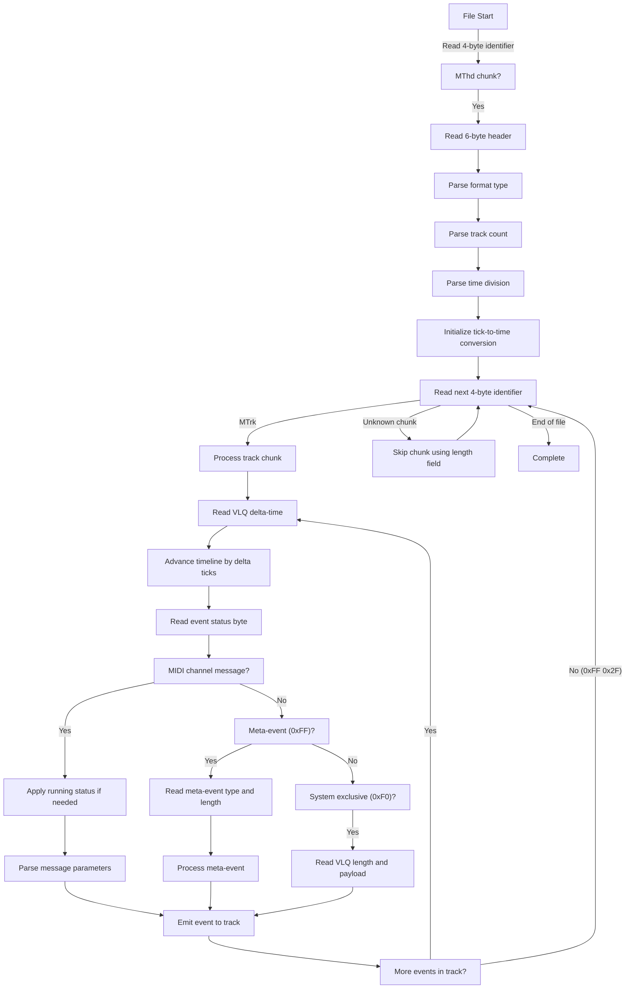

# Lesson 4: File Formats, Routing, Ecosystem Integration

## 1. First-Principles Intuition & Invariants

The MIDI specification emerged in 1983 as a real-time streaming protocol for transmitting musical gestures between synthesizers and sequencers over 31.25 kbaud serial connections. The protocol's rapid adoption across manufacturers created an immediate need for a persistent storage format—a recording medium that could capture complete musical performances while preserving temporal relationships, control changes, and the meta-information necessary to reconstruct a composition's full context. The Standard MIDI File specification answered this need by defining a binary container format that encoded MIDI events alongside timing metadata, enabling portability across hardware platforms and software ecosystems with fundamentally different internal representations of musical time.

A Standard MIDI File is a serialized representation of one or more MIDI event streams, each corresponding to a logical track. The format reconciles two conflicting requirements: microsecond-level timing precision for expressive performances, and parseability by simple embedded systems with limited memory. The designers chose a chunk-based binary format modeled after the IFF (Interchange File Format) architecture developed by Electronic Arts. The file begins with a header chunk declaring global timing resolution, followed by one or more track chunks containing variable-length encoded delta-time event sequences. This chunking strategy allows parsers to skip unknown chunk types gracefully, providing forward compatibility as the specification evolved to accommodate new event types and metadata extensions.

The foundational invariant governing Standard MIDI Files is the division of musical time into abstract tick counts rather than absolute clock time. The header chunk declares a time base—either pulses per quarter note (PPQN) for tempo-relative timing or frames per second for SMPTE-locked synchronization—and every subsequent event carries a delta-time offset measured in these units. This design decouples musical content from playback tempo. A performance recorded at 120 BPM with 480 PPQN resolution can be played back identically at 90 BPM by scaling the conversion factor between ticks and microseconds. This tempo-agnostic representation explains why Standard MIDI Files remain the universal interchange format for notation software, digital audio workstations, and algorithmic composition systems four decades after their introduction.

The Standard MIDI File specification defines three format types—Type 0, Type 1, and Type 2—each optimized for different use cases. Type 0 files contain a single track multiplexing all MIDI channels into one interleaved stream, sorted by absolute time. This format targeted simple hardware sequencers with limited memory, where track-based organization was unnecessary overhead. Type 1 files maintain separate tracks for each musical part or MIDI channel, preserving the logical organization of multi-instrument arrangements. This format dominates professional music production because it allows composers to isolate instrumental voices, apply per-track processing, and edit individual parts without disturbing the global timing grid. Type 2 files define independent sequences with no shared timing reference. They were intended for pattern-based hardware sequencers but saw minimal adoption in software ecosystems and are now effectively obsolete.

The General MIDI specification introduced a standardized mapping between program change numbers and instrumental timbres, ensuring that a Standard MIDI File would produce recognizable instrumentation regardless of playback device. General MIDI Level 1 defined 128 program numbers organized into sixteen instrument families: pianos occupy slots 1 through 8, chromatic percussion 9 through 16, organs 17 through 24, and so forth. The specification also standardized a drum map on channel 10 where MIDI note 36 always triggers a bass drum and note 38 always triggers an acoustic snare. This standardization allowed composers to distribute MIDI files with confidence that the musical intent would survive playback on any General MIDI-compliant synthesizer, from consumer sound cards to professional rackmount modules. General MIDI Level 2 expanded the instrument palette to 256 programs using bank select messages, introduced standardized controller mappings for sound variation and release time, and mandated polyphony and multitimbral capabilities that elevated baseline quality expectations for compliant devices.

Roland's GS and Yamaha's XG extensions built upon General MIDI by defining proprietary system exclusive messages that unlocked additional synthesis parameters, effects processing, and extended instrument banks. These extensions preserved backward compatibility with General MIDI playback while offering enhanced expressiveness for users with brand-specific hardware. A GS-aware sequencer could embed reverb level adjustments, chorus depth modulation, and filter cutoff sweeps directly into the MIDI file, but non-GS devices would ignore these messages harmlessly and fall back to General MIDI instrument mapping. This layered compatibility model demonstrates the extensibility design principle that guided MIDI's evolution: every new feature must degrade gracefully on legacy hardware rather than rendering older files unplayable.

The routing topology connecting MIDI sources to destinations within modern digital audio workstations represents a virtualized instantiation of hardware patching paradigms that governed studio workflows in the 1980s and 1990s. In the hardware era, a composer might route a master keyboard controller through a MIDI thru box to trigger multiple synthesizer modules simultaneously, with each module assigned to a unique MIDI channel. The sequencer would record the merged input stream and play it back through the same routing matrix, relying on channel-based filtering to direct musical gestures to their intended destinations. Software DAWs preserve this conceptual model while eliminating physical cable constraints, allowing arbitrary many-to-many connections between virtual instruments, effect processors, and control surfaces. A single MIDI track can drive multiple software synthesizers in parallel, each responding to overlapping note ranges or controller numbers, while a single hardware controller can simultaneously manipulate transport controls, mixer faders, and synthesis parameters across dozens of virtual instruments.

## 2. Standard MIDI File Format Structure

The binary structure of a Standard MIDI File consists of a sequence of chunks, each beginning with a four-byte ASCII identifier followed by a 32-bit big-endian length field specifying the chunk payload size in bytes. This length field allows parsers to skip unrecognized chunk types by advancing the read pointer by the declared length, providing resilience against future specification extensions. The two mandatory chunk types are the header chunk (identified by the ASCII string "MThd") and one or more track chunks (identified by "MTrk"). Optional chunks carrying auxiliary data such as lyrics, time signatures, or instrument names may appear between track chunks, but conforming parsers must not require their presence.

The header chunk payload is exactly six bytes: a 16-bit format type field (0, 1, or 2), a 16-bit track count field, and a 16-bit time division field. The format type determines whether tracks are interpreted as a single multiplexed stream (Type 0), parallel synchronized streams (Type 1), or independent sequences (Type 2). The track count specifies how many track chunks follow the header; for Type 0 files, this value must be 1. The time division field encodes the temporal resolution using a sign-disambiguated format: when the most significant bit is 0, the remaining 15 bits specify pulses per quarter note (PPQN), typically 96, 192, 384, or 480. When the most significant bit is 1, the field encodes SMPTE frame-based timing, with the upper byte specifying frames per second (24, 25, 29.97, or 30) as a negative two's complement value and the lower byte specifying ticks per frame.

Track chunks contain sequences of time-stamped MIDI events prefixed by variable-length delta-time values. Delta-times encode the number of ticks elapsed since the previous event using a compact variable-length quantity (VLQ) format inherited from ASN.1 encoding standards. Each byte in a VLQ carries seven bits of payload in the lower seven bit positions, with the most significant bit serving as a continuation flag: when set, another byte follows; when clear, the current byte is the final byte. To decode a VLQ, a parser accumulates bits from successive bytes, shifting previous values left by seven bits and OR-ing in the lower seven bits of each new byte, until it encounters a byte with the continuation bit cleared. This encoding allows common small delta-times (0 to 127 ticks) to fit in a single byte while accommodating arbitrarily large delays without imposing a fixed field width.

Following each delta-time, the file contains either a MIDI channel message, a system exclusive message, or a meta-event. MIDI channel messages use running status compression: when consecutive events share the same status byte (identical message type and channel), the second and subsequent events may omit the status byte, inheriting it from the previous event. This compression technique significantly reduces file size for dense passages where a single channel produces rapid note streams. System exclusive messages begin with the status byte 0xF0, followed by a variable-length encoded payload length, followed by the manufacturer ID and parameter bytes, and terminated by 0xF7. Meta-events, unique to Standard MIDI Files, begin with status byte 0xFF followed by a type byte and a variable-length encoded payload. Common meta-event types include sequence number (0x00), text events (0x01), copyright notice (0x02), track name (0x03), tempo changes (0x51), time signature (0x58), key signature (0x59), and end-of-track marker (0x2F). Every track chunk must terminate with an end-of-track meta-event; parsers encountering a track chunk without this marker should treat the file as malformed.

The tempo meta-event (0xFF 0x51 0x03) carries a 24-bit payload specifying microseconds per quarter note. This value, combined with the PPQN resolution from the header chunk, defines the conversion factor between abstract ticks and real-world time. At a tempo of 120 BPM, each quarter note occupies 500,000 microseconds. With 480 PPQN resolution, each tick corresponds to $500{,}000 / 480 \approx 1041.67$ microseconds. A delta-time of 240 ticks advances the playback position by $240 \times 1041.67 \approx 250{,}000$ microseconds, or one eighth note. When a tempo change meta-event appears mid-sequence, the conversion factor updates immediately, causing subsequent delta-times to expand or contract proportionally. This mechanism allows rubato performances, accelerando passages, and fermatas to be encoded naturally without resorting to artificially dense event streams.

Time signature meta-events (0xFF 0x58 0x04) carry four bytes: numerator, denominator expressed as a power of two (2 for quarter notes, 3 for eighth notes), MIDI clocks per metronome click, and thirty-second notes per 24 MIDI clocks. The denominator encoding allows efficient representation of compound meters: a 6/8 time signature encodes as numerator 6, denominator 3 (since $2^3 = 8$), metronome click rate 36, and thirty-seconds per 24 clocks equal to 8. These meta-events guide notation software when rendering the MIDI file as a score, but they do not affect timing or playback directly—tempo meta-events alone control temporal interpretation.

## 3. General MIDI, GS, and XG Standards

The General MIDI specification emerged in 1991 to address the chaos of incompatible program change mappings across synthesizer manufacturers. Before General MIDI, a MIDI file created on a Roland synthesizer might sound unrecognizable on a Yamaha device because program number 10 could trigger a string ensemble on one device and a saxophone on another. General MIDI Level 1 standardized 128 program numbers across sixteen instrument families: acoustic grand piano (1), bright acoustic piano (2), electric grand piano (3), honky-tonk piano (4), electric piano 1 (5), electric piano 2 (6), harpsichord (7), clavinet (8), celesta (9), glockenspiel (10), music box (11), vibraphone (12), marimba (13), xylophone (14), tubular bells (15), dulcimer (16), drawbar organ (17), and so forth through to gunshot (128). The specification mandated 24-voice polyphony and 16-part multitimbrality, ensuring that devices could play complex arrangements without voice-stealing artifacts that truncated sustained notes prematurely.

Channel 10 received special treatment as the dedicated percussion channel, with a standardized drum map assigning each MIDI note number to a specific unpitched percussion instrument. The General MIDI drum map includes acoustic bass drum (35), bass drum 1 (36), side stick (37), acoustic snare (38), hand clap (39), electric snare (40), low floor tom (41), closed hi-hat (42), high floor tom (43), pedal hi-hat (44), low tom (45), open hi-hat (46), low-mid tom (47), hi-mid tom (48), crash cymbal 1 (49), high tom (50), ride cymbal 1 (51), and continues through to open triangle (82). This mapping derives from the electronic drum kit layouts popularized by Roland's TR-808 and TR-909 drum machines, ensuring that MIDI files created with drum programming software would trigger the expected percussion sounds on any General MIDI playback device.

The General MIDI specification also standardized controller assignments for expressive performance parameters. Controller 1 (modulation wheel) affects vibrato depth, controller 7 (channel volume) sets relative loudness, controller 10 (pan) positions the sound in the stereo field, controller 11 (expression) provides real-time dynamic shaping, controller 64 (sustain pedal) extends note durations, and controller 91 (reverb send level) adjusts spatial depth. These controller assignments allow composers to embed expressive nuances directly into MIDI files, with confidence that the performance will translate across playback devices. The pitch bend range defaults to ±2 semitones, providing smooth glissando and vibrato effects without extreme detuning that would sound cartoonish or broken.

General MIDI Level 2, ratified in 1999, expanded the instrument palette to 256 programs by introducing bank select messages (controllers 0 and 32). The specification defined a capital tone bank (MSB 121) containing variations on the 128 base instruments—for example, program 1 in bank 0 is acoustic grand piano, while program 1 in bank 121 is a brighter or alternate acoustic grand piano. General MIDI Level 2 also introduced standardized controller assignments for filter cutoff frequency (controller 74), filter resonance (71), envelope attack time (73), envelope decay time (75), envelope release time (72), and vibrato rate (76), giving composers access to synthesis parameters that were previously device-specific. The specification mandated 32-voice polyphony and 16-channel multitimbrality, doubling the minimum voice count to accommodate orchestral arrangements with dense textures.

Roland's GS extension, introduced with the Roland Sound Canvas series in 1991, predated General MIDI Level 2 and established many of the concepts that later became standardized. GS defined additional instrument banks accessed through controller 0 (bank select MSB), with bank 1 containing variations on the base General MIDI sounds and bank 127 hosting the capital tone variations. GS also introduced system exclusive messages for global effects control, allowing sequencers to adjust reverb type (room, hall, plate), reverb time, reverb level, chorus type (chorus 1, chorus 2, chorus 3, chorus 4, feedback chorus, flanger, short delay, short delay with feedback), chorus rate, chorus depth, chorus feedback, and delay time. A GS reset system exclusive message (0xF0 0x41 0x10 0x42 0x12 0x40 0x00 0x7F 0x00 0x41 0xF7) initializes the synthesizer to known parameter values, ensuring consistent playback across sessions.

Yamaha's XG extension, introduced with the Yamaha MU80 and DB50XG in 1994, competed with Roland's GS by offering an even more extensive parameter set accessible through system exclusive messages. XG defined 480 instrument variations organized into banks, with bank select MSB determining the broad category (0 for normal voices, 64 for SFX) and LSB selecting the specific variation. XG introduced integrated multi-effects processing with insertion effects (distortion, overdrive, compression, parametric EQ, auto-wah, auto-pan), system effects (reverb and chorus with detailed parameter control), and master equalizer settings. The XG specification also included variation effects that could be routed per channel, giving composers access to studio-grade processing chains within the MIDI file itself. An XG reset message (0xF0 0x43 0x10 0x4C 0x00 0x00 0x7E 0x00 0xF7) restores default parameters, similar to GS reset functionality.

Both GS and XG maintained strict backward compatibility with General MIDI Level 1, ensuring that files created with extended features would play back on basic General MIDI devices with graceful degradation. Unknown system exclusive messages are ignored silently, and bank select messages that reference unavailable banks default to bank 0, producing the standard General MIDI instrument set. This compatibility model allowed composers to target the lowest common denominator while optionally enhancing playback for users with advanced synthesizers.

## 4. MIDI Routing in Modern DAW Environments

Digital audio workstations virtualize the hardware patching paradigms that governed MIDI routing in the 1980s, where physical cables connected controllers, sequencers, and sound modules in a signal flow determined by MIDI thru boxes and patch bays. In contemporary software environments, MIDI routing operates as a directed graph where nodes represent MIDI sources (hardware controllers, virtual instruments, sequencer tracks, arpeggiators, MIDI effect processors) and destinations (virtual instruments, hardware synthesizers, control surfaces, recording tracks), and edges represent MIDI connections that can filter, transform, or merge event streams. This graph topology allows arbitrary many-to-many mappings: a single controller can drive multiple virtual instruments simultaneously, and a single virtual instrument can respond to merged input from multiple controllers.

The fundamental routing primitive is the MIDI track, which serves as both a recording destination and a playback source. When a MIDI track's input is armed for recording, it listens to one or more MIDI input ports (hardware interfaces or virtual IAC buses on macOS, ALSA sequencer ports on Linux, or virtual MIDI cables on Windows) and optionally filters the incoming event stream by channel number. The recorded events are timestamped relative to the project timeline using the DAW's internal tick resolution, which typically matches or exceeds the 480 PPQN resolution common in Standard MIDI Files. During playback, the track emits its recorded event sequence to one or more MIDI output destinations—typically virtual instruments loaded in the same project or external hardware synthesizers connected via MIDI interface—with optional per-track transposition, velocity scaling, or delay offset applied in real time.

MIDI effect processors insert into the signal path between a track and its output destination, transforming event streams in musically meaningful ways. Common MIDI effects include arpeggiators (which convert held chords into rhythmic note patterns), chord generators (which harmonize single-note input with thirds, fifths, or custom intervals), quantizers (which snap event timestamps to a rhythmic grid), humanizers (which introduce subtle timing and velocity variations to mechanical sequences), and transposers (which shift pitch by semitone intervals or scale degrees). These processors can be chained serially, with the output of one effect feeding the input of the next, creating complex transformations that would be tedious to program manually. For example, a chord generator followed by an arpeggiator converts single-note input into arpeggiated chord progressions, while a quantizer followed by a humanizer produces rhythmically tight but expressively varied performances.

MIDI routing matrices in professional DAWs allow track outputs to fan out to multiple destinations with per-connection filtering and transformation. Ableton Live's MIDI routing panel supports arbitrary track-to-track connections, enabling a single performance track to drive multiple instruments in parallel while recording the merged input from hardware controllers and other tracks. Logic Pro's environment window exposes a lower-level graph editor where users can construct custom MIDI processing chains by connecting virtual cables between instrument objects, channel splitters, transformers, and output ports. This flexibility enables esoteric routing scenarios: a single keyboard controller can simultaneously trigger a piano virtual instrument, record MIDI to a sequencer track, send control change messages to mixer automation, and drive lighting cues via MIDI-to-DMX conversion, all from a single performance.

Channel-based filtering remains a critical routing mechanism inherited from hardware MIDI workflows. A physical MIDI cable carries events for all sixteen channels, and receiving devices filter the stream by listening only to their assigned channel. In software, this paradigm persists through virtual MIDI buses that multiplex events from multiple sources, with receiving instruments filtering by channel assignment. A single virtual MIDI bus can carry a complete orchestral arrangement, with channel 1 carrying violin, channel 2 carrying viola, channel 3 carrying cello, channel 4 carrying bass, and so forth, and each virtual instrument responding only to its designated channel. This approach conserves routing complexity in large projects while maintaining logical separation between instrumental voices.

MIDI clock synchronization enables external hardware sequencers, drum machines, and effects processors to lock to the DAW's transport and tempo. The MIDI clock protocol transmits 24 timing pulses per quarter note along with start, stop, and continue messages that control transport state. When a DAW transmits MIDI clock to an external sequencer, the hardware device advances its internal timeline in lockstep with the software project, allowing hybrid workflows where some parts play back from the computer and others play from hardware. MIDI Time Code (MTC) provides an alternative synchronization method based on SMPTE timecode, transmitting hours, minutes, seconds, and frames at 30 Hz to lock video editing systems, tape machines, and multi-track recorders to the DAW's timeline. MTC is particularly valuable in post-production workflows where audio must remain frame-locked to video during editing and mixing.

Control surfaces communicate with DAWs using a bidirectional MIDI protocol that maps physical faders, knobs, and buttons to software parameters while updating the control surface's displays and motorized faders to reflect current parameter values. The Mackie Control Universal (MCU) protocol became the de facto standard for control surface communication, defining a fixed mapping between MIDI note numbers, controller numbers, and mixer functions (channel faders, pan knobs, mute/solo buttons, transport controls, jog wheel). DAWs supporting MCU protocol can automatically recognize and configure compatible control surfaces, establishing bidirectional communication over a standard MIDI connection. Proprietary protocols like Ableton's Link, MIDI Polyphonic Expression (MPE), and OSC (Open Sound Control) extend control surface capabilities beyond traditional MIDI's limitations, but MIDI remains the universal fallback for basic transport control and parameter automation.

The routing flexibility of modern DAW environments enables hybrid workflows that combine virtual instruments, hardware synthesizers, MIDI effects, and control surfaces into integrated production systems. A composer might perform a piano part on a MIDI controller, route the input through a chord generator to create four-note voicings, split the chords across three virtual instrument tracks (bass, piano, strings) using channel filtering, record the performance to a sequencer track for editing, and simultaneously drive the LED rings on the controller to provide visual feedback for velocity and sustain pedal state. This level of integration, impossible in the hardware era, transforms MIDI from a simple note transport protocol into a comprehensive control infrastructure that orchestrates every aspect of music production.
