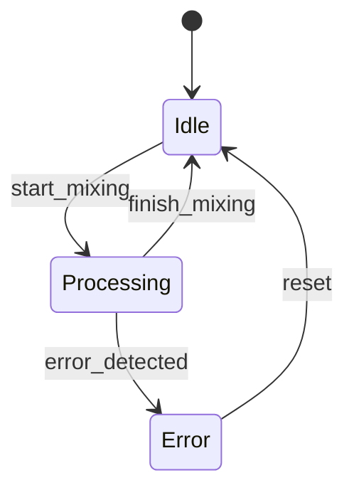
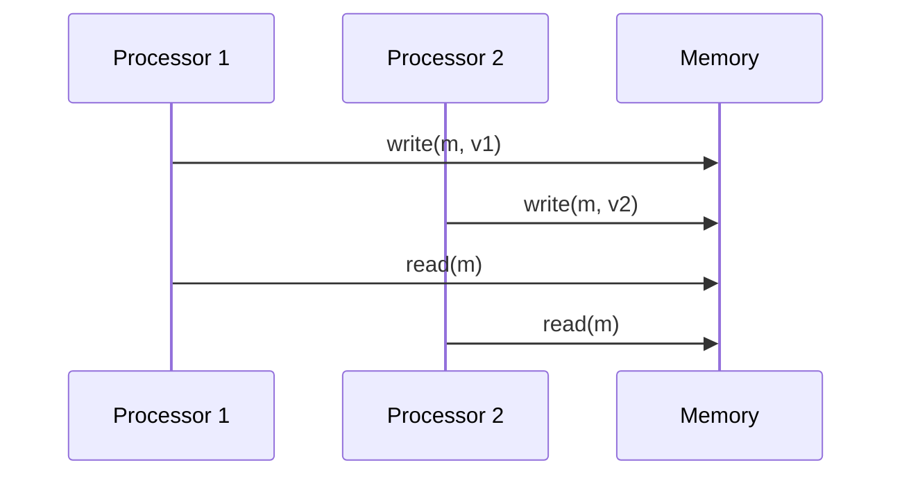

# Advanced Foundation: Mixing
## 1. Theoretical Invariants & Formal Frameworks

### Formal Proofs in Mixing
Formal proofs in mixing involve the rigorous mathematical demonstration of the consistency and correctness of mixing algorithms and processes. These proofs ensure that the mixing operations adhere to predefined invariants and constraints, providing a solid theoretical foundation for audio processing.

**Example:**
Consider the invariant that the sum of the amplitudes of the mixed signals should not exceed a certain threshold to prevent clipping. A formal proof would involve demonstrating that for any input signals \( x(t) \) and \( y(t) \), the output \( z(t) = x(t) + y(t) \) satisfies \( |z(t)| \leq T \), where \( T \) is the threshold.

### Kernel or Physical Invariants
Kernel invariants in the context of mixing refer to the properties that remain unchanged under the operations of the mixing kernel. Physical invariants are the properties of the audio signals that are preserved during the mixing process.

**Example:**
A physical invariant in mixing could be the conservation of energy, where the total energy of the mixed signals is equal to the sum of the energies of the individual input signals. This can be expressed as:
\[ \int_{-\infty}^{\infty} |z(t)|^2 \, dt = \int_{-\infty}^{\infty} |x(t)|^2 \, dt + \int_{-\infty}^{\infty} |y(t)|^2 \, dt \]

## 2. Low-Level Invariant Taxonomy

### Deep Registers
Deep registers in mixing refer to the low-level memory structures used to store and manipulate audio data. These registers must maintain certain invariants to ensure data integrity and consistency.

**Example:**
A deep register invariant could be that the data stored in a register does not change unless explicitly modified by a mixing operation. This can be expressed as:
\[ \forall t, \forall i, \text{if } \text{no\_operation}(t, i) \text{ then } R_i(t+1) = R_i(t) \]
where \( R_i(t) \) represents the value in register \( i \) at time \( t \).

### Memory Models
Memory models define the rules for accessing and modifying memory in a mixing system. These models must ensure that memory operations adhere to certain invariants to prevent data corruption and ensure consistency.

**Example:**
A memory model invariant could be that a read operation returns the value that was last written to the memory location. This can be expressed as:
\[ \forall t, \forall m, \forall v, \text{if } \text{write}(m, v, t) \text{ then } \text{read}(m, t+1) = v \]

### Hardware Constraints
Hardware constraints in mixing refer to the limitations and capabilities of the hardware used to perform mixing operations. These constraints must be taken into account to ensure that the mixing process is feasible and efficient.

**Example:**
A hardware constraint invariant could be that the mixing process does not exceed the maximum processing capacity of the hardware. This can be expressed as:
\[ \forall t, \text{if } \text{mixing\_load}(t) \leq \text{max\_capacity} \]

### Axiomatic Definitions
Axiomatic definitions in mixing provide the fundamental principles and assumptions that underlie the mixing process. These definitions must be consistent and well-defined to ensure the correctness of the mixing operations.

**Example:**
An axiomatic definition of a mixing operation could be that the output signal is the sum of the input signals scaled by their respective gains. This can be expressed as:
\[ z(t) = g_x \cdot x(t) + g_y \cdot y(t) \]
where \( g_x \) and \( g_y \) are the gains for signals \( x(t) \) and \( y(t) \), respectively.

## 3. Micro-Architecture & Concurrency Dynamics

### Mermaid and ASCII State Machines
State machines are used to model the behavior of the mixing system at a micro-architectural level. Mermaid and ASCII diagrams can be used to visualize the state transitions and operations performed by the system.

**Example:**

### Cache
Cache is used to store frequently accessed data to improve the performance of the mixing system. Cache invariants ensure that the data stored in the cache is consistent with the data in main memory.

**Example:**
A cache invariant could be that the data in the cache is a subset of the data in main memory. This can be expressed as:
\[ \forall m, \forall v, \text{if } \text{cache}(m) = v \text{ then } \text{memory}(m) = v \]

### Race Condition Diagrams
Race conditions occur when the behavior of the mixing system depends on the relative timing of operations. Race condition diagrams can be used to identify and analyze potential race conditions in the system.

**Example:**

## 4. Subtle Failure Modes & Boundary Conditions

### Subtle Failure Modes
Subtle failure modes in mixing refer to errors that are difficult to detect and diagnose. These modes can arise due to the complex interactions between different components of the mixing system.

**Example:**
A subtle failure mode could be that a mixing operation produces incorrect results due to a rounding error in the floating-point arithmetic used to perform the operation. This can be mitigated by using higher precision arithmetic or by carefully designing the mixing algorithm to minimize rounding errors.

### Boundary Conditions
Boundary conditions refer to the extreme values or edge cases that the mixing system must handle correctly. These conditions can arise due to the limitations of the hardware or the constraints of the mixing process.

**Example:**
A boundary condition could be that the mixing process must handle the case where the input signals are at the maximum amplitude. This can be ensured by designing the mixing algorithm to prevent clipping and to maintain the integrity of the audio signals.

## 5. Master Socratic Inquiries

### Research-Grade Discussion Questions
Research-grade discussion questions are designed to promote deep and critical thinking about the mixing process. These questions encourage the exploration of new ideas and the development of innovative solutions.

**Example:**
1. How can the mixing process be optimized to minimize the impact of hardware constraints on performance?
2. What are the implications of using different memory models in the mixing process, and how do they affect data consistency and integrity?
3. How can subtle failure modes in the mixing process be identified and mitigated?
4. What are the theoretical invariants that must be maintained in the mixing process to ensure the correctness and consistency of the output signals?
5. How can race conditions in the mixing process be identified and resolved to ensure the reliability and stability of the system?
