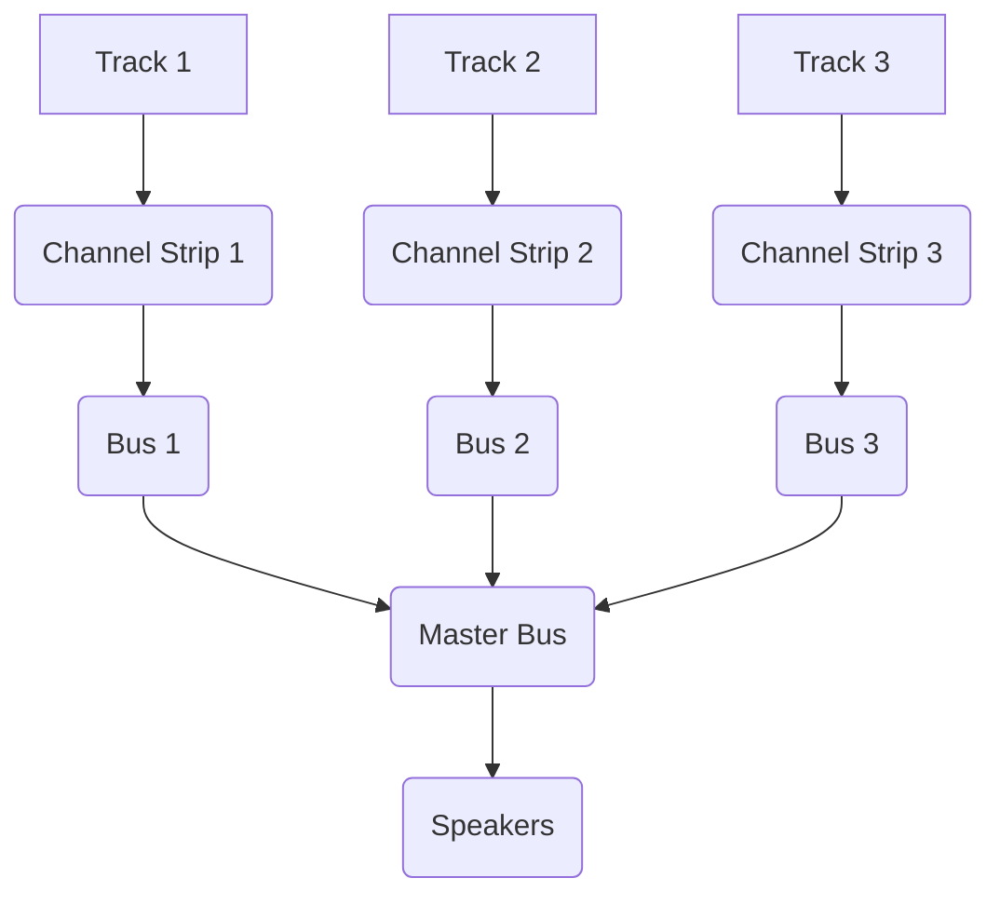

# Beginner Foundation: Mixing
## 1. Everyday Intuition & First Principles
Imagine you're throwing a party and you want to make sure everyone can hear the music clearly, but also enjoy the conversation. Mixing is like being the sound engineer at that party. You adjust the volume of different instruments and vocals to ensure that each element is heard properly and the overall sound is balanced and pleasant. Just as you wouldn't want the music to drown out the conversation, you also wouldn't want the conversation to be louder than the music. Mixing is about finding that perfect balance.

## 2. Foundational Vocabulary & Glossary
- **Track:** A single audio channel in a mix, such as a guitar, bass, or vocals.
- **Channel Strip:** The collection of controls for a single track, including EQ, gain, and effects.
- **EQ (Equalization):** The process of adjusting the frequency response of a track to boost or cut certain frequencies.
- **Gain:** The control that adjusts the volume of a track before it is processed by effects or sent to the master bus.
- **Pan (Panning):** The control that positions a track in the stereo field, from left to right.
- **Bus:** A virtual channel that can route multiple tracks to a common point for processing or monitoring.
- **Master Bus:** The final output bus that combines all the tracks and sends them to the speakers or headphones.
- **Automation:** The process of recording and playing back control changes, such as volume or EQ, over time.

## 3. Visual System Flow
### ASCII Diagram
```
[Track 1] -> [Channel Strip 1] -> [Bus 1] -> [Master Bus] -> [Speakers]
[Track 2] -> [Channel Strip 2] -> [Bus 2] -> [Master Bus] -> [Speakers]
[Track 3] -> [Channel Strip 3] -> [Bus 3] -> [Master Bus] -> [Speakers]
```

### Mermaid Flowchart


## 4. Common Beginner Misconceptions & Mental Traps
- **Misconception:** Mixing is about making everything louder. **Reality:** Mixing is about balancing the levels and frequencies of different tracks to create a cohesive sound.
- **Misconception:** You need expensive equipment to mix well. **Reality:** While high-quality gear can help, the most important aspect of mixing is your ears and your understanding of the principles.
- **Misconception:** Mixing is a one-time process. **Reality:** Mixing is an iterative process that often requires revisiting and refining your decisions.

## 5. Socratic Discussion Starters
- What is the difference between EQ and gain, and when would you use each?
- How does panning affect the stereo image of a mix?
- Can you explain the role of buses in a mix and why they are useful?
- What are some common mistakes beginners make when mixing, and how can they be avoided?
- How does automation help in creating dynamic mixes?
