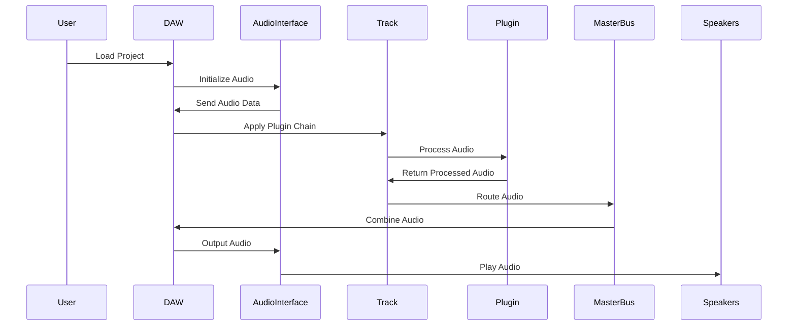

# Intermediate Foundation: Mixing
## 1. Architectural Mental Model
In the realm of mixing, understanding the architectural mental model is crucial for effective sound design and production. This model encompasses the various components and their interactions within a digital audio workstation (DAW) environment. For intermediate mix engineers, it's essential to grasp how these components work together to create a cohesive and polished final product.

### Key Components:
- **DAW (Digital Audio Workstation):** The central hub where all audio tracks are managed, edited, and processed.
- **Audio Interface:** The hardware that connects your computer to audio equipment, including microphones, instruments, and speakers.
- **Audio Tracks:** Individual channels containing raw or processed audio data.
- **Plugins:** Software tools that modify audio signals, including EQs, compressors, reverb, and delay.
- **MIDI Devices:** Instruments and controllers that send control signals to the DAW, often used for synthesizers and drum machines.
- **Master Bus:** The final output channel where all individual tracks are combined and processed for the final mix.

### Production Architecture:
The production architecture in mixing involves the strategic placement and configuration of these components to achieve the desired sound. This includes:
- **Track Layout:** Organizing audio tracks in a logical manner, often by instrument or function (e.g., drums, bass, vocals, effects).
- **Plugin Chain:** The sequence of plugins applied to each track, affecting the signal flow and processing order.
- **Bus Routing:** Directing audio signals to specific buses for group processing and effects.

## 2. Systems Taxonomy & Component Protocols
Understanding the systems taxonomy and component protocols in mixing is vital for interoperability and efficient workflow management.

### Standard Interfaces:
- **VST (Virtual Studio Technology):** A widely used plugin format for Windows and Mac, supporting a variety of audio processing tools.
- **AU (Audio Units):** A plugin format exclusive to macOS, offering a range of audio effects and instruments.
- **RTAS (Real-Time Audio Suite):** A plugin format developed by Digidesign (now Avid), primarily used in Pro Tools.
- **AAX (Avid Audio Exchange):** An advanced plugin format developed by Avid, offering high-performance audio processing.

### Protocols:
- **MIDI (Musical Instrument Digital Interface):** A protocol for sending control signals between electronic musical instruments, computers, and other related devices.
- **ASIO (Audio Stream Input/Output):** A low-latency audio interface protocol for Windows, used for high-quality audio input and output.
- **Core Audio:** A framework for audio processing on macOS, providing a standardized interface for audio applications.

### Data Models:
- **Audio Files:** Common formats include WAV, AIFF, FLAC, and MP3, each with its own characteristics in terms of quality and file size.
- **Session Files:** Files that store the project's state, including track layout, plugin settings, and automation data.
- **Preset Files:** Pre-configured settings for plugins, allowing for quick and consistent application of effects.

## 3. Multi-Component Interaction Flow
To visualize the interaction between components in a mixing workflow, we can use ASCII and Mermaid sequence diagrams.

### ASCII Sequence Diagram:
```
User -> DAW: Load Project
DAW -> Audio Interface: Initialize Audio
Audio Interface -> DAW: Send Audio Data
DAW -> Track: Apply Plugin Chain
Track -> Plugin: Process Audio
Plugin -> Track: Return Processed Audio
Track -> Master Bus: Route Audio
Master Bus -> DAW: Combine Audio
DAW -> Audio Interface: Output Audio
Audio Interface -> Speakers: Play Audio
```

### Mermaid Sequence Diagram:


## 4. Architectural Trade-offs & Production Pitfalls
Understanding architectural trade-offs and potential pitfalls is crucial for making informed decisions in the mixing process.

### Trade-offs:
- **Latency vs. Quality:** Lower latency can improve real-time performance but may sacrifice audio quality.
- **Resource Utilization:** Efficient use of system resources (CPU, RAM) is essential for smooth performance, especially with complex plugin chains.
- **Scalability:** Designing a scalable architecture allows for easy addition of new tracks and effects as the project evolves.

### Pitfalls:
- **Over-Processing:** Applying too many plugins or excessive processing can lead to a loss of clarity and naturalness in the audio.
- **Phase Issues:** Incorrect routing or processing can cause phase cancellation, resulting in thin or hollow-sounding audio.
- **Inconsistent Levels:** Mismatched levels across tracks can lead to an unbalanced mix, with some elements overpowering others.

## 5. Socratic Discussion Starters
Engaging in thoughtful discussions about the architectural aspects of mixing can deepen understanding and foster creativity.

### Questions:
- How does the choice of plugin format (VST, AU, RTAS, AAX) impact the mixing process?
- What are the advantages and disadvantages of using different audio interfaces and protocols (ASIO, Core Audio, MIDI)?
- How can you design a scalable and efficient mixing architecture that accommodates future changes and additions?
- What strategies can be employed to minimize latency and maximize audio quality in real-time mixing?
- How do you balance the use of plugins and processing to achieve a natural and polished final mix?

By exploring these questions and concepts, intermediate mix engineers can develop a deeper understanding of the architectural principles underlying effective mixing practices.
