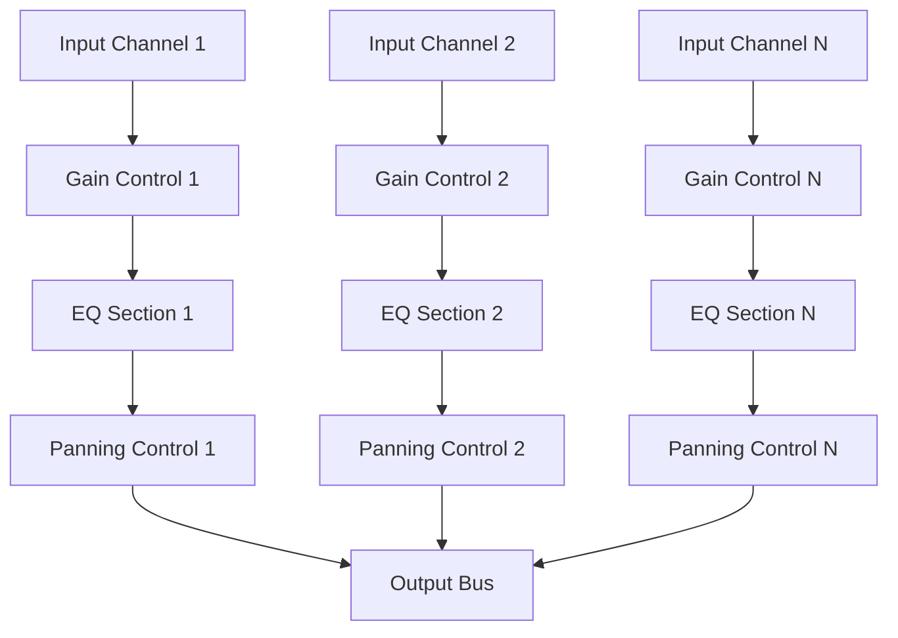

# Lesson 1: Mixer Basics

## 1. First-Principles Intuition & Invariants

The art of mixing is a profound intersection of electrical engineering, psychoacoustics, and artistic expression. At its core, a mixer is a device that combines multiple audio signals into a single output, while allowing for individual control over each signal's amplitude, frequency response, and spatial positioning. This process is fundamental to the creation of a cohesive and balanced audio mix, where each element of a musical composition is given its proper place and prominence.

From a theoretical standpoint, the operation of a mixer can be understood through the lens of signal processing. Each channel in a mixer represents a discrete audio signal, which can be mathematically modeled as a time-varying function. The primary function of a mixer is to perform a weighted sum of these individual signals, where the weights are determined by the gain settings of each channel. This process can be expressed as:

\[ y(t) = \sum_{i=1}^{N} g_i \cdot x_i(t) \]

where \( y(t) \) is the output signal, \( x_i(t) \) is the input signal from channel \( i \), \( g_i \) is the gain applied to channel \( i \), and \( N \) is the total number of channels. The gain \( g_i \) is a scalar value that can be adjusted to increase or decrease the amplitude of the corresponding input signal.

The concept of gain is deeply rooted in the physical properties of sound and the human auditory system. In the context of audio mixing, gain adjustment is used to balance the relative loudness of different instruments or vocal tracks, ensuring that no single element overwhelms the others. This balance is crucial for achieving a harmonious and aesthetically pleasing mix, where each component contributes to the overall musical narrative.

Furthermore, the frequency response of each channel can be manipulated through equalization (EQ) controls, which allow for the boosting or cutting of specific frequency bands. This capability is essential for addressing issues such as unwanted resonances, muddy bass, or harsh high frequencies. EQ adjustments can be modeled using digital filters, which modify the spectral content of the audio signal according to a specified frequency response curve. The most common types of EQ filters are low-pass, high-pass, band-pass, and band-reject filters, each of which can be implemented using various digital filter design techniques.

In addition to amplitude and frequency control, mixers also provide means for spatial positioning through panning. Panning allows for the distribution of audio signals across a stereo or multi-speaker setup, creating a sense of depth and width in the mix. The panning control can be thought of as a way to adjust the phase relationship between the left and right channels, with a fully left panning position corresponding to a phase difference of 0 degrees and a fully right panning position corresponding to a phase difference of 180 degrees. This phase relationship is crucial for creating a realistic and immersive audio experience, as it mimics the way sound waves propagate through space and are perceived by the human ear.

## 2. Core Architecture & Mechanics

The internal architecture of a mixer is designed to efficiently handle the complex task of combining multiple audio signals while providing a wide range of control over each signal's characteristics. At a high level, a mixer consists of several key components: input channels, gain controls, equalization sections, panning controls, and output buses.

Each input channel is responsible for receiving an audio signal from an external source, such as a microphone, instrument, or digital audio workstation (DAW). The input signal is then processed through a series of gain controls, which allow for the adjustment of the signal's amplitude. These gain controls are typically implemented using digital potentiometers or software-based gain stages, which provide precise and responsive control over the signal's level.

Following the gain controls, the signal is passed through an equalization section, which consists of one or more digital filters. These filters allow for the adjustment of the signal's frequency response, enabling the user to boost or cut specific frequency bands as needed. The equalization section is a critical component of the mixer, as it provides the means to address issues such as unwanted resonances, muddy bass, or harsh high frequencies.

After the equalization section, the signal is passed through a panning control, which allows for the distribution of the signal across a stereo or multi-speaker setup. The panning control is typically implemented using a digital delay line or a phase shifter, which adjusts the phase relationship between the left and right channels. This phase relationship is crucial for creating a sense of depth and width in the mix, as it mimics the way sound waves propagate through space and are perceived by the human ear.

Finally, the processed signal is sent to an output bus, which combines the signals from all of the input channels into a single output. The output bus is responsible for summing the signals from each channel, taking into account the gain, EQ, and panning adjustments made to each signal. The output bus is typically implemented using a digital summing algorithm, which performs a weighted sum of the input signals according to the gain settings of each channel.

To illustrate the internal architecture of a mixer, we can use a simple Mermaid diagram:

In this diagram, each input channel is connected to a gain control, which is in turn connected to an equalization section and a panning control. The processed signals from all of the input channels are then sent to the output bus, which combines the signals into a single output.

## 3. High-Performance Optimization & Failure Modes

The performance of a mixer is critical to the overall quality of the audio mix, as even small delays or distortions can have a significant impact on the final result. To ensure high performance, mixers are designed with a number of optimizations and safeguards to address potential failure modes.

One of the most important optimizations in a mixer is the use of efficient digital signal processing (DSP) algorithms. DSP algorithms are used to perform the various signal processing operations required by the mixer, such as gain adjustment, equalization, and panning. These algorithms must be optimized for speed and accuracy, as even small delays or distortions can have a significant impact on the final result.

To achieve high performance, mixers often employ advanced techniques such as parallel processing, where multiple DSP operations are performed simultaneously, and pipelining, where the signal processing pipeline is divided into stages that can operate concurrently. These techniques help to minimize processing latency and ensure that the mixer can handle real-time audio processing demands without introducing noticeable delays or artifacts.

Another critical aspect of mixer performance is the use of high-quality analog-to-digital and digital-to-analog converters (ADCs and DACs). These converters are responsible for converting analog audio signals to digital format for processing and vice versa. High-quality converters with low distortion and high dynamic range are essential for maintaining the integrity of the audio signal throughout the mixing process.

In addition to these optimizations, mixers are designed with safeguards to prevent common failure modes. For example, many mixers include overload protection to prevent distortion caused by excessively high input levels. This protection is typically implemented using limiting circuits that automatically reduce the gain when the input signal exceeds a certain threshold.

Furthermore, mixers often incorporate redundancy and fail-safe mechanisms to ensure reliable operation. For instance, critical components such as power supplies and DSP processors may be duplicated, allowing the mixer to continue operating even if one component fails. These design considerations help to ensure that the mixer remains a reliable and high-performance tool for audio professionals.
