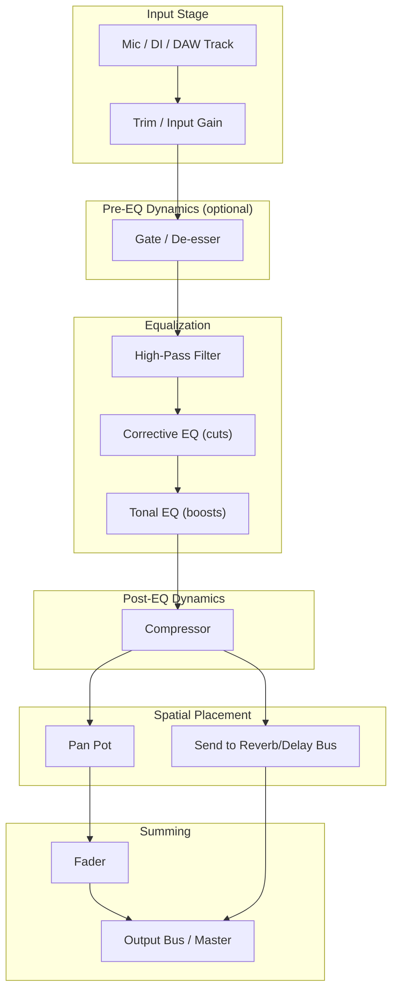
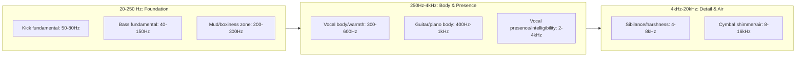
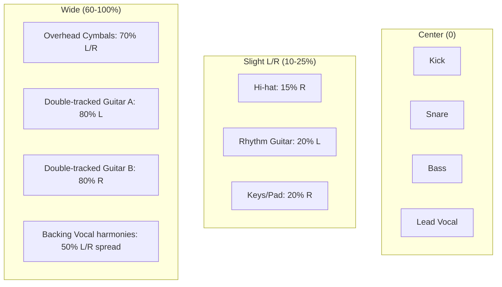
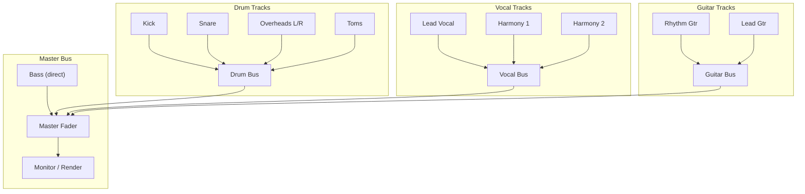

# Lesson 1: Mixing — Gain Staging, EQ, and Panning on a Real Console

## 1. First-Principles Intuition: What You're Actually Controlling

A mixer combines multiple signals into one output while giving you three independent handles on each one: **level** (how loud), **spectrum** (which frequencies are emphasized), and **position** (where it sits in the stereo field). Every decision you make while mixing reduces to adjusting one of these three things for one of these three reasons: clarity, balance, or emotional effect.

The core operation at the output bus is a weighted sum:

$$y(t) = \sum_{i=1}^{N} g_i \cdot x_i(t)$$

That's it — each channel gets multiplied by its gain and all channels get added together. The entire discipline of mixing is about choosing good values of $g_i$ moment to moment, and shaping $x_i(t)$ before it hits that sum so the addition doesn't collapse into mud. Two correct, well-recorded signals summed together will often clip or mask each other — not because the math is wrong, but because sound sources overlap in frequency and time. Mixing is the craft of managing that overlap by ear, using gain, EQ, dynamics, and pan as your four tools.

**Panning physics correction:** panning is not a 0°–180° phase shift between channels. On a standard stereo bus, panning is implemented as a simple **level split** (constant-power pan law) — as you pan right, the signal's amplitude decreases in the left channel and increases in the right channel, typically following a -3dB center law so perceived loudness stays constant across the pan range. True phase/time-based imaging (Haas effect, mid-side techniques) is a separate, deliberate technique layered on top of amplitude panning, not what the pan knob does by default.

## 2. Gain Staging: Get This Wrong and Nothing Else Matters

Gain staging is the single most consequential skill in mixing, and it's almost entirely mechanical. The goal: every stage of the signal path (preamp → channel strip → bus → master) should receive a signal that's loud enough to sit well above the noise floor, but with enough headroom that transient peaks never clip.

### The procedure, on a real console or DAW mixer

1. **Set input gain (trim) first, before touching faders.** Play the loudest section of the performance. Watch the channel's input meter (pre-fader, post-trim). Target **peaks around -12 dBFS to -18 dBFS** in a digital system (more headroom than analog because digital clipping is a hard, ugly wall at 0 dBFS — there's no "warm" overload).
2. **Leave channel faders near unity (0 dB) during initial balance.** If you need to crank a fader to +8 dB to hear the track, your trim/input gain is too low — fix it at the source, not the fader. Faders are for *relative balance*, trim is for *absolute level*.
3. **Check the master bus meter.** Sum of all channels should peak around -6 dBFS or lower before any bus compression or limiting. If the mix bus is already hot at -1 dBFS with no processing, you've gain-staged wrong upstream — go back and pull trims down, not faders.
4. **Rule of thumb for live/analog consoles:** unity gain (0 dB on the fader, trim showing a healthy signal on the pre/post meter, no red clip LED) is your home base. Every fader move away from unity should be a deliberate musical choice, not a fix for bad trim.

**Common failure mode:** stacking tracks with each one individually sounding fine in solo, but the sum clips or sounds congested. This is because gain staging must be evaluated **in context of the full mix**, not in solo. Always A/B a gain or EQ move with the rest of the band playing.

## 3. The Mixing Signal Chain: Order of Operations

This order matters and is not arbitrary:

- **High-pass before anything else.** Removing sub-100Hz rumble (mic stand handling noise, room HVAC, proximity-effect bass buildup) before the compressor means the compressor isn't triggered by inaudible garbage, and before boosts means you're not boosting energy you're about to filter out anyway.
- **Corrective cuts before tonal boosts.** Find and remove the resonant honk or boxiness first (subtractive EQ), *then* decide if the track still needs brightness or warmth added. Boosting a frequency that's fighting a resonance just amplifies the problem.
- **Compression after EQ** (in most pop/rock contexts) so the compressor reacts to the tonally-corrected signal, not to boosted frequencies that would make it over-react. (Exception: de-essers and gates often go *before* EQ since they're dealing with raw transient/sibilance content.)
- **Pan and sends happen post-fader-path but their relationship to the fader is genre-dependent** — most DAWs let you choose pre- or post-fader sends; use **post-fader** for reverb/delay sends on 95% of tracks so the wet signal tracks the dry level as you ride the fader.

## 4. EQ: Subtractive First, By Ear, With Numbers as Landmarks

EQ filter types and when to reach for them:

| Filter Type | Use Case | Typical Settings |
|---|---|---|
| High-pass (HPF) | Remove rumble, mic handling noise, proximity bass buildup | 80–120 Hz on vocals/guitars, 30–40 Hz on bass, 20 Hz on kick (gentle, 6dB/octave) |
| Low-pass (LPF) | Tame harsh cymbal bleed, de-fizz distorted guitars | 8–12 kHz, gentle slope |
| Bell (peak) boost/cut | Surgical correction or tonal shaping | Q of 3–8 for surgical cuts, Q of 0.7–1.5 for musical boosts |
| Shelf | Broad brightness or warmth adjustment | High shelf +2dB at 8kHz for "air," low shelf +2dB at 150Hz for "weight" |

### The "sweep and cut" method for finding problem frequencies

1. Grab a narrow bell (Q around 6–8), set it to boost +10 to +15 dB (exaggerate intentionally).
2. Sweep that boosted bell slowly across the frequency range (start around 200 Hz for low-mid mud, 2–4 kHz for harshness/nasal quality).
3. When the sweep hits a frequency that makes the track sound noticeably worse (boxy, honky, harsh), you've found a resonance.
4. Narrow the Q slightly, pull the gain down to -3 to -6 dB at that exact frequency instead of boosting.
5. Widen the Q back out and reassess by ear with the boost removed — the resonance should be noticeably tamed, not surgically erased (over-narrow, over-deep cuts make things sound phasey and thin).

### Frequency map — practical landmarks for full-band mixing

**The classic frequency-collision fix:** kick drum and bass guitar both want the 50–100 Hz range for their fundamentals, and both want presence around 1–3 kHz for attack/definition. Standard move: carve a complementary notch — boost kick at 60Hz and cut bass at 60Hz by 2-3dB (or vice versa depending which should dominate), so each instrument owns a distinct slice instead of both fighting for the same frequency and canceling/masking each other.

## 5. Panning: Building a Stereo Image That Doesn't Collapse

Panning law on a standard DAW pan pot: at center, both L and R channels get the signal at -3dB relative to full pan (this keeps perceived loudness constant as you pan across, since a centered mono signal would otherwise sound louder than a hard-panned one at equal fader level).

### A practical panning scheme for a 4-piece rock/pop mix

**Why keep low-frequency sources centered:** bass and kick carry the most energy in the mix. If you pan them off-center, you create an imbalance that's audible on mono playback systems (phone speakers, club PA summed to mono, Bluetooth speakers) and wastes headroom on one side of a stereo system. Keep anything below roughly 150-200Hz centered or summed to mono regardless of what the source material's stereo recording captured — this is why many mixers insert a mono-maker or low-frequency correlation filter on the master bus's low end.

**Double-tracking trick:** record (or duplicate + slightly detune/time-shift) a guitar or vocal part twice, pan the two takes hard left and hard right. This creates width through genuine performance differences between takes, not artificial stereo widening plugins, and reads as much more natural and three-dimensional.

## 6. Bus Routing & Subgrouping — Mixing in Groups, Not Just Channels

Real mixing sessions with 24-60+ tracks are unworkable if every fader move happens at the individual channel level. Subgroup (bus) routing solves this.

**Practical benefits of subgrouping:**
- **One fader move controls the whole drum kit's level** relative to the rest of the mix, instead of riding 6-8 individual drum faders in sync.
- **Bus compression glues a section together.** A light compressor (2:1 ratio, slow attack around 10-30ms to let transients through, auto or medium release) on the drum bus makes the kit feel like one instrument instead of separate hits.
- **Bus-level EQ** can do broad tonal shaping (e.g., a gentle high-shelf boost on the vocal bus) without touching every individual harmony track's settings.

## 7. Gain Staging and EQ in Practice: A Worked Vocal Chain Example

Concrete settings for a single lead vocal track in a pop mix, in processing order:

1. **Trim:** input peaking around -16 dBFS.
2. **Gate/noise reduction:** threshold set just above the room noise floor, fast attack (1-2ms), medium release (100-150ms) — removes headphone bleed and breath noise between phrases without chopping words.
3. **High-pass filter:** 100 Hz, 12dB/octave slope — removes proximity-effect bass buildup and mic stand rumble.
4. **Corrective cut:** -3dB bell at 300 Hz, Q=4 — removes boxiness common in close-mic'd vocals.
5. **De-esser:** targeting 5-7 kHz, threshold set to catch sibilant "s" and "sh" sounds reducing them by 4-6dB only on sibilant peaks.
6. **Compressor:** 4:1 ratio, threshold set for 4-6dB of gain reduction on peaks, attack 5-10ms (let the consonant transient through for clarity), release 80-120ms (autorelease on most modern compressors handles this well).
7. **Tonal boost:** +2dB shelf at 10kHz for "air" and presence.
8. **Fader:** set relative to the rest of the mix, typically sitting 2-4dB above the instrumental bed in choruses, pulled back slightly in verses.
9. **Sends:** reverb send (post-fader) at a level where you can just barely perceive it disappearing when muted — reverb should be felt, not heard as a distinct effect, unless it's a deliberate creative choice.

## 8. Failure Modes and Debugging Procedure

| Symptom | Likely Cause | Fix |
|---|---|---|
| Mix sounds muddy/congested | Too many tracks with unmanaged energy in 200-500Hz | HPF non-bass sources at 100-150Hz; subtractive EQ cuts at 300Hz per track |
| Mix sounds harsh/fatiguing | Buildup in 2-5kHz across multiple tracks | Identify which 2-3 tracks are loudest in that band; cut 1-2dB on secondary sources, keep the lead element bright |
| Vocal disappears when band comes in | Masking — vocal and guitars/synths sharing the same 1-3kHz presence range | Carve a complementary notch in competing instruments at the vocal's presence frequency |
| Bass sounds great solo but disappears in full mix | Kick and bass fighting for same low-end frequency and phase-cancelling | Check phase alignment between kick and bass mics/samples; EQ complementary notches at the shared fundamental |
| Mix sounds narrow/mono even with panned tracks | Low frequencies panned off-center, or over-reliance on stereo widener plugins on mono-source content | Center/mono everything below 150-200Hz; use genuine double-tracking instead of artificial widening |
| Master bus clipping with headroom to spare on individual channels | Gain staged in solo, not evaluated as a sum; too many unity-gain channels summing hot | Pull down trim on 3-4 loudest contributing channels, not the master fader (master fader doesn't fix internal summing clip, only output level) |
| Compressor "pumping" audibly, breathing with the kick | Release time too fast, fighting the song's tempo | Set release in musical time — try syncing release roughly to a 1/8 or 1/4 note at the song's BPM |

## 9. Practice Drill: Build a Mix-Ready Ear in 30 Minutes

This is an ear-training routine, not a passive listening exercise — do it actively, with a DAW open.

1. **(5 min) Frequency ID drill.** Load the sweep-and-boost EQ trick from Section 4 on a full mix reference track. Sweep through 5 bands (100Hz, 300Hz, 1kHz, 3kHz, 8kHz) and name out loud what each band sounds like boosted. Repeat daily — this builds the frequency-to-sound association that lets you EQ without staring at a number readout.
2. **(10 min) Gain staging drill.** Take a multitrack session (even a free stems pack). Mute everything, bring in one track at a time, setting trim so each new track peaks around -12dBFS before adjusting any fader. Check the master bus meter after each addition — it should climb predictably, never jump unexpectedly.
3. **(10 min) Panning drill.** Build a basic 4-track mix (drums, bass, guitar, vocal) with everything centered. Then deliberately pan only the guitar and listen on headphones vs. a single mono speaker — confirm the mix still sounds balanced in mono (a critical professional check, since many playback systems sum to mono).
4. **(5 min) A/B against a reference.** Load a commercially released track in a similar genre on a separate channel at matched loudness (use a loudness meter, not fader-by-ear, to match perceived level — mismatched levels bias your ear toward whichever is louder). Switch between your rough mix and the reference; note one specific, actionable difference (e.g., "my vocal sits 2dB too quiet," not "mine sounds worse").

Run this drill 4-5 times a week. Mixing skill is ear calibration built through repetition, not theoretical knowledge — the EQ frequency chart in Section 4 is a map for where to start searching, not a substitute for trusting what you hear.
