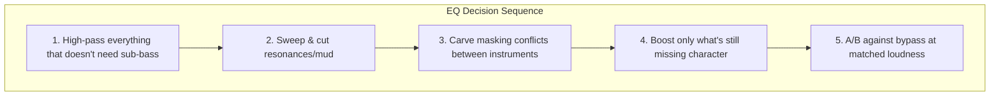

# Lesson 2: Equalization — Shaping Tone by Ear and by Number

## 1. Why EQ Works: The 15% You Need and No More

Every sound you mix is a stack of simultaneous frequencies. A bass guitar's 80 Hz fundamental rides under 400–800 Hz of finger noise and string buzz, topped with harmonics stretching past 2 kHz that let your ear identify *which* string is being plucked. EQ is a scalpel for that stack: it boosts or cuts slices of the spectrum so each instrument keeps the frequencies that define it and gives up the ones that collide with somebody else's.

Two facts drive almost every real decision you'll make at the console:

1. **Masking.** When two sounds carry energy in the same frequency range at similar levels, your ear can't fully separate them — the louder or closer-in-frequency one wins and the other gets swallowed. A kick drum's punch (60–100 Hz) and a bass guitar's fundamental (40–80 Hz) overlap constantly. The fix isn't more level, it's carving pocket space: cut the bass around 80–100 Hz, cut the kick around 300–500 Hz, and both become audible without touching a fader.
2. **Equal-loudness perception.** Hearing is most sensitive between roughly 2–5 kHz — this is why vocal presence and consonant clarity live there — and least sensitive at the sub-100 Hz and above-10 kHz extremes. A 1–2 dB boost at 3 kHz reads as dramatically louder and closer than the same boost at 60 Hz, which you'll barely register. Know this and you stop reaching for big boosts where a small one at the right frequency does the job.

That's the whole theory section. Everything past this point is ears, hands, and repetition.

## 2. The Filter Toolkit — What Each Shape Actually Does

Five tools live on every parametric EQ. Learn what each is *for*, not just its name.

| Filter Type | Shape | Primary Use | Typical Settings |
|---|---|---|---|
| High-Pass (HPF) | Removes everything below cutoff | Strip rumble, mic stand handling noise, proximity-effect mud | 80–120 Hz on vocals, 40–60 Hz on guitars, 20–30 Hz safety roll-off on everything else |
| Low-Pass (LPF) | Removes everything above cutoff | Tame harsh cymbal bleed, soften digital harshness, de-fizz distorted guitars | 8–12 kHz on room mics, 6–9 kHz on bus overheads |
| Bell (Peak) | Boosts/cuts a hump around a center frequency | Surgical correction or tonal enhancement | Narrow Q (3–8) for cuts, wide Q (0.5–1.4) for musical boosts |
| Shelf (High/Low) | Boosts/cuts everything above or below a point, flattening out | Broad brightness/warmth moves | +2 dB high-shelf at 8 kHz for "air," +1.5 dB low-shelf at 150 Hz for "weight" |
| Notch | Very narrow, very deep cut | Kill a single resonant frequency or hum (50/60 Hz mains) | Q 10+, cut 10–20 dB at exactly the offending frequency |

**Q is the setting beginners ignore, and it's the one that changes everything.** Q controls how narrow or wide the filter's influence spreads around the center frequency. Low Q (wide, 0.5–1.0) is musical and gentle, good for tone-shaping boosts. High Q (narrow, 4–10+) is surgical, good for finding and removing one specific resonance without touching the surrounding tone.

**Hands-on Q test, do this once so your fingers remember it:**
1. Load a bell at 1 kHz, +6 dB, Q = 0.5. Sweep gain up and down. Notice how broad and forgiving it sounds.
2. Snap Q to 10 at the same frequency and gain. Notice how it now sounds like a thin whistle riding on top of the signal rather than a tonal change.
3. This is the physical difference you're choosing every time you set a Q value — breadth of musical color versus precision targeting.

## 3. The Subtractive-First Workflow (Do This Before You Boost Anything)

Most engineers reach for boosts first because it feels proactive. This is backwards, and it's why inexperienced mixes sound harsh and congested. The professional sequence:



### Step 1 — High-Pass Everything That Doesn't Need Sub-Bass

Vocals, guitars, snare top mics, overheads, most synths — almost nothing except kick and bass needs information below 80–100 Hz, and that unused low end just eats headroom and causes mud.

**Procedure:**
1. Solo the track. Insert an HPF, start it at 20 Hz (effectively off).
2. Slowly raise the cutoff frequency while listening to the low-mid body of the sound.
3. Stop the instant you hear the track start to thin out or lose weight.
4. Back the cutoff off by 10–15 Hz from that point. That's your setting.
5. Un-solo and confirm in context — bleed and room tone often tolerate a slightly higher HPF than the dry instrument alone suggests.

This single move cleans more mixes than any other EQ technique, because it removes energy that was never musically useful and was only stacking with the kick and bass to produce mud.

### Step 2 — The Sweep-and-Cut Resonance Hunt

The single most valuable EQ drill you will ever practice.

1. Load a narrow bell filter (Q = 8–10) with a boost of +10 to +15 dB.
2. Solo the track. Slowly sweep the center frequency from 150 Hz up to 8 kHz.
3. Listen for frequencies that suddenly jump out as boxy, honky, nasal, or ringing — that's a resonance in the instrument, the room, or the mic.
4. When you find it, flip the boost to a cut of -3 to -8 dB and widen the Q slightly, to 3–5, so the cut sounds like tone shaping rather than surgery.
5. Re-check against the full mix. A cut that sounds necessary in solo sometimes isn't needed once other instruments mask the same frequency anyway. Solo-only EQ decisions are a common beginner trap — always confirm in context before committing.

Train your ear to recognize these resonance zones by name, not just by number:

- **200–500 Hz** — boxiness, cardboard-box quality, "mud." Almost every close-mic'd instrument carries some.
- **800 Hz–1.2 kHz** — nasal, honky, "quacky" quality, especially on vocals and horns.
- **2–4 kHz** — harshness, listening fatigue, "ice-pick" quality on vocals and cymbals.
- **5–7 kHz** — sibilance-region overlap, can read as sharp or brittle.

### Step 3 — Carve Masking Conflicts (Complementary EQ)

When two instruments compete for the same space, don't cut both the same way — cut them in *opposite, complementary* zones so each keeps what it needs and loses what it doesn't.

**Kick vs. bass guitar, the classic conflict:**
- Kick: boost a bell at 60–80 Hz (+2–3 dB) for thump, cut a bell at 300–500 Hz (-3 dB) to remove boxiness, boost a bell at 3–5 kHz (+2 dB) for beater click.
- Bass: cut a bell at 60–80 Hz (-2–3 dB) to make room for the kick's thump, keep the fundamental presence at 100–200 Hz, boost slightly at 800 Hz–1 kHz for note definition on fretted lines.

**Vocal vs. guitar, the midrange conflict:**
- Lead vocal: boost gently at 2–3 kHz (+1.5–2 dB) for presence and consonant clarity.
- Rhythm guitar (electric or acoustic): cut at 2–3 kHz (-2 dB) to duck out of the vocal's presence range, and let the guitar's own character live at 4–5 kHz instead.

**Drill to internalize this:** solo kick and bass together, nothing else. Make the complementary cuts above. Confirm you can hear both the kick's attack *and* the bass's pitch clearly at the same time, at the same fader levels you started with. If you still can't hear one of them, the conflict isn't fully resolved — cut deeper or widen the gap between the two boost zones before reaching for level.

### Step 4 — Boost What's Still Missing

Only after cutting resonances and carving pockets should you add anything. Keep boosts under +3 dB with wide Q wherever possible. Anything larger usually means you're compensating for a masking problem you haven't actually solved, and should cut the competing instrument instead.

### Step 5 — Gain-Matched A/B

Every EQ move changes perceived loudness — boosts always sound "better" simply because they're louder. Match output level before judging a move: use a gain trim after the EQ, or your plugin's built-in gain-match feature. If a boost still sounds better once level-matched, keep it. If not, it was a loudness illusion, not a tonal improvement.

## 4. Practical Frequency Map by Instrument (Quick Reference)

| Instrument | Cut Here (if problem) | Boost Here (for character) | HPF Setting |
|---|---|---|---|
| Kick drum | 300–500 Hz (box), 1–2 kHz (if harsh) | 60–80 Hz (thump), 3–5 kHz (beater) | 30 Hz |
| Snare | 400–800 Hz (boxy) | 150–250 Hz (body), 2–5 kHz (crack) | 60 Hz |
| Bass guitar | 200–300 Hz (mud) | 80–100 Hz (weight), 800 Hz–1 kHz (definition) | 30–40 Hz |
| Lead vocal | 300–500 Hz (mud), 1 kHz (nasal) | 2–4 kHz (presence), 8–12 kHz (air, shelf) | 80–100 Hz |
| Acoustic guitar | 200–400 Hz (boom) | 80–120 Hz (body, shelf), 8–10 kHz (sparkle) | 80 Hz |
| Electric guitar (distorted) | 600 Hz–1 kHz (honk) | 3–4 kHz (bite) | 80–100 Hz |
| Overheads/cymbals | 3–5 kHz (harsh) | 8–10 kHz (shelf, air) | 150–250 Hz |
| Piano | 300–500 Hz (boxy) | 2–5 kHz (clarity, attack) | 40 Hz |

Treat this as a starting point for the sweep-and-cut drill, not gospel. Room acoustics, mic choice, and the specific instrument in front of you will shift every one of these numbers by a few hundred Hz in either direction.

## 5. Lab: Full EQ Pass on a Four-Track Stem (Kick, Bass, Vocal, Guitar)

A complete worked session you can replicate on any DAW with a stock parametric EQ.

**Setup:** solo-isolated stems of kick, bass, lead vocal, and rhythm guitar, all playing the same 16-bar section.

1. **HPF pass (5 min).** Sweep and set HPF per Section 3, Step 1, on bass (30–40 Hz), vocal (80–100 Hz), and guitar (80 Hz). Leave the kick's HPF at 30 Hz, just removing subsonic rumble below the musical fundamental.
2. **Resonance hunt (15 min).** Run the sweep-and-cut drill from Section 3, Step 2, on each of the four tracks independently, in solo. Log every cut you make: frequency, Q, depth.
3. **Context check (10 min).** Play all four tracks together. For each cut logged in step 2, bypass it individually and listen for whether it's still audible as a problem in the mix. Remove or reduce any cut that isn't earning its place in context — this is the most commonly skipped step and the one that prevents a sterile, over-processed sound.
4. **Complementary carve (10 min).** Apply the kick/bass carve and vocal/guitar carve from Section 3, Step 3, listening to each pair in isolation first, then in the full four-track context.
5. **Boost pass (5 min).** Add any missing character per Step 4 — typically vocal air shelf and guitar bite — keeping every boost under +3 dB.
6. **Gain-matched final A/B (5 min).** Bypass all EQ on the bus, listen, re-engage, listen, with output trimmed to match loudness. Confirm every move earns its place.

Total time: roughly 50 minutes for a full four-track pass. Run this drill on a new multitrack stem once a week for two months and the sweep-and-cut reflex becomes close to automatic.

## 6. Ear-Training Drill: Frequency Recognition (Do This Daily)

The fastest way to stop guessing and start hearing is a structured drill, 10–15 minutes a day.

1. Load a parametric EQ on pink noise or a full mix bus.
2. Set a bell filter to Q = 2, boost +12 dB.
3. Close your eyes. Have a practice partner, or a randomizer plugin/script, move the center frequency to a random spot between 100 Hz and 10 kHz.
4. Guess the frequency within one octave before looking.
5. Check your answer, log it, repeat for 15–20 rounds.

Progressive accuracy target, run like a metronome ramp for your ears:

- **Weeks 1–2:** identify within 1 octave, 60% accuracy.
- **Weeks 3–4:** identify within 1/2 octave, 70% accuracy.
- **Week 6+:** identify within 1/3 octave — standard EQ band spacing — 80%+ accuracy.

This single drill, run consistently, improves your mixing more than any plugin purchase.

## 7. Digital Filter Architecture (The 15% Engineering Core)

Every parametric EQ band you touch on a plugin is implemented under the hood as a **biquad filter**, a second-order IIR filter computed sample by sample:

```
y[n] = (b0/a0)*x[n] + (b1/a0)*x[n-1] + (b2/a0)*x[n-2] - (a1/a0)*y[n-1] - (a2/a0)*y[n-2]
```

`x[n]` is the current input sample, `y[n]` the current output sample, and the `a`/`b` coefficients derive from your center frequency, Q, and gain settings (standard derivation: the Audio EQ Cookbook by Robert Bristow-Johnson; every DAW's EQ implements some variant). You will never type these coefficients by hand in a mix session — the value of knowing this is purely diagnostic:

- **Why do extreme boosts at high Q sometimes ring or sound metallic?** Narrow, high-Q boosts push the filter's poles close to the edge of stability, producing a longer, resonant impulse response you hear as ringing. If a surgical cut starts sounding unnatural, widen the Q rather than deepen the cut.
- **Why does cascading many EQ bands sometimes degrade sound quality?** Each cascaded biquad stage introduces its own rounding and phase shift; stacking 8–10 narrow bands compounds phase smear across the spectrum. Prefer consolidating moves into fewer, well-chosen bands over stacking many small ones.
- **Why can boosting near 15–18 kHz on budget plugins introduce harshness?** Filters that don't properly pre-warp their frequency response near the Nyquist limit — half the sample rate, 22.05 kHz at 44.1 kHz — can misbehave close to that ceiling. Higher internal sample rates (88.2/96 kHz processing) push that misbehavior further from the audible range.

## 8. Linear-Phase vs. Minimum-Phase EQ — A Real Production Decision

Most EQs — analog-modeled, "musical" plugins — are **minimum-phase**: fast, CPU-light, but they introduce a frequency-dependent time delay around the filtered region. This is usually inaudible on a single track but becomes a real problem on:

- **Parallel bus processing**, where an EQ'd signal is blended with an unprocessed copy of the same source — the phase shift causes comb-filtering cancellation.
- **Mastering**, where broad tonal moves across the entire mix benefit from phase coherence to avoid smearing transients.

**Linear-phase EQ** eliminates phase shift by processing symmetrically around each sample via FFT-based convolution, at the cost of pre-ringing — audible smearing before sharp transients like a snare hit — and added latency, which makes it unsuitable for tracking or live monitoring.

**Practical rule:** use minimum-phase EQ on individual tracks during mixing — standard choice, no latency penalty, more musical character. Reserve linear-phase EQ for mix bus and mastering moves, and for any parallel-processing chain where phase alignment matters.

**Quick test to hear the difference:** duplicate a drum bus, apply a minimum-phase EQ with a large low-mid cut on the duplicate, and blend it back under the dry bus at equal level. Listen for thinning or hollowing. Switch the same EQ to linear-phase mode and repeat — the hollowing should largely disappear. That's the comb-filtering artifact you're being warned about, made audible on purpose.

## 9. Common Failure Modes and Fixes

| Symptom | Likely Cause | Fix |
|---|---|---|
| Mix sounds harsh or fatiguing after 10 minutes of listening | Accumulated boosts in 2–5 kHz across many tracks | Solo the 2–5 kHz region on the mix bus with a narrow boost; if several tracks fight there, cut rather than boost on at least half of them |
| Boosting a frequency makes the track "bigger" in solo but disappears in the mix | Masking by a louder competing instrument in the same band | Carve the competing instrument instead of boosting further — see Section 3, Step 3 |
| Cut sounds unnatural, scooped, or hollow | Q too narrow for a broad tonal problem, or cut too deep | Widen Q, reduce cut depth, or split into two gentler cuts at adjacent frequencies instead of one deep cut |
| Ringing artifact after a high-Q surgical cut | Filter poles pushed near the instability edge at high Q | Widen Q to 3–5, or switch to a dynamic/multiband EQ that only cuts when the resonance actually triggers |
| Parallel-processed bus sounds thin or hollow compared to the dry signal | Phase cancellation between the minimum-phase-filtered copy and the dry copy | Switch to linear-phase EQ for that chain, or nudge sample delay to realign |
| High-frequency boost introduces a harsh, digital edge | Operating close to Nyquist on a minimum-phase filter at a low sample rate | Use a gentler shelf starting lower, 10 kHz instead of 16 kHz, or upsample the session to 88.2/96 kHz |

## 10. Session Checklist

Run this on every track before you touch a compressor:

1. High-pass filter set by sweeping up to the point just before body thins out, then backed off 10–15 Hz.
2. Sweep-and-cut pass complete: resonances identified and tamed at moderate Q (3–5), not left as surgical knife-edge cuts out of habit.
3. Every solo-only cut re-checked against the full mix; at least one false cut removed or reduced.
4. Masking conflicts with competing instruments resolved via complementary carving, not raised faders.
5. All boosts under +3 dB, wide Q, and confirmed via gain-matched A/B that they're earning their place.
6. If EQ sits on a parallel bus or at the mastering stage, linear-phase mode considered and tested.
