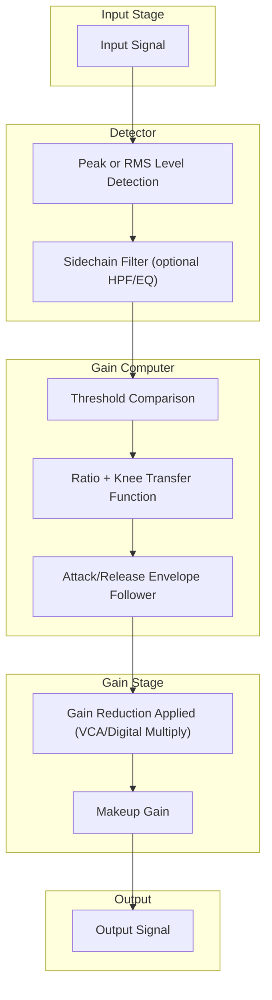

# Lesson 3: Dynamics Processing — Compression, Gates, and Limiting in Practice

## 1. Why Dynamics Processing Works: The 15% You Need

Every sound has an **amplitude envelope** — its loudness shape over time. A snare hit has a sharp transient (the crack of the stick) followed by a decaying body (the drum's resonance). A vocal sustain has a slower rise and a long, variable tail. Dynamics processors reshape these envelopes by measuring level against a **threshold** and applying gain change according to a **ratio**.

The transfer function you actually need:

```text
Above threshold:  Output dB = Threshold + (Input dB − Threshold) / Ratio
Below threshold:  Output dB = Input dB (unity, unprocessed)
```

A 4:1 ratio on a signal hitting 8 dB over threshold produces only 2 dB of output rise above threshold — the compressor "ate" 6 dB. That's gain reduction (GR), and it's the number on your GR meter you watch while mixing, not the abstract math.

Two detector types change how a compressor *feels*:
- **Peak detection** reacts to the instantaneous waveform — grabs transients hard and fast. Use for peak control (limiting, drum transient taming).
- **RMS detection** averages energy over a short window (typically 1–50 ms) — tracks perceived loudness, ignores brief spikes. Use for musical, "glue" style leveling (bus compression, vocal riding).

**Equal-loudness perception in one paragraph, practically applied:** your ear is less sensitive to deep bass and extreme highs at low-to-moderate listening volumes, and more sensitive to the 2–5 kHz range, where consonants and most transient "bite" live. This is why compressing a bass-heavy signal with a broadband detector causes **pumping on the low end** that's inaudible at low volume but slams your mix at loud playback, and why a de-esser (frequency-selective compression) exists — broadband compression can't selectively tame a 6 kHz sibilant without also squashing the whole vocal.

That's the theory ceiling. Everything below is hands-on.

---

## 2. The Controls, What They Actually Do, and Starting Points

| Control | What it does | Practical starting point |
|---|---|---|
| **Threshold** | Level above which compression begins | Set so GR meter shows 3–6 dB on loudest peaks |
| **Ratio** | How hard it compresses above threshold | 2:1–4:1 (gentle leveling), 8:1+ (limiting character) |
| **Attack** | Delay before full gain reduction engages | 10–30 ms lets transient punch through; < 3 ms squashes it |
| **Release** | Time to return to unity gain after signal drops | Match to tempo/decay — too fast causes pumping artifacts, too slow smothers the next note |
| **Knee** | How abruptly ratio engages at threshold | Soft knee = transparent, musical; hard knee = obvious, aggressive |
| **Makeup Gain** | Compensates for level lost to compression | Gain-match before/after so loudness bias doesn't fool your ears |

### The attack-time ear trick
Attack time is the single most audible knob and the one beginners set wrong most often.

- **Fast attack (0.1–3 ms)**: catches the transient itself. Use on a snare you want to *tame* the crack of, or a bass you want perfectly even with no pick/finger spikes.
- **Medium attack (10–30 ms)**: lets the initial transient pass uncompressed, then clamps the body. This is how you get a punchy, forward drum sound — the attack "pokes through" before the compressor engages.
- **Slow attack (30–80 ms)**: transient passes almost entirely unprocessed; only sustain is controlled. Used for adding sustain and bloom to bass guitar or electric guitar.

**Drill**: Loop a single snare hit. Set ratio 6:1, threshold for 10 dB GR. Sweep attack from 0 ms to 50 ms in 5 ms steps while listening only to the initial transient. Note the exact point where the "crack" reappears — that's your audible attack threshold for that source. Do this with your own ears on every new source; published numbers are starting points, not laws.

### The release-time pocket-lock drill
A wrong release time either pumps (too fast — audible breathing in time with the signal) or smothers (too slow — the next note gets compressed before it can speak).

**Drill**: Loop a 4-bar section at the song's actual tempo. Set a bus compressor to 4:1 ratio, fast attack (5 ms), and start release at 250 ms. Listen for pumping on the downbeats. Walk release down in 20 ms increments until pumping disappears but you still feel the compressor "breathing" with the groove — that audible breath, used intentionally, is the classic glue-compression sound (SSL bus compressor practice). For transparent control instead, use auto-release (program-dependent release) if your plugin offers it — it adapts to transient density automatically.

---

## 3. Core Architecture (Signal Flow You Can Picture While Mixing)



**Why the sidechain filter block matters in practice**: feed the detector a high-pass-filtered copy of the signal (sidechain HPF, typically 100–300 Hz) so the compressor stops over-reacting to kick drum/bass energy and instead responds to the midrange content you actually want controlled. This is standard on vocal bus compressors and mix bus compressors — without it, a strong kick pump-compresses the whole mix every time it hits.

---

## 4. Compressor Types and When to Reach for Each

| Topology | Character | Best Use Case |
|---|---|---|
| **VCA** (dbx 160, SSL bus comp) | Fast, punchy, precise | Drums, bass, mix bus glue |
| **FET** (1176-style) | Fast attack, aggressive, slight distortion-on-purpose | Vocals, snare, rock guitars — "in your face" |
| **Opto** (LA-2A-style) | Slow, program-dependent, smooth, musical | Vocals, bass, mastering — forgiving on dynamics |
| **Tube/Vari-Mu** (Fairchild-style) | Warm, glue-y, nonlinear harmonics | Mix bus, mastering, adding perceived weight |
| **Digital/Lookahead** | Surgical, transparent, zero-latency-capable with lookahead | Mastering limiters, transparent mix bus control |

---

## 5. Gates and Expanders: The Control Most Mixers Skip

A **gate** is the inverse of a compressor: below threshold, it attenuates (or mutes) the signal; above threshold, it passes unity. An **expander** does the same but gently (2:1 ratio) instead of hard-cutting, avoiding the "chopped off" artifact a gate can produce on decaying sounds.

| Control | What it does | Practical starting point |
|---|---|---|
| **Threshold** | Level below which attenuation engages | Set just above the noise floor / bleed level, below the quietest wanted hit |
| **Range** | Maximum attenuation applied when closed | −20 dB to −40 dB (rarely full silence — full silence sounds unnatural on bleed-heavy sources) |
| **Attack** | Speed of gate opening | 0.1–1 ms — must be faster than the transient or you clip the front of the note |
| **Hold** | Minimum time gate stays open once triggered | 10–50 ms — prevents chatter on sustained but slightly uneven signals |
| **Release** | Speed of gate closing after signal drops below threshold | 50–200 ms — too fast chokes the natural decay/ring of the drum |

### Where gates earn their keep
- **Tom mics in a live multitrack**: toms ring and bleed into every other mic on the kit. Gate each tom track, threshold just above the bleed level, hold 20 ms, release 150 ms — the tom "speaks" cleanly and disappears between hits instead of smearing into the next section.
- **Noisy guitar amp DI/mic**: gate with fast attack, moderate release, to kill amp hiss between phrases without clipping pick attack.
- **Kick drum bleed control on a multi-mic kit**: tightens the low end so the kick mic isn't also reproducing a smeared, out-of-phase snare hit.

**Drill**: On a tom track with heavy kit bleed, set threshold so the gate is closed during silence and opens only on the actual tom hit. Walk release from 300 ms down to 50 ms in 25 ms steps — listen for the point where the natural ring gets cut short (release too fast) versus the point where bleed sneaks back in before the gate closes (release too slow). Lock in the value between those two failure points.

---

## 6. Hands-On Lab: Building a Mix Bus Compression Chain

### Step 1 — Vocal compression (clarity + consistency)
1. Insert a compressor on the vocal track (not the bus yet).
2. Ratio: 3:1. Attack: 15 ms (let consonants poke through). Release: Auto or 80 ms.
3. Set threshold for **4–6 dB GR on average phrases**, up to 8 dB on loud peaks.
4. Gain-match output to input level (A/B with compressor bypassed — loudness should sound the same, only dynamic range should differ).
5. If sibilance becomes harsh after compression, insert a de-esser *after* the compressor, sidechain-triggered at 5–8 kHz, threshold set so it only engages on "s"/"sh" sounds (solo the track, watch for 3–6 dB GR only on sibilants).

### Step 2 — Drum bus glue
1. Group kick, snare, toms, OH, and room mics to a drum bus.
2. VCA-style compressor. Ratio 4:1. Attack 10–30 ms (preserve transient punch — critical). Release 100–150 ms or Auto.
3. Target only **2–4 dB GR** — this is glue, not crushing.
4. Parallel option: duplicate the drum bus, compress the duplicate hard (10:1 ratio, fast attack, 10+ dB GR — "New York compression"), blend underneath the uncompressed bus at 20–30% to add weight without losing transient definition.

### Step 3 — Mix bus (2-bus) compression
1. Insert one compressor across the full mix bus, post-fader, pre-limiter.
2. Ratio 2:1 (gentle — this is glue, not control). Attack 10–30 ms. Release Auto or tempo-matched (see release drill above).
3. Target **1–3 dB GR maximum** on loudest sections. If you need more than 3 dB here, fix levels upstream instead — bus compression should polish, not rescue.
4. Gain-match and A/B constantly. If you can't tell it's doing anything except "feels more glued together," it's working correctly.

### Step 4 — Mastering limiter (final stage, separate session ideally)
1. Insert a brickwall limiter (lookahead-capable) last in chain.
2. Set ceiling to **−1.0 dBFS to −0.3 dBFS** (headroom for lossy codec encoding — streaming platforms re-encode and can create overs if you hit 0 dBFS).
3. Push input gain until GR meter shows **1–3 dB** on peaks for a "loud but clean" master; push to 4–6+ dB only if an aggressively loud master is the explicit goal, and expect audible pumping/distortion artifacts past that point.
4. Check mono summing and phase after limiting — heavy limiting can expose comb filtering issues that were masked before.

---

## 7. Fader and Gain-Staging Fundamentals Before You Reach for a Compressor

Compression fixes dynamic range problems. It does not fix a bad gain-staging decision, and reaching for a compressor to solve a level problem is the single most common beginner mistake.

**Rough-mix fader order (do this before any processing):**
1. Set the kick and bass to a comfortable reference level around −18 dBFS RMS (digital headroom standard for most DAWs' internal float processing).
2. Bring in drums, then lead vocal, balancing by ear against the kick/bass foundation — vocal should sit clearly forward without fader-riding yet.
3. Layer supporting elements (guitars, keys, pads) underneath, leaving headroom — nothing should push the mix bus meter above roughly −6 dBFS before any bus processing.
4. Only once faders are balanced and nothing is clipping should compression be used to control dynamic range *within* a part, not to fix level imbalances *between* parts.

**Automation vs. compression**: if a vocal has one quiet verse and one loud chorus, that's a balance problem — ride the fader (manual automation) first, then compress to control the moment-to-moment dynamics within each section. Compressors react to instantaneous level; they're the wrong tool for intentional, planned level changes a fader automation lane handles better and more transparently.

---

## 8. Troubleshooting Guide

| Symptom | Likely Cause | Fix |
|---|---|---|
| Pumping / breathing artifact | Release too fast relative to program material | Lengthen release, or switch to Auto/program-dependent release |
| Transients disappear, mix feels dull | Attack too fast | Lengthen attack to 10–30 ms to let transient through |
| Compressor "doesn't seem to do anything" | Threshold set too high — no GR occurring | Lower threshold until GR meter actively moves (check the meter, not your ears, first) |
| Vocal sounds "swallowed" after heavy compression | Ratio too high + fast release, over-compressing sustained vowels | Drop ratio to 3:1, use multiband or parallel compression instead of one aggressive stage |
| Kick drum triggers unwanted gain reduction on vocal bus compressor | No sidechain HPF, kick energy dominating detector | Add 100–200 Hz HPF in the detector sidechain path |
| Master sounds loud but flat/lifeless | Over-limiting, GR exceeding 6+ dB consistently | Back off limiter input gain, address loudness via better gain-staging earlier in chain, not brute-force limiting |
| Mix sounds fine solo, collapses in full mix | No bus glue, each element dynamically independent | Add light bus compression (Step 3) to lock elements together rhythmically |
| Gated tom/snare sounds choked or clipped at the front | Gate attack too slow, or hold time too short | Set attack under 1 ms; increase hold to 20–50 ms |
| Gate chatters open/closed rapidly on a sustained note | Threshold sitting right at the signal's natural level fluctuation | Raise hold time, or add a touch of hysteresis/range reduction instead of full gating |
| Mix sounds good on monitors but collapses on phone speaker | Over-reliance on sub-bass and extreme highs that disappear on small drivers | Check midrange (300 Hz–3 kHz) clarity specifically; this band carries translation across all playback systems |

---

## 9. Practice Routine (Ear Training, Not Just Theory)

Treat compressor ear-training like scales — repetition builds instinct faster than reading specs.

1. **Week 1 — Threshold/ratio recognition drill**: Loop a drum loop. A/B bypass vs. 2 dB GR vs. 6 dB GR vs. 12 dB GR at matched loudness. Name the amount of GR by ear before checking the meter. Repeat daily until accuracy is consistent.
2. **Week 2 — Attack drill**: Run the snare attack-sweep drill above on five different drum samples (acoustic kit, 808, brush snare, electronic clap, live room mic). Log the attack time where the transient reappears for each — build intuition for how attack-time "feel" varies with transient sharpness.
3. **Week 3 — Release/groove-lock drill**: At four tempos (70, 95, 120, 140 BPM), tune a bus compressor's release to the groove using the pumping-walkdown method. Note the release times — you'll find they roughly track tempo, confirming release should usually be tempo-informed, not a fixed preset number.
4. **Week 4 — Gate precision drill**: On a multitrack live kit recording, gate every tom and the snare bottom mic. Tune threshold, attack, hold, and release on each until bleed disappears but the natural decay of every hit remains intact. A/B gated vs. ungated at the full mix level, not in solo — bleed control matters most in context.
5. **Week 5 — Full chain build**: Run the complete Section 6 lab on a real multitrack session end to end, gain-staging and A/B-ing at every stage. Export two versions — compressed chain and bypassed chain — and blind-test them on different playback systems (phone speaker, earbuds, studio monitors) to hear how dynamics processing changes translation across systems.
