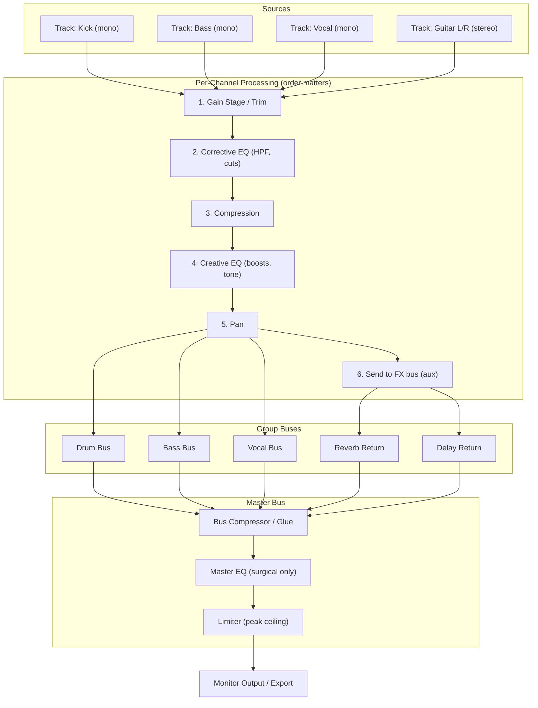
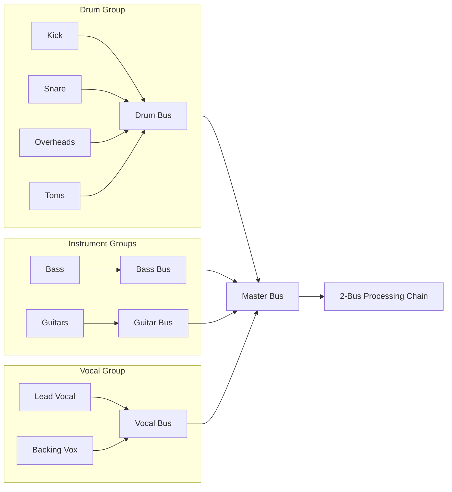

# Lesson 4: Advanced Mixing Techniques

## 1. Why This Works: The 15% You Need

Mixing is decision-making under constraint. You have a limited dynamic range (your speakers, the listener's room, streaming loudness normalization), a limited frequency spectrum (practically 40Hz–16kHz for most material), and a limited stereo field (two speakers or two ears). Every track competes for space in three dimensions: **level, frequency, and stereo position**. Mixing is the craft of giving each element its own space in at least one of those three dimensions so nothing has to fight for room.

Three psychoacoustic facts drive almost every technique in this lesson:

- **Equal-loudness contours (Fletcher-Munson / ISO 226):** the ear is most sensitive between 2–5 kHz and least sensitive below 100 Hz and above 15 kHz at low playback levels. As SPL increases, that curve flattens. This is why a mix that sounds balanced at low volume often feels bass-heavy and dull when played loud. **Practical consequence:** reference your mix at multiple volumes, not one comfortable level.
- **Masking:** when two sounds share a frequency range at similar levels, the louder one makes the quieter one harder to hear. Kick and bass guitar both living at 60–100 Hz is the classic collision. **Practical consequence:** EQ is primarily a carving tool. You carve space out of one instrument so another can occupy it, not stack boosts on everything.
- **Haas effect / interaural time difference:** the brain localizes direction mostly from timing differences between the ears (below ~1.5 kHz) and level differences (above). Delays under ~35ms between a sound and its copy fuse into one wider sound instead of a discrete echo. This is the physical basis of every stereo-widening and doubling trick in Section 7.

Gain staging, EQ carving, compression, bus routing, and panning are all engineering responses to these three facts. You're solving a space-allocation problem under a psychoacoustic constraint, not decorating a track.

## 2. Signal Flow Architecture (What Actually Happens to the Audio)

Before touching a plugin, know the order audio travels through your session. Get this wrong and you'll chase problems that don't exist.

**Why the processing order inside a channel matters:**
1. **Gain stage first** — every plugin after this, especially compressors, behaves differently depending on input level. A compressor fed -6dBFS peaks reacts nothing like one fed -24dBFS peaks even with identical threshold settings. Fix gain before touching anything else.
2. **Corrective EQ before compression** — a 200Hz boom or rumble below 40Hz will make a compressor pump/duck in response to garbage you don't want anyway. Cut it before the compressor sees it.
3. **Compression before creative/tonal EQ** — compression changes perceived frequency balance (raising low-level harmonic detail often makes a track sound brighter). EQ after compression tunes the *result*, not a guess at the *input*.
4. **Pan after tone is set** — panning decisions are easier to judge once the sound has its final timbre.

## 3. Gain Staging: The Unskippable Foundation

Gain staging is the single highest-leverage fix for muddy, flat, or distorted mixes — more impactful than any plugin choice.

**Procedure (before any EQ or compression):**

1. Set every fader to **unity (0dB)**.
2. Solo each track. Use the **channel trim/input gain** (not the fader) to set peak level around **-18dBFS to -12dBFS** in a session running at 24-bit/48kHz. This matches analog console calibration and leaves headroom before the digital ceiling at 0dBFS.
3. Un-solo everything. Build the balance using faders only, starting from the rhythm section outward: **kick → bass → snare → drum overheads → lead vocal → everything else.**
4. Check the master bus meter. If it's clipping before you've added any processing, go back and trim individual channels down — don't reach for the master fader as a band-aid.

**Why -18dBFS matters:** plugins modeling analog gear (tape saturation, vintage compressors, console emulations) are calibrated assuming signal hits them around that level. Slam them at -3dBFS and the saturation algorithm clips in ways the designer never intended — you get harsh digital distortion disguised as "warmth."

**Troubleshooting a muddy mix that "won't clean up" no matter how much EQ you add:** before reaching for another EQ band, solo the kick and bass together and check their individual input gain. If either channel trim sits above -10dBFS while others sit near -18dBFS, that one track is dominating the summing bus disproportionately. Re-trim first; mud frequently disappears without touching a single EQ band.

## 4. EQ: Carving Space, Not Painting Color

### The corrective pass (every channel, in this order)

1. **High-pass filter (HPF) everything that isn't a bass instrument.** Vocals: 80–100Hz. Guitars: 80–120Hz. Even kick drums get an HPF around 30–40Hz to remove sub-rumble that eats headroom without adding audible weight.
   - *Why:* frequencies below an instrument's fundamental carry no musical information, only room rumble, mic stand vibration, and proximity-effect boom. Removing them frees headroom and declutters the low end for kick/bass to occupy.
2. **Find and cut resonant buildups by sweeping a narrow boost.** Set a bell EQ to +6 to +10dB gain, Q around 4–8, and sweep slowly through the spectrum while soloing the track. When a frequency jumps out as boxy, honky, or harsh, stop, drop that same frequency to -3 to -6dB, and widen the Q slightly.
   - Common offenders: **200–400Hz** (boxiness/mud on guitars, vocals, piano), **500–800Hz** (honk on horns, vocals), **2–4kHz** (harshness/fatigue on vocals and cymbals).
3. **De-mask the kick/bass relationship** — pick a crossover point (commonly 60–100 Hz). Decide which instrument "owns" that range (usually kick for punch, bass for sustain) and cut a complementary dip of 2–3dB in the other instrument at that exact frequency.

### The creative pass (musical shaping, after compression)

- **Boost broadly, cut narrowly.** A wide bell boost of +2dB at 10kHz adds "air" to a vocal without a specific frequency jumping out as "EQ'd." Narrow cuts remove specific problems; wide boosts add general character.
- **Vocal presence:** gentle boost 3–5kHz (+1 to +3dB, wide Q) for intelligibility and forwardness in a dense mix.
- **Bass clarity on small speakers:** a gentle boost around 800Hz–1.2kHz lets the ear perceive bass weight even on devices that can't reproduce 60Hz (phones, laptop speakers) — the ear reconstructs a sense of the fundamental from its upper harmonics.

**Filter topology note (the 15% physics):** EQ bands are implemented as biquad filters, second-order IIR filters whose coefficients set cutoff frequency, Q, and gain. A high Q creates a narrow, resonant notch; low Q creates a broad, gentle curve. Steep filters (24dB/octave+) introduce more phase shift near the cutoff than gentle ones (6–12dB/octave) — this is why aggressive HPFs on bass-heavy sources can make transients sound smeared, and why engineers often prefer gentler slopes for anything but surgical rumble removal.

### Quick reference: EQ moves by instrument

| Instrument | Cut | Boost | Notes |
|---|---|---|---|
| Kick (in) | Rumble < 30Hz; boxiness 300–500Hz | Punch 2.5–4kHz (beater click); weight 60–80Hz | Don't boost 60–80Hz and sub-bass region of bass guitar simultaneously |
| Bass guitar | Mud 200–300Hz | Fundamental 60–100Hz; definition 700Hz–1.2kHz | HPF below 40Hz unless 5-string low B is in use |
| Snare | Boxiness 400–600Hz | Crack 2–5kHz; body 150–250Hz | Top/bottom mic phase-check before EQ |
| Lead vocal | Mud 200–400Hz; harsh sibilance 5–8kHz (de-esser, not EQ) | Presence 3–5kHz; air 10–12kHz | De-ess after compression, not before |
| Acoustic guitar | Boom 100–200Hz; boxiness 300–500Hz | Sparkle 8–10kHz | HPF at 100–150Hz when layered under vocal |
| Electric guitar (distorted) | Mud 150–300Hz; fizz > 8kHz | Bite 1.5–3kHz | Guitar amps naturally roll off above 5kHz; don't fight this |

## 5. Compression: Controlling Dynamics, Not Just "Making It Louder"

### Parameters and what they actually do

| Parameter | Function | Starting point for vocals | Starting point for drums (bus) |
|---|---|---|---|
| Threshold | Level above which compression engages | Set so gain reduction shows 3–6dB on loud phrases | 2–4dB reduction on hits |
| Ratio | Reduction above threshold (4:1 = 4dB in → 1dB out) | 3:1 to 4:1 | 2:1 to 4:1 |
| Attack | Delay before compression engages | 5–15ms (lets consonants through) | 10–30ms (lets transient "click" through, controls body) |
| Release | Time to return to no compression | 80–150ms, or auto-release | 100–250ms, tempo-synced if possible |
| Knee | How gradually ratio ramps in near threshold | Soft knee (transparent) | Hard knee (punchy, obvious) |

**Attack time is the most important creative decision.** A fast attack (< 5ms) clamps the transient itself, reducing punch and snap — useful for taming an overly aggressive pick attack on bass. A slower attack (15–30ms) lets the initial transient through uncompressed while controlling the sustain/body that follows — the standard choice when you want drums to stay punchy.

### Practice drill: setting compression by ear, not just meters

1. Set ratio to 4:1, attack to 10ms, release to 100ms.
2. Lower the threshold until the gain reduction meter shows 6dB on the loudest hits.
3. **A/B by bypassing/un-bypassing repeatedly**, listening only for a level jump. If the compressed version sounds louder, turn down makeup gain until both versions are perceptually loudness-matched.
4. With loudness matched, A/B again — now judge whether the compression *feels* better (controlled, glued, punchy) or worse (squashed, lifeless) without loudness bias skewing the call. Skipping this step is the most common reason mixers overcompress: they mistake "louder" for "better."

**Metronome-style progressive drill for ear training:** practice this A/B discipline on five different source types in one session — kick, bass, snare, full vocal take, acoustic guitar. Time yourself: 3 minutes per track, forcing a decision before moving on. Builds the instinct to loudness-match reflexively instead of trusting first impressions.

### Parallel compression (New York compression) — punch without losing dynamics

1. Duplicate the drum bus, or send it to an aux via a bus send at unity gain.
2. On the duplicate, apply **heavy** compression: ratio 8:1–20:1, fast attack (1–3ms), fast release (50–80ms), threshold pulled down until gain reduction shows 10–15dB. It should sound crushed and ugly in isolation.
3. Blend the crushed duplicate under the clean original, pushing it up until the crushed signal adds weight and sustain without audibly squashing the transients.
   - *Why this works:* the clean signal preserves transient detail and dynamic range; the crushed signal fills in sustain and low-level detail (cymbal tails, room ambience, ghost notes) that would otherwise sit below the audible floor. You get the energy of heavy compression without the pumping artifacts.

### Multiband compression — when a single band of EQ can't fix a frequency-dependent dynamics problem

Use multiband compression when a problem exists only in part of the spectrum and changes over time — a bass guitar whose low end is fine but whose high-mid "growl" spikes unpredictably on certain notes, for example. A static EQ cut removes the growl everywhere, even when it's not spiking. A multiband compressor only reacts when that band gets loud.

1. Split into 3 bands: low (< 200Hz), mid (200Hz–3kHz), high (> 3kHz) as a starting template.
2. Leave low and high bands at low ratio (1.5:1) or bypassed.
3. On the problem mid band, apply a fast attack (3–5ms), moderate release (80–120ms), ratio 3:1–4:1, threshold set to catch only the spikes.
4. Check gain reduction only engages during the problem moments, not constantly — if it's compressing all the time, you've built a static EQ cut with extra CPU cost. Raise the threshold.

## 6. Bus Routing & Group Processing

**Why group buses exist:** processing 8 individual drum mics with the same compressor one at a time never sounds as cohesive as summing them to one bus and compressing that sum together. Bus compression reacts to the combined signal, imposing a single dynamic feel across the whole group — this is what "glue" compression means.

**Standard group structure for a full-band mix:**

**Drum bus glue compressor settings (classic SSL-style starting point):**
- Ratio: 4:1
- Attack: 10–30ms (slow enough to pass kick/snare transient)
- Release: Auto, or ~0.3s
- Threshold: pull down until gain reduction shows 2–4dB on the loudest hits. Subtle is the goal — this is glue, not squash.

**Troubleshooting pumping drum bus compression:** if kick hits cause an audible dip in cymbal/overhead level right after each hit, your release is too fast relative to the tempo. At 120 BPM a quarter note is 500ms; a 100ms release recovering well before the next hit should feel tight, not pumpy. If it still pumps, switch to auto-release mode, which adapts to program material, or slow the release toward 300–400ms.

## 7. Panning & Stereo Field Management

The stereo field is a second axis of separation, independent of frequency and level. Use it deliberately.

**Standard rock/pop panning template:**

| Element | Pan Position | Rationale |
|---|---|---|
| Kick, Snare, Bass, Lead Vocal | Center (0) | Carry the rhythmic and melodic core — centering keeps them stable across mono playback (phones, Bluetooth speakers) |
| Hi-hat | Slightly R (15–25%) | Matches a drummer's typical physical kit perspective |
| Overheads/Room mics | Hard L/R (80–100%) | Establishes the stereo width of the kit |
| Rhythm guitar (doubled) | Hard L + Hard R (two takes) | True stereo width from two independent performances, not a widener plugin |
| Keys/Pads | 30–50% L or R | Fills space without competing with guitars |
| Backing vocals | Spread 20–60% L/R | Creates width around the centered lead vocal |

**Mono compatibility check:** sum your mix to mono (most DAWs have a mono button on the master, or flip one channel's polarity and sum — anything that cancels out was pure out-of-phase stereo information). If the mix collapses, loses the bass, or key elements disappear, something is relying entirely on phase cancellation rather than real signal content. Many Bluetooth speakers, smart speakers, and club PA systems sum to mono or near-mono — don't skip this check.

**The Haas trick for width without a stereo widener plugin:** duplicate a mono track, nudge the duplicate 10–25ms later, hard-pan the original left and the duplicate right. The brain perceives this as one wide sound rather than two discrete echoes (effective below ~35ms). This is literally how most doubling and "stereo enhancer" plugins work under the hood — know the mechanism so you can apply it manually with full control over delay time, and avoid the phasey artifacts automated wideners sometimes introduce.

**Troubleshooting a hollow or phasey mix after widening:** if the mix sounds wide on headphones but collapses or sounds thin in mono, you've leaned too hard on Haas-based widening or a comb-filtering widener plugin. Pull the delay time down toward 10ms (less obvious echo, less destructive cancellation) or reduce the widener's intensity. True stereo width (two mic'd/played takes, real stereo instruments) survives mono summing far better than delay-based tricks.

## 8. Effects Sends: Reverb & Delay as Space, Not Decoration

**Use sends (aux buses), not inserts, for reverb and delay** — this lets every track share one reverb algorithm, which mirrors how real rooms work (every sound source in a room reflects off the same walls). Insert-only reverb on individual tracks creates a mix where every instrument sounds like it's in its own disconnected room.

**Practical send-based reverb setup:**

1. Create an aux/FX bus. Insert a reverb plugin on it (100% wet, no dry signal — the dry signal already exists on the original track).
2. From each channel, add a **send** routed to that aux, with its own independent send-level knob.
3. Vocals typically send more (prominent space); drums and bass typically send little to none (reverb on low frequencies causes mud fast — HPF the reverb return itself at 200–300Hz if you must send bass-heavy sources to it).

**Pre-delay as a separation tool:** set the reverb's pre-delay to 20–40ms. This creates a short gap between the dry sound and the onset of reflections, preserving clarity and transient definition before the wash of reverb arrives — critical for keeping vocals intelligible while still sounding spacious.

**Delay vs. reverb for space:** a short slapback delay (80–120ms, low feedback, one or two repeats) adds perceived room size and vintage character without reverb's smearing wash — classic on rockabilly vocals and guitar, and useful anywhere you want width/depth without blur.

**Troubleshooting a vocal that disappears when reverb is added:** if the vocal loses intelligibility the moment reverb comes up, check pre-delay first (push it to 30–40ms before touching send level), then check whether the reverb return itself needs an HPF around 300–400Hz — low-frequency reflections are what most often bury consonants and vocal clarity.

## 9. Master Bus: Final Glue, Not a Fix-It Station

**If you're reaching for heavy EQ or compression on the master bus to fix a problem, go back and fix it on the individual track or bus instead.** The master bus chain should only apply a light, final polish:

1. **Light bus compression** (if used): ratio 2:1, slow attack (30ms+), auto release, 1–2dB gain reduction max. This is about cohesion, not control.
2. **Surgical EQ only** — a broad, gentle tonal tilt (±1dB shelf) at most. Never fix a mud problem here; fix the offending track.
3. **Limiter as the final stage**, purely for peak safety and loudness targeting:
   - Set the ceiling to **-1dBFS to -0.3dBFS** (not 0dBFS) to leave headroom for lossy codec encoding — MP3/AAC can produce inter-sample peaks that exceed 0dBFS after decoding, causing audible clipping on playback. True-peak limiting handles this.
   - Target integrated loudness around **-14 LUFS** for streaming platforms (Spotify, YouTube, Apple Music all normalize near this), or **-9 to -11 LUFS** for club/EDM masters that stay louder outside LUFS-normalizing contexts. Check with a loudness meter plugin (free option: Youlean Loudness Meter).

**Troubleshooting a mix that sounds great in your DAW but thin/weird on Spotify:** streaming platforms apply loudness normalization. If your master sits at -6 LUFS and the platform normalizes to -14 LUFS, it turns your output *down* by 8dB on playback — all the aggressive limiting you did to get loud bought you nothing but reduced dynamic range, because the platform undoes the loudness gain and keeps the squashed transients. Mix for a loudness target, not for "as loud as possible."

## 10. Practice Drill: Full Session Workflow Checklist

Run this exact sequence on your next mix, timing yourself with a stopwatch to build speed without skipping steps:

1. **Gain stage** every channel to -18dBFS average peak (5–10 min).
2. **Build rough balance** with faders only, no processing, in this order: kick, bass, snare, drums, lead vocal, rhythm instruments, everything else (10 min).
3. **HPF every non-bass-instrument track** (5 min).
4. **Corrective EQ sweep** on the 3–4 most problematic tracks only — don't EQ everything by default (15–20 min).
5. **Compress rhythm section first** (kick, bass, snare individually; then drum bus as a group) using the A/B loudness-matched method from Section 5 (20 min).
6. **Compress lead vocal** (20 min).
7. **Pan everything** per the template in Section 7, then check mono sum (5 min).
8. **Set up reverb/delay sends**, adjust send levels per track (15 min).
9. **Reference against a commercial track** in the same genre at matched loudness (use a loudness-matching plugin like Mastering The Mix REFERENCE, or manually gain-match by ear) — listen specifically for low-end weight, vocal clarity, and stereo width differences (10 min).
10. **Master bus polish**: light glue compression, limiter at -1dBFS ceiling, check LUFS target (10 min).

Total: roughly 2 hours for a full critical mix pass on a ~16–24 track session. Repeat this drill on five different genre references (pop, rock, hip-hop, EDM, acoustic/singer-songwriter) to build genre-flexible instincts — each genre has different conventional targets for LUFS, stereo width, and low-end balance.

## 11. Common Failure Patterns and Fast Diagnosis

| Symptom | Likely Cause | First Fix to Try |
|---|---|---|
| Mix sounds good at one volume, bad at another | Monitoring at a single level only | Reference at low (conversation level), medium, and loud; the Fletcher-Munson curve shifts your bass/treble perception at each |
| Kick and bass fight for the same space | Both occupying 60–100Hz uncut | Pick the crossover, carve a 2–3dB complementary dip in whichever doesn't "own" that range |
| Vocal sounds harsh on long sessions | Buildup at 2–4kHz, possibly stacked across vocal EQ + presence boost + de-esser all fighting the same region | Pull back the EQ boost, lower compressor makeup gain, confirm you're not boosting presence while a saturation plugin is also adding harmonics in the same band |
| Mix feels lifeless after mastering chain | Over-limiting killing transient dynamics | Pull the limiter's gain reduction down to 2–3dB max on peaks; stop chasing a louder number |
| Great in the studio, thin on laptop speakers | No content in 800Hz–1.2kHz range for the ear to reconstruct bass harmonics | Add a gentle boost in that range on bass/kick, check on an actual laptop speaker, not just monitors |
| Backing vocals swallow the lead | Same frequency range, same stereo position, same dynamic treatment | Spread backing vocals wider in pan, cut 2–4kHz slightly on backing vocals to leave that presence range for the lead |
