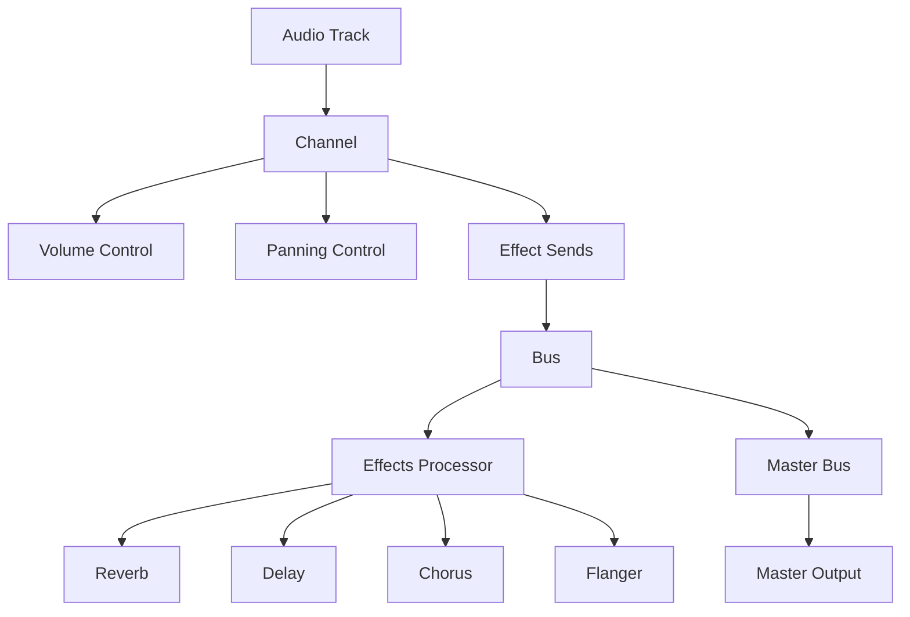

# Lesson 4: Advanced Mixing Techniques

## 1. First-Principles Intuition & Invariants

In the realm of music production, mixing is the art of balancing and manipulating audio signals to create a cohesive and polished final product. This process requires a deep understanding of the physical properties of sound, the psychoacoustic principles that govern human perception, and the technical invariants that underpin digital audio processing. At the heart of mixing lies the principle of signal manipulation, where individual audio tracks are sculpted and blended to achieve a harmonious and impactful auditory experience.

The theoretical foundation of mixing is rooted in the physics of sound waves and their interaction within a given acoustic space. Sound waves are vibrations that propagate through a medium, such as air, and are characterized by their frequency, amplitude, and phase. In the digital domain, these properties are represented as discrete samples, each capturing the amplitude of the waveform at a specific point in time. The Nyquist-Shannon sampling theorem dictates that to accurately reconstruct a continuous signal, the sampling rate must be at least twice the highest frequency component of the signal. This fundamental invariant ensures that the digital representation of sound is faithful to its analog counterpart, preserving the essential qualities of timbre, pitch, and dynamics.

Psychoacoustics, the study of how humans perceive sound, plays a crucial role in the art of mixing. The Fletcher-Munson curves, which describe the equal-loudness contours of human hearing, reveal that our perception of sound intensity is not uniform across all frequencies. High and low frequencies are perceived as quieter than midrange frequencies at the same amplitude level. This non-linear perception necessitates careful attention to the balance of frequency components in a mix, ensuring that no single element dominates the auditory landscape.

Invariants in mixing also extend to the principles of automation, panning, and effects processing. Automation involves the use of control surfaces or software to dynamically adjust parameters over time, such as volume, panning, and effect settings. This technique allows for nuanced and expressive control over the mix, enabling the creation of dynamic transitions and subtle variations that enhance the emotional impact of the music. Panning, on the other hand, involves positioning audio signals within a stereo or surround sound field, creating a sense of spatial depth and width. The invariants of panning are rooted in the principles of binaural hearing, where the brain interprets the relative timing and intensity of sound waves reaching each ear to determine the direction and distance of sound sources. Effects processing, including reverb, delay, and modulation, introduces additional layers of texture and depth to the mix, simulating acoustic spaces and creating unique soundscapes. The invariants of effects processing are grounded in the principles of digital signal processing, where algorithms are employed to manipulate audio signals in the time and frequency domains.

## 2. Core Architecture & Mechanics

The architecture of a digital audio workstation (DAW) is designed to facilitate the manipulation and processing of audio signals. At the core of this architecture lies the mixer, which serves as the central hub for routing, processing, and balancing audio tracks. The mixer is composed of several key components, including channels, buses, and effects processors.

Each channel in a mixer represents an individual audio track, such as a guitar, bass, or vocal. Channels are equipped with a variety of controls, including volume, panning, and effect sends, which allow for precise manipulation of the audio signal. The internal data structure of a channel typically includes a buffer for storing audio samples, a set of control parameters for adjusting volume and panning, and a routing matrix for directing audio to buses and effects processors.

Buses serve as virtual audio pathways, allowing multiple channels to be routed to a common destination. Buses can be used for a variety of purposes, such as grouping channels together for simultaneous processing, creating submixes, or routing audio to external hardware processors. The internal data structure of a bus typically includes a buffer for storing audio samples, a set of control parameters for adjusting volume and panning, and a routing matrix for directing audio to other buses and effects processors.

Effects processors are used to introduce additional layers of texture and depth to the mix. Common effects include reverb, delay, chorus, and flanger, each of which simulates a specific acoustic or modulation effect. The internal data structure of an effects processor typically includes a set of control parameters for adjusting the effect's settings, such as decay time, feedback, and modulation depth, as well as a processing algorithm for applying the effect to the audio signal.

The mechanics of mixing involve the dynamic interaction between these components. Automation, for example, involves the use of control surfaces or software to dynamically adjust parameters over time. This can be achieved through the use of automation lanes, which allow for the recording and playback of parameter changes. The internal data structure of an automation lane typically includes a buffer for storing parameter values at specific time intervals, as well as a playback algorithm for applying these values to the corresponding control parameters.

Panning involves the positioning of audio signals within a stereo or surround sound field. This can be achieved through the use of panning controls, which adjust the relative volume of the left and right channels. The internal data structure of a panning control typically includes a set of control parameters for adjusting the panning position, as well as a processing algorithm for applying the panning effect to the audio signal.

Effects processing involves the introduction of additional layers of texture and depth to the mix. This can be achieved through the use of effects processors, which apply specific algorithms to the audio signal. The internal data structure of an effects processor typically includes a set of control parameters for adjusting the effect's settings, as well as a processing algorithm for applying the effect to the audio signal.

To illustrate the architecture and mechanics of a mixer, consider the following Mermaid diagram:

