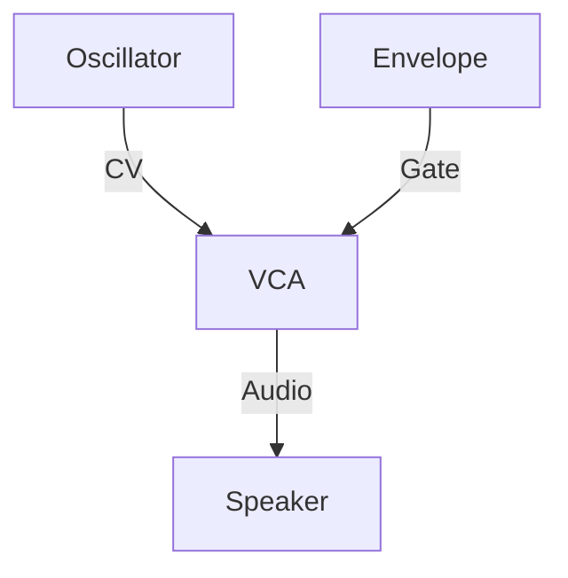

# Beginner Foundation: Modular Synthesis

## 1. Everyday Intuition & First Principles
Imagine you have a box of Lego blocks, each with a specific function. Some blocks can make sounds, others can change the pitch, and some can mix sounds together. Modular synthesis is like building your own custom musical instrument using these Lego blocks. Each module (or block) has a specific job, and by connecting them in different ways, you can create a wide variety of sounds and textures. This approach allows you to explore the fundamental building blocks of sound and music creation, giving you unparalleled control and creativity.

## 2. Foundational Vocabulary & Glossary
- **Module:** A self-contained unit that performs a specific function, such as generating sound, processing signals, or controlling other modules.
- **Patch:** The arrangement of modules and the connections between them, which determines the overall sound and behavior of the synthesizer.
- **Signal:** An electrical or electronic representation of sound that travels through the modules.
- **Input:** A jack or port on a module where a signal can be received.
- **Output:** A jack or port on a module where a signal is sent.
- **Voltage Control (CV):** A method of controlling modules using voltage signals, allowing for dynamic and automated changes in sound parameters.
- **Gate:** A type of control signal used to turn a module on or off, often used to trigger envelopes or sequencers.
- **Envelope:** A module that controls the amplitude (volume) of a sound over time, typically with Attack, Decay, Sustain, and Release stages.

## 3. Visual System Flow
### ASCII Diagram
```
[Oscillator] --(CV)--> [VCA] --(Audio)--> [Speaker]
[Envelope] --(Gate)--> [VCA]
```

### Mermaid Flowchart


## 4. Common Beginner Misconceptions & Mental Traps
- **Misconception:** Modular synthesis is too complicated for beginners.
  - **Reality:** Modular synthesis can be as simple or complex as you want it to be. Start with basic patches and gradually add complexity.
- **Misconception:** You need expensive equipment to get started.
  - **Reality:** There are affordable modular synthesizers available, and you can even build your own using DIY kits.
- **Misconception:** Modular synthesis is only for electronic music.
  - **Reality:** Modular synthesis can be used to create a wide range of musical styles, from ambient and experimental to rock and pop.
- **Misconception:** You need to understand all the technical details to start creating.
  - **Reality:** While knowledge is helpful, you can start creating music by experimenting with different patches and connections.

## 5. Socratic Discussion Starters
- What are the advantages of using modular synthesis over a traditional synthesizer?
- How does the concept of voltage control (CV) differ from digital control in synthesizers?
- Can you describe a simple patch that combines an oscillator with a VCA and an envelope?
- How might you use a sequencer module to create a rhythmic pattern in your modular setup?
- What are some ways to incorporate modular synthesis into a live performance or recording session?
