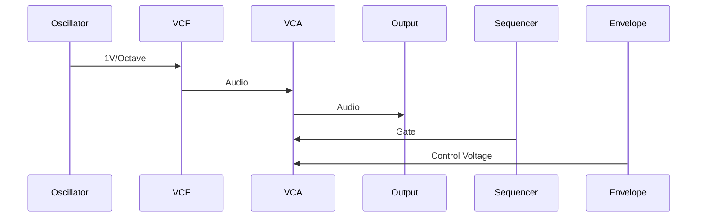

# Intermediate Foundation: Modular Synthesis
## 1. Architectural Mental Model
### Overview
Modular synthesis involves building complex sounds and music by connecting individual modules that perform specific functions. Each module can be thought of as a building block, and the connections between them form the architecture of your synthesizer system. Understanding the architectural mental model is crucial for designing effective and efficient modular synthesis setups.

### Key Concepts
- **Modular Units:** These are the individual components of your synthesizer, such as oscillators, filters, amplifiers, and sequencers. Each unit performs a specific function and can be connected to other units to create complex soundscapes.
- **Signal Flow:** This refers to the path that signals take as they travel through the system. Understanding signal flow is essential for designing effective modular synthesis setups.
- **Patch Cables:** These are the physical connections between modules. They carry signals from one module to another, allowing you to create complex systems by connecting multiple units.

### Production Architecture
When designing a modular synthesis system, it's important to consider the overall architecture of your setup. This includes the arrangement of modules, the signal flow, and the connections between modules. A well-designed architecture can help you create complex and interesting sounds while keeping your setup organized and manageable.

### Example Architecture
Here's an example of a simple modular synthesis architecture:
1. **Oscillator:** Generates the base sound.
2. **Filter:** Shapes the sound by removing certain frequencies.
3. **Amplifier:** Controls the volume of the sound.
4. **Sequencer:** Controls the timing and sequence of notes.

In this architecture, the signal flow would be:
1. The oscillator generates a sound.
2. The sound is sent to the filter, which shapes the sound.
3. The shaped sound is sent to the amplifier, which controls the volume.
4. The sequencer controls the timing and sequence of notes.

## 2. Systems Taxonomy & Component Protocols
### Standard Interfaces
Modular synthesis systems use standard interfaces to connect modules. The most common interface is the 3.5mm TRS (Tip-Ring-Sleeve) jack, which is used to connect modules. Other interfaces include Eurorack, which uses 3.5mm TRS jacks, and Doepfer A-100, which uses 3.5mm TRS jacks with a specific pinout.

### Protocols
Modular synthesis systems use protocols to define how signals are transmitted between modules. The most common protocol is the 1V/Octave protocol, which is used to control the pitch of oscillators. Other protocols include the 0-5V protocol, which is used to control the amplitude of signals, and the 0-10V protocol, which is used to control the pitch of oscillators with a wider range.

### Data Models
Modular synthesis systems use data models to define the types of signals that can be transmitted between modules. The most common data models are control voltages, which are used to control the pitch, amplitude, and other parameters of signals. Other data models include audio signals, which are used to transmit audio data between modules, and gate signals, which are used to trigger events.

## 3. Multi-Component Interaction Flow
### Detailed ASCII Diagram
Here's an example of a detailed ASCII diagram of a modular synthesis system:
```
[Oscillator] --(1V/Octave)--> [VCF] --(Audio)--> [VCA] --(Audio)--> [Output]
[Sequencer] --(Gate)--> [VCA]
[Envelope] --(Control Voltage)--> [VCA]
```
In this diagram, the oscillator generates a sound, which is sent to the voltage-controlled filter (VCF) to shape the sound. The shaped sound is then sent to the voltage-controlled amplifier (VCA) to control the volume. The sequencer controls the timing and sequence of notes, and the envelope controls the amplitude of the sound.

### Mermaid Sequence Diagram
Here's an example of a Mermaid sequence diagram of a modular synthesis system:

In this diagram, the oscillator generates a sound, which is sent to the voltage-controlled filter (VCF) to shape the sound. The shaped sound is then sent to the voltage-controlled amplifier (VCA) to control the volume. The sequencer controls the timing and sequence of notes, and the envelope controls the amplitude of the sound.

## 4. Architectural Trade-offs & Production Pitfalls
### Trade-offs
When designing a modular synthesis system, there are several trade-offs to consider:
- **Complexity vs. Simplicity:** A more complex system can produce more interesting sounds, but it can also be more difficult to manage and maintain.
- **Cost vs. Quality:** Higher-quality modules can produce better sounds, but they can also be more expensive.
- **Scalability vs. Portability:** A larger system can produce more complex sounds, but it can also be more difficult to transport and set up.

### Pitfalls
When designing a modular synthesis system, there are several pitfalls to avoid:
- **Signal Degradation:** Poor-quality patch cables and connections can degrade the quality of signals, resulting in poor sound quality.
- **Feedback Loops:** Feedback loops can cause unwanted noise and distortion, so it's important to avoid them.
- **Signal Clipping:** Signal clipping can occur when signals exceed the maximum input level of a module, resulting in distortion and poor sound quality.

## 5. Socratic Discussion Starters
### Questions Bridging Architecture to Low-Level Implementation
- **How does the architecture of a modular synthesis system affect the quality of the sounds it produces?**
- **What are the trade-offs between complexity and simplicity in modular synthesis system design?**
- **How do standard interfaces and protocols affect the compatibility and interoperability of modular synthesis systems?**
- **What are the best practices for managing and maintaining a modular synthesis system?**
- **How do feedback loops and signal clipping affect the quality of sounds produced by a modular synthesis system?**
- **What are the best practices for designing and implementing a modular synthesis system that is both scalable and portable?**
- **How do the data models used in modular synthesis systems affect the types of sounds that can be produced?**
- **What are the best practices for designing and implementing a modular synthesis system that is both cost-effective and high-quality?**
- **How do the protocols used in modular synthesis systems affect the types of signals that can be transmitted between modules?**
- **What are the best practices for designing and implementing a modular synthesis system that is both flexible and efficient?**
