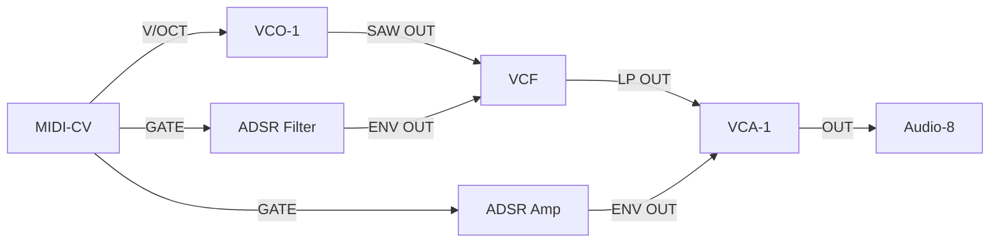

# Operational Verification Labs: Modular Synthesis

## Objective & DAW / Studio Setup

These laboratories establish operational proficiency in modular synthesis through three integrated practice domains: signal flow architecture and patch construction, spectral manipulation through voltage-controlled parameter modulation, and critical analysis of harmonic content under dynamic performance conditions. The exercises demand hands-on engagement with virtual modular environments, disciplined parameter logging, and iterative refinement cycles that mirror professional sound design workflows. You will construct functioning synthesizer voices from fundamental oscillator and envelope primitives, route control voltage to shape timbre in real time, and verify spectral integrity through measurement tools that expose aliasing artifacts, phase cancellation, and harmonic distortion. This operational framework prioritizes immediate sonic results over theoretical abstraction, yet grounds every patching decision in the underlying physics of voltage-controlled analog circuits and discrete-time digital signal processing.

Your studio environment requires a digital audio workstation configured for low-latency operation at 48 kHz sample rate with buffer sizes between 128 and 256 samples to balance CPU efficiency against real-time responsiveness. Install VCV Rack 2 as your primary modular synthesis platform, a software environment that replicates Eurorack hardware with cycle-accurate voltage simulation and comprehensive module interoperability. VCV Rack operates as a standalone application or VST3/AU plugin hosted within your DAW, enabling integration with timeline-based sequencing, audio routing, and automation recording. Configure your DAW to send MIDI clock and transport messages to VCV Rack, establishing synchronization between the modular patch and external sequencers or drum machines. Insert Voxengo SPAN as a post-fader spectrum analyzer on the VCV Rack return channel, setting the analysis window to 8192 samples with Blackman-Harris windowing for high-resolution frequency domain visualization. Enable the oscilloscope view within VCV Rack's Fundamental Scope module to monitor waveform shape, DC offset, and peak excursion in the time domain. If your DAW supports metering standards, activate an ITU-R BS.1770-4 compliant loudness meter to track integrated LUFS and true peak levels during synthesis exercises, ensuring that no clipping distortion contaminates the signal chain before intentional waveshaping processes.

Patch cable discipline forms the foundation of reliable modular operation. In VCV Rack, cables carry voltage signals normalized to the range $-10\text{V}$ to $+10\text{V}$, with pitch control following the one-volt-per-octave standard where an increase of precisely $1\text{V}$ raises pitch by one musical octave. Gate and trigger signals conventionally operate at $5\text{V}$ high and $0\text{V}$ low, with gates sustaining the high state for the duration of a note and triggers providing brief impulses typically $10\text{ms}$ in width. Audio-rate signals occupy the full $20\text{V}_{\text{pp}}$ range, while control-rate modulation sources often output bipolar signals centered at $0\text{V}$ or unipolar envelopes that ramp from $0\text{V}$ to $+10\text{V}$. Understanding these voltage semantics prevents mispatching and enables predictable signal routing across heterogeneous module ecosystems. Always zero unused oscillators before patching to eliminate DC offset accumulation, and route audio through VCA modules with envelope or LFO control rather than directly to output mixers, replicating the gating discipline of hardware modular systems where ungated oscillators produce continuous drone tones that obscure musical articulation.

The exercises progress from foundational voice architecture through complex modulation matrices to real-time performance and diagnostic verification. Each laboratory demands documented signal flow diagrams, parameter value logs, and spectral measurements that constitute an auditable record of your synthesis decisions. Approach these exercises with the rigor of a recording engineer conducting mix revisions: iterate patches, measure results, adjust parameters based on objective data from SPAN and oscilloscope readings, and critically evaluate whether the synthesized timbre achieves the intended harmonic profile and dynamic envelope shape. Modular synthesis rewards methodical exploration over random cable insertion, and these laboratories enforce that discipline through structured verification checkpoints that reveal whether your patch functions correctly under varied musical contexts and stress conditions.

## Exercise 1: Practical Composition & Voice-Leading Realization

This exercise constructs a monophonic bass synthesizer voice capable of articulating a twelve-bar blues walking bass line with independent control over pitch, dynamics, and harmonic timbre. The patch architecture follows the classic East Coast subtractive synthesis paradigm: a harmonically rich sawtooth oscillator feeds a voltage-controlled lowpass filter swept by an envelope generator, with the filtered signal routed through a voltage-controlled amplifier shaped by a second envelope. This signal chain replicates the Minimoog architecture that defined analog bass synthesis in the 1970s, establishing a proven template for fat, punchy low-end tones with musical filter resonance and aggressive envelope snap. You will program a sixteen-step MIDI sequence containing root-fifth-octave-sixth intervals ascending chromatically through a blues scale, synchronize the modular patch to your DAW's transport, and verify that each note exhibits consistent filter cutoff trajectory and amplitude envelope regardless of pitch or velocity.

Begin by launching VCV Rack as a standalone application and initializing a blank patch. Insert the following modules from the Fundamental plugin collection, arranging them in left-to-right signal flow order: VCO-1 oscillator, VCF voltage-controlled filter, VCA-1 voltage-controlled amplifier, two ADSR envelope generators (one for filter modulation, one for amplitude control), Audio-8 interface output module, and MIDI-CV converter module. The VCO-1 module generates sawtooth, triangle, and pulse waveforms with voltage-controlled frequency and pulse width modulation. Select the sawtooth output, which contains all harmonic partials with amplitudes inversely proportional to harmonic number $n$ following $A_n = \frac{1}{n}$, producing a bright, buzzy timbre ideal for subtractive filtering. Set the octave switch to the second position and the fine-tune knob to center detent, establishing a nominal pitch of A1 at $55\text{Hz}$ when the $\text{V/OCT}$ input receives $0\text{V}$.

Patch the sawtooth output into the audio input of the VCF module, a transistor ladder filter emulation with $24\text{dB/octave}$ rolloff slope and voltage-controlled resonance. Initialize the cutoff frequency knob to thirty percent rotation (approximately $400\text{Hz}$ cutoff) and resonance to twenty percent, providing subtle emphasis at the filter corner frequency without self-oscillation. The VCF module accepts exponential frequency modulation via its $\text{FREQ}$ input, where each $1\text{V}$ change corresponds to one octave shift in cutoff frequency, and linear modulation via its $\text{FM}$ input with attenuverter control. Connect the first ADSR envelope output to the VCF $\text{FREQ}$ input, establishing the classic filter sweep that opens bright on attack and decays to a darker sustain tone. Set the ADSR parameters to $A=5\text{ms}$, $D=200\text{ms}$, $S=0.3$, $R=100\text{ms}$, creating a sharp transient that blooms into sustained harmonic content before releasing smoothly.

Route the VCF lowpass output into the signal input of the VCA-1 module, a linear voltage-controlled amplifier with unity gain at full CV voltage. Connect the second ADSR envelope output to the VCA $\text{CV}$ input, establishing amplitude gating that prevents the synthesizer from droning between notes. Set this amplitude envelope to $A=1\text{ms}$, $D=50\text{ms}$, $S=0.7$, $R=50\text{ms}$, providing instantaneous attack that avoids the soft, slow-rising transients characteristic of string synthesis while maintaining sufficient decay and release for musical phrasing. Patch the VCA output into channels one and two of the Audio-8 module to deliver stereo output to your operating system's audio interface.

Insert the MIDI-CV module and configure it to receive MIDI input from your DAW. The module converts incoming MIDI note messages into $\text{V/OCT}$ pitch control voltage, gate signals, and optional velocity and aftertouch outputs. Connect the $\text{V/OCT}$ output to the VCO-1 frequency input, the $\text{GATE}$ output to both ADSR trigger inputs, and optionally the $\text{VEL}$ output to a VCA or attenuator for velocity-sensitive dynamics. Set the MIDI-CV module to monophonic mode with legato disabled, ensuring that overlapping notes retrigger envelopes rather than sliding pitch without re-articulation.

Open your DAW and create a new MIDI track routed to VCV Rack's virtual MIDI input. Program a sixteen-step sequence in 4/4 time at $90\text{BPM}$ with the following blues walking bass pattern in the key of A: A1, C2, D2, Eb2, E2, G2, A2, A1, repeating twice to fill four bars. Each note occupies one quarter-note duration with $10\text{ms}$ gaps between note-offs and subsequent note-ons to ensure clean envelope retriggering. Set all MIDI velocities to $100$ (approximately $79\%$ of maximum) for consistent dynamics during initial testing. Enable your DAW's metronome and set the transport to loop the four-bar region.

Start playback and observe the spectrum analyzer. The sawtooth oscillator fundamental at $55\text{Hz}$ should appear as a strong peak with harmonic partials visible at integer multiples extending beyond $5\text{kHz}$. As each note triggers, watch the filter envelope sweep the cutoff frequency upward, temporarily revealing higher harmonics before settling to the darker sustained timbre. Verify that the SPAN display shows no aliasing artifacts (spurious spectral components above the Nyquist frequency of $24\text{kHz}$ reflected back into the audible range) and that the fundamental tracks correctly as you transpose the sequence up one octave by adding $+12$ semitones in your DAW's MIDI editor. The filter cutoff should maintain its proportional relationship to pitch due to the exponential frequency modulation, keeping the timbre consistent across the keyboard range.

Measure the dynamic range of the synthesized bass line by recording four bars to an audio track in your DAW. Analyze the recorded waveform: peak levels should reach approximately $-6\text{dBFS}$ with the VCA-1 level knob at center position, providing sufficient headroom for downstream processing without necessitating gain staging adjustments. Examine the attack transient under microscope zoom (sample-level resolution): the amplitude envelope should exhibit the specified $1\text{ms}$ rise time without overshoot or ringing, and the filter envelope should open smoothly without zipper noise or discontinuities. If you observe spectral smearing or frequency-dependent amplitude fluctuations, verify that the VCF resonance remains below the self-oscillation threshold (typically $90\%$ of maximum rotation) and that the envelope depth does not drive the cutoff frequency beyond the module's stable operating range.

Introduce velocity sensitivity by patching the MIDI-CV $\text{VEL}$ output through a VCA or attenuator module, scaling the $0\text{V}$ to $+10\text{V}$ velocity range to approximately $\pm3\text{V}$ modulation depth. Sum this scaled velocity signal with the filter ADSR output using a mixer or multiple module before routing to the VCF $\text{FREQ}$ input. Re-record the bass line with varied MIDI velocities ($64$, $80$, $100$, $120$) and verify that higher velocities produce brighter attacks while maintaining the underlying filter envelope contour. This two-stage modulation architecture (static envelope plus velocity offset) replicates the expressive dynamics of performance-oriented synthesizers where keyboard force directly influences timbral brightness independent of amplitude.

Document your final patch with a signal flow diagram indicating all cable connections, module parameter settings, and envelope timing values. Export a stereo audio file of the complete twelve-bar bass line at $48\text{kHz}$ / $24\text{bit}$ resolution and generate a corresponding SPAN spectral analysis screenshot showing the frequency content during the brightest attack transient and the darkest sustain phase. This documentation constitutes the verification record demonstrating that your synthesizer voice meets the exercise specifications: stable pitch tracking across two octaves, consistent filter envelope behavior regardless of note velocity, and artifact-free subtractive synthesis with controlled harmonic rolloff.
