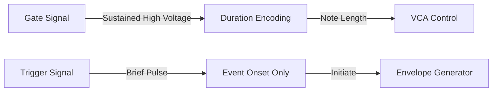
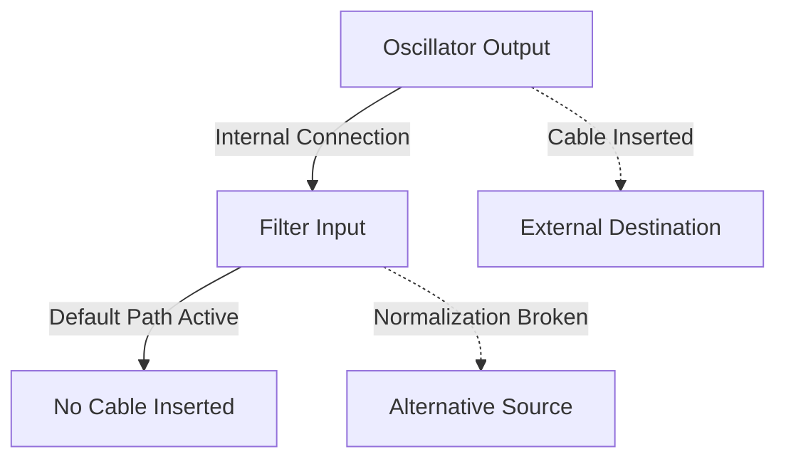

# Lesson 1: Signal Flow, Voltage Control, Patching Fundamentals

## 1. First-Principles Intuition & Invariants

The modular synthesizer represents a return to the foundational principle that governed electronic music's birth in the 1960s: direct voltage control over every parameter of sound generation and transformation. Unlike integrated synthesizers where signal paths are hardwired and predetermined by the manufacturer, modular systems expose the raw electrical topology of synthesis itself. Every oscillator, filter, envelope generator, and amplifier becomes an independent module communicating through analog voltages carried on patch cables. This architectural philosophy mirrors the Unix design principle of small, composable tools connected through well-defined interfaces, but operating in the continuous-time domain of electrical signals rather than discrete digital streams.

At the heart of modular synthesis lies a critical distinction between two fundamentally different voltage domains: audio-rate signals and control voltages. Audio signals occupy the frequency spectrum humans perceive as sound, typically ranging from 20 Hz to 20 kHz, and carry the actual acoustic content that will eventually reach speakers or recording systems. These signals oscillate rapidly, completing thousands of cycles per second, and their amplitude variations directly encode the waveform shape that determines timbre. Control voltages, by contrast, operate at sub-audio rates—usually between DC (zero hertz) and perhaps 50 Hz—and modulate the behavior of sound-generating modules rather than producing audible output themselves. A control voltage might slowly sweep a filter's cutoff frequency over several seconds, or trigger an envelope generator at precise rhythmic intervals, but it never directly becomes sound. The distinction is not merely semantic; these voltage types demand different electrical characteristics, connector standards, and patching strategies.

The voltage control paradigm itself emerged from Robert Moog's collaboration with composers Herbert Deutsch and Wendy Carlos in the mid-1960s. Moog recognized that precise musical pitch could be encoded as a linear voltage relationship: one volt per octave. This standard, which remains universal across modern Eurorack systems, establishes that for every one-volt increase in a control signal, the controlled oscillator's pitch rises exactly one musical octave. The elegance of this mapping cannot be overstated. It transforms complex exponential frequency relationships—where the frequency ratio between successive octaves doubles each time—into simple linear arithmetic. An oscillator receiving 0V might produce a fundamental tone at 261.63 Hz (middle C), 1V yields 523.25 Hz (C5), 2V produces 1046.50 Hz (C6), and so forth. This logarithmic-to-linear conversion happens inside the oscillator's voltage-controlled amplifier circuitry, which applies an exponential transfer function to the incoming control voltage before modulating the oscillator core. The mathematical relationship follows the form:

$$f(V) = f_0 \cdot 2^V$$

where $f_0$ represents the base frequency at 0V, $V$ is the control voltage in volts, and $f(V)$ is the resulting output frequency. This exponential function maps the linear voltage domain to the logarithmic frequency domain of human pitch perception.

Equally important are the gate and trigger standards that govern rhythmic and temporal control. A gate signal is a sustained voltage that remains high (typically +5V or +10V depending on system standards) for the duration of an event, then drops to 0V when the event ends. Think of a piano key: the gate goes high when you press the key down and remains high until you release it. The duration of the high state directly corresponds to the note's length. A trigger, by contrast, is a brief voltage pulse—usually 5 to 10 milliseconds in duration—that marks only the onset of an event without encoding its duration. Triggers are used to initiate time-based processes like envelope generators or clock sequencer steps, where the receiving module generates its own internal timing after receiving the initial impulse. The distinction matters because gates and triggers connect to different input circuits. A gate input typically feeds into a comparator that detects the high/low threshold, while a trigger input often uses edge-detection circuitry that responds only to the rising voltage transition.

The modular synthesizer's power emerges from its complete absence of predetermined signal paths. In a conventional synthesizer, the manufacturer decides that oscillator A feeds filter B, which then routes through envelope-controlled amplifier C to the output. These fixed paths optimize workflow for common musical tasks but impose rigid constraints on sound design. Modular systems invert this paradigm: every module exposes input and output jacks, and the musician creates signal paths dynamically by inserting patch cables between them. An oscillator's output can drive a filter, yes, but it can equally well frequency-modulate another oscillator, trigger an envelope, or control the rate of a low-frequency oscillator. The patch cable becomes the primary compositional interface, transforming synthesis from parameter adjustment into topological design.

This architectural flexibility does introduce a critical challenge: without careful signal flow discipline, feedback loops and voltage incompatibilities can damage modules or produce unintended sonic artifacts. The system operates as an electrical circuit governed by Kirchhoff's laws and Ohm's law, not as an abstract data flow graph. When you connect an output to an input, you create a physical electrical path where current flows according to voltage differentials and circuit impedances. Multiple outputs patched to a single input sum their voltages together, potentially driving the input beyond its acceptable range. Output stages typically use low-impedance voltage sources (often less than 1kΩ) to drive the relatively high-impedance inputs (typically 100kΩ or greater) of receiving modules, ensuring that signal voltage transfers with minimal attenuation. This impedance bridging principle explains why modular systems can chain multiple modules in series without significant signal degradation, unlike passive guitar pedal chains where each additional unit loads down the previous stage. The voltage division relationship follows:

$$V_{out} = V_{in} \cdot \frac{Z_{in}}{Z_{out} + Z_{in}}$$

where $Z_{out}$ represents the output impedance and $Z_{in}$ represents the input impedance. When $Z_{in} \gg Z_{out}$, the fraction approaches unity, preserving signal voltage.

The concept of normalization provides a pragmatic compromise between modular flexibility and workflow efficiency. Certain module combinations occur so frequently that hardwiring them as defaults reduces patching complexity for common tasks. A semi-modular synthesizer might internally connect an oscillator's output to a filter's input, but expose both connection points as jacks on the front panel. When no cable is inserted, the internal connection remains active; inserting a cable into either jack breaks the normalization and allows the musician to override the default path. This switching mechanism uses the mechanical action of the patch cable's tip making contact with a switching contact inside the jack. Many envelope generators normalize their output to a voltage-controlled amplifier's control input, so that simply triggering the envelope produces sound without requiring an explicit patch cable. Normalization thus preserves the modular philosophy while acknowledging that certain signal paths represent best practices or ergonomic necessities for musical performance.

## 3. Signal Flow Paradigms: Generation, Transformation, Routing

Signal flow in modular synthesis ultimately reduces to three core operations: generation, transformation, and routing. Generation modules produce voltages from internal processes—oscillators synthesize periodic waveforms, noise generators create stochastic signals, envelope generators produce time-varying control voltages, and sequencers emit predetermined voltage patterns. Transformation modules accept input voltages and modify them according to their transfer functions—filters attenuate frequency bands, wave shapers apply nonlinear distortion, voltage-controlled amplifiers scale signal amplitude, and mixers combine multiple inputs through weighted summation. Routing modules direct signals without altering their content—multiples split one output to drive several inputs simultaneously, switches select between multiple sources under voltage control, and matrix mixers enable complex cross-patching topologies. Every patch, regardless of complexity, consists of these three operations chained together in directed acyclic graphs where voltage flows from generators through transformers to destinations, with routing modules managing the branching and convergence of signal paths. Understanding this tripartite taxonomy provides the conceptual framework necessary to design patches systematically rather than through trial and error, transforming modular synthesis from an exploratory art into a disciplined engineering practice grounded in signal flow principles.
