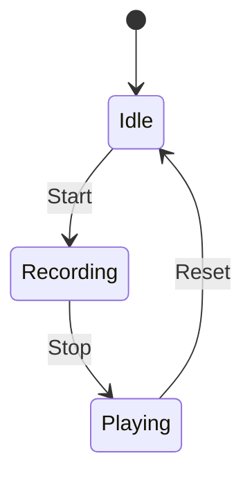

# Advanced Foundation: Production

## 1. Theoretical Invariants & Formal Frameworks

### Formal Proofs and Kernel Invariants

In the realm of music production, formal proofs and kernel invariants are essential for ensuring the robustness and reliability of digital audio workstations (DAWs) and audio processing algorithms. A fundamental invariant in digital audio is the Nyquist-Shannon sampling theorem, which states that a signal must be sampled at a rate at least twice its highest frequency component to avoid aliasing. Mathematically, this can be expressed as:

\[ f_s \geq 2 \cdot f_{\text{max}} \]

where \( f_s \) is the sampling frequency and \( f_{\text{max}} \) is the maximum frequency of the signal. This theorem is a cornerstone of digital audio processing and serves as a kernel invariant that must be respected to maintain the integrity of audio signals.

### Physical Invariants

Physical invariants in music production relate to the laws of physics governing sound and audio systems. One such invariant is the principle of conservation of energy, which applies to audio signals as they propagate through various components of an audio system. The energy of an audio signal must be conserved as it is processed, transmitted, and converted between different media (e.g., analog to digital and vice versa). This principle ensures that the amplitude and power of the signal remain consistent, preventing unintended distortions or losses.

Another physical invariant is the principle of linear superposition, which states that the response of a linear system to multiple inputs is the sum of the responses to each input considered individually. This principle is crucial in audio processing, as it allows for the decomposition of complex signals into simpler components, facilitating the design and analysis of audio algorithms.

## 2. Low-Level Invariant Taxonomy

### Deep Registers and Memory Models

In the context of music production, deep registers refer to the low-frequency components of audio signals, which are critical for the perceived richness and depth of sound. Low-frequency signals are particularly challenging to process due to their long wavelengths and the high resolution required to accurately represent them. A key invariant in this domain is the bit depth of audio samples, which determines the precision with which low-frequency signals can be represented. Higher bit depths provide greater dynamic range and reduced quantization noise, ensuring the integrity of low-frequency components.

Memory models in music production are critical for managing the storage and retrieval of audio data. A key invariant in memory models is the alignment of audio data in memory, which ensures efficient access and processing. Misaligned data can lead to performance degradation and increased latency, which are undesirable in real-time audio applications. Therefore, it is essential to adhere to memory alignment invariants to maintain optimal performance.

### Hardware Constraints and Axiomatic Definitions

Hardware constraints in music production impose limitations on the processing capabilities of audio systems. One such constraint is the processing power of the central processing unit (CPU), which determines the maximum complexity of audio algorithms that can be executed in real-time. Another constraint is the memory bandwidth, which affects the speed at which audio data can be read from and written to memory. These constraints must be respected to ensure that audio processing algorithms can be executed efficiently and reliably.

Axiomatic definitions in music production provide a formal foundation for the design and analysis of audio systems. One such axiom is the principle of causality, which states that the output of an audio system at any given time depends only on the input up to that time. This principle ensures that audio systems can be designed to operate in real-time, without introducing latency or other temporal distortions.

## 3. Micro-Architecture & Concurrency Dynamics

### Mermaid and ASCII State Machines

Micro-architecture in music production refers to the design and implementation of audio processing algorithms at a low level. State machines are a useful tool for modeling the behavior of audio systems, as they provide a clear and concise representation of the possible states and transitions of a system. Mermaid and ASCII state machines are two popular notations for representing state machines.

For example, consider a simple state machine for a basic audio effect, such as a delay line. The state machine can be represented using Mermaid notation as follows:



In this state machine, the system can be in one of three states: Idle, Recording, or Playing. The system transitions between states in response to input events, such as Start, Stop, and Reset.

### Cache and Race Condition Diagrams

Cache and race condition diagrams are useful tools for analyzing the performance and reliability of audio processing algorithms. Cache diagrams provide a visual representation of the data stored in the cache memory of a CPU, which is critical for optimizing the performance of audio algorithms. Race condition diagrams provide a visual representation of the interactions between multiple threads or processes, which is essential for ensuring the reliability of concurrent audio processing algorithms.

For example, consider a simple cache diagram for an audio processing algorithm that reads and writes audio data to memory. The cache diagram can be represented using ASCII notation as follows:

```
+-------------------+
| Cache             |
+-------------------+
| Line 0:           |
|   Address: 0x1000 |
|   Data: 0x00000000|
+-------------------+
| Line 1:           |
|   Address: 0x1004 |
|   Data: 0x00000000|
+-------------------+
| Line 2:           |
|   Address: 0x1008 |
|   Data: 0x00000000|
+-------------------+
| Line 3:           |
|   Address: 0x100C |
|   Data: 0x00000000|
+-------------------+
```

In this cache diagram, the cache memory is divided into four lines, each of which can store a block of data. The address and data fields indicate the memory address and data stored in each line.

Race condition diagrams provide a visual representation of the interactions between multiple threads or processes. For example, consider a simple race condition diagram for an audio processing algorithm that reads and writes audio data to shared memory. The race condition diagram can be represented using ASCII notation as follows:

```
+-------------------+       +-------------------+
| Thread 1          |       | Thread 2          |
+-------------------+       +-------------------+
| Read data from    |       | Write data to     |
| shared memory     |       | shared memory     |
+-------------------+       +-------------------+
|                   |       |                   |
|                   |       |                   |
|                   |       |                   |
|                   |       |                   |
|                   |       |                   |
|                   |       |                   |
|                   |       |                   |
|                   |       |                   |
|                   |       |                   |
|                   |       |                   |
|                   |       |                   |
|                   |       |                   |
+-------------------+       +-------------------+
```

In this race condition diagram, two threads are accessing shared memory simultaneously. If the threads do not coordinate their access to the shared memory, a race condition can occur, leading to inconsistent or corrupted data.

## 4. Subtle Failure Modes & Boundary Conditions

### Subtle Failure Modes

Subtle failure modes in music production refer to errors or anomalies that are difficult to detect or diagnose. One such failure mode is quantization noise, which occurs when audio signals are represented using a finite number of bits. Quantization noise can introduce unwanted distortion or artifacts into audio signals, particularly in low-frequency components. To mitigate quantization noise, it is essential to use high bit depths and dithering techniques.

Another subtle failure mode is aliasing, which occurs when audio signals are sampled at a rate that is too low. Aliasing can introduce unwanted high-frequency components into audio signals, leading to distortion or artifacts. To mitigate aliasing, it is essential to use anti-aliasing filters and to sample audio signals at a rate that is at least twice the highest frequency component.

### Boundary Conditions

Boundary conditions in music production refer to the limits or extremes of audio signals and processing algorithms. One such boundary condition is the maximum amplitude of audio signals, which is determined by the bit depth of audio samples. If audio signals exceed the maximum amplitude, clipping can occur, leading to distortion or artifacts. To mitigate clipping, it is essential to use dynamic range compression and limiting techniques.

Another boundary condition is the maximum processing load of audio systems, which is determined by the processing power of the CPU and the memory bandwidth. If audio systems exceed the maximum processing load, performance degradation or system crashes can occur. To mitigate performance degradation, it is essential to optimize audio algorithms and to use efficient data structures and algorithms.

## 5. Master Socratic Inquiries

### Research-Grade Discussion Questions

Master Socratic inquiries are research-grade discussion questions that challenge the assumptions and knowledge of experts in music production. These inquiries are designed to promote critical thinking and to encourage the exploration of new ideas and perspectives.

1. **Theoretical Invariants & Formal Frameworks:**
   - How can formal proofs and kernel invariants be used to ensure the robustness and reliability of digital audio workstations (DAWs) and audio processing algorithms?
   - How can physical invariants, such as the principle of conservation of energy and the principle of linear superposition, be applied to the design and analysis of audio systems?

2. **Low-Level Invariant Taxonomy:**
   - How can deep registers and memory models be optimized to ensure the integrity and performance of low-frequency audio signals?
   - How can hardware constraints and axiomatic definitions be used to design and implement efficient and reliable audio processing algorithms?

3. **Micro-Architecture & Concurrency Dynamics:**
   - How can state machines, cache diagrams, and race condition diagrams be used to model and analyze the behavior of audio systems?
   - How can micro-architecture and concurrency dynamics be optimized to ensure the performance and reliability of audio processing algorithms?

4. **Subtle Failure Modes & Boundary Conditions:**
   - How can subtle failure modes, such as quantization noise and aliasing, be mitigated to ensure the integrity and quality of audio signals?
   - How can boundary conditions, such as the maximum amplitude and processing load, be managed to ensure the performance and reliability of audio systems?

By engaging with these research-grade discussion questions, experts in music production can deepen their understanding of the theoretical and practical aspects of audio processing and can contribute to the development of new and innovative audio technologies.
