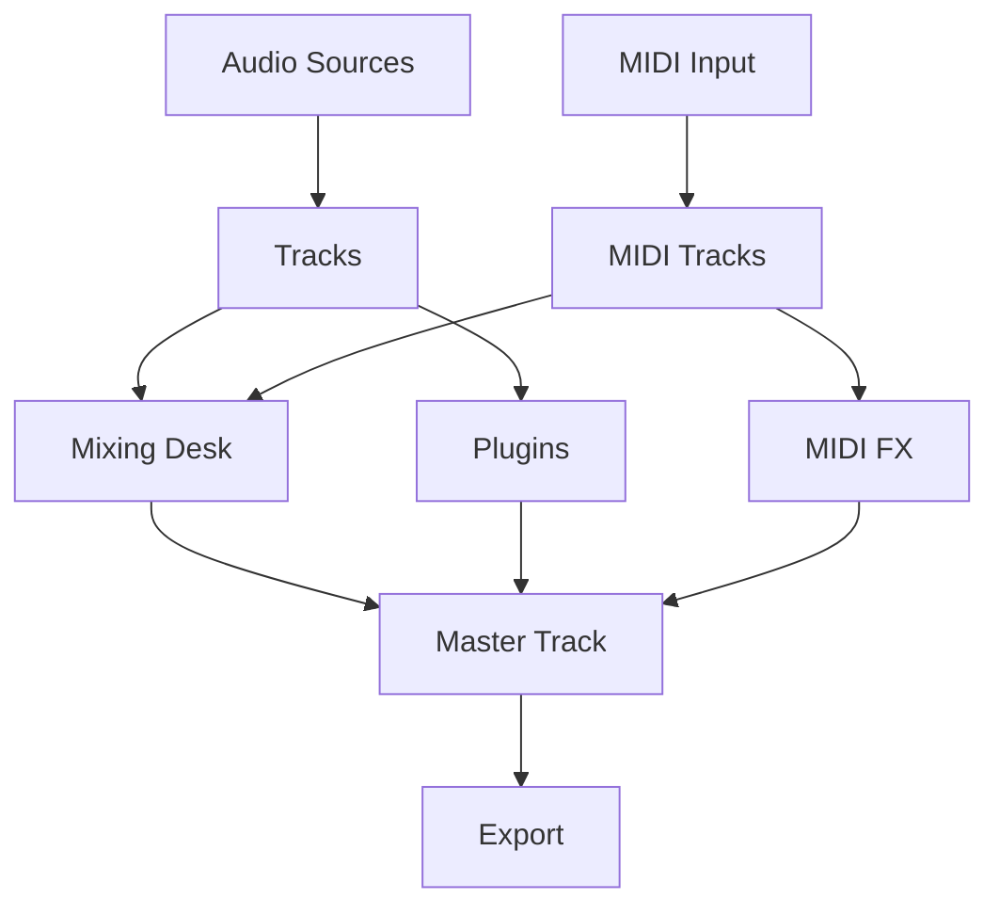

# Beginner Foundation: Production

## 1. Everyday Intuition & First Principles

Imagine you are a chef in a bustling kitchen. You have a variety of ingredients, each with its own unique flavor and texture. Your task is to combine these ingredients in a way that creates a dish that is not only delicious but also pleasing to the palate. Music production is much like this culinary endeavor. You have a collection of sounds, each with its own character and timbre, and your job is to blend them together to create a piece of music that resonates with listeners. Just as a chef must understand the properties of each ingredient and how they interact, a music producer must understand the properties of each sound and how they can be manipulated to create a cohesive and engaging musical experience.

## 2. Foundational Vocabulary & Glossary

### Track
A track is a single channel of audio in a music production project. It can contain a single instrument, a vocal, or any other audio source. For example, in a pop song, you might have separate tracks for the lead vocals, bass guitar, drums, and synthesizer.

### Sample
A sample is a short segment of audio that can be played back at various pitches and lengths. Samples are often used in electronic music to create unique sounds and textures. For instance, a producer might use a sample of a drum hit to create a rhythmic pattern.

### Loop
A loop is a section of audio that repeats continuously. Loops are commonly used in hip-hop and electronic dance music to create a repetitive, driving beat. A producer might loop a bassline or a drum pattern to form the foundation of a track.

### MIDI
MIDI (Musical Instrument Digital Interface) is a protocol that allows electronic musical instruments, computers, and other related devices to communicate. MIDI messages can control various aspects of sound, such as pitch, velocity, and effects. For example, a producer might use MIDI to trigger a synthesizer to play a specific note or sequence.

### Plugin
A plugin is a software tool that adds functionality to a digital audio workstation (DAW). Plugins can perform a wide range of tasks, from adding effects like reverb and delay to generating new sounds with synthesizers. A producer might use a reverb plugin to add depth to a vocal track or a compressor plugin to control the dynamics of a drum track.

### DAW (Digital Audio Workstation)
A DAW is a software application used for recording, editing, and producing music. DAWs provide a comprehensive set of tools for managing audio tracks, applying effects, and arranging music. Examples of DAWs include Ableton Live, FL Studio, and Logic Pro. A producer uses a DAW to organize and manipulate audio and MIDI data to create a finished piece of music.

## 3. Visual System Flow

### ASCII Diagram

```
+-------------------+       +-------------------+       +-------------------+
|   Audio Sources   |  ---> |      Tracks       |  ---> |      Plugins      |
+-------------------+       +-------------------+       +-------------------+
          |                           |                           |
          v                           v                           v
+-------------------+       +-------------------+       +-------------------+
|     MIDI Input    |  ---> |      MIDI Tracks  |  ---> |      MIDI FX      |
+-------------------+       +-------------------+       +-------------------+
          |                           |                           |
          v                           v                           v
+-------------------+       +-------------------+       +-------------------+
|    Mixing Desk    |  ---> |      Master Track |  ---> |      Export       |
+-------------------+       +-------------------+       +-------------------+
```

### Mermaid Flowchart



## 4. Common Beginner Misconceptions & Mental Traps

### Misconception: You Need Expensive Equipment to Produce Music
Many beginners believe that producing high-quality music requires expensive equipment. While professional-grade gear can enhance your production, it is not necessary to start. You can produce great music using a laptop and free or affordable software.

### Misconception: Music Production is Only for Electronic Music
Music production encompasses a wide range of genres, from electronic dance music to rock, pop, and classical. The skills you learn in music production can be applied to any style of music.

### Misconception: You Need to Be a Great Instrumentalist to Produce Music
While having instrumental skills can be beneficial, it is not a requirement for music production. Many producers use samples, loops, and virtual instruments to create their music. Your ability to arrange and manipulate sounds is more important than your instrumental proficiency.

### Misconception: Music Production is All About Making Beats
While creating beats is a crucial part of music production, it is only one aspect. Music production involves arranging melodies, harmonies, and rhythms, as well as applying effects and mixing to create a cohesive and polished final product.

## 5. Socratic Discussion Starters

### Basic Questions to Explore with Your AI Tutor

1. **What is the difference between a track and a loop in music production?**
2. **How does MIDI work, and why is it important for producers?**
3. **Can you explain the role of plugins in music production with an example?**
4. **What are some common mistakes beginners make when starting with a DAW?**
5. **How can you use samples and loops to create a unique sound in your music?**
6. **What is the significance of the mixing desk in the music production process?**
7. **How does the choice of audio sources (e.g., live instruments, samples) affect the overall sound of a production?**
8. **What are some tips for organizing your tracks and plugins efficiently in a DAW?**

By exploring these questions, you can build a strong foundation in music production and develop the skills necessary to create compelling and engaging music.
