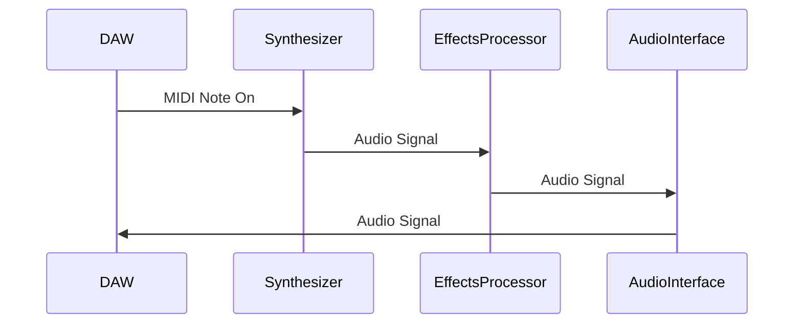

# Intermediate Foundation: Production

## 1. Architectural Mental Model

In the realm of music production, the architectural mental model serves as the blueprint for organizing and managing the various components that contribute to the creation and delivery of a musical piece. This model is not merely a technical framework but a conceptual landscape that guides the producer through the intricate process of sound design, composition, and arrangement. For those who have already grasped the foundational concepts of music production, it is essential to delve deeper into the architecture that underpins these processes.

At the heart of this architecture lies the **Digital Audio Workstation (DAW)**, which acts as the central hub for all production activities. The DAW is responsible for sequencing, recording, editing, and mixing audio and MIDI data. Surrounding the DAW are a myriad of components, including synthesizers, samplers, effects processors, and external hardware interfaces. Each of these components plays a crucial role in the production process, and their interactions are governed by a set of protocols and standards that ensure seamless communication and data exchange.

The architectural mental model can be visualized as a layered system, with the DAW at the core and the various components arranged in concentric layers around it. The innermost layer consists of the DAW and its built-in plugins, which provide the basic functionality required for production. The next layer includes external hardware and software plugins, which extend the capabilities of the DAW and offer specialized processing and synthesis options. The outermost layer comprises the physical environment, including microphones, speakers, and other audio interfaces that facilitate the capture and playback of audio signals.

Understanding this architectural mental model is crucial for producers who wish to expand their capabilities and explore new production techniques. By grasping the relationships between the various components and the protocols that govern their interactions, producers can design more efficient and effective production workflows.

## 2. Systems Taxonomy & Component Protocols

The systems taxonomy in music production encompasses a wide range of components, each with its own set of protocols and data models that define how it interacts with other components in the system. These components can be broadly categorized into the following groups:

### 2.1 Digital Audio Workstations (DAWs)

DAWs are the central hubs of music production, providing the core functionality required for sequencing, recording, editing, and mixing audio and MIDI data. Some popular DAWs include Ableton Live, Logic Pro, FL Studio, and Pro Tools. Each DAW has its own set of features and capabilities, but they all share a common set of protocols and data models that enable them to communicate with other components in the system.

### 2.2 Synthesizers and Samplers

Synthesizers and samplers are used to generate and manipulate audio signals. Synthesizers produce sound by generating waveforms and applying various effects, while samplers play back pre-recorded audio samples. Both synthesizers and samplers can be hardware-based or software-based, and they often provide a wide range of parameters that can be controlled via MIDI or other protocols.

### 2.3 Effects Processors

Effects processors are used to modify and enhance audio signals. Common effects include reverb, delay, distortion, and equalization. Effects processors can be hardware-based or software-based, and they often provide a wide range of parameters that can be controlled via MIDI or other protocols.

### 2.4 External Hardware Interfaces

External hardware interfaces are used to connect physical audio devices to the DAW. These interfaces include audio interfaces, MIDI controllers, and other hardware devices that facilitate the capture and playback of audio signals. External hardware interfaces often provide a wide range of protocols and data models that enable them to communicate with other components in the system.

### 2.5 Standard Interfaces and Protocols

The systems taxonomy in music production is governed by a set of standard interfaces and protocols that ensure seamless communication and data exchange between components. Some of the most important protocols include:

- **MIDI (Musical Instrument Digital Interface):** MIDI is a protocol that enables electronic musical instruments, computers, and other related devices to communicate with each other. MIDI messages can include note-on and note-off commands, controller data, and system messages.
- **VST (Virtual Studio Technology):** VST is a plugin format that allows software instruments and effects to be used within DAWs. VST plugins can be hosted by a wide range of DAWs and provide a standardized interface for controlling and interacting with the plugin.
- **AU (Audio Units):** AU is a plugin format that is native to Apple's DAWs, including Logic Pro and GarageBand. AU plugins provide a standardized interface for controlling and interacting with the plugin.
- **ASIO (Audio Stream Input/Output):** ASIO is a low-latency audio interface protocol that is used to connect audio interfaces to DAWs. ASIO provides a standardized interface for capturing and playing back audio signals with minimal latency.

### 2.6 Data Models

Data models define the structure and organization of data within a system. In music production, data models are used to represent audio signals, MIDI data, and other types of data. Some of the most important data models include:

- **WAV (Waveform Audio File Format):** WAV is a file format that is used to store audio signals. WAV files can store audio data in a variety of formats, including PCM (Pulse Code Modulation) and IEEE float.
- **AIFF (Audio Interchange File Format):** AIFF is a file format that is used to store audio signals. AIFF files can store audio data in a variety of formats, including PCM and IEEE float.
- **MIDI Files:** MIDI files are used to store MIDI data. MIDI files can store note-on and note-off commands, controller data, and system messages.

## 3. Multi-Component Interaction Flow

The interaction flow in music production involves the seamless exchange of data and control signals between the various components in the system. This interaction flow can be visualized using ASCII diagrams and Mermaid sequence diagrams.

### 3.1 ASCII Diagram

The following ASCII diagram illustrates the interaction flow between a DAW, a synthesizer, an effects processor, and an audio interface:

```
+-------------------+        +-------------------+        +-------------------+        +-------------------+
|       DAW         |        |     Synthesizer   |        |   Effects Processor |        |    Audio Interface  |
+-------------------+        +-------------------+        +-------------------+        +-------------------+
|  MIDI Out         |------->|  MIDI In          |        |  Audio In         |------->|  Audio Out          |
|  Audio Out        |------->|  Audio Out        |------->|  Audio Out        |------->|  Audio Out          |
+-------------------+        +-------------------+        +-------------------+        +-------------------+
```

In this diagram, the DAW sends MIDI messages to the synthesizer, which generates audio signals that are sent to the effects processor. The effects processor applies various effects to the audio signals and sends them to the audio interface, which plays back the audio signals.

### 3.2 Mermaid Sequence Diagram

The following Mermaid sequence diagram illustrates the interaction flow between a DAW, a synthesizer, an effects processor, and an audio interface:



In this diagram, the DAW sends a MIDI note-on message to the synthesizer, which generates an audio signal that is sent to the effects processor. The effects processor applies various effects to the audio signal and sends it to the audio interface, which plays back the audio signal.

## 4. Architectural Trade-offs & Production Pitfalls

The architectural design of a music production system involves a series of trade-offs that can impact the performance, efficiency, and effectiveness of the system. Some of the most important trade-offs include:

### 4.1 Performance vs. Flexibility

Performance and flexibility are often at odds in music production systems. High-performance systems are optimized for speed and efficiency, but they may lack the flexibility required to accommodate a wide range of production techniques. Conversely, flexible systems are designed to accommodate a wide range of production techniques, but they may suffer from performance issues.

### 4.2 Latency vs. Quality

Latency and quality are also important trade-offs in music production systems. Low-latency systems provide real-time feedback and allow producers to work more efficiently, but they may sacrifice audio quality. Conversely, high-quality systems provide superior audio quality, but they may suffer from latency issues.

### 4.3 Cost vs. Capabilities

Cost and capabilities are another important trade-off in music production systems. High-capability systems provide a wide range of features and capabilities, but they can be expensive. Conversely, low-capability systems may be more affordable, but they may lack the features and capabilities required for advanced production techniques.

### 4.4 Production Pitfalls

There are several common pitfalls that can arise in music production systems, including:

- **Inadequate Latency Management:** Latency issues can cause real-time feedback problems and make it difficult to work efficiently. Producers should ensure that their systems are optimized for low latency to avoid these issues.
- **Poor Audio Quality:** Audio quality is critical in music production, and producers should ensure that their systems are optimized for high-quality audio. This includes using high-quality audio interfaces, effects processors, and other components.
- **Inefficient Workflow:** Inefficient workflows can slow down the production process and make it difficult to work effectively. Producers should design their systems to support efficient workflows and minimize the time required to complete production tasks.
- **Lack of Flexibility:** Flexibility is important in music production, and producers should ensure that their systems are designed to accommodate a wide range of production techniques. This includes using modular components and open standards that allow producers to easily integrate new components and technologies.

## 5. Socratic Discussion Starters

The architectural design of a music production system is a complex and multifaceted process that involves a series of trade-offs and decisions. To deepen our understanding of this process, it is useful to engage in Socratic discussions that explore the relationships between architecture, low-level implementation, and production techniques.

### 5.1 How do the architectural trade-offs between performance, flexibility, latency, and quality impact the overall production process?

### 5.2 What are the most important protocols and data models in music production, and how do they enable seamless communication and data exchange between components?

### 5.3 How can producers design their systems to support efficient workflows and minimize the time required to complete production tasks?

### 5.4 What are the most common pitfalls in music production systems, and how can producers avoid them?

### 5.5 How do the architectural design decisions made by producers impact the overall sound and quality of their productions?

By engaging in these Socratic discussions, producers can gain a deeper understanding of the architectural design of music production systems and develop the skills and knowledge required to create high-quality productions.
