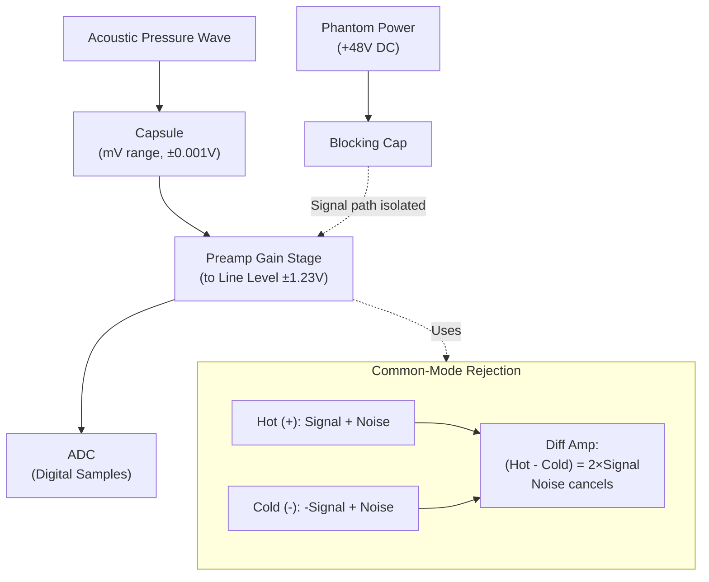
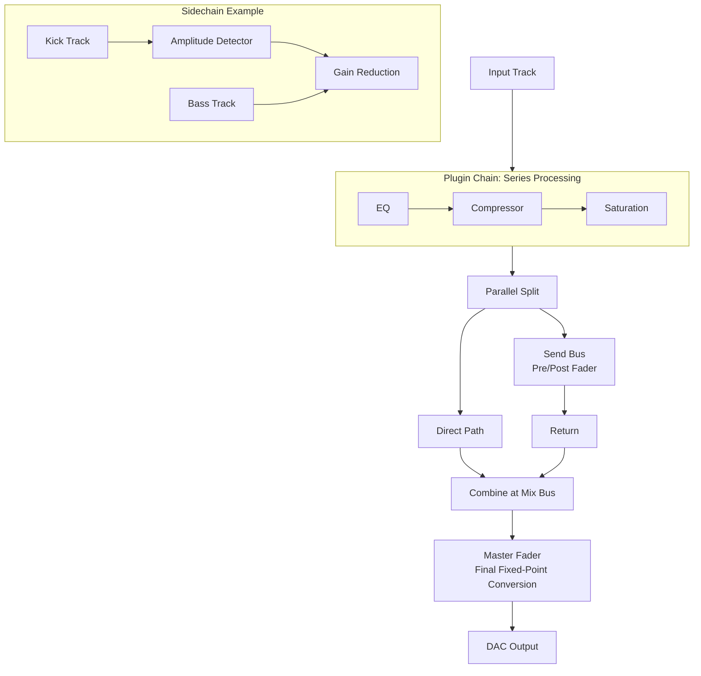

# Lesson 1: Signal Flow Architecture

## 1. First-Principles Intuition & Invariants

Every sound that reaches your monitors or headphones has traveled through a precise chain of transformations, each stage multiplying or dividing amplitude, filtering frequency content, or converting between physical and digital representations. Understanding signal flow architecture means developing an intuitive mental model of how audio moves through your production environment—from the moment a microphone diaphragm vibrates in response to acoustic pressure waves, through preamps and converters, into your digital audio workstation, and back out through digital-to-analog conversion to your monitoring system. This knowledge separates engineers who troubleshoot problems methodically from those who randomly adjust knobs hoping for improvement.

The fundamental invariant governing all signal flow is the preservation of dynamic range while maintaining adequate headroom. Dynamic range represents the difference between the loudest signal your system can reproduce without distortion and the quietest signal that remains distinguishable from the noise floor. Every stage in your signal chain possesses its own noise floor and clipping threshold, creating a cumulative effect where poor gain staging at any single point can compromise your entire mix. A microphone preamp pushed into distortion cannot be "fixed" later in the digital domain—the harmonic artifacts and intermodulation products have already been encoded into the signal. Conversely, a signal recorded too quietly requires excessive digital gain later, amplifying both the intended audio and the accumulated noise from every preceding stage.

Impedance matching governs how efficiently energy transfers between components. When a microphone's output impedance mismatches with a preamp's input impedance, frequency response deviations occur alongside potential signal loss. Professional audio gear typically follows the "bridging" impedance model where the receiving device's input impedance runs ten times higher than the source's output impedance, ensuring minimal loading effects while maximizing voltage transfer. This principle extends throughout your entire chain: instrument-level signals from guitars or synthesizers require high-impedance inputs (typically 1 megohm or higher) to avoid tone-sucking capacitance effects, while line-level signals operate comfortably into 10 kilohm inputs. Understanding these relationships prevents the mysterious tone degradation that occurs when impedances clash.

The analog-to-digital conversion boundary represents the critical transition where continuous voltage variations become discrete numerical samples. The sampling theorem, formalized by Nyquist and Shannon, establishes that a digital system must sample at least twice the highest frequency you wish to capture. This explains why professional audio interfaces operate at 44.1 kHz (capturing frequencies up to 22.05 kHz, just beyond human hearing's 20 kHz limit) or higher sample rates like 48 kHz, 88.2 kHz, 96 kHz, and 192 kHz. The bit depth dimension governs amplitude resolution: 16-bit audio divides the amplitude range into 65,536 discrete steps, while 24-bit offers 16,777,216 steps, dramatically lowering the quantization noise floor from approximately -96 dB to -144 dB theoretical maximum. In practice, 24-bit recording provides around 120 dB of usable dynamic range before analog circuit noise becomes the limiting factor.

Latency represents the time delay between when you perform a musical action and when you hear the result through your monitoring system. This delay accumulates from multiple sources: analog-to-digital conversion buffer filling, digital signal processing calculations, operating system audio driver overhead, and digital-to-analog conversion. Buffer size directly trades latency against processing stability—a 64-sample buffer at 48 kHz yields approximately 1.3 milliseconds of latency per direction (2.6 ms round-trip), while a 512-sample buffer increases this to 10.7 ms per direction. Human perception begins detecting latency as distinct delay around 10-12 milliseconds, though musicians performing in real-time feel the "drag" of slower response times well before that threshold. Managing this tension between low-latency monitoring and stable processing headroom forms a core production skill.

## 2. Core Architecture & Mechanics

Signal flow architecture divides conceptually into three domains: the analog input stage, the digital processing environment, and the analog output stage. Each domain transforms your audio differently while introducing its own artifacts, noise contributions, and optimization opportunities.

The analog input stage begins at the transducer—the physical device converting acoustic energy into electrical voltage. Microphones generate minuscule signals measured in millivolts, requiring preamplification to reach line level (typically +4 dBu or approximately 1.23 volts RMS in professional equipment, -10 dBV or 0.316 volts in consumer gear). The preamp's gain control directly determines how much of the analog-to-digital converter's available bit depth you'll utilize. Recording a quiet source with insufficient preamp gain means the analog signal might only modulate the upper 12 bits of your 24-bit converter, effectively wasting the lower bits and raising your effective noise floor. The optimal approach records transient peaks reaching -12 to -6 dBFS (decibels relative to full scale), providing substantial headroom while ensuring strong bit utilization.

Professional microphone preamps operate in balanced differential mode, where the audio signal rides on two conductors carrying opposite polarity (hot and cold) with a ground reference. The receiving preamp circuit subtracts cold from hot, which doubles the desired signal while canceling common-mode interference that couples identically to both conductors. This explains why balanced XLR and TRS cables reject electromagnetic interference far better than unbalanced TS connections. Phantom power (+48V DC) rides on both signal conductors simultaneously, powering condenser microphone capsules and active electronics without interfering with the audio signal due to blocking capacitors in the circuit path.

The analog-to-digital converter samples this voltage at your selected sample rate, taking instantaneous amplitude measurements at precise time intervals. Anti-aliasing filters precede this conversion, removing frequency content above the Nyquist frequency (half the sample rate) to prevent aliasing artifacts where high frequencies fold back down as spurious tones within the audible spectrum. Modern converters employ steep digital reconstruction filters rather than older analog designs, achieving sharper cutoff slopes with minimal phase distortion in the passband.

Bit depth quantization introduces a subtle but measurable distortion pattern called quantization noise. When the smooth analog voltage gets rounded to the nearest digital step value, small errors accumulate that manifest as a noise floor. The relationship between bit depth and theoretical dynamic range follows the formula 6.02 dB per bit plus 1.76 dB, yielding approximately 98 dB for 16-bit and 146 dB for 24-bit systems. Dither—intentionally added low-level noise—decorrelates quantization errors, transforming harsh distortion artifacts into benign white noise. Recording at 24-bit eliminates any practical concern about bit depth limitations, as the 120+ dB usable range exceeds even the best analog circuits' performance.

Within the digital domain, your DAW routes audio through a sophisticated graph of processing nodes. Each plugin instance, auxiliary send, and routing path operates at your session's internal bit depth, typically 32-bit floating point or 64-bit double precision. Floating-point arithmetic provides enormous headroom—levels can temporarily exceed 0 dBFS during intermediate calculations without clipping, as the format stores both a mantissa (significand) and exponent. This architectural decision means you can freely boost individual tracks or plugins without fear of digital clipping until the final master fader or export stage performs the conversion back to fixed-point audio.

Routing topologies organize how signals split, combine, and process through the mixing graph. Series processing chains plugins sequentially, where each plugin's output feeds the next plugin's input. Parallel processing splits a signal into multiple paths that eventually recombine, either through auxiliary send-and-return configurations or through specialized parallel compression routing. Sidechain routing feeds one signal's amplitude envelope to control another processor's behavior—the classic application being ducking, where a kick drum triggers compression on the bassline, creating rhythmic pumping. Understanding the difference between pre-fader and post-fader auxiliary sends prevents common mistakes: pre-fader sends remain unaffected by the source track's fader position (useful for creating independent reverb mixes), while post-fader sends scale proportionally with the track's volume.

The digital-to-analog converter reconstructs continuous voltage from discrete samples using interpolation and reconstruction filtering. Modern DACs employ oversampling techniques, generating many intermediate sample points mathematically before applying gentle analog filters to smooth the final waveform. This approach achieves better performance than older designs required steep analog filters with problematic phase response. The DAC's output drives your monitor controller or headphone amplifier, which must possess adequate power and current delivery to move the speaker drivers or headphone transducers accurately without distortion.

Monitoring calibration establishes consistent reference levels throughout your facility. The standard practice calibrates so that sine wave test tones at -18 dBFS produce 85 dB SPL (C-weighted) at the listening position, though many engineers prefer slightly quieter (83 dB) or louder (87 dB) reference levels. This calibration ensures that your gain staging decisions translate predictably—when your mix bus meters read -6 dB, you're hearing an appropriate loudness level that leaves headroom for mastering while avoiding both the hearing damage of excessive monitoring levels and the poor decision-making that occurs when monitoring too quietly.

## 3. High-Performance Optimization & Failure Modes

Gain staging optimization requires working backward from your final output target while maintaining consistent headroom throughout the chain. Start by setting your master fader to unity gain (0 dB) and establishing your loudest mix element—often the drum transients—peaking around -10 to -6 dBFS on the mix bus. Individual track peaks can safely exceed 0 dBFS on their own channels thanks to floating-point headroom, but conservative practice keeps track peaks below -3 dBFS to prevent intersample peaks during export. Intersample peaks occur when the reconstruction of continuous analog voltage from discrete samples creates amplitude overshoots between sample points, causing clipping even though no individual sample exceeded full scale.

Buffer size optimization balances latency against processing stability. During tracking sessions where performers monitor themselves in real-time, prioritize low latency by selecting 64 or 128 sample buffers while freezing or disabling CPU-intensive plugins on non-essential tracks. During mixing, increase buffer sizes to 512 or 1024 samples, providing maximum CPU overhead for complex plugin chains. Most DAWs offer plugin delay compensation (PDC) that automatically time-aligns tracks to account for processing latency, but this compensation only functions correctly when all tracks remain active—bouncing individual stems while muting other tracks can create phase alignment problems if those tracks contributed PDC timing offsets.

Sample rate selection involves practical tradeoffs rather than absolute rules. Recording at 96 kHz doubles file sizes and CPU usage compared to 48 kHz while providing questionable audible benefits for most productions. The legitimate advantages of elevated sample rates include reduced anti-aliasing filter phase shift in the audible band, improved headroom in the ultrasonic range during extreme processing, and better transient resolution when time-stretching or pitch-shifting. For acoustic music production focused on transparent capture, 48 kHz at 24-bit provides professional results. Electronic production involving heavy nonlinear processing, bit reduction, or extreme pitch manipulation may benefit from 96 kHz as the processing artifacts occur at higher frequencies that subsequent downsampling can filter away.

Clock synchronization prevents one of the most insidious failure modes in digital audio: jitter-induced distortion when multiple devices run from unsynchronized or poorly implemented clocks. When your audio interface's ADC samples at fractionally different intervals than expected, the timing irregularities add noise sidebands around strong frequency components. Word clock or ADAT optical connections transmit clock synchronization between devices, with one device configured as master and others as slaves. The master device generates the reference clock that all others follow. Configuring two devices both as clock masters creates a race condition where they battle for control, producing crackling, popping, or complete signal dropouts.

Impedance-related failures manifest subtly compared to obvious problems like incorrect gain staging. Loading effects occur when a source device's output impedance approaches the receiving device's input impedance, causing high-frequency rolloff and reduced level. This commonly affects guitar pickups feeding standard line inputs instead of high-impedance instrument inputs—the resulting tone sounds dull and weak even at matched levels. Conversely, driving long cable runs with high output impedance sources causes capacitive coupling that forms unintentional low-pass filters, rolling off high frequencies progressively with cable length. Using balanced low-impedance line-level signals (typically 150-600 ohm output driving 10+ kilohm input) allows cable runs of hundreds of feet without audible degradation.

Ground loop hum represents another common analog signal path failure occurring when multiple ground paths exist between interconnected equipment. The resulting current flow through ground conductors at AC mains frequencies (50/60 Hz) magnetically couples into audio signal paths as audible hum. Breaking the ground loop by lifting the ground on one device eliminates the hum but creates shock hazards—the proper solution isolates the audio path using transformer-coupled direct boxes or balanced connections while maintaining safety grounds.

Clipping distortion manifests differently depending where in the signal chain it occurs. Analog clipping generates predominantly odd-order harmonics that can sound harsh or, when intentionally applied, musically saturated. Digital clipping at the ADC stage creates harsh, brittle distortion due to the immediate brick-wall limiting—there is no soft saturation region. Digital clipping within your DAW on individual floating-point tracks may not be audible until export, when the floating-point values get converted to fixed-point format and hard clip. The master fader or export process represents the critical hard ceiling where digital clipping must be absolutely avoided through conservative gain staging.

Latency compensation failures produce comb filtering and phase cancellation when tracks slip out of time alignment. Recording additional takes while monitoring existing tracks through software with inadequate latency compensation causes the performer to play slightly behind the existing material. The recorded performance appears correctly aligned during playback, but summing the new and old tracks creates comb filtering from the delayed relationship. PDC systems track the latency of every plugin and route, time-shifting tracks to maintain phase coherence. Disabling PDC or working in DAWs with incomplete PDC implementations requires manual nudging of tracks or printing processed tracks to eliminate latency before combining sources.

Monitoring level consistency prevents the equal-loudness contour distortion of mix decisions. Fletcher-Munson curves demonstrate that human hearing perceives bass and treble differently at varying SPL levels—quiet monitoring makes bass and treble seem deficient, encouraging over-boosting those ranges. Loud monitoring creates the opposite problem, making bass and treble seem exaggerated while masking midrange imbalances. Calibrating to 85 dB SPL C-weighted and periodically checking mixes at lower (75 dB) and higher (90 dB) levels reveals whether EQ decisions remain appropriate across the loudness spectrum. Extended listening at excessive levels causes temporary threshold shifts in hearing sensitivity that can take hours to fully recover, making all subsequent mixing decisions unreliable.

The signal flow architecture you've internalized now extends beyond mere technical competence into reliable methodology. You understand that proper gain staging isn't obsessive perfectionism but fundamental signal integrity—that impedance matching isn't esoteric specification-reading but audible tonal preservation. You recognize latency not as an unavoidable annoyance but as a quantifiable engineering constraint to be managed through informed buffer size choices. Most critically, you've developed the mental model to trace any audio signal from acoustic origin through electrical transformation, digital quantization, processing, and reconstruction, identifying at each stage the potential failure modes and optimization opportunities that separate amateur-sounding productions from professional results.
