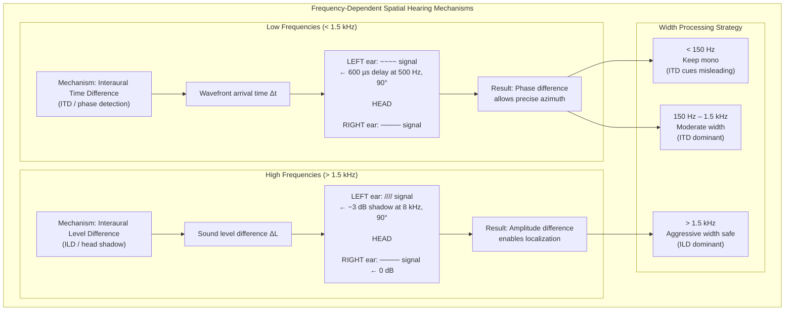

# Lesson 2: Psychoacoustic Foundations

## 1. First-Principles Intuition & Invariants

The physical reality of sound waves and the perceptual experience of those waves inside a human listener's consciousness occupy fundamentally different domains. A microphone captures air pressure variations with linear fidelity across its response range, but the human auditory system applies a cascade of nonlinear transformations, frequency-dependent sensitivity curves, and cognitive processing layers that dramatically reshape the signal before it reaches conscious awareness. Understanding this perceptual signal chain is not an academic curiosity—it is the foundational substrate upon which every mixing decision, mastering choice, and sound design gesture must rest. A producer who ignores psychoacoustics operates blind, making arbitrary fader moves disconnected from how the human ear-brain system actually constructs sonic experience.

At the core of psychoacoustic science lies a biological constraint: the basilar membrane inside the cochlea behaves as a logarithmic spectrum analyzer, with distinct regions responding to distinct frequency bands. This tonotopic organization creates the phenomenon of critical bands—adjacent frequency regions within which multiple tones interact perceptually rather than remaining distinct. When two sine waves fall within the same critical band, they produce beating, roughness, and amplitude fluctuations that the auditory system cannot resolve into separate pitch identities. This is not a defect; it is an evolved feature that allows the auditory system to extract timbral information, detect harmonicity, and segregate sound sources in complex acoustic environments. The width of critical bands increases logarithmically with frequency, ranging from approximately 100 Hz at low frequencies to over 3000 Hz in the highest octaves. Every equalization move, every harmonic layering decision, and every masking interaction in a mix operates within the constraints imposed by these critical bands.

The second invariant is frequency-dependent sensitivity. The human auditory system exhibits wildly uneven sensitivity across the audible spectrum, and this sensitivity shifts as a function of playback level. The Fletcher-Munson equal-loudness contours, refined into the modern ISO 226 standard, quantify this relationship with precision. At low playback levels—common in home listening environments, background music scenarios, and late-night production sessions—the ear loses sensitivity to low and high frequencies far more rapidly than midrange content. A mix balanced at 85 dB SPL will sound bass-heavy and overly bright when played back at 60 dB SPL, because the ear's reduced sensitivity at the frequency extremes disappears while the mix's spectral balance remains fixed. This is why mixing at excessively low monitoring levels produces mixes with bloated bass and hyped treble, and why checking mixes at multiple playback levels is not optional—it is a perceptual necessity dictated by the nonlinear response curves of the human ear.

Masking phenomena introduce the third invariant. When two sounds occupy overlapping frequency and time regions, the louder sound can render the quieter sound partially or completely inaudible. Frequency masking operates asymmetrically: low-frequency energy masks higher frequencies far more effectively than the reverse. A kick drum at 60 Hz will mask bass guitar fundamentals at 80 Hz and even lower midrange content up to 200 Hz, but a vocal at 2 kHz has negligible impact on the kick's audibility. Temporal masking extends this principle into the time domain. A loud transient creates a brief window of reduced sensitivity both before (pre-masking, lasting 5–20 milliseconds) and after (post-masking, lasting 50–200 milliseconds) the masking event. This temporal integration window determines how the ear perceives rhythm, attack transients, and the intelligibility of rapid musical gestures. A fast hi-hat pattern at 140 BPM places individual strokes only 107 milliseconds apart—within the temporal resolution limits of the auditory system at high frequencies, where critical bands are wider and temporal precision degrades.

Spatial hearing mechanisms complete the foundational picture. The auditory system localizes sound sources through interaural time differences (ITD) at low frequencies and interaural level differences (ILD) at high frequencies, with the crossover occurring around 1.5 kHz. Below this transition, the ear detects phase differences between the two ears with microsecond precision; above it, the ear relies on intensity differences created by the acoustic shadow of the head. Pinna filtering—the spectral modifications introduced by the outer ear's complex geometry—provides elevation cues and front-back discrimination. These mechanisms are why stereo width manipulation through phase decorrelation works differently at different frequencies, why bass content below 80 Hz contributes negligibly to perceived stereo width, and why mid-side processing must account for frequency-dependent localization mechanisms to avoid perceptual artifacts.

The invariants that govern all psychoacoustic phenomena in music production are therefore: critical band interaction determines frequency masking and timbral fusion; frequency-dependent sensitivity shifts with playback level; masking operates asymmetrically in frequency and extends across time; and spatial perception relies on frequency-dependent binaural cues. Every tool in the producer's arsenal—equalization, compression, reverb, stereo imaging, harmonic saturation—operates within the constraints imposed by these perceptual mechanisms. Understanding them transforms mixing from intuitive guesswork into principled decision-making grounded in the actual behavior of the human auditory system.

## 2. Core Architecture & Mechanics

The basilar membrane functions as the auditory system's primary frequency analyzer, but its mechanical operation differs fundamentally from the Fourier analysis performed by digital spectrum analyzers. Rather than computing discrete frequency bins through mathematical transformation, the basilar membrane operates as a continuous mechanical filter bank. High frequencies excite regions near the oval window at the cochlear base, where the membrane is narrow, stiff, and light. Low frequencies propagate further along the membrane toward the apex, where increased width and reduced stiffness create resonance at progressively lower frequencies. This spatial encoding of frequency information is called tonotopy, and it establishes the biological foundation for critical bands.

Critical band width can be approximated by the equivalent rectangular bandwidth (ERB) formula, which provides a smooth function describing how band width scales with center frequency. At 100 Hz, the ERB measures approximately 12 Hz; at 1 kHz, it expands to 130 Hz; at 10 kHz, it reaches 1170 Hz. This logarithmic scaling has direct implications for equalization strategy. A narrow boost at 5 kHz—say, 0.3 octaves with a Q of 4.3—targets a single critical band and produces a focused, surgical tonal change. A broad boost at the same frequency—2 octaves wide with a Q of 0.67—spans multiple critical bands and yields a more natural, musical enhancement that mirrors the ear's own frequency resolution. When stacking harmonic layers in sound design, placing partials within the same critical band produces amplitude modulation and beating, while separating them across critical bands allows each partial to maintain distinct perceptual identity.

Frequency masking operates through a combination of mechanical and neural mechanisms. When a loud tone excites a region of the basilar membrane, the resulting vibration spreads to adjacent membrane regions, physically stimulating hair cells tuned to nearby frequencies. This mechanical spread creates simultaneous masking—the immediate reduction in sensitivity to other tones present at the same time. The masking threshold follows an asymmetric curve: upward spread of masking (a lower-frequency masker affecting higher-frequency targets) extends over a broader frequency range than downward spread. A 500 Hz masker at 60 dB SPL can elevate the detection threshold for tones up to 1.5 kHz by 20–40 dB, but it affects tones below 400 Hz by less than 10 dB. This asymmetry explains why low-frequency build-up in a mix—untamed kick drum fundamentals, bass guitar low end, synth sub layers—destroys midrange clarity far more aggressively than the reverse.

Temporal masking arises from the auditory system's finite temporal resolution and neural adaptation rates. Pre-masking, the counterintuitive phenomenon where a loud sound masks a quieter sound that occurred slightly before it, results from neural processing delays. The auditory system requires 5–20 milliseconds to fully encode and transmit stimulus information from the cochlea to the auditory cortex. A loud transient arriving within this window can suppress the neural representation of a quieter preceding sound, rendering it inaudible despite occurring first in physical time. Post-masking extends much longer—50 to 200 milliseconds—because hair cells and auditory nerve fibers exhibit adaptation. A loud stimulus depletes neurotransmitter reserves at synapses and temporarily reduces sensitivity, requiring time to recover. This recovery period creates a window during which quieter sounds following the masker remain inaudible.

Practical application of temporal masking appears throughout dynamic mixing decisions. When a snare transient strikes, any reverb tail present during the first 50 milliseconds post-impact remains largely masked by the snare's decay. This is why pre-delay on snare reverb—delaying the onset of the reverb by 20–40 milliseconds—increases reverb audibility without requiring additional reverb level. The reverb arrives after the temporal masking window closes, making it perceptually distinct from the snare transient. Similarly, pumping side-chain compression on bass in response to kick drum hits operates within the temporal masking window. If the bass level reduction lasts less than 100 milliseconds, the listener perceives tighter low-frequency interaction rather than obvious gain reduction, because the bass attenuation occurs during the kick's post-masking window.

Loudness perception integrates frequency-dependent sensitivity, critical band summation, and temporal integration into a unified percept. The ear does not measure sound pressure level linearly; instead, it integrates energy across critical bands and across time windows spanning approximately 400 milliseconds. Two tones separated by more than one critical band sound louder together than either tone alone, because the auditory system sums their contributions across distinct neural channels. But two tones within the same critical band do not sum linearly—they interact through beating and roughness, and their combined loudness increases by less than the arithmetic sum of their individual levels. This phenomenon underlies perceptual loudness metering standards like ITU-R BS.1770, which applies frequency weighting (the K-weighting curve, approximating the inverse of the 80 dB equal-loudness contour) and integrates energy across time using a 400-millisecond window.

The Fletcher-Munson equal-loudness contours, now superseded by ISO 226, quantify how perceived loudness at a given sound pressure level varies with frequency. The curves are normalized so that all frequencies require the same SPL to match the perceived loudness of a 1 kHz tone at the reference level. At 40 phons (the subjective loudness level), a 100 Hz tone requires approximately 62 dB SPL to sound as loud as a 1 kHz tone at 40 dB SPL—a 22 dB deficit. At 80 phons, the deficit shrinks to 10 dB. At 100 phons, it nearly vanishes. The curves flatten as playback level increases, meaning bass content becomes proportionally louder relative to midrange as monitoring level rises. This level-dependent perception shift is why reference monitoring level standards exist. Mastering engineers typically work at 85 dB SPL (C-weighted, slow) because this level provides relatively flat frequency perception while remaining below the threshold of temporary threshold shift—the temporary hearing damage that begins around 90 dB SPL with prolonged exposure.

The practical workflow consequence is unavoidable: checking mixes at multiple playback levels is not a luxury but a perceptual necessity. A mix checked only at 75 dB SPL will sound thin and bass-deficient at 85 dB SPL, while a mix checked only at 90 dB SPL will sound boomy and dull at 70 dB SPL. The solution is to establish a primary reference level—typically 79–85 dB SPL for mixing, with pink noise or program material measured C-weighted slow at the listening position—and then verify the mix at both quieter levels (65–70 dB SPL, simulating laptop playback or background listening) and louder levels (90 dB SPL, simulating club or car playback). Adjustments made at the reference level should translate to other levels without requiring wholesale spectral rebalancing. If they do not, the mix contains spectral imbalances that the frequency-dependent sensitivity curves reveal.

Spatial hearing mechanisms partition into low-frequency and high-frequency strategies. Below approximately 1.5 kHz, the auditory system relies on interaural time differences (ITD). When a sound source lies off-center, the wavefront reaches the near ear before the far ear, creating a time delay proportional to the azimuthal angle. At 500 Hz, a 90-degree lateral source creates an ITD of approximately 600 microseconds—a half-wavelength at this frequency, producing a 180-degree phase difference between ears. The auditory system detects these phase differences with extraordinary precision, on the order of 10 microseconds, enabling accurate low-frequency localization. Above 1.5 kHz, wavelengths become too short for phase-based ITD detection to remain unambiguous. The system switches to interaural level differences (ILD), where the acoustic shadow of the head attenuates high-frequency content at the far ear. At 8 kHz, a 90-degree source creates an ILD exceeding 20 dB, providing robust localization cues.

Mid-side processing and stereo width manipulation must respect these frequency-dependent mechanisms. Widening bass content below 150 Hz through mid-side decorrelation produces phase differences between channels that the auditory system interprets as ITD cues, but because bass wavelengths are large relative to head size, the resulting ITDs correspond to physically impossible source positions—angles beyond ±90 degrees. The ear perceives this as instability, diffuseness, or phase cancellation when summed to mono. Conversely, widening midrange and high-frequency content through decorrelation or Haas-effect delays produces perceptually stable width because the ILD and pinna filtering cues remain consistent with plausible source positions. The standard practice of keeping bass content below 100 Hz strictly mono and applying width enhancement only above 200 Hz aligns with the biological reality of binaural hearing.

Pinna filtering contributes elevation and front-back disambiguation through spectral notches created by sound wave reflections off the complex folds of the outer ear. These notches occur at frequencies determined by the geometry of the incident sound wave relative to pinna structures, typically producing dips in the 6–16 kHz range. The auditory system learns these spectral patterns through lifetime exposure and uses them to infer source elevation and resolve front-back ambiguities that ITD and ILD alone cannot distinguish. Head-related transfer functions (HRTFs), the frequency-domain representation of how the head, torso, and pinnae filter sound from different spatial positions, encode all these mechanisms. Binaural rendering for headphone playback applies measured or modeled HRTFs to position sound sources in three-dimensional space, but the effectiveness depends on how closely the applied HRTF matches the listener's individual anatomy. Generic HRTFs work reasonably well for azimuthal localization but produce high variability in elevation and front-back perception.

The temporal resolution of the auditory system determines how rapidly changing sounds can be perceived as distinct events rather than continuous textures. At low frequencies, the auditory system can detect amplitude modulation and rhythm with precision down to approximately 2–3 milliseconds. This temporal acuity enables the perception of individual kick drum cycles at 50 Hz (20 millisecond period) and the distinction between tight versus loose timing in rhythm sections. At high frequencies, temporal resolution degrades to 10–20 milliseconds because wider critical bands integrate energy over longer time windows. This degradation is why high-frequency transient timing—hi-hat flamming, shaker ornaments—requires larger time separations than low-frequency transient timing to sound distinct. A 5-millisecond delay between two kick drums sounds clearly separated, but a 5-millisecond delay between two hi-hats may sound like a single blurred transient.

Perceptual loudness models integrate these mechanisms into computational frameworks. The ITU-R BS.1770 standard, adopted by streaming platforms and broadcast standards worldwide, applies a K-weighting curve that approximates the inverse of the 80 phon equal-loudness contour, attenuating low and high frequencies relative to midrange. The standard then measures energy using a 400-millisecond sliding window, capturing the auditory system's temporal integration characteristics. Loudness is computed in Loudness Units Full Scale (LUFS), where 0 LUFS corresponds to full-scale digital peak and typical streaming targets fall around −14 LUFS for integrated program loudness. This model does not capture every nuance of loudness perception—it ignores masking, critical band summation, and temporal masking—but it provides a standardized, perceptually weighted measure far superior to peak or RMS level metering.

The relationship between physical sound pressure level and perceived loudness follows a logarithmic power law, formalized in Stevens' power law: perceived loudness grows proportionally to SPL raised to a power of approximately 0.6 for medium-intensity sounds. Doubling the physical sound pressure (a 6 dB increase) does not double perceived loudness; it requires roughly a 10 dB increase to achieve that perceptual doubling. This logarithmic relationship explains why achieving the last few decibels of loudness in mastering requires exponentially more dynamic range compression and limiting than the first few decibels. A mix at −20 LUFS sounds substantially quieter than a mix at −14 LUFS, but the difference between −8 LUFS and −6 LUFS—the same 2 dB delta—sounds far smaller because the relationship between physical intensity and perceived loudness is compressing.

## 3. High-Performance Optimization & Failure Modes

Psychoacoustic awareness optimizes mixing workflows by aligning decisions with perceptual reality rather than visual waveform appearance or spectrum analyzer displays. The first optimization principle is frequency masking exploitation. Since low-frequency content masks higher frequencies far more effectively than the reverse, managing low-end build-up becomes the highest-leverage mixing task. A cluttered mix with excessive bass from multiple sources—kick, bass guitar, synth pads, toms—loses midrange intelligibility not because the midrange is quiet, but because it is perceptually masked. The solution is surgical high-pass filtering on all non-bass sources, removing energy below their fundamental pitch range. Vocals rarely contain meaningful content below 80 Hz; filtering them at 100–120 Hz with a steep slope removes rumble and reduces masking load without altering timbre. Guitars, pianos, and synth leads similarly benefit from high-pass filtering tailored to their pitch range, preserving their tonal character while opening perceptual space for bass and kick fundamentals.

The second optimization principle is leveraging temporal masking windows for dynamic processing. Side-chain compression on bass triggered by the kick drum can be tuned to operate entirely within the kick's post-masking window, making the bass attenuation inaudible as an independent event. Setting the compressor attack to 5–10 milliseconds and release to 50–100 milliseconds ensures the bass ducks during the kick's loudest portion and recovers before temporal masking ends. The result sounds like improved low-frequency cohesion rather than obvious compression pumping. Similarly, reverb pre-delay can be set to match the temporal masking duration of the dry transient, ensuring the reverb tail emerges after the masking window closes and thus gains maximum perceptual prominence without requiring additional reverb level.

Critical band awareness informs equalization strategy, particularly when stacking harmonic layers. If building a bass sound from three layers—a sub-bass sine wave at 50 Hz, a mid-bass sawtooth providing harmonics from 100–400 Hz, and a distorted top layer carrying 800 Hz–3 kHz—each layer should target distinct critical band regions to avoid beating and roughness. The sub-bass remains pure and mono-focused. The mid-bass is high-passed at 80 Hz to avoid clashing with the sub, and low-passed at 500 Hz to avoid interfering with the top layer. The distorted top is high-passed at 600 Hz and low-passed at 4 kHz, occupying midrange critical bands without extending into the sub or mid-bass territory. This separation allows each layer to contribute distinct timbral information without perceptual fusion or masking interactions eroding clarity.

Reference monitoring level discipline prevents frequency balance errors caused by Fletcher-Munson sensitivity shifts. Establishing a primary mixing level—79 to 85 dB SPL measured with pink noise at the mix position using C-weighted slow response—and checking that level with an SPL meter before each session ensures consistent perceptual conditions. Mixing at excessively loud levels (>90 dB SPL) causes the bass and treble to sound overly prominent, leading to compensatory EQ cuts that produce thin, mid-heavy mixes on playback systems. Mixing at excessively quiet levels (< 70 dB SPL) causes bass and treble to sound deficient, leading to compensatory boosts that sound bloated and hyped on louder playback systems. Frequent level checks at ±10 dB relative to the reference level catch these imbalances before they require wholesale mix revisions.

Failure mode recognition allows early detection of psychoacoustic problems. If a mix sounds clear and spacious at 85 dB SPL but becomes cluttered and midrange-heavy at 70 dB SPL, the mix has excessive bass content that is only audible at higher playback levels. The ear's reduced bass sensitivity at quiet levels reveals the imbalance. The correction is to reduce bass level by 1–3 dB globally—lowering the kick, bass guitar, and sub synth layers—and recheck at multiple levels until the spectral balance remains consistent. If a mix sounds punchy and impactful at 85 dB SPL but becomes harsh and fatiguing at 95 dB SPL, the mix has excessive high-frequency content. The ear's increased treble sensitivity at loud levels reveals the imbalance. The correction is to apply gentle high-frequency shelving attenuation above 8 kHz, reducing 1–2 dB to restore balance.

Masking-related clarity loss manifests as congestion in dense arrangements where multiple instruments occupy overlapping frequency and time regions. A common failure case occurs when pads, rhythm guitars, and synth arpeggios all occupy the 200 Hz–2 kHz midrange, creating a perceptual blob where individual elements cannot be distinguished. The solution is spectral carving: identify the primary midrange element (often the vocal or lead instrument) and preserve its frequency range intact, then notch complementary instruments at the primary element's peak resonances. If the vocal exhibits a broad presence peak from 1–3 kHz, carve 2–4 dB out of pads and guitars in this same range using a moderate-Q cut. The vocal remains clear and upfront, while the supporting elements still contribute harmonic body without directly competing.

Stereo width processing failure modes often arise from applying width enhancement without respecting frequency-dependent spatial hearing mechanisms. Widening bass below 100 Hz produces phase cancellation when the mix is summed to mono, rendering the bass inaudible on single-speaker playback systems, Bluetooth speakers, and mono club sound systems. The failure occurs because ITD cues at these frequencies create phase differences that destructively interfere in mono. The prevention is strict high-passing of stereo width processing above 150 Hz. Any stereo enhancement technique—mid-side widening, Haas delays, microshifting—must include a parallel mono bass path that remains unaffected by width processing. Similarly, excessive width enhancement above 8 kHz using decorrelation can produce diffuse, phasey artifacts because the auditory system expects high-frequency content to exhibit strong ILD cues consistent with point-source localization. Overprocessing destroys this consistency, leaving high-frequency elements sounding smeared and unstable.

Loudness normalization on streaming platforms exposes mixes that rely on excessive loudness rather than tonal balance and dynamic contrast for impact. A mix crushed to −6 LUFS with aggressive limiting will be attenuated to match the platform's target (typically −14 LUFS for Spotify, Apple Music, and YouTube), removing its loudness advantage while preserving the distortion and pumping artifacts introduced by over-limiting. The normalized mix sounds dull, lifeless, and over-compressed compared to a mix that achieved −10 to −12 LUFS with moderate dynamic control. The optimization is to master to −10 LUFS integrated loudness with −1 dBTP true peak ceiling, preserving dynamic range and transient detail while still achieving competitive loudness. This approach allows the streaming platform's normalization to work in your favor rather than exposing over-processing.

Temporal masking mismanagement appears as buried reverb tails, inaudible delay throws, and obscured background vocals. If reverb is applied to a snare without pre-delay, the reverb onset occurs simultaneously with the snare transient, falling entirely within the snare's temporal masking window. The reverb becomes inaudible until the snare decay drops below the masking threshold, by which point the reverb tail has already decayed significantly. Introducing 20–40 milliseconds of pre-delay shifts the reverb onset outside the masking window, making it perceptually distinct from the snare transient and thus audible at lower reverb levels. Similarly, delay throws on vocals become more prominent when the delay time exceeds 80–100 milliseconds, placing the delayed repetition outside the direct vocal's post-masking window.

The ultimate psychoacoustic optimization workflow integrates these principles into systematic mixing sequences. Begin by managing low-frequency masking: high-pass all non-bass sources aggressively, leaving only kick and bass below 100 Hz. Address temporal masking through side-chain dynamics and reverb pre-delay, ensuring transients remain clear and effects remain audible. Carve spectral space for primary elements through complementary EQ cuts in supporting layers, respecting critical band interactions. Monitor at a calibrated reference level and verify spectral balance at quieter and louder playback levels, correcting imbalances before advancing to detail refinement. Master to loudness targets that preserve dynamic range rather than chasing maximum SPL, trusting streaming platform normalization to level the playing field. This sequence aligns the technical signal chain with the perceptual realities of the human auditory system, ensuring mixes translate accurately across playback systems and listening contexts.
