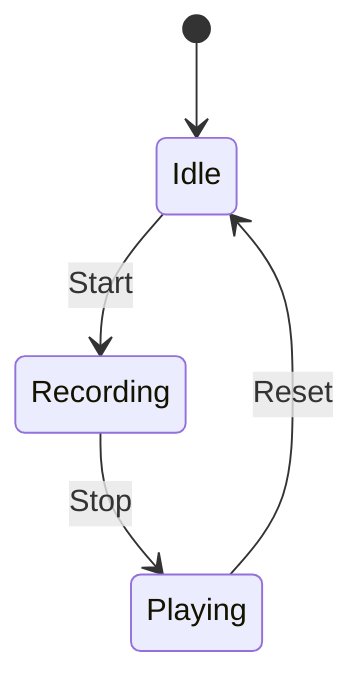

# Advanced Foundation: Sound Design

## 1. Theoretical Invariants & Formal Frameworks

### 1.1 Formal Proofs in Digital Signal Processing

Digital Signal Processing (DSP) is grounded in the formal mathematical framework of discrete-time signals and systems. A fundamental invariant in DSP is the Nyquist-Shannon Sampling Theorem, which states that a continuous-time signal must be sampled at a rate at least twice its highest frequency component to avoid aliasing. Formally, if \( x(t) \) is a band-limited signal with no frequency components above \( f_m \), then it can be reconstructed from its samples \( x[n] = x(nT_s) \) if the sampling rate \( f_s = \frac{1}{T_s} \geq 2f_m \).

### 1.2 Kernel or Physical Invariants in Audio Systems

In audio systems, the physical invariant of energy conservation must be considered. The power of a signal in the time domain is equal to its power in the frequency domain, as described by Parseval's theorem. Mathematically, this is expressed as:

\[
\sum_{n=-\infty}^{\infty} |x[n]|^2 = \frac{1}{2\pi} \int_{-\pi}^{\pi} |X(e^{j\omega})|^2 d\omega
\]

where \( x[n] \) is the discrete-time signal and \( X(e^{j\omega}) \) is its Discrete-Time Fourier Transform (DTFT).

## 2. Low-Level Invariant Taxonomy

### 2.1 Deep Registers & Memory Models

In the context of sound design, deep registers refer to the lower frequency ranges of audio signals. These registers are critical for bass and sub-bass synthesis and require careful handling to avoid aliasing and quantization noise. Memory models in DSP are essential for efficient data handling. For instance, the use of circular buffers in delay effects ensures that memory usage is optimized and avoids overflow issues.

### 2.2 Hardware Constraints & Axiomatic Definitions

Hardware constraints, such as the bit depth and sample rate of audio interfaces, impose invariants on sound design. For example, a 16-bit audio interface has a maximum dynamic range of approximately 96 dB, which is a physical invariant. Axiomatic definitions in DSP include the linearity and time-invariance of digital filters, which are essential for predictable and stable signal processing.

## 3. Micro-Architecture & Concurrency Dynamics

### 3.1 Mermaid and ASCII State Machines

State machines are crucial for understanding the micro-architecture of audio processing systems. For example, a simple state machine for a delay effect can be represented as follows:



### 3.2 Cache & Race Condition Diagrams

Cache management and race conditions are critical in concurrent audio processing. A simple ASCII diagram illustrating cache coherence in a multi-core DSP system might look like this:

```
Core 1: [Cache A] <--> [Shared Memory]
Core 2: [Cache B] <--> [Shared Memory]
```

Race conditions can be visualized as follows:

```
Core 1: [Write] --> [Shared Memory]
Core 2: [Read] --> [Shared Memory]
```

## 4. Subtle Failure Modes & Boundary Conditions

### 4.1 Subtle Failure Modes in Audio Processing

Subtle failure modes in audio processing often arise from numerical precision issues. For example, quantization noise can introduce audible artifacts in low-bit audio systems. Another failure mode is the accumulation of phase errors in recursive filters, which can lead to instability.

### 4.2 Boundary Conditions in Audio Systems

Boundary conditions in audio systems include edge cases such as zero-crossings, discontinuities, and extreme frequency responses. For instance, a low-pass filter with a very high cutoff frequency may exhibit phase distortion near the Nyquist frequency. Boundary conditions must be carefully analyzed to ensure robust audio processing.

## 5. Master Socratic Inquiries

### 5.1 Research-Grade Discussion Questions

1. **Formal Proofs:** How can the Nyquist-Shannon Sampling Theorem be extended to multi-dimensional signals, such as audio textures or spatial audio?
2. **Physical Invariants:** What are the implications of energy conservation in audio systems for the design of efficient audio compression algorithms?
3. **Memory Models:** How do different memory models (e.g., circular buffers, double buffering) impact the performance and stability of real-time audio processing systems?
4. **Hardware Constraints:** How can the limitations of current hardware (e.g., bit depth, sample rate) be leveraged to create unique and innovative sound design techniques?
5. **State Machines:** How can state machines be used to model and optimize complex audio processing pipelines, such as those found in modular synthesizers?
6. **Cache & Race Conditions:** What are the trade-offs between cache coherence and performance in multi-core DSP systems, and how can race conditions be mitigated in real-time audio processing?
7. **Subtle Failure Modes:** How can numerical precision issues be addressed in audio processing systems, and what are the implications for the design of robust and reliable audio software?
8. **Boundary Conditions:** How can boundary conditions be systematically analyzed and tested in audio systems, and what are the implications for the design of high-quality audio effects and synthesizers?

This advanced foundation guide provides a comprehensive overview of the theoretical, low-level, and micro-architectural aspects of sound design, with a focus on invariant analysis, formal mathematical frameworks, and extreme edge-case theory.
