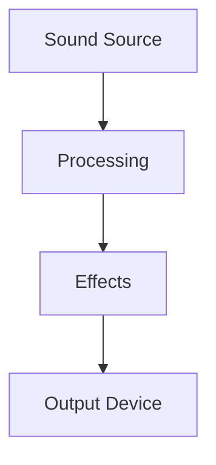

# Beginner Foundation: Sound Design

## 1. Everyday Intuition & First Principles

Sound design is the art of creating and manipulating audio to evoke emotions and enhance storytelling. Imagine you're a chef in a kitchen, and instead of ingredients, you have sounds. Just as a chef combines flavors, textures, and aromas to create a dish, a sound designer combines and manipulates sounds to create an auditory experience. Every sound has a unique character, and through sound design, we can shape these characters to fit the mood and narrative of a project. Whether it's the eerie hum of a spaceship, the rustling leaves in a forest, or the pounding heartbeat of a character in distress, sound design brings these elements to life, enriching the overall experience.

## 2. Foundational Vocabulary & Glossary

### 1. **Sample**: A digital recording of a sound. For example, a sample of a drum hit or a human voice.
### 2. **Synthesis**: The process of generating sound electronically. This can be done using oscillators, filters, and other electronic components to create a wide range of sounds.
### 3. **Sampling**: The process of using samples to create new sounds. For example, using a sample of a guitar note and manipulating it to create a new sound.
### 4. **Filter**: An electronic device or software that allows certain frequencies to pass through while attenuating others. Filters can be used to shape the tone of a sound, such as a low-pass filter that removes high frequencies.
### 5. **Envelope**: A control mechanism that defines how a sound changes over time. The most common type is the ADSR envelope, which stands for Attack, Decay, Sustain, and Release.
### 6. **Modulation**: The process of varying one sound parameter with another. For example, using an LFO (Low-Frequency Oscillator) to modulate the pitch of a sound, creating a vibrato effect.
### 7. **Effect**: A processor that alters the sound in some way. Common effects include reverb, delay, and distortion.
### 8. **MIDI**: A protocol that allows electronic musical instruments, computers, and other related devices to communicate. MIDI can control synthesizers, samplers, and other sound-producing devices.

## 3. Visual System Flow

### ASCII Diagram

```
+-------------------+       +-------------------+       +-------------------+       +-------------------+
|   Sound Source    |  ---> |     Processing    |  ---> |     Effects       |  ---> |   Output Device   |
| (Sample, Synth)   |       | (Filter, Envelope)|       | (Reverb, Delay)   |       | (Speakers, Headphones)|
+-------------------+       +-------------------+       +-------------------+       +-------------------+
```

### Mermaid Flowchart



## 4. Common Beginner Misconceptions & Mental Traps

### Misconception 1: Sound Design is Only for Video Games and Film
**Trap**: Thinking that sound design is limited to creating sound effects for video games and films.
**Reality**: Sound design is a fundamental aspect of music production, audio engineering, and even everyday media. It is used in advertising, podcasts, and even in live performances to enhance the auditory experience.

### Misconception 2: You Need Expensive Equipment to Sound Design
**Trap**: Believing that high-end equipment is necessary to create professional-sounding designs.
**Reality**: While professional equipment can enhance your capabilities, many sound designers start with basic equipment and software. The key is creativity and understanding the principles of sound design.

### Misconception 3: Sound Design is Only About Creating New Sounds
**Trap**: Focusing solely on creating new sounds without considering the context and purpose.
**Reality**: Effective sound design involves understanding the emotional and narrative context of the project. It's about enhancing the story and evoking the desired emotions through sound.

### Misconception 4: Sound Design is Easy to Learn
**Trap**: Thinking that sound design can be mastered quickly without practice.
**Reality**: Like any skill, sound design requires time, practice, and experimentation. It involves understanding the principles of acoustics, electronics, and psychology of sound.

## 5. Socratic Discussion Starters

### 1. What is the primary goal of sound design in a film or video game?
### 2. How does the choice of sound source (sample vs. synthesis) affect the final sound design?
### 3. Can you explain the role of filters in shaping the tone of a sound?
### 4. How does the ADSR envelope contribute to the emotional impact of a sound?
### 5. What are some common effects used in sound design, and how do they alter the sound?
### 6. How does MIDI fit into the sound design workflow, and why is it important?
### 7. Can you describe a scenario where sound design enhances the narrative of a project?
### 8. How do you balance the creation of new sounds with the use of existing samples in your sound design process?
