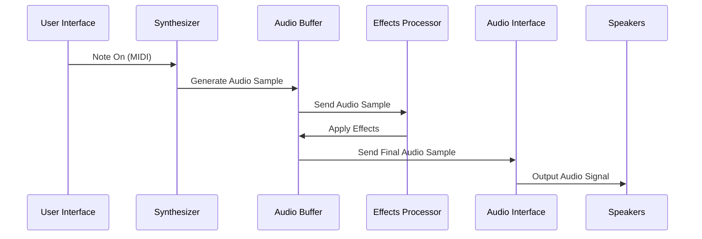

# Intermediate Foundation: Sound Design

## 1. Architectural Mental Model

In the realm of sound design, the architectural mental model is a foundational concept that guides the organization and interaction of various components within a production system. This model assumes a basic understanding of sound synthesis, sampling, and digital signal processing (DSP) but delves deeper into the systematic design of sound environments. The architecture of a sound design system encompasses not only the individual components but also their interconnections and the overall flow of data and control signals.

At the core of this mental model lies the concept of modular design, where each component is designed to perform a specific function, and these components are interconnected to form a cohesive system. This modularity allows for flexibility, scalability, and maintainability. For instance, a sound design system might include synthesizers, samplers, effects processors, and mixers, each with its own set of parameters and capabilities. These components interact through well-defined interfaces and protocols, ensuring seamless communication and data exchange.

The architectural mental model also emphasizes the importance of abstraction layers. Higher-level abstractions, such as the user interface and control systems, provide a simplified interface for users to interact with the system, while lower-level abstractions, such as the DSP algorithms and data structures, handle the detailed processing and data management. This layered approach facilitates efficient development and maintenance, as changes at one level can be made with minimal impact on other levels.

## 2. Systems Taxonomy & Component Protocols

A comprehensive understanding of the systems taxonomy and component protocols is crucial for effective sound design. This section outlines the standard interfaces, protocols, and data models that govern the interaction between different components within a sound design system.

### Standard Interfaces

1. **Control Voltage (CV) and Gate/Trigger Interfaces:**
   - **Control Voltage (CV):** CV is a standard interface used in modular synthesizers and Eurorack systems. It typically operates at a 1V/Octave scale, where a 1V change corresponds to a one-octave change in pitch. CV can also be used to control other parameters, such as filter cutoff frequency, amplitude, and LFO rate.
   - **Gate/Trigger:** Gates and triggers are used to start and stop events in a sound design system. Gates are typically used to control the duration of a sound, while triggers are used to initiate events, such as note on/off signals.

2. **MIDI (Musical Instrument Digital Interface):**
   - MIDI is a widely used protocol for communication between musical instruments, computers, and other electronic devices. It supports a variety of messages, including note on/off, control change, program change, and pitch bend. MIDI is particularly useful for controlling synthesizers, samplers, and other sound-generating devices.

3. **Audio Interfaces:**
   - Audio interfaces are used to connect sound design systems to audio hardware, such as speakers, headphones, and microphones. Common audio interfaces include analog-to-digital converters (ADCs) and digital-to-analog converters (DACs), which convert between analog and digital audio signals. Audio interfaces also support various digital audio formats, such as AES/EBU, S/PDIF, and USB.

### Standard Protocols

1. **Open Sound Control (OSC):**
   - OSC is a network protocol used for controlling and communicating with sound design systems over a network. It supports a variety of data types, including integers, floats, strings, and blobs, and can be used to control parameters, trigger events, and exchange data between different components.

2. **Audio Interchange File Format (AIFF) and Waveform Audio File Format (WAV):**
   - AIFF and WAV are standard audio file formats used for storing and exchanging audio data. These formats support various audio sample rates, bit depths, and channel configurations, and are widely used in sound design and audio production.

### Data Models

1. **Audio Buffers:**
   - Audio buffers are used to store and process audio data in real-time. They are typically implemented as circular buffers, which allow for efficient data management and processing. Audio buffers can be used to store audio samples, intermediate processing results, and final output signals.

2. **Parameter Trees:**
   - Parameter trees are used to organize and manage the parameters of sound design components. They provide a hierarchical structure for parameters, allowing for easy access and manipulation. Parameter trees can be used to control synthesizer parameters, effect settings, and other system parameters.

## 3. Multi-Component Interaction Flow

Understanding the interaction flow between different components within a sound design system is essential for effective system design. This section provides detailed ASCII and Mermaid sequence diagrams to illustrate the flow of data and control signals between components.

### ASCII Sequence Diagram

```
User Interface -> Synthesizer: Note On (MIDI)
Synthesizer -> Audio Buffer: Generate Audio Sample
Audio Buffer -> Effects Processor: Send Audio Sample
Effects Processor -> Audio Buffer: Apply Effects
Audio Buffer -> Audio Interface: Send Final Audio Sample
Audio Interface -> Speakers: Output Audio Signal
```

### Mermaid Sequence Diagram



## 4. Architectural Trade-offs & Production Pitfalls

Designing a sound design system involves numerous architectural trade-offs and potential pitfalls. This section explores some of the key considerations and challenges in system design.

### Trade-offs

1. **Modularity vs. Performance:**
   - Modularity allows for flexibility and scalability, but it can also introduce overhead and reduce performance. Designers must balance the benefits of modularity with the need for efficient processing and low latency.

2. **Scalability vs. Complexity:**
   - Scalability is important for accommodating future growth and expansion, but it can also increase complexity and make the system more difficult to manage. Designers must carefully consider the trade-offs between scalability and complexity.

3. **Real-time Processing vs. Offline Rendering:**
   - Real-time processing allows for immediate feedback and interaction, but it can be limited by processing power and latency. Offline rendering provides more processing power and flexibility, but it can be less interactive and time-consuming.

### Production Pitfalls

1. **Poor Interface Design:**
   - A poorly designed user interface can make the system difficult to use and understand. Designers must focus on creating intuitive and user-friendly interfaces that are easy to navigate and control.

2. **Inefficient Data Management:**
   - Inefficient data management can lead to performance bottlenecks and increased latency. Designers must optimize data structures and algorithms to ensure efficient data processing and management.

3. **Lack of Documentation:**
   - Lack of documentation can make it difficult for users and developers to understand and maintain the system. Designers must provide comprehensive documentation that covers system architecture, component interfaces, and usage instructions.

## 5. Socratic Discussion Starters

Socratic discussion starters are questions that bridge the gap between architectural design and low-level implementation. These questions encourage critical thinking and exploration of the underlying principles and concepts.

1. **How does the choice of audio interface and sample rate affect the overall sound quality and performance of a sound design system?**
2. **What are the advantages and disadvantages of using modular synthesis compared to traditional synthesizers?**
3. **How can designers optimize the interaction flow between components to minimize latency and improve performance?**
4. **What are the key considerations when designing a parameter tree that supports a wide range of sound design components and effects?**
5. **How can designers balance the trade-offs between modularity, scalability, and performance in a sound design system?**

By addressing these questions, designers can gain a deeper understanding of the architectural principles and design patterns that underpin effective sound design systems.
