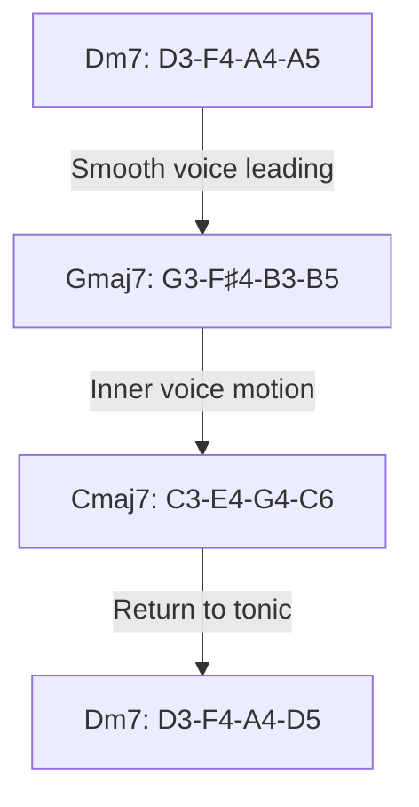
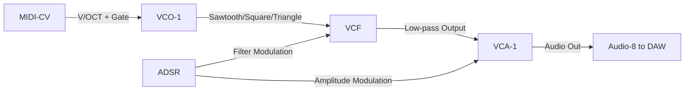
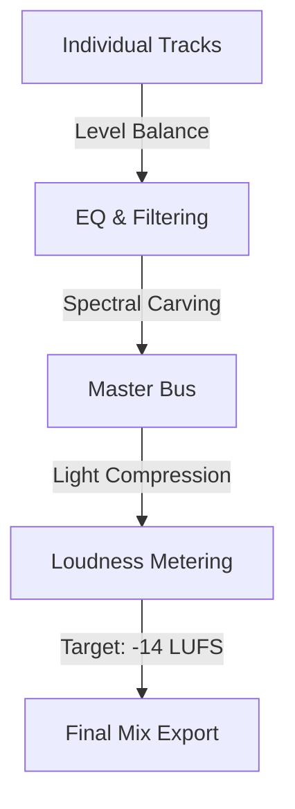

# Operational Verification Labs: Sound Design

## Objective & DAW / Studio Setup

This operational verification lab establishes hands-on proficiency in sound design through three critical domains: harmonic voice-leading realization, subtractive and wavetable synthesis parameter manipulation, and spectrum-aware mixing with dynamic range control. The exercises guide you through composing a short musical phrase, synthesizing timbres from oscillator fundamentals, and analyzing the spectral and loudness characteristics of your mix under real-world playback conditions. The objective centers not on theoretical mastery of signal processing mathematics but on developing repeatable, professional-grade workflows that integrate compositional intent, synthesis mechanics, and critical listening into a unified practice.

Your studio environment must provide real-time MIDI input and output, multi-track audio routing with insert effects, and visual diagnostic feedback through spectrum analysis and loudness metering. The Digital Audio Workstation serves as the central integration point, hosting virtual instruments, processing plugins, and analysis tools within a unified timeline. Ableton Live, Logic Pro, and Reaper all provide suitable environments, though their routing paradigms differ. Ableton's session view facilitates rapid iteration on musical ideas through clip launching and MIDI looping, while Logic's traditional linear arrangement and score editor streamline notation-centric workflows. Reaper offers unparalleled routing flexibility and low CPU overhead, making it well-suited for modular synthesis environments with dozens of parallel signal chains. Choose your DAW based on your current proficiency and the availability of native instruments, but ensure that you can monitor MIDI note data in real time, insert spectrum analyzers on individual tracks, and meter the master output with an integrated loudness meter calibrated to broadcast standards.

Install VCV Rack 2 Free as your modular synthesis simulator, providing a hardware-agnostic environment for exploring voltage-controlled oscillator tuning, filter cutoff modulation, and envelope shaping without the financial and spatial constraints of a physical Eurorack system. VCV Rack operates as a standalone application or as a VST/AU plugin within your DAW, enabling you to route MIDI from your DAW's piano roll into VCV's virtual MIDI-to-CV module and return audio through the host bridge. This hybrid workflow allows you to sketch melodic phrases in your DAW's native notation tools, then route those phrases through VCV's modular signal paths for timbre exploration, all while maintaining tempo synchronization and project-wide version control.

For spectrum analysis, install Voxengo SPAN, a freeware FFT analyzer offering 23-band octave resolution, stereo correlation metering, and adjustable averaging windows. Insert SPAN on individual instrument tracks to visualize harmonic distribution during synthesis design, and place a final instance on your master bus to verify that your mix occupies the full audible spectrum without excessive energy concentration in any single band. SPAN's block size parameter controls frequency resolution versus time resolution: set it to 8192 samples for precise low-frequency analysis during bass synthesis, and reduce it to 2048 samples when analyzing transient-rich percussive material where temporal accuracy matters more than narrow frequency bins.

Configure your DAW's master output to feed a loudness meter calibrated to ITU-R BS.1770-4 integrated LUFS measurement. Youlean Loudness Meter 2 provides a free, cross-platform solution with real-time short-term and momentary LUFS readouts, true peak limiting detection, and historical range graphs. Set your target integrated loudness to $-14$ LUFS for streaming platforms like Spotify and Apple Music, or $-16$ LUFS for broadcast television standards. This reference level ensures that your mix translates consistently across playback systems without triggering normalization penalties or dynamic range compression from the distribution platform.

Create a new project in your DAW with a tempo of 110 BPM and a 4/4 time signature. Insert three tracks: one MIDI instrument track for melodic composition, one audio return track hosting VCV Rack as a plugin for synthesis experiments, and one master bus with SPAN and Youlean Loudness Meter in the effects chain. Set your DAW's buffer size to 256 samples at 48 kHz sample rate, balancing low-latency MIDI performance with stable CPU load during real-time synthesis. Save this template as `Sound_Design_Lab_Template` and use it as your starting point for all subsequent exercises, ensuring consistent routing architecture and diagnostic visibility across sessions.

## Exercise 1: Practical Composition & Voice-Leading Realization

Compose an eight-measure phrase in D Dorian mode, employing functional harmonic motion and smooth voice-leading principles to create a foundation for subsequent synthesis and mixing exercises. This exercise grounds your sound design work in musical intentionality, ensuring that every synthesis parameter adjustment and mixing decision serves the compositional narrative rather than existing as isolated technical demonstrations. Write for four voices: melody, bass, and two inner harmonic voices, observing species counterpoint rules to avoid parallel fifths and octaves while maintaining independent melodic contour in each line.

D Dorian mode contains the pitch classes D, E, F, G, A, B, C, returning to D, yielding a minor scale with a raised sixth degree compared to natural minor. This raised sixth creates a major triad on the subdominant (G major) and a minor seventh chord on the tonic (Dm7), providing bright, modal color distinct from the harmonic minor palette. Your harmonic progression exploits these modal characteristics through a i–IV–♭VII–i cadential motion, rendered as Dm7 (D–F–A–C), Gmaj7 (G–B–D–F♯), Cmaj7 (C–E–G–B), and returning to Dm7. This progression emphasizes the raised sixth (B natural in the G major chord) and the lowered seventh (C natural), two defining features of the Dorian mode.

Begin by sketching the bass line in your DAW's piano roll or score editor, placing whole notes on beat 1 of measures 1, 3, 5, and 7, establishing root motion of D, G, C, D. This bass line descends by perfect fifth from D to G (a strong dominant-to-tonic motion inverted), ascends by perfect fourth from G to C (another inversion of the fifth), and descends by major second from C to D, creating a balanced contour that avoids excessive leaps while clearly articulating harmonic function. On the MIDI instrument track, select a simple sine wave or electric piano preset with minimal built-in effects, ensuring that timbral complexity does not obscure pitch relationships during the composition phase. Set the velocity of all bass notes to 100 out of 127, providing consistent loudness for harmonic analysis without dynamic shaping at this stage.

Construct the melody in the upper register, occupying the octave from D5 to D6. The melody should move primarily by stepwise motion, with occasional leaps of a third or fourth to outline chord tones and create phrase shape. Begin on A5 (the fifth of Dm7) in measure 1, descend to F5 (the third) in measure 2, leap up to B5 (the major third of Gmaj7) in measure 3, resolve down to G5 in measure 4, ascend to C6 (the root of Cmaj7) in measure 5, descend through B5 and A5 in measures 6 and 7, and resolve to D5 in measure 8. This melodic contour traces a gentle arch, peaking in measure 5 and descending toward resolution, while emphasizing the characteristic tones of each chord: the F natural of Dm7, the B natural of Gmaj7, and the C natural of Cmaj7.

Add two inner voices to complete the four-part texture, ensuring that each chord contains a complete triad or seventh chord voicing. For the Dm7 chord in measure 1, place F4 in the alto voice and A4 in the tenor voice, with the bass on D3 and the melody on A5. For Gmaj7 in measure 3, move the alto voice to F♯4 (the major seventh) and the tenor to D4 (the fifth), creating smooth voice leading where F4 moves up by semitone to F♯4 and A4 moves down by perfect fifth to D4. For Cmaj7 in measure 5, shift the alto to E4 (the third) and the tenor to G4 (the fifth), with F♯4 descending by major second to E4 and D4 ascending by perfect fourth to G4. Return to Dm7 in measure 7 by moving the alto from E4 to F4 (ascending semitone) and the tenor from G4 to A4 (ascending major second).

Verify that no voice pair produces parallel perfect fifths or octaves across consecutive chords. Check the bass and tenor voices from measure 1 to measure 3: D3–A4 forms a perfect twelfth (compound fifth), while G3–D4 also forms a perfect fifth. These parallel fifths violate species counterpoint conventions and create a hollow, static sound. Correct this by inverting the tenor voice in measure 3, moving it from D4 to B3, the major third of Gmaj7. Now the interval changes from a perfect fifth to a major third, eliminating the parallel motion. Apply similar scrutiny to all voice pairs, ensuring that each voice moves independently with contrary or oblique motion wherever possible.

Render a MIDI visualization of your four-voice texture using your DAW's piano roll editor or a third-party notation plugin. The visualization should display all four voices simultaneously, with each voice assigned a distinct color: bass in blue, tenor in green, alto in yellow, and melody in red. This color coding allows you to rapidly identify voice-crossing errors or instances where inner voices drift into the melody's register, creating muddiness in the upper partials. Export this visualization as a PNG image and annotate the chord symbols (Dm7, Gmaj7, Cmaj7, Dm7) above each harmonic change, along with arrows indicating semitone and whole-tone voice motion between chords.

Play back your composition through your DAW's default MIDI instrument, listening for smooth voice leading and correct pitch spelling. Each chord change should sound connected rather than disjointed, with minimal leap size in the inner voices. The melody should clearly outline the harmonic progression, hitting chord tones on strong beats and passing tones on weak beats. Record your composition as a MIDI file with the filename `dorian_phrase.mid`, ensuring that all four voices are captured on separate MIDI channels if your DAW supports multi-channel MIDI export. This MIDI file serves as the input source for the synthesis exercises that follow, where you will assign different timbres to each voice and explore how harmonic relationships interact with spectral content.

Document your compositional decisions in a brief text file saved as `composition_notes.txt`. Describe why you chose the specific melodic contour, how you resolved any voice-leading challenges, and what modal characteristics of D Dorian you emphasized through chord selection and voice motion. This documentation practice reinforces the connection between analytical understanding and creative execution, preparing you to articulate design rationale in professional collaborative environments where you must justify synthesis and mixing choices to producers, directors, or other stakeholders.

## Exercise 2: Subtractive Synthesis Parameter Manipulation

Design three distinct timbres using subtractive synthesis principles within VCV Rack, assigning each timbre to a different voice in your D Dorian composition. Subtractive synthesis begins with harmonically rich waveforms generated by voltage-controlled oscillators, then removes frequency content using filters to sculpt the final timbre. This reductive paradigm contrasts with additive synthesis, where you build timbres by summing individual sine wave partials, and with frequency modulation synthesis, where you create complex spectra by modulating one oscillator's frequency with another. Subtractive synthesis offers intuitive control over brightness (filter cutoff frequency), resonance (filter Q factor), and dynamic evolution (envelope-controlled filter modulation), making it the foundational synthesis technique in both analog hardware synthesizers and modern software instruments.

Launch VCV Rack and create a new blank patch. Add the following modules from the library: VCO-1 (a voltage-controlled oscillator with sawtooth, square, and triangle waveform outputs), VCF (a state-variable filter providing low-pass, high-pass, and band-pass outputs), VCA-1 (a voltage-controlled amplifier for envelope shaping), ADSR (an attack-decay-sustain-release envelope generator), MIDI-CV (a MIDI-to-control-voltage converter for receiving note data from your DAW), and Audio-8 (an audio output interface for routing synthesis results back to your DAW). Arrange these modules in a left-to-right signal flow: MIDI-CV feeds pitch CV and gate signals to VCO-1 and ADSR, VCO-1's sawtooth output connects to VCF's audio input, ADSR's envelope output modulates both VCF's cutoff frequency and VCA-1's amplitude, and VCF's low-pass output feeds VCA-1, which finally routes to Audio-8 for host integration.

Configure VCO-1 to generate a sawtooth waveform at concert pitch A4 (440 Hz) when receiving a MIDI note-on message for A4 from your DAW. Connect the MIDI-CV module's V/OCT output to VCO-1's V/OCT input, ensuring that pitch changes in your DAW's piano roll correctly translate to frequency changes in the oscillator. The V/OCT standard specifies that each 1-volt increase in the control voltage doubles the oscillator frequency (one octave), and that 0 volts corresponds to C4 (approximately 261.63 Hz). Verify this calibration by sending a C4 MIDI note from your DAW and confirming with a frequency counter plugin that VCO-1 outputs approximately 262 Hz.

Set VCF's cutoff frequency knob to 1000 Hz, creating a low-pass filter that attenuates frequencies above 1000 Hz while allowing lower frequencies to pass. A sawtooth waveform contains all integer harmonics of the fundamental frequency with amplitudes proportional to $1/n$, where $n$ is the harmonic number. For a 440 Hz sawtooth, the second harmonic appears at 880 Hz, the third at 1320 Hz, the fourth at 1760 Hz, and so forth. With the cutoff at 1000 Hz, the filter passes the fundamental and second harmonic while attenuating the third harmonic and above, producing a warm, muted timbre compared to the bright, buzzy character of the unfiltered sawtooth.

Increase VCF's resonance control to emphasize frequencies near the cutoff. Resonance introduces positive feedback around the cutoff frequency, creating a peak in the filter's frequency response. Set the resonance to approximately 50% of its maximum range, producing a noticeable peak without pushing the filter into self-oscillation (a state where the feedback is so strong that the filter generates its own tone independent of the input signal). This resonant peak adds presence and definition to the timbre, making the cutoff frequency more perceptually salient and giving the sound a vocal-like quality.

Connect the ADSR module's output to VCF's FM (frequency modulation) input, allowing the envelope to dynamically sweep the cutoff frequency over time. Set the ADSR parameters as follows: attack time to 50 milliseconds, decay time to 300 milliseconds, sustain level to 40% of maximum, and release time to 500 milliseconds. Connect the MIDI-CV gate output to ADSR's gate input, triggering the envelope whenever a MIDI note-on message arrives. This envelope configuration causes the filter cutoff to rise quickly during the attack phase, reaching a peak brightness, then decay to a moderate sustain level, and finally fade out during the release. The result is a timbre that begins bright and percussive, settles into a stable sustained tone, and smoothly diminishes when the note ends.

Adjust the depth of the envelope modulation by attenuating the ADSR output before it reaches VCF's FM input. Insert a VCA or attenuator module between ADSR and VCF, setting the attenuation to 60%, which scales the envelope's voltage range from 0–10 volts to 0–6 volts. This moderation prevents the filter cutoff from sweeping excessively high, which would produce a shrill, overly bright attack transient. Experiment with different attenuation levels while playing sustained notes from your DAW, listening for the point where the attack is prominent but not harsh.

Route VCF's low-pass output to VCA-1's audio input, and connect a second ADSR envelope (or duplicate the first) to VCA-1's CV input. This amplitude envelope shapes the overall loudness contour of the timbre, independent of the filter envelope. Set the amplitude ADSR to match the filter envelope initially: 50 ms attack, 300 ms decay, 40% sustain, 500 ms release. Later exercises will explore decoupling these envelopes to create timbres where brightness and loudness evolve at different rates, such as a tone that begins soft and bright, then grows louder while becoming darker.

Send a sequence of eighth notes at 110 BPM from your DAW's MIDI track to VCV Rack, triggering the patch you just constructed. Listen for the attack transient, the decay into sustain, and the release tail. The timbre should sound warm and dynamic, with a clear sense of articulation at the start of each note. If the attack is too slow, reduce the attack time to 20 ms. If the release cuts off abruptly, increase the release time to 800 ms. These adjustments tailor the timbre to the musical context, ensuring that note boundaries are clear without sounding choppy.

Create a second timbre for the bass voice by duplicating the VCO-VCF-VCA signal chain and modifying the filter and envelope settings. Set VCO-1 to generate a square waveform instead of a sawtooth, producing a timbre with only odd harmonics (fundamental, third harmonic, fifth harmonic, and so on). Lower VCF's cutoff frequency to 400 Hz, emphasizing the fundamental and suppressing higher partials to create a deep, subtractive bass tone. Increase the resonance to 70% to add a slight mid-range growl around the cutoff frequency. Set the filter envelope to a faster attack of 10 ms, a longer decay of 600 ms, a sustain level of 20%, and a release of 300 ms. This envelope profile creates a punchy, defined attack suitable for rhythmic bass lines, with a quick transient followed by a moderate decay into a low sustain.

For the amplitude envelope of the bass timbre, use a shorter attack of 5 ms, a decay of 400 ms, a sustain of 30%, and a release of 200 ms. This creates a percussive amplitude contour where the note hits quickly and fades relatively fast, preventing the bass from sustaining too long and masking other voices. Play the bass line from your D Dorian composition through this patch, verifying that each root note (D, G, C, D) punches through clearly without excessive sustain or muddiness.

Design a third timbre for the inner harmonic voices (alto and tenor) by creating another VCO-VCF-VCA chain, this time using a triangle waveform from VCO-1. Triangle waveforms contain only odd harmonics, like square waves, but with amplitudes proportional to $1/n^2$, yielding a softer, more flute-like tone than the hollow, reedy quality of a square wave. Set VCF's cutoff to 2000 Hz, allowing more high-frequency content than the bass timbre but less than the bright melody timbre. Set the resonance to 20%, providing gentle emphasis without harshness. Configure the filter envelope with a 30 ms attack, 200 ms decay, 60% sustain, and 400 ms release, creating a timbre that develops smoothly and sustains well for harmonic padding.

Set the amplitude envelope for the inner voices to 20 ms attack, 150 ms decay, 70% sustain, and 600 ms release. This envelope prioritizes sustain over transient impact, allowing the inner voices to blend into a cohesive harmonic texture while the melody and bass provide rhythmic definition. Route the MIDI data for the alto and tenor voices from your DAW to this patch, ensuring that both voices share the same timbre but play different pitches according to your voice-leading arrangement.

Insert SPAN on the return track receiving audio from VCV Rack, visualizing the spectral content of each timbre in isolation. Play the melody timbre alone and observe the distribution of energy across the spectrum. The sawtooth waveform with a 1000 Hz cutoff should show a strong fundamental and second harmonic, with a gradual rolloff above 1 kHz and a resonant peak visible as a narrow spike near the cutoff frequency. Switch to the bass timbre and note the concentration of energy below 400 Hz, with minimal content above 1 kHz. The square waveform's odd-harmonic structure appears as a series of peaks at odd multiples of the fundamental frequency, spaced farther apart than the sawtooth's harmonic series.

Analyze the inner voice timbre's spectrum, observing the triangle waveform's gentler rolloff compared to the sawtooth and square waves. The harmonic peaks are more widely spaced and lower in amplitude at higher frequencies, creating a smoother, less aggressive spectral shape. This softer character allows the inner voices to fill the harmonic space without competing for attention with the melody or bass.

Document each timbre's settings in a text file named `synthesis_parameters.txt`. For each voice (melody, bass, inner), record the waveform type, filter cutoff frequency, resonance level, filter envelope parameters (attack, decay, sustain, release), and amplitude envelope parameters. Include brief observations about the resulting timbre's character and its suitability for the voice's musical role. This documentation serves as a reference for future synthesis sessions and helps you develop a systematic approach to timbre design, where you consciously link synthesis parameters to perceptual outcomes and musical functions.

## Exercise 3: Spectrum-Aware Mixing & Dynamic Range Control

Balance the three timbres from Exercise 2 within a cohesive mix, applying spectrum-aware gain staging and dynamic range control to ensure clarity, depth, and consistent loudness across playback systems. Mixing transforms isolated synthesis elements into an integrated sonic image where each voice occupies distinct frequency regions, contributes appropriate perceptual weight, and maintains audibility without masking other voices. This exercise introduces frequency-conscious level balancing, subtractive equalization to carve spectral niches, and final-stage loudness metering to verify broadcast compliance.

Route the three synthesis outputs from VCV Rack to separate mixer tracks in your DAW, labeling them "Melody," "Bass," and "Inner Voices." Set each track's fader to unity gain (0 dB) initially, establishing a neutral starting point before making relative level adjustments. Play back your D Dorian composition with all three voices active, listening for which elements dominate the mix and which recede into the background. The melody should be the most prominent voice, followed by the bass, with the inner voices providing harmonic support without drawing excessive attention.

Adjust the melody track fader to $-6$ dB relative to unity, reducing its raw output level to create headroom for subsequent gain adjustments. Lower the bass track to $-9$ dB, accounting for the perceptual loudness boost that low-frequency content receives due to the ear's frequency-dependent sensitivity. Set the inner voices track to $-12$ dB, placing them well behind the melody and bass in the perceptual foreground. These initial level settings establish a rough balance; further adjustments will refine the mix based on spectral analysis and critical listening.

Insert SPAN on each individual track to visualize the frequency distribution of each voice in isolation. Observe the melody track's spectrum, noting energy concentration between 400 Hz and 4 kHz, with the fundamental and first few harmonics clearly visible as discrete peaks. The bass track's spectrum shows dominant energy below 400 Hz, with the fundamental and third harmonic (for the square waveform) peaking around 100–300 Hz. The inner voices occupy a middle ground, with energy spread from 300 Hz to 2 kHz, filling the gap between the bass and melody without overlapping excessively with either.

Identify spectral masking where one voice's energy obscures another's within the same frequency band. The melody's fundamental around 440 Hz (A4) may clash with the bass's third harmonic at approximately 330 Hz (when the bass plays D2 at 73.4 Hz), creating muddiness in the lower midrange. Apply a narrow band-cut EQ to the inner voices track, reducing the level by 3 dB in a 200 Hz wide band centered at 400 Hz. This subtle cut removes energy that competes with the melody's lower harmonics, improving separation without drastically altering the inner voices' timbre.

Insert a high-pass filter on the melody track with a cutoff at 200 Hz and a 12 dB/octave slope, removing subsonic content and low-frequency rumble that does not contribute to the melody's musical function. This filter also prevents the melody from interfering with the bass voice's low-frequency domain, ensuring that the bass remains the sole provider of energy below 200 Hz. Monitor the effect of this filter by toggling it on and off while observing SPAN on the master bus, confirming that low-frequency clutter disappears without noticeably thinning the melody's tone.

Apply a gentle low-pass filter to the bass track with a cutoff at 5 kHz and a 6 dB/octave slope, rolling off high-frequency harmonics that do not contribute to the bass's perceived pitch but add harshness and compete with the melody's upper partials. The bass voice's musical function centers on providing rhythmic and harmonic foundation, which depends primarily on the fundamental and first few harmonics. Removing energy above 5 kHz cleans up the mix without sacrificing the bass's definition.

Check the master bus spectrum with SPAN, verifying that the combined mix exhibits a balanced frequency distribution without excessive peaks or gaps. The spectrum should show continuous energy from 60 Hz to 10 kHz, with the bass dominating the low end (60–200 Hz), the inner voices filling the midrange (200–2000 Hz), and the melody providing upper midrange and high-frequency content (400–4000 Hz). If any frequency band shows a pronounced dip or peak greater than 6 dB relative to neighboring bands, return to the individual tracks and adjust EQ or levels to smooth the overall spectral shape.

Insert Youlean Loudness Meter on the master bus, resetting the integrated LUFS measurement to begin tracking the loudness of your complete composition. Play the entire eight-measure phrase from start to finish, allowing the meter to accumulate loudness data across the full duration. At the end of playback, observe the integrated LUFS value. If the reading falls below $-18$ LUFS, the mix is quieter than typical streaming platform targets and may sound weak compared to other tracks in a playlist. If the reading exceeds $-12$ LUFS, the mix is too loud and risks triggering normalization or limiting from the playback system.

Adjust the master fader to bring the integrated loudness to $-14$ LUFS, the target for Spotify and Apple Music. If the initial reading was $-16$ LUFS, raise the master fader by approximately 2 dB, then replay the composition and re-check the meter. Iterate this process until the integrated loudness stabilizes at $-14$ LUFS ±0.5 LU. Verify that the true peak level (displayed separately in Youlean Loudness Meter) does not exceed $-1$ dBTP, ensuring headroom for lossy encoding formats like MP3 and AAC, which can introduce inter-sample peaks that clip even if the sample values remain below 0 dBFS.

Monitor the short-term LUFS graph in Youlean Loudness Meter during playback, observing how loudness fluctuates across the composition. The graph should show relatively stable loudness during sustained sections and slight dips during note transitions or rests. If the short-term loudness varies by more than 6 LU between the loudest and quietest moments, consider applying gentle compression to reduce dynamic range. Insert a compressor plugin on the master bus with a ratio of 2:1, a threshold of $-10$ dB, an attack time of 10 ms, and a release time of 100 ms. This light compression smooths out level inconsistencies without audibly squashing transients or removing dynamic expression.

Export the final mix as a 48 kHz, 24-bit WAV file named `dorian_mix.wav`, ensuring that dither is disabled since the source material is already at 24-bit resolution. Import this file into a separate analysis project and insert SPAN on the audio track, examining the long-term average spectrum. The spectrum should display a gentle downward slope from low to high frequencies, reflecting the natural distribution of musical energy where bass and midrange content typically dominates. If the high-frequency region (above 5 kHz) shows excessive energy comparable to the midrange, the mix may sound harsh or fatiguing; return to the synthesis stage and reduce filter cutoff frequencies or resonance levels.

Compare your mix to a reference track in a similar genre and tempo, importing the reference as a second audio file in the analysis project. Match the reference track's loudness to your mix by adjusting its gain so that both tracks measure approximately $-14$ LUFS integrated. Place SPAN on both tracks simultaneously (or toggle between them) and compare spectral shapes. Note any significant deviations: if the reference has more low-frequency energy, consider boosting the bass voice's level or reducing the high-pass filter cutoff; if the reference has brighter high-frequency content, increase the melody's filter cutoff or reduce resonance on the inner voices to make room for upper harmonics.

Document your mixing decisions in a file named `mixing_notes.txt`, recording the final fader levels for each track, the EQ adjustments applied (frequency, Q, gain), the compressor settings, and the integrated LUFS measurement. Describe the rationale for each adjustment, linking specific parameter changes to observed spectral or loudness problems and their solutions. This documentation reinforces the diagnostic workflow where you identify issues through metering and visualization, hypothesize solutions based on signal processing principles, implement the solutions, and verify their effectiveness through re-measurement.

Create a final A/B comparison by exporting two versions of your mix: one without master compression and one with compression engaged. Label these files `dorian_mix_uncompressed.wav` and `dorian_mix_compressed.wav`. Import both into a listening session and toggle between them, noting the subjective difference in dynamic range, transient punch, and overall cohesion. The compressed version should sound slightly more controlled and polished, with less variation in perceived loudness between the loudest and softest moments, while the uncompressed version retains more dynamic contrast and natural expression. Understanding this tradeoff informs future decisions about when to apply compression and how much to use, balancing technical consistency with artistic intent.
