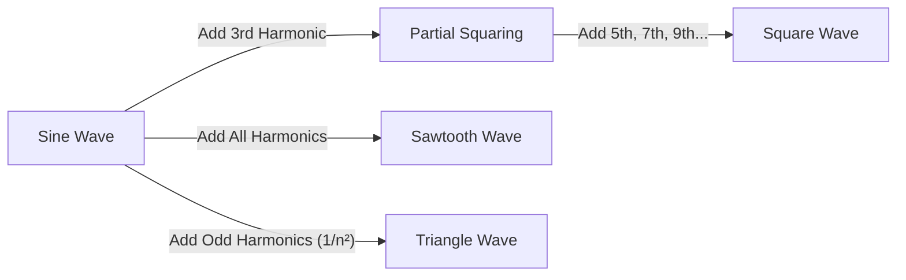
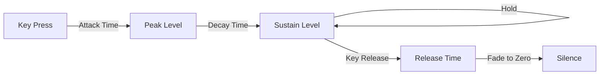
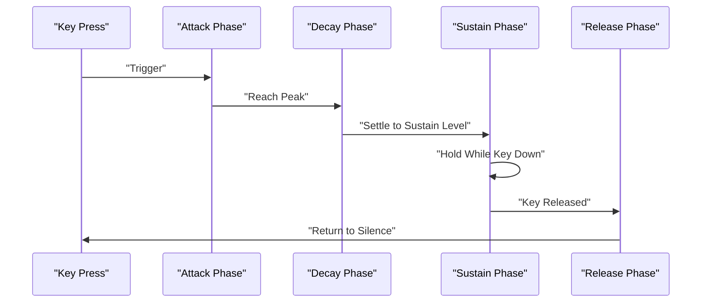

# Lesson 1: Acoustic Foundations, Waveform Theory, Harmonic Structure

## 1. First-Principles Intuition & Invariants

Sound exists as a disturbance in a compressible medium—most commonly air—where molecules are periodically compressed and rarefied by a vibrating source. When a guitar string is plucked, the string's displacement creates alternating regions of high and low air pressure that propagate outward as longitudinal waves, traveling at approximately 343 meters per second at sea level and 20°C. This propagation velocity is a physical constant for a given medium and temperature, establishing the first invariant of acoustic physics: wavelength and frequency are inversely coupled through the relationship $\lambda = c/f$, where $c$ is the speed of sound, $f$ is frequency in Hertz, and $\lambda$ is wavelength in meters. A 440 Hz tone—the orchestral standard A4—produces a wavelength of roughly 78 centimeters, while the low E1 on a bass guitar at 41.2 Hz generates a wavelength exceeding 8 meters. This spatial dimension of sound is critical for understanding room modes, speaker placement, and why low-frequency energy requires physically larger drivers and enclosures to radiate efficiently.

The psychoacoustic perception of pitch correlates directly with frequency, but the relationship is logarithmic rather than linear. Western equal temperament divides the octave into twelve semitones, where each semitone represents a frequency ratio of the twelfth root of two—approximately 1.05946. Doubling frequency always produces an octave regardless of the starting pitch: 110 Hz to 220 Hz is the same perceptual interval as 440 Hz to 880 Hz. This logarithmic scaling explains why piano keyboards span 88 keys to cover the human hearing range from 27.5 Hz to 4186 Hz, while a linear frequency display would compress the entire musical range into the leftmost fraction of the spectrum. When designing synthesizer interfaces or analyzing spectral content, this perceptual weighting demands that frequency axes be displayed logarithmically to match human auditory resolution, which is finer at low frequencies and coarser at high frequencies.

Amplitude governs loudness perception, measured in decibels (dB) on a logarithmic scale relative to a reference level. The decibel scale compresses the vast dynamic range of human hearing—from the threshold of hearing at 0 dB SPL to the threshold of pain near 120 dB SPL—into a manageable numerical range. Every 6 dB increase represents an approximate doubling of acoustic pressure, while every 10 dB increase is perceived as roughly twice as loud due to the ear's nonlinear response. In digital audio, 0 dBFS (decibels full scale) represents the maximum possible amplitude before clipping distortion occurs, and all signal levels are measured as negative values below this ceiling. A well-recorded vocal track typically peaks between -6 dBFS and -3 dBFS, leaving headroom for transient peaks and mastering processing. Understanding this dual scaling—acoustic SPL in the physical domain and dBFS in the digital domain—is essential for gain staging throughout the production chain, from microphone preamplifiers through mixing console channels to final master bus limiting.

The harmonic series is the fundamental organizing principle of timbre and tonal color. When a physical object vibrates, it rarely produces a single pure frequency; instead, it vibrates simultaneously at multiple related frequencies called partials or overtones. A vibrating string, for example, oscillates at its fundamental frequency (first harmonic) while also producing vibrations at integer multiples: the second harmonic at twice the fundamental frequency, the third harmonic at three times the fundamental, and so forth. This pattern—$f$, $2f$, $3f$, $4f$, $5f$, and upward—is the harmonic series, and it dictates why a piano, violin, and trumpet playing the same note sound distinctly different. Each instrument emphasizes different harmonics with varying amplitudes, creating a unique spectral envelope that the ear interprets as timbre. The second harmonic lies one octave above the fundamental, the third harmonic lies an octave plus a perfect fifth, the fourth harmonic lies two octaves up, and the fifth harmonic introduces the major third interval. These integer relationships are why consonant intervals sound stable—they share common harmonics that reinforce rather than conflict.

Phase describes the temporal alignment of waveforms and becomes critical when multiple sound sources or signal paths are combined. A sine wave's phase is measured in degrees from 0° to 360°, representing one complete cycle. When two identical signals are summed in perfect phase alignment (0° offset), their amplitudes add constructively, doubling the peak level and producing a 6 dB gain. When the same signals are summed 180° out of phase—one waveform's compression aligning with the other's rarefaction—they cancel completely, producing silence. In practice, phase relationships are rarely this extreme, but partial cancellation and reinforcement occur continuously in multi-microphone recordings, stereo imaging, and room acoustics. A common mixing disaster occurs when a kick drum is recorded with both a close dynamic microphone and a room condenser microphone: if the room microphone's distance introduces a phase offset that places the kick's fundamental frequency near 180° misalignment, the low-end power collapses when the channels are summed. Phase coherence monitoring and corrective tools like polarity inversion and time-alignment plugins are indispensable for preserving tonal integrity in complex mixes.

Transient behavior defines the initial attack portion of a sound and carries disproportionate perceptual weight in determining clarity and impact. The transient is the high-amplitude, short-duration burst of energy at a sound's onset—the beater striking a drumhead, the plectrum releasing a string, the hammer hitting a piano wire. Transients contain broadband energy spanning the entire frequency spectrum, often exceeding the sustained portion's level by 10–20 dB. This initial spike triggers the ear's temporal resolution mechanisms, allowing the brain to localize sound sources and distinguish overlapping events in a dense mix. Compression and limiting, when applied carelessly, attenuate transients and reduce perceived punch and definition. Conversely, transient designers and envelope shapers can artificially enhance or suppress attack energy, allowing a snare drum to cut through a wall of distorted guitars or a bass guitar to sit back in the groove without occupying excessive headroom. Understanding that transient preservation is often more important than RMS loudness informs every decision from microphone placement to final limiting ratios.

## 2. Core Architecture & Mechanics

A periodic waveform repeats its pattern at regular intervals, and the simplest periodic waveform is the sine wave—a pure tone containing energy at only one frequency with no harmonic content. The sine wave is the atomic building block of all complex sounds, described mathematically as $y(t) = A \sin(2\pi f t + \phi)$, where $A$ is amplitude, $f$ is frequency, $t$ is time, and $\phi$ is initial phase. This elegant simplicity makes sine waves the ideal test signal for measuring system response, calibrating equipment, and isolating specific frequency bands during analysis. Real-world sounds, however, are rarely pure sine waves. Musical instruments, voices, and environmental sounds produce complex waveforms composed of multiple sine waves at different frequencies and amplitudes—a principle formalized by Fourier's theorem, which states that any periodic waveform can be decomposed into a sum of sine and cosine waves at harmonically related frequencies.

The square wave is the first complex periodic waveform encountered in synthesis and signal processing. A perfect square wave alternates instantaneously between two fixed amplitude levels, creating a waveform that resembles a digital clock signal. According to Fourier analysis, a square wave contains only odd harmonics—the fundamental frequency plus the third, fifth, seventh, ninth harmonics and beyond—with amplitudes inversely proportional to the harmonic number. The third harmonic appears at one-third the amplitude of the fundamental, the fifth at one-fifth, the seventh at one-seventh, and so on, following the series $\frac{1}{n}$ for odd $n$. This spectral signature produces the square wave's characteristic hollow, woody timbre, commonly associated with clarinet-like tones in subtractive synthesizers. The abrupt transitions between states also generate significant high-frequency energy, which is why square waves sound bright and aggressive compared to sine waves. In practice, perfect square waves cannot exist in analog systems due to bandwidth limitations—real square waves exhibit finite rise and fall times, softening the spectral edges.

The sawtooth wave contains all harmonics—both odd and even—with amplitudes following the inverse harmonic series $\frac{1}{n}$ for all integers $n$. This complete harmonic spectrum produces a bright, buzzy timbre rich in upper harmonics, making sawtooth waves the foundation of classic analog synthesizer sounds. The waveform's distinctive ramp shape rises linearly from minimum to maximum amplitude before dropping instantly back to the starting point, creating a sharp discontinuity that generates the full harmonic series. Because the sawtooth contains more harmonic energy than any other basic waveform, it serves as the ideal starting material for subtractive synthesis—filtering can sculpt the dense harmonic content into an infinite variety of tones, from warm pads to aggressive leads. The sawtooth's spectral richness also makes it computationally expensive to generate digitally without aliasing artifacts, requiring sophisticated band-limited synthesis techniques to prevent false frequencies from appearing below the Nyquist limit.

The triangle wave occupies a middle ground between sine and square waves, containing only odd harmonics like the square wave but with amplitudes falling off much more rapidly—following $\frac{1}{n^2}$ rather than $\frac{1}{n}$. This quadratic attenuation means the third harmonic appears at one-ninth the fundamental's amplitude, the fifth at one-twenty-fifth, and higher harmonics become negligible quickly. The result is a waveform that sounds mellower and more flute-like than a square wave but less pure than a sine wave. The triangle wave's shape—a linear rise followed by a linear fall—eliminates the abrupt discontinuities present in square and sawtooth waves, concentrating energy in lower harmonics and producing a gentler, more rounded timbre. This makes triangle waves particularly useful for synthesizing mellow bass lines, soft pad sounds, and melodic elements that need to sit comfortably in a mix without excessive brightness.

Pulse waves generalize the square wave concept by introducing duty cycle—the ratio of high time to total period. A 50% duty cycle produces a standard square wave, but adjusting the duty cycle to 25%, 10%, or any other value creates asymmetric waveforms with unique spectral characteristics. As the pulse becomes narrower, more harmonic energy spreads across the spectrum, and the timber shifts from hollow to nasal and eventually to thin and reedy. This variation is the foundation of pulse-width modulation (PWM), a classic synthesis technique where the duty cycle is continuously varied by a low-frequency oscillator (LFO). The shifting spectral content creates a rich, animated sound reminiscent of analog string machines and synthetic brass sections. PWM introduces time-varying harmonic relationships that defeat the ear's adaptation mechanisms, maintaining interest and movement without requiring additional processing or effects.

White noise is the archetypal stochastic signal, containing equal energy at all frequencies across the audible spectrum. Unlike periodic waveforms with discrete harmonic structures, white noise exhibits a continuous frequency distribution with no discernible pitch. The term "white" derives from the analogy to white light, which contains equal energy at all visible wavelengths. In practice, white noise sounds like a continuous hiss or rush, similar to steam escaping from a valve or wind blowing through trees. This broadband energy makes white noise invaluable for testing frequency response, masking unwanted sounds, and generating percussive elements. A snare drum's characteristic snap comes primarily from the broadband burst of noise created by the snare wires vibrating against the bottom head. In synthesis, white noise is the starting point for creating realistic hi-hats, cymbals, ocean waves, and breath sounds. Filtering white noise produces colored variants: pink noise has equal energy per octave rather than per Hertz, resulting in more low-frequency energy and a darker timbre; brown noise (Brownian noise) has even more low-end emphasis, sounding like distant thunder or rumbling machinery.

The envelope is a time-varying amplitude contour that shapes a sound's loudness over its duration, transforming a static oscillator output into a dynamically evolving musical event. The ADSR envelope—Attack, Decay, Sustain, Release—is the most common model, defining four distinct phases. Attack determines how quickly the sound rises from silence to peak amplitude; a zero attack produces a percussive click, while a slow attack creates a gradual fade-in suitable for pads and strings. Decay defines the fall time from peak to the sustain level, introducing an initial transient before settling into a steady state. Sustain is the held amplitude level while a key remains pressed—the only parameter measured in level rather than time. Release governs the fade-out time after the key is released, ranging from abrupt cutoffs for staccato notes to long tails for reverberant sounds. This four-stage model, while simple, provides sufficient flexibility to emulate the temporal behavior of most acoustic instruments and to design entirely synthetic envelopes that respond expressively to keyboard velocity and aftertouch.

Frequency modulation (FM) synthesis generates complex harmonic and inharmonic spectra by using one oscillator (the modulator) to modulate the frequency of another oscillator (the carrier). When the modulator frequency is low—below approximately 20 Hz—the result is vibrato, a periodic pitch variation perceived as a single fluctuating tone. When the modulator frequency enters the audio range, the carrier's instantaneous frequency changes so rapidly that the ear perceives a new timbre rather than pitch wobble. The resulting spectrum contains sidebands at frequencies given by $f_c \pm n f_m$, where $f_c$ is the carrier frequency, $f_m$ is the modulator frequency, and $n$ is an integer. The number and amplitude of sidebands are controlled by the modulation index—the ratio of frequency deviation to modulator frequency. Low modulation indices produce subtle harmonic enrichment similar to analog oscillator drift, while high indices generate dense, metallic, bell-like timbres. FM synthesis, popularized by the Yamaha DX7 in the 1980s, excels at creating bright, percussive sounds—electric pianos, bells, marimbas, and aggressive bass tones—that are difficult or impossible to achieve through subtractive synthesis alone.

Additive synthesis builds complex timbres by explicitly summing individual sine wave components, each with independent control over frequency, amplitude, and phase. This approach provides complete spectral control, allowing the sound designer to sculpt harmonic content with surgical precision. A single violin note might be constructed from sixty or more sine waves, each representing a partial in the instrument's spectrum, with time-varying amplitudes that replicate the natural evolution of the acoustic source. While additive synthesis offers unparalleled flexibility, it suffers from parameter explosion—controlling hundreds of oscillators individually quickly becomes impractical. Modern additive synthesizers mitigate this complexity through grouped envelope controls, harmonic morphing, and resynthesis algorithms that analyze recorded sounds and generate matching additive recipes. The technique shines when creating evolving pad textures, realistic organ simulations, and hybridized timbres that smoothly interpolate between different harmonic structures over time.

Granular synthesis fragments sound into tiny grains—typically 1 to 100 milliseconds in duration—which are then recombined, time-stretched, pitch-shifted, and scattered across the stereo field to create new textures. Each grain is a brief snippet of audio windowed by an amplitude envelope, often a Gaussian or Hann window, to prevent clicks at the grain boundaries. By triggering thousands of grains per second with varying densities, pitches, and spatial positions, granular synthesis transforms even simple source material into vast, shimmering clouds of sound. Time-stretching is achieved by varying the grain playback rate independently of the grain trigger rate: reading grains slower than they are triggered stretches time without altering pitch, while the reverse compresses time. Pitch-shifting occurs by transposing each grain's playback speed while maintaining a constant grain density. Granular synthesis excels at creating atmospheric textures, glitch effects, and spectral smearing, and it forms the basis of modern time-stretching algorithms in digital audio workstations.

## 3. Practical Application & Workflow Integration

Oscillator tuning establishes the foundational pitch relationships in any synthesis patch, and precise frequency control separates amateur presets from professional sound design. When programming a unison sound—multiple oscillators detuned slightly to create width and movement—the detuning amount determines whether the result sounds rich and chorused or out-of-tune and unstable. A detune range of 5 to 15 cents (where 100 cents equals one semitone) introduces subtle beating and phasing that thickens a single oscillator into a dense ensemble without sacrificing pitch clarity. Exceeding 20 cents pushes the sound into dissonant territory, useful for aggressive leads and experimental textures but inappropriate for conventional musical material. Octave stacking—layering oscillators one or two octaves apart—adds harmonic richness and perceived power without thickening the fundamental frequency range, a technique essential for bass patches that need to cut through dense mixes. Lower octaves provide subsonic weight and chest-thumping impact, while upper octaves contribute brightness and articulation that help the sound translate on small speakers and headphones.

Waveform selection is the primary determinant of a synthesizer's starting timbre, and understanding the spectral content of each waveform enables efficient filter and modulation routing. A sawtooth wave's dense harmonic spectrum requires aggressive low-pass filtering to sculpt warm, vintage analog tones, while a triangle wave's mellow harmonic structure needs minimal filtering or even high-pass filtering to avoid muddiness. Square waves naturally suit hollow, reedy sounds—clarinets, oboes, and synthetic woodwinds—but can be transformed into aggressive leads by applying resonant filtering and distortion. Pulse-width modulation applied to a pulse wave creates organic movement and animation, particularly effective for string pads and evolving ambient textures. White noise serves as the excitation source for percussive elements: filtering white noise through a sharp band-pass filter at 200 Hz creates a synthetic kick drum body, while high-pass filtering at 8 kHz produces crisp hi-hat transients. Layering waveforms—mixing a sawtooth with a square, or blending a triangle with noise—generates hybrid timbres that combine the strengths of multiple sources, yielding complex sounds that evolve interestingly under modulation.

Envelope shaping defines a sound's temporal evolution and is equally important as waveform selection in determining musical character. Percussive sounds demand fast attacks (0–10 ms) to preserve transient impact, with short decays and zero sustain to emulate the natural behavior of struck or plucked instruments. A kick drum's envelope typically features an instantaneous attack, a 50–200 ms decay tuned to the desired boom length, and no sustain or release. Conversely, sustained sounds like organ tones and drones require zero attack, full sustain, and minimal release, creating an immediate, constant-level output that continues as long as a key is held. Pad sounds occupy the opposite extreme: slow attacks (500–2000 ms) create gradual fade-ins that avoid drawing attention to note transitions, allowing chords to shift smoothly without rhythmic artifacts. The decay and release times contribute to the pad's overall lushness—long releases create overlapping layers as new notes are played, building harmonic density and reverberant ambience. Attack time also affects perceived brightness: fast attacks emphasize high-frequency transients, while slow attacks allow the brain to focus on the sustained harmonic content, making the same waveform sound duller despite identical spectral content.

Filter cutoff and resonance are the two primary parameters for subtractive synthesis, controlling which harmonics are attenuated and how sharply the filter responds near its cutoff frequency. A low-pass filter's cutoff frequency determines the boundary above which harmonics are progressively attenuated—setting the cutoff to 1 kHz on a sawtooth wave removes all harmonics above the fundamental and first few overtones, transforming a bright, buzzy tone into a warm, muffled sound. Resonance (also called Q or emphasis) boosts frequencies near the cutoff, creating a peaked response that emphasizes a narrow frequency band. Moderate resonance (Q between 2 and 5) adds character and definition, making the filter's movement more audible and musical. High resonance (Q above 10) pushes the filter into self-oscillation, generating a sine wave at the cutoff frequency even without an input signal—a technique used for creating screaming leads, laser effects, and tuned filter tones. The filter slope, measured in decibels per octave (dB/oct), determines the steepness of attenuation beyond the cutoff: a gentle 12 dB/oct slope produces subtle filtering suitable for smooth, natural timbres, while a steep 24 dB/oct slope creates dramatic tonal transformations and aggressive sweeps characteristic of vintage Moog and Oberheim synthesizers.

Modulation routing connects low-frequency oscillators (LFOs), envelopes, and other modulation sources to synthesis parameters, animating static patches into dynamic, evolving sounds. An LFO applied to oscillator pitch creates vibrato when the rate is slow (4–7 Hz) and chaotic pitch instability when the rate is fast (20+ Hz). An envelope applied to filter cutoff creates the classic "wah" effect heard on funk bass and classic house leads—the filter opens during the attack phase, emphasizing transient brightness, then closes during decay and sustain, allowing the sound to darken naturally. The envelope amount (modulation depth) determines the intensity of this movement: subtle modulation adds organic character, while extreme modulation creates dramatic filter sweeps that define the sound's identity. LFO-to-pulse-width modulation thickens square waves into chorused, animated textures without requiring additional oscillators or effects processing. Velocity-to-envelope attack makes percussive patches more expressive—soft strikes produce gentle attacks, while hard strikes create immediate transients, emulating the natural dynamics of acoustic instruments. Aftertouch-to-vibrato introduces pitch modulation only when pressure is applied after the initial key press, providing nuanced control for expressive solos and lead lines.

Layering oscillators and synthesizers creates depth and complexity impossible to achieve with a single sound source. The classic supersaw—a stack of seven or more detuned sawtooth oscillators—produces a massive, wide sound ubiquitous in trance, progressive house, and modern pop. Each oscillator is detuned by progressively larger amounts (±5, ±10, ±15 cents), spreading the frequency content across the stereo field and creating a dense interference pattern that defeats the ear's ability to localize individual sources. Layering across octaves adds harmonic reinforcement and perceived power: a bass patch might combine a sine wave sub-bass at the fundamental frequency, a sawtooth wave one octave up for body and definition, and a square wave two octaves up for brightness and articulation. Each layer occupies a distinct frequency range, avoiding masking and ensuring the composite sound translates across all playback systems. Parallel processing extends this concept further—duplicating a sound source and applying different effects chains to each copy allows selective enhancement of specific characteristics. A vocal might be split into three layers: a dry, unprocessed version for clarity; a heavily compressed version for density and sustain; and a saturated, distorted version for aggressive edge. Blending these layers in varying proportions provides control over the final timbre that cannot be achieved with serial processing alone.

Spectral analysis tools visualize frequency content in real-time, exposing harmonic structures, resonances, and masking problems invisible to the ear during mixing. A spectrum analyzer displays amplitude versus frequency, typically using a logarithmic frequency axis and a decibel amplitude scale to match human perception. Observing a synthesizer patch on a spectrum analyzer reveals which harmonics dominate, where resonant peaks occur, and how much energy resides in the sub-bass, midrange, and treble regions. A well-balanced sound exhibits a smooth spectral envelope without excessive peaks or dips, ensuring it occupies its intended frequency range without encroaching on other elements. Resonant filters appear as sharp spikes in the spectrum, while excessive resonance creates feedback loops that cause the filter to self-oscillate—useful for special effects but problematic for conventional musical sounds. Spectral analysis also identifies aliasing artifacts—spurious frequencies that appear below the Nyquist limit due to inadequate band-limiting in digital oscillators. These false frequencies manifest as inharmonic components that clash with the intended pitch and add harshness to the timbre. Spotting aliasing during sound design allows corrective measures—enabling oversampling, switching to band-limited waveforms, or applying brick-wall low-pass filtering before sample-rate conversion.

Phase analysis reveals temporal relationships between waveforms, exposing cancellation and comb-filtering problems that degrade low-end power and stereo imaging. A correlation meter displays the phase relationship between left and right channels, ranging from +1 (perfectly in phase) to -1 (perfectly out of phase). Mono-compatible material should maintain correlation values above +0.5 across the frequency spectrum, ensuring minimal signal loss when summed to mono for AM radio, club systems, and consumer devices. A goniometer (vector scope) provides a visual representation of stereo width, plotting the left channel on the horizontal axis and the right channel on the vertical axis. A narrow, vertical trace indicates a mono signal, while a wide, diagonal trace indicates stereo content. Analyzing a unison synthesizer patch on a goniometer reveals whether the detuned oscillators are properly panned or stacked in mono—proper stereo width appears as a diffuse cloud, while mono stacking produces a thin diagonal line. Phase issues also arise when layering multiple recordings of the same source: if two microphones capturing a guitar amplifier are summed without checking phase alignment, comb filtering introduces spectral notches that hollow out the tone and reduce low-frequency impact. Inverting the polarity of one channel or applying time-alignment processing restores tonal integrity and prevents destructive interference.

Harmonic distortion adds warmth, aggression, and character by generating new harmonics not present in the original signal. Saturation, the mildest form of distortion, introduces subtle harmonic content that thickens sounds and glues mix elements together, emulating the behavior of analog tape machines, tube amplifiers, and transformer-coupled circuits. Light saturation adds primarily second-order harmonics—one octave above the fundamental—which reinforce the pitch and add perceived warmth without obvious distortion. Heavier saturation generates higher-order odd harmonics—thirds, fifths, sevenths—which create brightness, edge, and aggressive character. Clipping, the most extreme form of distortion, occurs when a signal exceeds the available headroom and is truncated at the maximum amplitude. Hard clipping introduces a square-wave-like spectral signature with strong odd harmonics, producing a harsh, buzzy tone suitable for aggressive guitar leads and industrial sound design. Soft clipping rounds the signal peaks rather than truncating them abruptly, resulting in a smoother transition into distortion and a more musical harmonic distribution. Waveshaping applies arbitrary transfer functions to reshape waveforms, allowing precise control over the resulting harmonic content—a sine wave passed through a polynomial waveshaper can generate sawtooth-like or square-wave-like spectra without aliasing artifacts. Distortion placement in the signal chain matters critically: distortion before filtering generates harmonic content that the filter then sculpts, while distortion after filtering emphasizes the harmonics already present, creating different tonal results from the same processing blocks.
