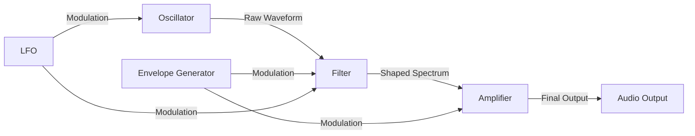

# Lesson 2: Synthesis Architectures, Modulation Systems, Oscillator Design

## 1. First-Principles Intuition & Invariants

Sound synthesis begins with a deceptively simple premise: generate waveforms algorithmically and shape them into musically useful timbres. Yet this act of digital creation confronts us immediately with profound acoustic and mathematical realities that govern every synthesizer architecture, from the humblest analog emulation to the most sophisticated granular engine. Understanding synthesis requires thinking simultaneously in three domains—the physical behavior of vibrating systems, the mathematical representation of periodic signals, and the perceptual psychology of timbre recognition. A synthesizer is not merely a tone generator; it is a computational instrument that bridges abstract signal processing with the embodied experience of musical performance.

The foundational invariant across all synthesis paradigms is that musical timbre emerges from the time-varying spectral distribution of energy across the frequency spectrum. When a violin string vibrates, it produces not a single pure tone but a complex aggregate of harmonics whose amplitudes decay at different rates, creating the characteristic brightness and warmth we recognize as "violin-ness." Digital synthesis reverse-engineers this principle: we construct timbres by either directly specifying harmonic content (additive synthesis), filtering harmonically rich waveforms (subtractive synthesis), or exploiting nonlinear interactions between oscillators (frequency modulation). Each architectural paradigm represents a different computational strategy for sculpting the frequency domain, and each imposes distinct creative affordances and technical constraints.

The second invariant concerns the discrete-time nature of digital audio. Unlike analog voltages that vary continuously, digital synthesis operates on samples captured at a fixed rate—typically 44.1 kHz or 48 kHz in professional contexts. This sampling imposes the Nyquist limit: we can only faithfully represent frequencies below half the sample rate. Attempting to generate higher frequencies produces aliasing, where out-of-band energy folds back into the audible spectrum as harsh, inharmonic distortion. Naive oscillator implementations that use direct table lookup or simple polynomial generators will invariably produce aliasing artifacts when generating harmonically rich waveforms, particularly at higher pitches where the fundamental frequency and its overtones approach the Nyquist boundary. Bandlimited oscillator design—employing techniques like BLEP (bandlimited step), PolyBLEP (polynomial bandlimited step), or wavetable interpolation with appropriate reconstruction filters—becomes a non-negotiable requirement for professional synthesis, trading computational cost for spectral purity.

The third invariant addresses modulation as the lifeblood of expressive synthesis. Static waveforms sound sterile and lifeless; acoustic instruments derive their vitality from continuous micro-variations in pitch, amplitude, and spectral content. Modulation systems provide the temporal evolution that transforms static tones into living, breathing sounds. An envelope defines how a parameter changes over the duration of a note—rising during attack, sustaining at a plateau level, then falling during release. A low-frequency oscillator (LFO) generates periodic variations slower than audible rates, creating vibrato, tremolo, or cyclical filter sweeps. A modulation matrix routes these control signals to synthesis parameters, enabling complex interactions: an envelope might control filter cutoff while an LFO modulates oscillator pitch, and velocity might scale the depth of both modulations. Understanding modulation architectures means thinking in control-rate signal flow graphs, where every synthesis parameter becomes a potential modulation destination and every modulation source can influence multiple targets with scaled intensity.

The historical evolution of synthesis architectures reveals a progression driven by both technological constraints and creative discovery. Subtractive synthesis emerged first because it mirrored analog circuitry: voltage-controlled oscillators generated harmonically rich waveforms, voltage-controlled filters carved away frequencies, and voltage-controlled amplifiers shaped dynamics. This signal flow—source, modifier, amplifier—became the conceptual template that persists across digital implementations. Additive synthesis, theoretically simpler (summing sine waves according to Fourier principles), proved computationally expensive in early digital systems but enabled precise spectral control impossible with filters alone. FM synthesis, discovered by John Chowning at Stanford in 1967, exploited nonlinear oscillator interactions to generate complex spectra with minimal computational overhead, revolutionizing digital synthesis in the Yamaha DX7 era. Wavetable synthesis emerged as a hybrid approach: store single-cycle waveforms in memory and sweep through them dynamically, combining the efficiency of table lookup with the spectral diversity of additive techniques. Granular synthesis, developed in the late 20th century, abandons periodic waveforms entirely, assembling sound from microscopic grains scattered across time and frequency, enabling textures impossible through harmonic methods.

Each architecture implies a distinct mental model for sound creation. Subtractive synthesis encourages a sculptor's mindset: start with a harmonically dense source and carve away frequencies until the desired timbre emerges. Additive synthesis demands an architect's precision: specify each harmonic explicitly and balance their amplitudes and phases. FM synthesis requires a physicist's intuition: understand how carrier and modulator frequency ratios generate sidebands and how modulation index controls spectral spread. Wavetable synthesis blends composition and navigation: design or select wavetables as raw materials, then explore the morphing continuum between them. Granular synthesis embraces stochastic assembly: define grain parameters statistically and let emergent textures arise from their collective behavior. Mastering synthesis means internalizing these mental models and knowing when each approach best serves the creative goal.

The performance context further constrains synthesis design. Real-time synthesis—generating audio in response to MIDI input with sub-10ms latency—demands CPU-efficient algorithms that can run dozens or hundreds of voices simultaneously. Offline synthesis for studio production permits more computationally expensive techniques like high-order convolution reverbs or brute-force additive resynthesis. Hardware synthesizers must implement synthesis entirely in dedicated DSP chips or FPGAs, favoring architectures with minimal memory bandwidth and predictable instruction counts. Software synthesizers can leverage modern CPUs' SIMD instructions (SSE, AVX, NEON) to process multiple samples in parallel, but must carefully manage cache locality and avoid pipeline stalls from unpredictable branches.

## 2. Subtractive Synthesis Architecture

Subtractive synthesis remains the most widely implemented and intuitively understood synthesis method, forming the foundation of countless analog and digital instruments. The architecture flows from a simple principle: begin with a harmonically rich waveform and use filters to remove unwanted frequencies, shaping the remaining spectrum into the desired timbre. This signal flow—oscillator, filter, amplifier—mirrors the voltage-controlled analog circuits that defined early electronic instruments like the Minimoog and ARP 2600, but translates cleanly into digital implementations with additional flexibility and precision.

### Oscillator Section

The oscillator generates the raw waveform that serves as the tonal foundation. Classic waveforms each possess characteristic harmonic structures that determine their sonic character. A sawtooth wave contains all integer harmonics with amplitudes proportional to $1/n$, where $n$ is the harmonic number. This gives the sawtooth its bright, buzzing quality—harmonically dense with energy distributed across the entire spectrum. A square wave contains only odd harmonics with amplitudes of $1/n$, producing a hollow, woodwind-like timbre. A triangle wave also contains odd harmonics, but with amplitudes falling off as $1/n^2$, resulting in a softer, flute-like tone. A pulse wave generalizes the square wave by varying the duty cycle (the ratio of high to low portions within each cycle), which shifts the relative amplitudes of harmonics and creates timbres ranging from thin and nasal (narrow pulse) to full and square (50% duty cycle).

The naive approach to digital oscillator implementation—incrementing a phase accumulator and reading directly from a wavetable—produces severe aliasing. Consider a sawtooth wave at 1000 Hz sampled at 44.1 kHz. The fundamental and first 21 harmonics lie below the Nyquist frequency (22.05 kHz), but harmonics 22 and above alias back into the audible range. At higher pitches, the problem worsens: a 5000 Hz sawtooth has only 4 harmonics below Nyquist, yet the mathematical sawtooth formula specifies infinite harmonics. The aliased energy manifests as harsh, inharmonic buzzing that moves with pitch changes, immediately identifying amateur synthesis implementations.

Bandlimited oscillators solve this problem by ensuring generated waveforms contain no energy above the Nyquist frequency. The PolyBLEP technique offers an excellent balance of quality and computational efficiency. PolyBLEP corrects the discontinuities in naive waveform generation by replacing sharp transitions with polynomial-smoothed ramps that suppress high-frequency content. For a sawtooth, the vertical jump from +1 to -1 at the phase wraparound point becomes a smoothed transition computed from a polynomial kernel. The kernel width adapts to the oscillator frequency, ensuring appropriate high-frequency rolloff at all pitches. A typical PolyBLEP implementation adds only a handful of multiplications and comparisons per sample compared to naive generation, making it practical for dozens of simultaneous voices.

Alternative approaches include BLEP (bandlimited step) synthesis, which precomputes the residual signal needed to correct discontinuities and adds it at appropriate phase points, and wavetable synthesis with oversampling, which generates waveforms at a higher sample rate, applies a low-pass filter, then decimates back to the target rate. High-end synthesizers may employ additive synthesis to generate static waveforms, computing only the harmonics that fall below Nyquist for the current pitch, though this approach requires more CPU cycles and is typically reserved for specialized applications.

### Filter Section

Filters sculpt the harmonic spectrum by attenuating frequencies according to a transfer function. The low-pass filter, most common in subtractive synthesis, attenuates frequencies above a cutoff point while passing lower frequencies. A high-pass filter does the inverse, removing low frequencies and retaining highs. A band-pass filter retains only a range of frequencies around a center point, while a notch (or band-reject) filter removes a narrow band. Each filter type serves distinct sonic purposes: low-pass for warmth and darkness, high-pass for brightness and air, band-pass for vocal-like formants, notch for phaser-like sweeping effects.

Filter slope, measured in decibels per octave (dB/oct), determines how aggressively frequencies beyond the cutoff are attenuated. A 12 dB/oct filter (two-pole) provides gentle rolloff, while a 24 dB/oct filter (four-pole) produces steeper attenuation with a more dramatic effect. The classic Moog ladder filter uses a four-pole topology, creating its signature warm, fat character. State-variable filters provide simultaneous low-pass, high-pass, and band-pass outputs from a single structure, enabling flexible routing and efficient multi-mode operation.

Resonance, also called Q (quality factor) or emphasis, amplifies frequencies near the cutoff point by feeding output back into the input with positive gain. Moderate resonance adds presence and character, emphasizing the cutoff frequency and making filter sweeps more pronounced. High resonance produces a sharp peak that can self-oscillate, generating a pure sine wave at the cutoff frequency—a technique used for creating whistle effects and synthetic percussion. The relationship between resonance and stability requires careful attention in digital implementations: excessive feedback can cause the filter to become unstable and produce clipping or DC offsets.

Digital filter implementation typically uses one of two approaches: infinite impulse response (IIR) or finite impulse response (FIR). IIR filters, implemented as recursive difference equations, offer CPU efficiency and closely model analog filter behavior. The classic biquad filter structure provides a two-pole filter (12 dB/oct) with arbitrary cutoff and resonance, requiring only five multiplications and four additions per sample. Cascading two biquads yields a four-pole filter (24 dB/oct) matching the Moog ladder characteristic. The drawback of IIR filters is potential instability: at high resonance or rapidly changing cutoff frequencies, coefficient values may push poles outside the unit circle, causing oscillation or divergence.

FIR filters avoid instability by using only feedforward paths (no recursion), but require many more taps (coefficients) to achieve equivalent rolloff slopes. A 100-tap FIR filter might be needed to match the response of a four-pole IIR filter, making FIR impractical for real-time subtractive synthesis. However, FIR filters exhibit linear phase response—all frequencies pass through with constant group delay—making them valuable in applications where phase distortion matters, such as mastering or scientific analysis.

Filter coefficient calculation from cutoff and resonance parameters involves bilinear transform or matched z-transform methods to convert continuous-time (Laplace domain) filter specifications to discrete-time (z-domain) implementations. The bilinear transform maps the entire s-plane to the unit circle in the z-plane through the substitution $s = \frac{2}{T} \frac{1 - z^{-1}}{1 + z^{-1}}$, where $T$ is the sample period. This transform preserves stability but introduces frequency warping: the analog and digital cutoff frequencies differ slightly, particularly at high frequencies approaching Nyquist. Prewarping corrects this by adjusting the analog cutoff frequency before transformation.

### Amplifier and Envelope Section

The amplifier scales the filtered signal according to a time-varying envelope, shaping the note's dynamic contour. The ADSR envelope—attack, decay, sustain, release—became the standard model in analog synthesis and persists in digital implementations. Attack specifies the time to rise from silence to peak amplitude when a note triggers. Decay defines the fall time from peak to the sustain level. Sustain represents the steady-state level held while the note remains active (unlike the other stages, sustain is a level, not a time). Release controls the fall time back to silence after note-off.

ADSR envelopes provide intuitive control over amplitude shaping, but more sophisticated envelopes enable finer articulation. Multi-stage envelopes with arbitrary breakpoints allow precise modeling of complex amplitude contours found in acoustic instruments. A plucked string might use a near-instantaneous attack, rapid initial decay, slow secondary decay, and minimal sustain, while a bowed string requires slow attack, no decay, full sustain, and moderate release. The envelope can also feature curve types (linear, exponential, logarithmic) for each segment, matching the perceptual characteristics of amplitude change—exponential decay sounds more natural than linear for most percussive sounds because human loudness perception is logarithmic.

Beyond amplitude, envelopes modulate any synthesis parameter: filter cutoff (creating the characteristic "wah" of a filter opening during attack), oscillator pitch (producing the pitch drop heard in analog synth bass), pulse width (adding dynamic timbral evolution), or even other envelope parameters (creating time-variant envelope shapes). This principle of envelopes as general-purpose control-rate signals extends subtractive synthesis far beyond simple amplitude shaping, enabling rich, evolving timbres that respond to performance gestures.

Digital envelope implementation requires careful attention to coefficient calculation and smoothing. A naive linear interpolation between envelope stages produces adequate results for slow envelopes, but fast envelopes or rapid parameter changes can introduce audible stepping or zipper noise. Exponential interpolation, computed as $y[n] = y[n-1] \cdot k + target \cdot (1 - k)$ where $k = e^{-1/(f_s \cdot \tau)}$ and $\tau$ is the time constant, provides smooth curves without per-sample transcendental function calls—the exponential coefficient $k$ is calculated once per envelope stage. For even higher quality, polynomial interpolation or oversampled envelope generation eliminates artifacts entirely.

### Modulation Sources

Low-frequency oscillators generate periodic control signals below the audible range (typically 0.1 Hz to 20 Hz), adding rhythmic or gradual timbral variation. An LFO modulating oscillator pitch creates vibrato, a subtle pitch wobble heard in vocal and string performances. An LFO modulating amplitude produces tremolo, a volume pulsation. LFO modulation of filter cutoff creates cyclical brightness changes, useful for pad sounds and rhythmic effects. LFO waveforms include sine (smooth, natural), triangle (linear rise and fall), sawtooth (ramping sweeps), square (abrupt switching), and sample-and-hold (random stepped values, creating unpredictable variation).

The modulation depth parameter scales the LFO's influence, allowing subtle humanization (shallow vibrato) or extreme effects (wild pitch swoops). Modulation rate controls the LFO frequency, while phase offset enables polyrhythmic modulations when multiple LFOs modulate different parameters. Syncing the LFO to MIDI clock creates tempo-locked modulation, ensuring rhythmic effects align with the musical tempo—a quarter-note rate LFO can produce pulsing filter sweeps that reinforce the groove.

Velocity, aftertouch, and mod wheel provide real-time performance control. Velocity (the speed at which a key is struck) typically modulates amplitude and filter cutoff, with harder strikes producing louder, brighter tones. Aftertouch (pressure applied after the initial strike) can add vibrato, increase filter resonance, or introduce additional oscillator layers, rewarding expressive playing. The mod wheel, a continuous controller, often routes to vibrato depth, enabling players to add pitch wobble by hand motion while sustaining a note. These performance parameters connect the physical gesture to sonic output, bridging the gap between instrument and musician.

A modulation matrix centralizes routing, allowing any modulation source to control any destination with user-defined scaling and polarity. Modern digital synthesizers implement modulation matrices with dozens of simultaneous routings, each represented as a triple: (source, destination, amount). The synthesis engine processes modulation at control rate (often 1/64th or 1/128th of the audio sample rate), calculating new parameter values by summing all active modulations targeting each parameter. This architecture decouples modulation logic from synthesis algorithms, enabling a single oscillator or filter implementation to respond to arbitrary modulation configurations without internal modification.

## 3. Additive Synthesis Architecture

Additive synthesis constructs timbres by summing individual sine wave components, each representing a single harmonic or partial. This approach directly implements the Fourier theorem: any periodic waveform can be expressed as a sum of sinusoids with specific frequencies, amplitudes, and phases. While conceptually straightforward, additive synthesis in practice involves managing hundreds or thousands of oscillators, each requiring precise frequency and amplitude control. The payoff is unparalleled spectral precision—every nuance of the frequency spectrum can be sculpted explicitly, enabling both meticulous recreation of acoustic timbres and entirely synthetic textures impossible through other methods.

### Harmonic Additive Synthesis

Harmonic additive synthesis restricts partials to integer multiples of a fundamental frequency. This constraint matches the harmonic series found in most musical instruments—strings, brass, woodwinds—where vibrating systems naturally produce overtones at whole-number ratios. A typical harmonic additive patch might sum 64 or 128 harmonics, each with an independent amplitude envelope. The first harmonic (fundamental) determines the pitch, while the relative amplitudes of upper harmonics define the timbre.

Recreating a clarinet tone, for example, requires emphasizing odd harmonics (1st, 3rd, 5th, 7th, etc.) while suppressing even harmonics, mirroring the physics of a cylindrical bore closed at one end. The amplitude envelope for each harmonic must also match the clarinet's behavior: lower harmonics decay slowly, while higher harmonics fade more quickly, producing the characteristic mellowing of the sound over time. This per-harmonic envelope control distinguishes additive synthesis from subtractive techniques, where a single filter shapes the entire spectrum simultaneously.

The computational cost of harmonic additive synthesis scales linearly with the number of partials. Each sine oscillator requires a phase accumulator, sine function evaluation, and amplitude multiplication. At 48 kHz sample rate with 128 harmonics, this amounts to over 6 million sine evaluations per second for a single voice. Early digital synthesizers lacked the CPU power for extensive additive synthesis, but modern processors handle 64-harmonic voices comfortably, particularly with SIMD optimizations that compute four or eight sine waves in parallel.

Phase alignment between partials affects the waveform shape but has minimal perceptual impact for harmonic tones, a consequence of the ear's insensitivity to phase relationships in complex tones. This allows implementations to reset all oscillator phases to zero at note onset, simplifying initialization. For inharmonic tones (partials not related by integer ratios), phase relationships become more audible, requiring careful management to avoid unwanted beating or roughness.

### Inharmonic Additive Synthesis

Inharmonic additive synthesis relaxes the integer frequency constraint, allowing partials at arbitrary frequencies. This unlocks sounds impossible through harmonic methods: bell-like timbres with stretched or compressed overtones, metallic clangs, and abstract digital textures. The challenge lies in control—specifying hundreds of independent frequencies and amplitudes manually proves unwieldy. Successful inharmonic synthesis relies on higher-level control paradigms: spectral envelopes that scale partial amplitudes by frequency region, frequency stretching parameters that compress or expand harmonic spacing, and randomization that introduces controlled detuning.

A classic application of inharmonic synthesis is bell modeling. Physical bells produce partials that deviate from the harmonic series due to the two-dimensional vibration modes of curved metal. The strongest partials typically occur near frequency ratios of 1:2:2.4:3:4, far from the 1:2:3:4 series of harmonic instruments. By explicitly programming these ratios and applying exponential decay envelopes with longer decay for lower partials, additive synthesis produces convincing bell tones. Adding slight randomization to partial frequencies on each note onset simulates the minute variations in real bells, preventing the overly static quality of perfectly tuned partials.

Resynthesis extends inharmonic additive synthesis into the domain of spectral transformation. Tools like the Fourier transform decompose recorded audio into its frequency components, yielding a time-varying amplitude and frequency for each partial. This spectral representation can be modified—stretching time without changing pitch, shifting pitch without altering duration, cross-fading between the spectra of two sounds—then resynthesized through additive oscillators. This technique underlies much contemporary electronic music, enabling morphing textures, extreme time-stretching, and hybridization of acoustic and synthetic sources.

### Phase Vocoder and Spectral Processing

The phase vocoder implements spectral analysis and resynthesis, bridging the gap between recorded audio and additive synthesis. The forward path applies a short-time Fourier transform (STFT) to overlapping windows of the input signal, producing a time-frequency representation: a sequence of spectra showing amplitude and phase for each frequency bin at successive time points. Modifying this representation—scaling amplitudes, shifting frequencies, interpolating between frames—yields new spectral data, which the inverse STFT converts back to audio.

Time-stretching without pitch shift exploits the phase vocoder's separation of temporal and spectral information. By reading spectral frames more slowly or quickly than they were analyzed, the playback duration changes while frequencies remain constant. The challenge lies in phase coherence: naively resampling frames produces phase discontinuities that cause phasiness and artifacts. Phase vocoder algorithms propagate phase values across frames, ensuring smooth evolution and preserving transient clarity. High-quality time-stretching requires careful window function selection (Hann or Blackman-Harris), sufficient overlap (75% or greater), and adaptive transient detection to avoid smearing attacks.

Pitch-shifting reverses the process: read frames at the original rate but shift all frequencies by a constant ratio. Doubling all frequencies raises the pitch by an octave while maintaining the original duration. The spectral envelope (the overall shape of the frequency distribution) must be preserved to retain timbral identity—pitch-shifting a male voice upward should yield a higher-pitched male voice, not a female voice. This requires separating the spectral envelope from the fine harmonic structure, scaling the harmonics, and reapplying the original envelope, a process called cepstral analysis or envelope-preserving pitch-shifting.

Cross-synthesis blends the spectral characteristics of two sounds. Vocoding, historically implemented with analog filter banks, uses the spectral envelope of one sound (the modulator) to shape the spectrum of another (the carrier). A classic example is robot voice effects: speech modulates a sawtooth oscillator, imposing vocal formants onto the buzzy carrier. Modern spectral cross-synthesis generalizes this concept, allowing arbitrary combinations of amplitude and frequency characteristics from different sources, opening vast creative possibilities for hybrid timbres.

## 4. Frequency Modulation Synthesis

Frequency modulation synthesis generates complex spectra through the nonlinear interaction of oscillators. Rather than summing partials additively or filtering them subtractively, FM exploits the mathematical property that modulating one oscillator's frequency with another produces sidebands—new frequency components at predictable positions determined by the carrier and modulator frequencies. This seemingly simple process yields timbres of astonishing complexity and variety with minimal computational cost, a discovery that revolutionized digital synthesis when commercialized in the Yamaha DX7.

### FM Theory and Sideband Generation

The mathematical foundation of FM synthesis begins with a carrier oscillator at frequency $f_c$ whose instantaneous frequency is modulated by a sine wave at frequency $f_m$. The modulation depth, controlled by the modulation index $\beta$, determines how far the carrier frequency deviates. The resulting waveform contains frequency components at $f_c \pm n \cdot f_m$ for all integer values of $n$, where the amplitude of each sideband is given by $J_n(\beta)$, the $n$-th order Bessel function of the first kind evaluated at $\beta$.

When $f_m = f_c$ (a 1:1 carrier-to-modulator ratio), the sidebands fall at integer multiples of $f_c$, producing a harmonic spectrum. A sawtooth-like timbre emerges when $\beta$ is large, generating many sidebands with amplitudes that approximate the $1/n$ falloff of a sawtooth's harmonics. Changing the modulation index dynamically—typically using an envelope to increase $\beta$ during the attack and decrease it during release—creates evolving timbres that grow brighter as the note begins and darken as it fades, a hallmark of FM synthesis.

Other carrier-to-modulator ratios produce inharmonic spectra. A 1:2 ratio places sidebands at $f_c \pm 2f_m, f_c \pm 4f_m$, etc., creating bell-like or metallic timbres. Irrational ratios like 1:1.414 (approximating $\sqrt{2}$) generate dense, unpredictable sideband structures useful for noise-like or atonal textures. The FM algorithm space—defined by carrier frequency, modulator frequency, and modulation index—offers a vast sonic palette, but navigating it requires either mathematical intuition or extensive experimentation.

### FM Algorithms and Operator Topologies

The Yamaha DX7 popularized the concept of FM algorithms: fixed routing topologies connecting multiple operators (oscillators) in series or parallel configurations. Each algorithm represents a different signal flow, with some operators modulating others and some contributing directly to the output. A simple two-operator algorithm has one modulator feeding one carrier: the modulator shapes the carrier's spectrum, and only the carrier's output is heard. A three-operator stack (modulator → modulator → carrier) produces even more complex spectra, as the first modulator creates sidebands in the second, which then creates sidebands in the carrier—a cascading spectral explosion.

Parallel configurations place multiple operators at the output, summing their contributions. A four-operator algorithm might use two modulators feeding two carriers, with both carriers audible. This enables timbres with distinct harmonic and inharmonic regions, or layered sounds where one pair produces the fundamental and harmonics while another adds texture or noise. The DX7 provided 32 algorithms covering the major topologies, giving users a structured exploration of FM's possibilities without requiring manual operator routing.

Feedback extends FM into self-modulation: an operator modulates its own frequency, creating a special case of FM where carrier and modulator are the same. At low feedback amounts, this produces subtle harmonic enrichment similar to waveshaping. At high feedback, the spectrum becomes dense and noise-like, useful for simulating breath noise in wind instruments or creating aggressive, distorted tones. Feedback is mathematically equivalent to iterating a nonlinear function, which can exhibit chaotic behavior at extreme settings, producing unpredictable and dynamically sensitive results.

### Practical FM Programming

Designing FM patches requires balancing multiple parameters: operator frequencies (often specified as ratios of the base pitch), amplitude envelopes for each operator, and modulation indices (controlled by the modulator's output level). A typical approach begins by choosing a carrier-to-modulator ratio appropriate for the desired harmonic structure—1:1 for harmonic timbres, 1:1.4 or 1:3.5 for bells, irrational ratios for abstract textures. The modulation index envelope is then crafted to control brightness over time: a rising attack with high peak creates a punchy, bright onset, while a gradual increase produces a softer entrance.

Layering multiple operator pairs enables richer timbres. A bass sound might combine a 1:1 operator pair for the fundamental and low harmonics with a 1:3 pair adding upper harmonic brightness. Detuning operators slightly (setting one to 1.005 times the base frequency, for example) introduces slow beating and chorusing, thickening the sound. Fixed-frequency operators, whose pitch remains constant regardless of the note played, add drum-like or resonant components useful for percussive elements or formant-like peaks.

FM synthesis is inherently digital—analog implementations are possible but cumbersome, requiring exponential frequency converters and precise oscillator tracking. Digital FM generates alias-free output as long as all operators run bandlimited, typically achieved through wavetable interpolation or direct sine computation. Modern FM synthesizers extend the classic model with additional waveforms (triangle, sawtooth) as operators, filter post-processing, and flexible routing matrices that generalize the fixed DX7 algorithms. These enhancements blur the line between FM and other synthesis methods, creating hybrid architectures that combine FM's spectral efficiency with the sculpting control of subtractive techniques.

## 5. Wavetable Synthesis Architecture

Wavetable synthesis occupies a middle ground between additive and subtractive paradigms, storing pre-computed waveforms in lookup tables and scanning through them dynamically. Unlike traditional oscillators that generate a single static waveform (sawtooth, square), wavetable synthesis enables smooth morphing between timbres by interpolating between multiple stored waveforms arranged in sequence. This technique efficiently produces evolving timbres that would require dozens of additive oscillators or complex modulation routings in subtractive synthesis, making it a staple in modern software synthesizers.

### Wavetable Structure and Interpolation

A wavetable is a collection of single-cycle waveforms, each typically 2048 or 4096 samples long, arranged in a table indexed by position. The oscillator scans through this table at audio rate to produce the base waveform, while a separate wavetable position parameter—often modulated by envelopes or LFOs—determines which waveform in the sequence is active. Interpolating between adjacent waveforms creates smooth timbral transitions: morphing from a sine wave through progressively more complex shapes to a sawtooth, or sweeping through formant-like resonances that suggest vowel sounds.

The scanning process involves two levels of interpolation. Sample-level interpolation reconstructs the waveform at arbitrary phase positions within a single-cycle waveform, necessary because the phase accumulator rarely lands exactly on a stored sample index. Linear interpolation between adjacent samples suffices for most applications, though higher-order methods (cubic, Hermite) reduce interpolation artifacts at the cost of additional computation. Wavetable-level interpolation blends between entire waveforms based on the wavetable position parameter, typically using linear crossfading: the output is a weighted sum of waveforms $N$ and $N+1$, where the weight depends on the fractional part of the position index.

High-quality wavetable synthesis requires that stored waveforms are bandlimited to avoid aliasing during playback. A single wavetable designed for low pitches would contain high-frequency content appropriate for, say, a 100 Hz fundamental. Played at 2000 Hz, many of those harmonics exceed Nyquist and alias back as distortion. The solution is to store multiple versions of each wavetable, each bandlimited for a different pitch range: one for low notes, one for midrange, one for high notes. The oscillator selects the appropriate bandlimited version based on the current pitch, a technique called mipmapping (borrowed from graphics texture filtering). This adds memory overhead—perhaps three or four versions per wavetable—but ensures clean output across the entire keyboard range.

### Wavetable Creation and Sound Design

Wavetables can be drawn manually, computed algorithmically, or extracted from recorded audio through spectral analysis. Drawing tools in software synthesizers provide direct visual manipulation: sketch a waveform shape, and the synthesizer generates a bandlimited version suitable for playback. Algorithmic generation employs mathematical functions to create waveforms with specific spectral properties—Chebyshev polynomials for precise harmonic control, Walsh functions for square-like timbres with controlled harmonic content, or additive summation of sine waves with random phase to create organic, evolving textures.

Audio import converts recorded sounds into wavetables by extracting single cycles. The process involves isolating a stable portion of the sound (avoiding transients or vibrato), detecting the fundamental period, and windowing out exactly one cycle. Applying this to a recording of a bowed violin string yields a wavetable capturing the violin's harmonic structure at that moment. Repeating the process at different points in the note's evolution and arranging the results in sequence creates a wavetable that morphs through the violin's natural timbral evolution. This technique enables realistic emulation of acoustic instruments while retaining the flexibility to modulate playback speed, wavetable position, and pitch independently.

Wavetable sequencing extends the concept by arranging wavetables into longer progressions. A 64-frame wavetable sequence might transition from percussive attack waveforms through sustained harmonic waveforms to noisy decay textures, encapsulating an entire sound evolution in a single morphing oscillator. Modulating the wavetable position with an envelope syncs the timbral evolution to the note's duration, while LFO modulation creates cyclical timbral sweeps. Dual wavetable oscillators with independent position modulation and detuning produce thick, chorused pads with rich internal motion, a signature sound of wavetable synthesis.

### Implementation Considerations

Efficient wavetable playback requires careful memory management and data structure design. Wavetables are typically stored as arrays of floating-point or fixed-point samples, with power-of-two lengths to enable fast index wrapping using bitwise AND operations. The phase accumulator, a 32-bit or 64-bit integer, increments by a phase step value proportional to the desired frequency, and its upper bits select the sample index. Fractional phase information in the lower bits drives sample-level interpolation, ensuring smooth pitch transitions without quantization noise.

Wavetable switching at note boundaries is straightforward—select the appropriate table when a note triggers and maintain it for the note's duration. Modulating wavetable position during a note requires additional care to avoid clicks. Abruptly switching from one waveform to another can introduce discontinuities that manifest as pops or buzzes. Crossfading between waveforms eliminates this issue but requires reading two waveforms simultaneously and computing a weighted sum, doubling the memory bandwidth. Optimized implementations use SIMD instructions to process multiple samples or wavetables in parallel, keeping CPU usage manageable even with dozens of voices.

Resampling quality significantly affects wavetable synthesis fidelity, particularly when large pitch transpositions are needed. Playing a wavetable several octaves above or below its design pitch effectively resamples the stored waveform, which can introduce aliasing (for upward transposition) or loss of high-frequency detail (for downward transposition). Mipmapping addresses upward transposition, but downward transposition benefits from oversampled wavetables that store more high-frequency content than initially audible, preserving detail when the pitch drops. The tradeoff is larger wavetables and increased memory consumption, acceptable in modern software synthesizers but historically limiting in hardware implementations.

## 6. Granular Synthesis Architecture

Granular synthesis abandons the periodic waveform paradigm entirely, constructing sound from short, overlapping fragments called grains. Each grain is a small snippet of audio—typically 10 to 100 milliseconds—windowed with an amplitude envelope to eliminate clicks and scattered across time and frequency according to stochastic or deterministic rules. Hundreds or thousands of grains overlap to form the final output, their collective behavior producing textures ranging from smooth, cloud-like pads to chaotic, glitchy rhythms. Granular synthesis excels at time-stretching, pitch-shifting, and textural transformation, enabling effects impossible through traditional synthesis methods.

### Grain Structure and Windowing

A grain consists of a source waveform segment multiplied by a window function that fades the grain in and out smoothly. Common window functions include Gaussian (bell-shaped, smooth but computationally expensive), Hann (cosine-based, efficient and artifact-free), and Tukey (flat top with tapered edges, balancing transient preservation and smoothness). The window duration determines the grain length: shorter grains produce grainy, granular textures with audible grain boundaries, while longer grains blend more smoothly but reduce temporal resolution.

Each grain possesses several parameters: start position in the source material, duration, pitch transposition, amplitude, and spatial position (pan or 3D location). Grain generation occurs at a specified grain rate, often 20 to 100 grains per second, with each grain's parameters selected from probability distributions or deterministic sequences. Overlapping grains sum together to form the output, with the overlap density (number of simultaneous grains) affecting output amplitude and texture density. Higher overlap densities produce smoother results but require more CPU.

Pitch transposition within individual grains occurs via resampling: reading the source waveform faster produces a higher pitch, slower yields a lower pitch. This couples pitch and duration at the grain level—higher pitches shorten grain duration, lower pitches extend it—but the overall macro-level pitch is controlled independently through the grain generation rate and transposition distribution. This decoupling enables time-stretching without pitch shift: play grains at the original pitch but advance the source read position more slowly than real-time, producing stretched duration with preserved pitch.

### Asynchronous and Synchronous Granular Synthesis

Asynchronous granular synthesis generates grains at irregular, stochastic intervals determined by random processes. Each grain's start time, duration, and pitch are drawn from probability distributions, creating textures with no discernible rhythmic structure. This mode excels at smooth, evolving soundscapes—cloud-like pads, atmospheric textures, and evolving drones. Parameters control the distribution centers and spreads: mean grain rate and its variation, mean pitch transposition and its range, source position and its randomization. Carefully tuned, asynchronous granular synthesis produces organic, non-repetitive textures that breathe and evolve without obvious looping or mechanical artifacts.

Synchronous granular synthesis generates grains at regular intervals, locked to a clock or tempo. This mode preserves or introduces rhythmic structure, useful for time-stretching loops while maintaining their groove or creating rhythmic glitch effects from sustained sounds. The grain rate aligns with musical subdivisions—16th notes, 32nd notes—and the source read position advances in fixed increments, ensuring that the output maintains temporal coherence with the original material's phrasing and articulation. Synchronous granular synthesis can produce extreme time-stretching with minimal artifacts, stretching a 1-second drum loop to 10 seconds while preserving every transient and rhythmic nuance.

Hybrid approaches blend asynchronous and synchronous characteristics: grains generate at a steady rate but with randomized pitch, duration, and source position offsets. This retains rhythmic regularity while avoiding the static quality of perfectly regular grain streams, balancing structure and chaos.

### Granular Parameter Control and Spatialization

Expressive granular synthesis requires real-time control over grain parameters. Mapping performance controllers to grain rate, source position, pitch range, and grain duration enables dynamic sculpting of the texture. A mod wheel might control source position, scanning through a sample in response to hand motion, while aftertouch modulates grain rate, increasing density as pressure increases. Envelope and LFO modulation apply to grain-level parameters, creating evolving textures where grain characteristics shift over the duration of a note.

Spatialization places grains in the stereo or surround field, creating immersive, spatially distributed textures. Each grain receives an independent pan position, randomly distributed across the stereo width or positioned according to spatial trajectories. In multichannel systems, grains scatter throughout the listening space, with some concentrated in the front, others diffused to the rear or sides. Spatial motion—grains moving through the sound field—adds kinetic energy and complexity, particularly effective for abstract or cinematic sound design.

Granular reverb exploits spatial grain scattering to create diffuse reverberation. Rather than using conventional convolution or delay-based reverbs, grains are scattered densely in time and space with randomized delays and positions, their collective behavior producing a reverb-like tail. Adjusting grain density and delay range controls the reverb length and diffusion, while filtering applied to grains shapes the reverb's frequency response. This technique integrates synthesis and spatialization into the reverb itself, enabling effects that morph between dry grain clouds and cavernous reverberant spaces without distinct boundaries.

### Real-Time Granular Synthesis Implementation

Real-time granular synthesis presents computational challenges, particularly at high grain densities. Each active grain requires independent sample generation, windowing, and summation, with dozens or hundreds of grains overlapping simultaneously. Naive implementations that iterate over all active grains per output sample quickly become CPU-bound, limiting the density or polyphony achievable.

Optimization strategies include grain pooling, where a fixed-size buffer of grain state structures is reused, avoiding dynamic memory allocation during audio processing. Active grains are tracked in a linked list or ring buffer, with completed grains returning to the pool for reuse. Vectorized processing computes multiple grains in parallel using SIMD instructions, processing four or eight grains per iteration. Efficient windowing employs precomputed window tables rather than recalculating window coefficients per sample, trading memory for speed.

Source material for granular synthesis is typically stored in RAM as floating-point buffers, enabling fast, low-latency access. Long samples require streaming from disk, with buffering and read-ahead logic ensuring that source data is available before grains reference it. This adds complexity but enables granular processing of arbitrarily long recordings without memory constraints. Some implementations use compressed or mipmapped source representations to reduce memory bandwidth, decompressing or interpolating data on-the-fly as grains are generated.

Granular synthesis's stochastic nature means that output amplitude varies with grain density and overlap—periods of high grain activity produce louder output than sparse regions. Automatic gain compensation, either through dynamic range compression or adaptive amplitude scaling, evens out these fluctuations, ensuring consistent output levels regardless of grain density. Careful attention to grain windowing and overlap also prevents amplitude modulation artifacts: when grains overlap with specific phase relationships, constructive or destructive interference can create unwanted amplitude ripples. Randomizing grain start phases or using longer, smoother windows mitigates this issue.

## 7. Modulation Systems and Control Architecture

Modulation systems breathe life into synthesis, transforming static waveforms into dynamic, evolving sounds that respond to performance and time. While oscillators, filters, and amplifiers provide the raw materials and shaping tools, modulation sources dictate how these elements change moment-to-moment, articulating the envelope of a note, introducing periodic variation, or responding to player input. Modern synthesizers implement modulation as a flexible routing matrix where any modulation source can control any synthesis parameter with scaled intensity, enabling complex interactions that would be impossible with hardwired signal paths.

### Envelope Generators

Envelope generators produce time-varying control signals that shape parameter changes over the duration of a note. The ADSR envelope remains the most common topology, dividing the note's lifetime into four stages. Attack begins at note-on, ramping from zero to the peak level over a specified time. Decay follows immediately, falling from peak to the sustain level. Sustain holds at a constant level while the note is active—unlike the other stages, sustain is a level, not a duration. Release triggers at note-off, fading from the sustain level back to zero. This four-stage model intuitively captures the dynamic contour of many acoustic instruments: the sharp attack of a piano note, the slow swell of a bowed string, the held drone of a wind instrument, the gradual decay of a plucked guitar.

ADSR envelopes applied to filter cutoff create the classic "filter sweep" sound: the filter opens during attack, creating a bright, punchy onset, then settles to a darker sustain timbre. Negative envelope amounts (inverted polarity) reverse the effect, starting dark and brightening over time. Envelope modulation of oscillator pitch produces transient pitch bends heard in synthesized bass and lead timbres: a rapid pitch drop at note onset adds punch and aggression, while a slow upward drift simulates the pitch instability of analog oscillators warming up.

Beyond ADSR, multi-stage envelopes with arbitrary breakpoints enable precise articulation. A five-stage envelope might include an initial attack, a quick dip (mimicking the transient behavior of struck strings), a secondary rise (the resonant bloom of the instrument body), a sustain plateau, and a release. Each stage can feature independent curve shapes—linear, exponential, logarithmic—matching the perceptual characteristics of amplitude, frequency, and filter change. Exponential decays sound natural for amplitude because human loudness perception is logarithmic, while linear ramps work well for pitch modulation where equal frequency increments are perceptually meaningful.

Looping envelopes repeat stages cyclically, creating rhythmic parameter changes synchronized to the note duration. A looping envelope controlling filter cutoff produces rhythmic "wah" effects, while looping pitch envelopes generate trills or arpeggios. Loop points define which stages repeat: a decay-sustain loop creates a bouncing, rhythmic sustain, while a full envelope loop restarts the entire ADSR cycle multiple times within a single note, useful for gated rhythmic effects.

Envelope retrigger behavior affects polyphonic synthesis. Legato mode maintains the envelope state when a new note overlaps an existing note, producing smooth transitions without restarting the attack. This suits expressive playing where phrases connect seamlessly. Retrigger mode resets the envelope to zero at each note-on, ensuring consistent articulation regardless of overlap—appropriate for percussive or rhythmic parts where each note should begin crisply. Note priority (lowest, highest, last-played) determines which note controls the envelope in monophonic modes, affecting how glissando and trills are articulated.

### Low-Frequency Oscillators

Low-frequency oscillators generate periodic control signals below the audible range, typically 0.01 Hz to 20 Hz, introducing rhythmic or gradual variation. An LFO modulating oscillator pitch creates vibrato, the subtle pitch wobble that adds expressiveness to vocal and string performances. Typical vibrato rates lie between 4 Hz and 8 Hz with depths of ±5 to ±20 cents (hundredths of a semitone). Slower rates produce a lazy, wide vibrato; faster rates sound anxious or exaggerated. An LFO modulating amplitude produces tremolo, rhythmic volume pulsations useful for rhythmic guitar effects or pulsing pad textures.

LFO waveforms determine the character of modulation. Sine waves produce smooth, natural variation, appropriate for vibrato and subtle timbral shifts. Triangle waves create linear rise-and-fall patterns, useful for crossfading between oscillator layers or scanning through wavetable positions. Sawtooth and ramp waves produce directional sweeps—filter cutoff rising steadily then jumping back down, creating cyclic brightness builds. Square waves produce abrupt on-off switching, toggling between two states or creating gated rhythmic effects. Sample-and-hold waveforms generate random stepped values, introducing unpredictable variation that simulates the organic imperfections of acoustic instruments or creates glitchy, digital textures.

LFO phase controls the starting point within the waveform cycle when a note triggers. Zero phase begins at the waveform's zero crossing, ensuring consistent modulation on each note. Random phase starts at a random point in the cycle, adding variability and preventing mechanical repetition in polyphonic patches. Phase offset between multiple LFOs creates polyrhythmic modulations: one LFO modulating filter cutoff at 3 Hz while another modulates pitch at 4.5 Hz produces complex, evolving interactions that never repeat exactly.

MIDI clock sync locks LFO rates to the host tempo, enabling tempo-synchronized modulation. A quarter-note rate LFO produces four complete cycles per bar, creating pulsing effects that align with the musical groove. Dotted and triplet subdivisions enable syncopated rhythms, while fractional rates (e.g., one cycle every two bars) produce slow, evolving modulations that unfold over extended phrases. Tempo sync ensures that rhythmic modulations remain locked to the music's tempo regardless of BPM changes, critical for electronic music production where synthesis and rhythm intertwine.

### Modulation Matrix and Routing Architecture

A modulation matrix centralizes routing, allowing any modulation source to control any synthesis parameter with user-defined scaling and polarity. Modern digital synthesizers implement modulation matrices with dozens of simultaneous routings, each represented as a triple: (source, destination, amount). Sources include envelopes, LFOs, velocity, aftertouch, mod wheel, pitch bend, and MIDI continuous controllers. Destinations span all synthesis parameters: oscillator pitch, pulse width, filter cutoff, resonance, amplifier gain, effect parameters, and even other modulation amounts (meta-modulation).

The synthesis engine processes modulation at control rate, typically 1/64th to 1/128th of the audio sample rate (e.g., 750 Hz control rate at 48 kHz sample rate). This reduces CPU load—control signals do not need sample-accurate precision—while remaining fast enough to capture envelope attack transients and avoid audible stepping. Each control cycle, the modulation matrix evaluates all active routings, summing contributions from multiple sources targeting the same destination. A parameter's final value is its base setting plus the sum of all modulation amounts targeting it, clamped to the parameter's valid range.

Modulation amount scaling determines the intensity of modulation. A filter cutoff modulation might have a range of ±100% of the filter's full range, or it might be scaled to ±25% for subtle variation. Bipolar modulation allows both positive and negative offsets: an LFO set to +50% shifts the cutoff up on the positive half-cycle and down on the negative half-cycle, creating symmetrical sweeps. Unipolar modulation (0% to 100%) shifts the parameter in one direction only, useful for velocity sensitivity where harder strikes should only increase (not decrease) brightness or amplitude.

Modulation sources themselves can be modulated, creating meta-modulation or second-order control. An envelope controlling the depth of LFO modulation creates time-varying vibrato: no vibrato at note onset, gradually increasing during the attack phase. A velocity-controlled envelope depth makes modulation intensity respond to playing dynamics: soft notes produce subtle modulation, hard strikes produce exaggerated effects. This layering of modulation sources enables complex, expressive behaviors where synthesis responds organically to performance nuances.

### Performance Controllers and Expression

MIDI velocity captures the speed of key press, typically mapped to amplitude and filter cutoff. Harder strikes produce louder, brighter tones; softer touches yield quieter, darker sounds. Velocity curves adjust the response: linear curves provide direct one-to-one mapping, exponential curves emphasize dynamic range in loud playing, and logarithmic curves make soft playing more expressive. Velocity can also modulate envelope times (faster attacks for hard strikes), oscillator balance (harder strikes bring in additional oscillators), or effect mix (more reverb on soft notes for distant, intimate sounds).

Aftertouch (channel pressure) measures the force applied to a key after the initial strike, enabling dynamic control while sustaining a note. Typical aftertouch routings include vibrato depth (no vibrato initially, increasing with pressure), filter cutoff (pressing harder opens the filter), or volume swell (adding dynamics to sustained chords). Polyphonic aftertouch, where each key reports independent pressure, enables per-note expression in chords—accenting one note while holding others softly—but requires specialized controllers and introduces significant MIDI bandwidth.

Mod wheel, pitch bend, and continuous controllers provide additional real-time control. The mod wheel commonly routes to vibrato depth, allowing performers to add pitch wobble by hand motion. Pitch bend handles expressive pitch slides, with the bend range (typically ±2 semitones, but configurable up to ±24 or more) determining the interval spanned by the wheel's full travel. Continuous controllers (MIDI CC messages) can modulate any parameter: CC1 (mod wheel), CC11 (expression), CC74 (filter cutoff), and assignable CCs for custom mappings. Breath controllers, expression pedals, and ribbon controllers extend expressive possibilities, enabling synthesis that responds to gestural nuance with acoustic-like responsiveness.

MPE (MIDI Polyphonic Expression) extends MIDI to carry per-note multidimensional control, assigning each note its own MIDI channel and allowing independent pitch bend, timbre (CC74), and pressure for every voice. This unlocks expressive playing techniques on grid controllers and touch surfaces, where sliding fingers, varying pressure, and vertical position modulate synthesis parameters independently for each note. MPE-compatible synthesizers treat each voice as a independent expressive entity, enabling playing styles that approach the nuance of acoustic instruments or gestural electronic performance.

---

This chapter establishes the foundational architectures and modulation systems that underpin sound synthesis. Subtractive, additive, FM, wavetable, and granular paradigms each provide distinct creative affordances, and modulation systems enable temporal evolution and expressive response. Understanding these architectures at a conceptual and technical level empowers sound designers to navigate synthesis tools fluently, recognize which paradigm best serves a creative goal, and exploit modulation routing to craft dynamic, living sounds. The next chapter will build on this foundation, exploring filters, effects processing, and spatial techniques that further shape and polish synthesized audio into production-ready timbres.
