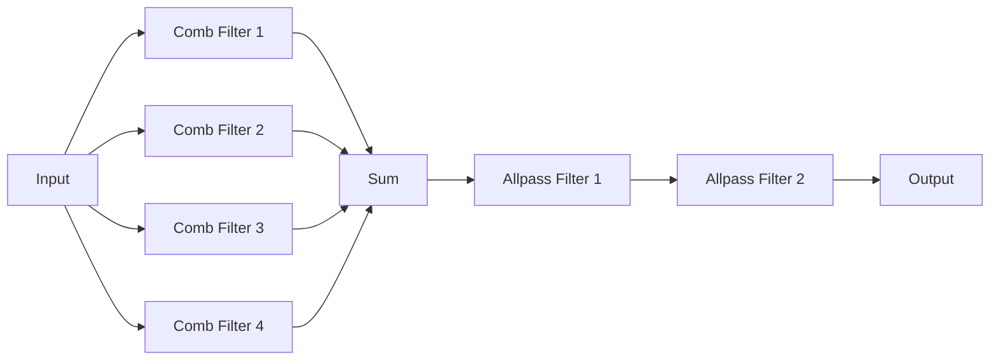

# Lesson 3: Signal Processing Primitives, Filter Theory, Time-Domain Effects

## 1. First-Principles Intuition & Invariants

Sound design begins not with presets or plugin interfaces, but with the fundamental recognition that all audio signals exist simultaneously in two complementary domains: time and frequency. When you observe a waveform scrolling across an oscilloscope or DAW timeline, you witness amplitude evolving through time—a drummer's stick striking a snare head, the instantaneous voltage surge, the exponential decay. Yet this same event, when analyzed through the lens of spectral decomposition, reveals itself as a dense constellation of sinusoidal frequencies, each with distinct amplitude and phase relationships. The Fourier transform, formalized by Jean-Baptiste Joseph Fourier in 1822 while studying heat diffusion, proves that any periodic or finite-duration signal can be expressed as the weighted sum of sine and cosine waves. This duality is not merely mathematical elegance; it is the foundational invariant upon which all signal processing rests.

When you apply an equalizer to boost 3 kHz by 6 dB, you are not "turning up the highs" in some vague colloquial sense. You are selectively amplifying the magnitude of all frequency components near 3000 Hz while leaving adjacent bands relatively untouched. The filter does not discriminate between a vocalist's sibilant consonant at 3 kHz and a hi-hat's transient sharing that same spectral region—it operates blindly on frequency content, which is why surgical EQ decisions demand both technical precision and musical context. The first invariant of digital signal processing is that once a continuous analog waveform passes through an analog-to-digital converter, it becomes a discrete-time sequence of amplitude samples captured at a fixed sampling rate. The Nyquist-Shannon sampling theorem dictates that to faithfully reconstruct a signal, the sampling rate must exceed twice the highest frequency component present in the original waveform. At the industry-standard 48 kHz sampling rate, frequencies up to 24 kHz can theoretically be represented, though practical anti-aliasing filters roll off content above approximately 20 kHz to prevent spectral mirroring artifacts.

The second invariant emerges from the physics of resonance. Every acoustic system—guitar body, concert hall, synthesizer filter circuit—possesses natural resonant frequencies where energy accumulates and sustains. In the context of filters, resonance manifests as a pronounced peak in the frequency response curve at the cutoff frequency, characterized by the quality factor $Q$. A low $Q$ value (0.5 to 1.0) produces a gentle, broad curve suitable for musical tone shaping; a high $Q$ value (10 to 100) creates a narrow, aggressive spike that can drive self-oscillation, transforming the filter into a sine wave generator when pushed to extremes. This behavior, first exploited in analog Moog ladder filters during the 1960s, remains a cornerstone of subtractive synthesis and aggressive sound design. The transistor ladder topology, invented by Bob Moog and refined through collaboration with musicians like Wendy Carlos, achieves its signature warm saturation through controlled transistor nonlinearity—each stage of the four-pole cascade gently compresses signal peaks, introducing harmonic distortion that musicians describe as "musical" or "analog warmth."

The third invariant addresses causality and latency. In the physical world, no effect precedes its cause; a filter cannot respond to a signal that has not yet arrived. This constraint manifests in digital systems as processing latency, measured in samples or milliseconds. A finite impulse response (FIR) filter with 1024 taps operating at 48 kHz introduces 21.3 milliseconds of delay ($1024 \div 48000$ seconds). While transparent for mixing workflows, such latency becomes intolerable during live monitoring or real-time performance, where musicians require acoustic feedback within 10 milliseconds to maintain rhythmic precision. Infinite impulse response (IIR) filters, by contrast, achieve equivalent frequency selectivity with far fewer coefficients by employing feedback loops, reducing latency at the cost of potential instability if coefficients are miscalculated. The biquad filter structure, consisting of two poles and two zeros, represents the minimal viable building block for parametric equalization, offering independently adjustable gain, frequency, and $Q$ with computational efficiency suited to real-time operation on modest CPU architectures.

Phase relationships constitute the fourth critical invariant, often neglected by novice engineers yet brutally audible in professional contexts. When two copies of the same signal are summed with a time offset—even a fraction of a millisecond—frequency-dependent cancellations and reinforcements occur, a phenomenon called comb filtering due to its characteristic spectrum of evenly spaced notches. This effect is immediately recognizable in the hollow, metallic timbre of poorly aligned multi-microphone drum recordings or parallel processing chains where plugin latency compensation has failed. Linear-phase filters, designed through symmetric FIR coefficient structures, eliminate phase distortion at the cost of significant latency and pre-ringing artifacts that can smear transient attacks. Minimum-phase filters, the default topology in most analog-modeled EQs and resonant synthesizer filters, introduce frequency-dependent phase shifts that subtly alter time-domain transient response but preserve causality and operate with minimal latency. The choice between these paradigms is not academic; it determines whether a kick drum retains its percussive snap or loses definition to pre-echo blurring, whether a snare crack remains punchy or softens into mush.

Convolution, the mathematical operation underlying impulse response-based processing, deserves special emphasis as the theoretical bridge between time and frequency domains. When a system is excited by an idealized impulse—a single-sample spike containing all frequencies with equal magnitude—the resulting output captures the complete linear frequency response and decay characteristics of that system in a single recording. This impulse response can then be convolved with any arbitrary input signal to impart the system's acoustic signature, whether that system is a Gothic cathedral's 8-second reverb decay, a vintage spring reverb tank's metallic resonances, or a rare analog compressor's harmonic distortion profile. Convolution reverb plugins such as Altiverb and Logic Pro's Space Designer operate by multiplying the Fourier transforms of the input signal and impulse response in the frequency domain, then inverse-transforming back to time domain—a technique that exploits the computational efficiency of Fast Fourier Transform (FFT) algorithms, reducing convolution complexity from $O(N^2)$ to $O(N \log N)$. This mathematical optimization enables real-time convolution of impulse responses spanning thousands of samples, a feat that would be computationally intractable using naive time-domain multiplication. The FFT-based approach, known as fast convolution or overlap-add convolution, partitions long signals into manageable blocks, processes each block independently in the frequency domain, and recombines them with careful attention to boundary conditions to ensure seamless temporal continuity.

The distinction between linear and nonlinear systems forms the final foundational invariant. Linear systems obey the principles of superposition and homogeneity: if input $x_1(t)$ produces output $y_1(t)$ and input $x_2(t)$ produces output $y_2(t)$, then input $ax_1(t) + bx_2(t)$ produces output $ay_1(t) + by_2(t)$ for any constants $a$ and $b$. Filters, equalizers, and linear reverbs fall into this category, their behavior fully characterized by impulse responses and frequency response curves. Nonlinear systems, by contrast, violate superposition—they generate harmonic and intermodulation distortion, frequency components not present in the input signal. Tape saturation, vacuum tube amplifiers, transistor clipping, and digital waveshaping all exploit nonlinearity to create new spectral content, thickening thin sources or adding aggression to sterile digital recordings. The transfer function of a nonlinear system cannot be fully captured by a single impulse response; it varies with input amplitude, requiring tools like harmonic distortion analysis, total harmonic distortion (THD) measurements, and intermodulation distortion (IMD) testing to characterize behavior across the dynamic range. Understanding this dichotomy prevents common mistakes: applying linear equalization to fix problems created by nonlinear distortion, or expecting analog warmth from purely linear digital algorithms that meticulously avoid the very nonlinearities responsible for vintage character.

## 2. Core Primitives: Filters in Theory and Practice

Filters are the fundamental building blocks of subtractive synthesis, tone shaping, and spectral manipulation. At the most abstract level, a filter is a frequency-selective system that attenuates or amplifies specific regions of the spectrum while leaving others unchanged. The ideal filter exhibits a perfectly flat passband (frequencies that pass unaffected), infinite attenuation in the stopband (frequencies to be removed), and an infinitely steep transition between the two. Real-world filters, constrained by causality and finite component values, approach this ideal asymptotically through increased filter order—the number of reactive elements (capacitors, inductors) in analog circuits or the number of delay elements in digital implementations.

The four canonical filter types—lowpass, highpass, bandpass, and bandstop—define the contours of modern sound design. A lowpass filter permits frequencies below a cutoff frequency $f_c$ to pass while attenuating higher frequencies, sculpting the timbral brightness of a sound. Synthesizer lowpass filters with resonance peaked near self-oscillation produce the liquid, vocal-like sweeps characteristic of acid basslines and evolving pad textures. A highpass filter performs the inverse operation, removing low-frequency content while preserving high-frequency detail; this proves essential for clearing muddy low-end buildup in dense mixes or removing rumble and handling noise from vocal recordings. A bandpass filter combines lowpass and highpass characteristics, isolating a narrow band of frequencies while rejecting content above and below; telephone voice codecs and wah-wah guitar effects exploit bandpass filtering to create their distinctive timbres. A bandstop (notch) filter performs the inverse, attenuating a narrow frequency band while passing all others; these filters excel at surgical removal of 60 Hz electrical hum, feedback-prone resonances in live sound reinforcement, or tonal masking issues in complex arrangements.

The slope or rolloff rate of a filter, measured in decibels per octave (dB/oct), quantifies how aggressively the filter attenuates frequencies beyond the cutoff. A first-order filter exhibits a 6 dB/oct slope, reducing amplitude by half (–6 dB) for every doubling of frequency beyond cutoff. Second-order filters achieve 12 dB/oct, third-order 18 dB/oct, and fourth-order 24 dB/oct. The Moog transistor ladder filter, a fourth-order lowpass design, became legendary precisely because its 24 dB/oct slope allowed extreme resonance without aliasing artifacts overwhelming the musical content. Butterworth filters, designed for maximally flat passband response with no ripples, trade steepness for phase linearity. Chebyshev filters accept passband ripple to achieve steeper rolloff. Elliptic (Cauer) filters tolerate ripple in both passband and stopband to reach the steepest possible transition for a given filter order, though at the cost of complex phase response unsuitable for musical applications where transient preservation matters.

The quality factor $Q$ and bandwidth $BW$ provide alternative parameterizations of filter selectivity. For a bandpass filter centered at frequency $f_0$, the relationship $Q = f_0 / BW$ defines $Q$ as the ratio of center frequency to the –3 dB bandwidth. A bandpass filter at 1 kHz with $Q = 10$ exhibits a bandwidth of 100 Hz, passing frequencies from 950 Hz to 1050 Hz while sharply attenuating content outside this range. In parametric equalizers, $Q$ controls the sharpness of boost or cut curves, with typical musical values ranging from 0.7 (broad, gentle) to 4.0 (narrow, surgical). Graphic equalizers, by contrast, employ fixed-frequency bandpass or bell filters with predetermined $Q$ values, sacrificing flexibility for visual immediacy—each slider directly corresponds to a frequency band, allowing intuitive real-time adjustment during live performance.

State-variable filters, a topology popularized in modular synthesizers, derive lowpass, highpass, and bandpass outputs simultaneously from a single input signal by cascading integrator stages. This architecture, implemented with operational amplifiers in analog form or difference equations in digital variants, permits voltage control of cutoff frequency and resonance through simple coefficient modulation, enabling the expressive filter sweeps that define electronic music performance. The mathematical description of a digital state-variable filter operating at sample index $n$ takes the form:

$$
\begin{align}
\text{highpass}(n) &= \text{input}(n) - \text{lowpass}(n) - Q \cdot \text{bandpass}(n) \\
\text{bandpass}(n+1) &= F \cdot \text{highpass}(n) + \text{bandpass}(n) \\
\text{lowpass}(n+1) &= F \cdot \text{bandpass}(n+1) + \text{lowpass}(n)
\end{align}
$$

where $F = 2 \sin(\pi f_c / f_s)$ represents the normalized cutoff frequency coefficient derived from the sampling rate $f_s$ and desired cutoff $f_c$. This recurrence relation computes each output sample from the current input and previous internal states, embodying the feedback structure that gives IIR filters their name. The coefficient $Q$ directly controls resonance magnitude, with values approaching infinity driving the filter into sustained self-oscillation at the cutoff frequency.

Digital filter design proceeds through several well-established methods, each with distinct tradeoffs. The bilinear transform maps continuous-time analog filter prototypes (Butterworth, Chebyshev, elliptic) into discrete-time equivalents by applying the substitution $s \rightarrow \frac{2}{T} \frac{1 - z^{-1}}{1 + z^{-1}}$, where $T$ represents the sampling period and $z^{-1}$ denotes a unit delay. This transformation preserves the magnitude response of the analog prototype but introduces frequency warping, compressing the infinite analog frequency axis onto the finite Nyquist range. Engineers compensate through pre-warping: adjusting the analog prototype's cutoff frequency so that after transformation, the digital filter exhibits the desired cutoff. The impulse invariance method, an alternative approach, samples the impulse response of the analog prototype directly, guaranteeing perfect time-domain matching at the sampling instants. However, this method suffers from aliasing unless the analog prototype is strictly band-limited, restricting its use to lowpass and bandpass filters.

Window-based FIR design offers a more intuitive approach: specify the ideal frequency response, compute its inverse Fourier transform to obtain the ideal impulse response (often infinite in duration), then truncate and window this response to a finite number of taps. The rectangular window, equivalent to abrupt truncation, produces severe ripples (Gibbs phenomenon) in the frequency response. Hann, Hamming, Blackman, and Kaiser windows taper the edges of the impulse response more gracefully, trading transition bandwidth for reduced passband and stopband ripple. Kaiser windows, parameterized by a shape factor $\beta$, allow precise control over this tradeoff, making them the preferred choice for professional filter design where specifications must be met with minimal computational overhead.

The Parks-McClellan algorithm, also known as the Remez exchange algorithm, takes FIR design to its theoretical optimum, computing the filter coefficients that achieve the smallest possible maximum error (minimax criterion) across passband and stopband simultaneously. This iterative method, based on Chebyshev approximation theory, produces equiripple filters where the magnitude response oscillates with constant amplitude around the desired response in both passband and stopband. For a given number of taps, Parks-McClellan filters achieve the steepest transition bandwidth and tightest tolerance specifications physically possible, making them the gold standard for anti-aliasing filters in high-end converters and decimation filters in sample rate conversion.

## 3. Time-Domain Effects: Delay, Echo, Chorus, Flanger, Phaser

Time-domain effects manipulate the temporal structure of audio signals through delay lines—memory buffers that store samples and retrieve them after a specified duration. The conceptual simplicity of delay belies its versatility; by varying delay time, feedback, and modulation, engineers construct an entire family of spatial and spectral effects that have defined popular music production for seven decades.

The simplest delay effect, a single discrete echo, copies the input signal into a delay buffer and mixes the delayed copy with the original after a fixed time $\tau$. The wet/dry mix parameter controls the balance between direct (dry) and delayed (wet) signals, while the feedback parameter routes a fraction of the delayed output back into the input, creating multiple decaying repetitions. The difference equation governing this process is:

$$
y(n) = x(n) + g \cdot x(n - D) + f \cdot y(n - D)
$$

where $x(n)$ represents the input sample at time index $n$, $y(n)$ the output, $D$ the delay in samples, $g$ the feedforward gain, and $f$ the feedback gain. Setting $f = 0$ produces a single echo; values $0 < f < 1$ generate exponentially decaying repetitions; $f \geq 1$ causes runaway feedback unless carefully controlled. Delay times below approximately 30 milliseconds do not register as discrete echoes but instead create comb filtering effects as the delayed signal interferes constructively and destructively with the original across the frequency spectrum.

Tape delay units, introduced in the 1950s and exemplified by the Watkins Copicat and Roland Space Echo, exploited this principle using magnetic tape loops. An incoming signal was recorded onto tape via a record head, then played back milliseconds later by one or more playback heads positioned along the tape path. The distance between record and playback heads, combined with tape speed, determined delay time. Adjusting tape speed shifted delay time continuously, producing the characteristic pitch-shifting swoops heard on countless dub reggae and psychedelic rock recordings. Tape saturation, wow and flutter, and frequency response limitations introduced by the tape medium and amplifier circuits imparted warmth and lo-fi character that digital delay plugins now painstakingly emulate through nonlinear modeling and noise injection.

Chorus effects emerged when engineers discovered that short delays (10–30 ms) with gentle time modulation mimicked the subtle pitch and timing variations of multiple performers playing in unison. A low-frequency oscillator (LFO) modulates the delay time sinusoidally at rates between 0.2 and 5 Hz, creating smooth pitch undulations that thicken monophonic sources into shimmering, multi-voiced textures. The chorus effect became synonymous with 1980s production, ubiquitous on electric guitars, synthesizer pads, and vocals. The Eventide Instant Flanger, introduced in 1975, and Roland Dimension D studio chorus rack unit (1979) set benchmarks for analog modulation quality that digital emulations still reference. A simplified chorus algorithm routes the input through two parallel delay lines with opposing modulation phases:

$$
y(n) = x(n) + 0.5 \cdot x(n - D_1(n)) + 0.5 \cdot x(n - D_2(n))
$$

where $D_1(n) = D_0 + A \sin(2\pi f_{\text{LFO}} n / f_s)$ and $D_2(n) = D_0 - A \sin(2\pi f_{\text{LFO}} n / f_s)$ represent time-varying delays with a base delay $D_0$, modulation depth $A$, and LFO frequency $f_{\text{LFO}}$. The opposing modulation phases prevent complete phase cancellation while maximizing the stereo width and spectral richness of the output.

Flanging, a more extreme variant, employs shorter base delays (1–10 ms) with deeper modulation and often includes feedback to emphasize comb-filter resonances. The term originated from the manual tape-flanging technique: engineers would simultaneously play two identical tape machines, then periodically press a finger on the flange (rim) of one machine's reel to slow it down, creating a sweeping phase cancellation as the two copies drifted in and out of sync. The characteristic "jet plane" swoosh of flanging, heard on iconic tracks like The Beatles' "Lucy in the Sky with Diamonds" and Led Zeppelin's "Kashmir," arises from the movement of comb-filter notches through the spectrum. A feedback path intensifies the effect:

$$
y(n) = x(n) + g \cdot y(n - D(n))
$$

where $D(n) = D_0 + A \sin(2\pi f_{\text{LFO}} n / f_s)$ and feedback gain $g$ typically ranges from 0.5 to 0.9. Higher feedback values produce more pronounced resonant peaks but risk instability if modulation depth pushes delay times toward zero samples.

Phasers achieve similar sweeping timbral effects through an entirely different mechanism: cascaded allpass filters whose phase response varies with frequency. Unlike delay-based comb filtering, phaser notches occur at non-harmonic intervals determined by the allpass filter pole frequencies. The MXR Phase 90, an iconic four-stage phaser pedal introduced in 1974, routes the guitar signal through four first-order allpass sections whose corner frequencies are modulated by an LFO-controlled resistor-capacitor network. Each allpass stage contributes 90 degrees of phase shift at its corner frequency, and when the phase-shifted signal is mixed with the dry input, constructive and destructive interference creates the phaser's signature notched spectrum. Six-stage and eight-stage phasers deepen the effect with additional notches spaced more closely across the spectrum. Digital phaser implementations replace analog allpass filters with biquad filter structures whose coefficients are modulated in real time:

$$
H(z) = \frac{a_0 + a_1 z^{-1} + a_2 z^{-2}}{1 + b_1 z^{-1} + b_2 z^{-2}}
$$

For a first-order allpass, this simplifies to $H(z) = \frac{a + z^{-1}}{1 + a z^{-1}}$, where the coefficient $a = \frac{1 - \tan(\pi f_c / f_s)}{1 + \tan(\pi f_c / f_s)}$ sets the corner frequency $f_c$. Modulating $a$ according to an LFO sweeps the phase response, producing the phaser effect without delay buffers or feedback paths.

Multi-tap delays extend the basic echo paradigm by retrieving samples from multiple points along a single delay buffer, each with independent gain and pan position. This architecture forms the backbone of early digital reverb algorithms and rhythmic delay effects. By setting tap times to musically meaningful intervals—quarter notes, eighth notes, dotted eighths—multi-tap delays transform simple repeats into complex rhythmic patterns that lock to the song's tempo. The output equation generalizes to:

$$
y(n) = x(n) + \sum_{k=1}^{N} g_k \cdot x(n - D_k)
$$

where $N$ taps retrieve delayed samples at positions $D_k$ with gains $g_k$. Modern delay plugins extend this with independent per-tap filtering, saturation, and modulation, blurring the line between delay and reverb.

## 4. Convolution and Impulse Responses

Convolution reverb represents the logical endpoint of linear time-invariant system modeling, capturing the complete acoustic signature of a space or device in a single impulse response recording. The mathematical operation of convolution, denoted $y(t) = x(t) \ast h(t)$, computes the output $y(t)$ by integrating the weighted overlap of input signal $x(t)$ with impulse response $h(t)$ across all time shifts:

$$
y(t) = \int_{-\infty}^{\infty} x(\tau) \cdot h(t - \tau) \, d\tau
$$

In discrete time, this becomes a summation over sample indices:

$$
y(n) = \sum_{k=0}^{L-1} x(n-k) \cdot h(k)
$$

where $h(k)$ represents the $L$-sample impulse response. Each output sample $y(n)$ is computed as the dot product of the current and past $L$ input samples with the impulse response coefficients. For long impulse responses (concert halls can exceed 100,000 samples at 48 kHz, representing over two seconds of decay), this direct time-domain computation becomes prohibitively expensive, requiring $L$ multiplications per output sample.

The convolution theorem rescues computational feasibility by proving that convolution in the time domain is equivalent to pointwise multiplication in the frequency domain:

$$
y(t) = x(t) \ast h(t) \quad \Longleftrightarrow \quad Y(f) = X(f) \cdot H(f)
$$

where $X(f)$, $H(f)$, and $Y(f)$ denote the Fourier transforms of $x(t)$, $h(t)$, and $y(t)$, respectively. The Fast Fourier Transform (FFT) algorithm computes the discrete Fourier transform of an $N$-sample signal in $O(N \log N)$ operations rather than the $O(N^2)$ operations required by the naive definition. For long signals, this enables fast convolution: transform both input and impulse response to the frequency domain, multiply them element-wise, then inverse-transform the result back to the time domain. The total complexity drops from $O(N \cdot L)$ to $O(N \log N + L \log L + N)$, a reduction that makes real-time convolution reverb practical on consumer hardware.

Overlap-add and overlap-save methods partition long input streams into short blocks compatible with FFT sizes while maintaining temporal continuity. In the overlap-add method, the input signal is divided into blocks of length $M$, each block is zero-padded to length $M + L - 1$ (where $L$ is the impulse response length) to prevent circular convolution artifacts, then convolved with the impulse response via FFT-based multiplication. Adjacent output blocks overlap by $L - 1$ samples; these overlapping regions are summed to reconstruct the continuous output stream. The overlap-save method, a dual formulation, instead discards edge samples corrupted by circular convolution and retains only the valid central portion of each block. Both methods achieve identical results, with the choice governed by implementation convenience.

Impulse response capture requires exciting the target system with a broadband test signal and recording the response. A simple approach fires a starter pistol or bursts a balloon in a room, capturing the acoustic decay with high-quality microphones. The impulse must contain energy across all audible frequencies to fully characterize the system's frequency response. In practice, noise, reflections, and the non-ideal nature of acoustic impulses limit quality. Swept-sine measurement techniques overcome these limitations by playing a sine wave whose frequency increases logarithmically from 20 Hz to 20 kHz over several seconds, recording the room response, then deconvolving the sweep from the recording through inverse filtering to extract the true impulse response. This method averages noise across time, dramatically improving the signal-to-noise ratio compared to impulsive excitation. Maximum-length sequence (MLS) signals, pseudorandom binary sequences with white spectrum, provide an alternative that concentrates energy in the time domain for robust measurement in noisy environments.

Modern convolution reverb plugins such as Waves IR-1, Logic Pro's Space Designer, and Altiverb ship with extensive impulse response libraries spanning concert halls, studios, cathedrals, vintage reverb hardware, and guitar amplifier cabinets. Users can load custom impulses captured from their own spaces or equipment, enabling unprecedented flexibility in sound design. A single impulse response encodes not only the reverberation decay but also frequency-dependent coloration, early reflections that convey spatial geometry, and nonlinear artifacts if the source system was driven into saturation during capture. Convolution cannot model time-varying or input-dependent behavior—modulated reverbs, dynamic plate reverbs, or feedback-dependent spring reverb behaviors require algorithmic modeling rather than impulse response playback.

The dual of convolution, deconvolution, attempts to reverse the process by removing a system's signature from a recorded signal. This proves valuable for de-reverberation, forensic audio restoration, and blind equalization. If a recording $y(t)$ is known to be the convolution of a clean source $x(t)$ with an impulse response $h(t)$, then in principle $x(t) = y(t) \ast h^{-1}(t)$, where $h^{-1}(t)$ represents the inverse filter. In the frequency domain, this becomes $X(f) = Y(f) / H(f)$. However, frequency components where $H(f) \approx 0$ cause division by near-zero values, amplifying noise catastrophically. Regularization techniques such as Wiener filtering mitigate this by rolling off the inverse filter at frequencies where the signal-to-noise ratio falls below a threshold, trading perfect inversion for noise-controlled approximation.

## 5. Reverb Algorithms: From Schroeder to Modern Techniques

Artificial reverberation dates to the 1930s, when engineers discovered that electromechanical transducers could excite metal plates and springs, capturing their complex vibrational modes as synthetic room ambience. The EMT 140 plate reverb, introduced in 1957 and measuring nearly eight feet in length, became the studio standard for decades, prized for its smooth, dense decay and musical warmth. A suspended steel plate, tensioned to prevent rattling, was driven by a voice coil at one point and picked up by contact microphones at others. Adjusting plate tension altered decay time, while damping pads pressed against the plate surface shortened reverberation for percussive sources. Spring reverbs, cheaper and more compact, exploited similar principles with helical springs, becoming ubiquitous in guitar amplifiers despite their characteristic boingy, metallic timbre and susceptibility to mechanical shock. A hard hit to a Fender Twin Reverb's cabinet produces an audible crash as the springs resonate chaotically—an artifact despised by some, treasured by others.

Digital reverb research began in earnest during the 1960s with Manfred Schroeder's pioneering work at Bell Labs. Schroeder recognized that natural reverberation consists of a dense, exponentially decaying cloud of reflections too numerous to model individually. He proposed constructing artificial reverb from networks of comb filters and allpass filters, exploiting their resonant and phase-dispersive properties to simulate reflection density and spectral diffusion. A comb filter, implemented as a delay line with feedback, generates a harmonic series of resonant peaks spaced at intervals of $f_s / D$, where $D$ represents the delay length in samples. Its transfer function is:

$$
H(z) = \frac{1}{1 - g z^{-D}}
$$

where $g$ controls the resonance strength and thus the decay time. A parallel bank of comb filters with non-integer-related delay times (carefully chosen to avoid common factors) produces a dense, inharmonic set of resonances approximating the modal structure of a room. Schroeder's 1962 reverb topology cascades four parallel comb filters into two series allpass filters:

The comb filters generate the resonant reverb tail, while the allpass filters diffuse the output by introducing frequency-dependent phase shifts that break up the regular comb spacing into a smoother, more natural-sounding decay. Schroeder specified delay times for the comb filters as 29.7 ms, 37.1 ms, 41.1 ms, and 43.7 ms, and for the allpass filters as 5.0 ms and 1.7 ms—values chosen through empirical testing to minimize metallic ringing while maintaining sufficient echo density.

Moorer (1979) extended Schroeder's design by embedding a first-order lowpass filter within each comb filter's feedback path, simulating air absorption and high-frequency damping characteristic of real rooms. The modified comb filter becomes:

$$
H(z) = \frac{1}{1 - g \cdot (1 - d) z^{-D} - g \cdot d z^{-D-1}}
$$

where $d$ controls the damping. As $d$ increases from 0 to 1, high frequencies decay faster than lows, producing the warm, smooth tail of a well-designed concert hall rather than the bright, metallic decay of raw feedback delays. Moorer also introduced early reflection modeling, recognizing that the first 50–100 milliseconds of a room response convey critical spatial information—room size, geometry, listener position—that a diffuse reverb tail alone cannot provide. A separate multi-tap delay line with carefully timed outputs simulates discrete reflections from walls, floor, and ceiling before feeding the diffuse reverb network. This two-stage architecture (early reflections → late diffuse reverb) remains the conceptual template for modern reverb design.

Feedback delay networks (FDNs), formalized by Jot and Chaigne (1991) and refined by Rocchesso and Smith, generalize Schroeder's parallel comb filters into a matrix structure where each delay line can feed back into every other delay line through a unitary mixing matrix. The FDN update equation is:

$$
\mathbf{s}(n+1) = \mathbf{A} \cdot \mathbf{D} \cdot \mathbf{s}(n) + \mathbf{B} \cdot x(n)
$$

where $\mathbf{s}(n)$ is a vector of delay line states, $\mathbf{D}$ is a diagonal matrix of delay lengths, $\mathbf{A}$ is the feedback matrix, and $\mathbf{B}$ distributes the input across delay lines. If $\mathbf{A}$ is unitary (its transpose equals its inverse), energy is conserved and the reverb decay is stable and smooth. Householder and Hadamard matrices provide computationally efficient unitary structures suitable for real-time implementation. FDNs achieve greater echo density than parallel comb filters with fewer delay lines, reducing metallic coloration and improving perceptual realism. They also permit independent control of decay time per frequency band by embedding parametric equalizers in the feedback paths—high frequencies can be set to decay in 1.2 seconds while lows sustain for 3 seconds, mimicking the frequency-dependent absorption of real architectural materials.

Reverberation density, the number of echoes per second reaching the listener, distinguishes between sparse early reflections and the dense late tail. Griesinger (1989) observed that perceptual diffusion requires at least 1000 echoes per second, a threshold below which individual reflections become audible as discrete events rather than fusing into smooth reverberation. Nested allpass filters, arranged in series-parallel configurations, multiply reflection counts exponentially: a chain of $N$ allpass filters, each contributing $M$ reflections, generates $M^N$ total reflections, rapidly surpassing the diffusion threshold even with modest computational resources. Modern commercial reverbs such as Valhalla VintageVerb and FabFilter Pro-R employ deeply nested allpass structures with time-varying delay lengths (modulated by LFOs at sub-audio rates) to eliminate periodic flutter echoes and metallic artifacts.

The distinction between algorithmic reverb and convolution reverb is not absolute. Hybrid approaches capture early reflections and room signature via convolution, then generate the late tail algorithmically for reduced CPU load and user-adjustable decay parameters. This combines the realism of measured acoustics with the flexibility of synthesis, enabling effects like reverse reverb, infinite decay, and spectral freezing that are impossible with static impulse responses. Spectral delay networks, a recent development, operate in the frequency domain, applying independent delay and feedback to each FFT bin, enabling reverbs with unprecedented spectral control—bass and treble can occupy entirely different acoustic spaces, or frequency bands can spiral through distinct delay patterns for surreal, evolving textures.

## 6. Practical Applications and Workflow Integration

Understanding signal processing primitives at a theoretical level means little without the ability to deploy them musically and troubleshoot when results fall short of expectations. This section distills decades of studio practice into actionable principles, addressing common pitfalls and illustrating how theory informs mix decisions.

Equalization remains the most frequently misapplied tool in the novice engineer's arsenal, often wielded to compensate for poor microphone placement, untreated rooms, or mismatched source material rather than to enhance well-recorded tracks. The first rule of EQ is to cut rather than boost whenever possible. Boosting 4 kHz to add presence to a vocal amplifies not only the desired articulation but also sibilance, electrical noise, and room reflections in that band. Cutting 400 Hz to reduce boxiness removes the offending buildup without adding noise or distortion, leaving headroom for subsequent processing. The second rule is to sweep with a narrow, highly resonant peak while listening for problematic frequencies, then widen the Q and cut the identified region rather than boost adjacent bands. This surgical approach preserves dynamic range and prevents the frequency pileup that results from over-EQing across multiple tracks.

High-pass filters serve as the unsung heroes of mix clarity, removing subsonic rumble, mic handling noise, and low-frequency buildup that congests the mix and robs headroom from the mastering chain. Applying an 80 Hz high-pass filter with a gentle 12 dB/oct slope to every track except kick drum, bass, and low synths cleans the low end dramatically, tightening the bottom and increasing perceived loudness without additional compression. Vocals rarely contain meaningful content below 100 Hz; acoustic guitars roll off naturally below 80 Hz; even floor toms have fundamental frequencies above 60 Hz. Resist the temptation to high-pass too aggressively—removing content below 200 Hz from a male vocal may eliminate boominess but also strips warmth and body, leaving a thin, nasal tone. Use high-pass filters with intent, not as a default thoughtlessly applied to every channel.

Resonant filter sweeps, a staple of electronic music production, demand careful gain staging to prevent distortion and maintain headroom. When pushing a resonant lowpass filter into self-oscillation, the output level can spike by 10 to 20 dB as energy accumulates at the cutoff frequency. If the input signal peaks near 0 dBFS (digital full scale), this resonance boost clips the output, introducing harsh aliasing artifacts that no amount of post-processing can remove. The solution is to reduce the input gain by 12 to 18 dB before the filter, then compensate with makeup gain afterward. Modern plugins often include auto-gain compensation to maintain perceived loudness during filter sweeps, though manual gain adjustment provides finer control and prevents unexpected clipping on extreme settings.

Parallel processing, routing a duplicate of the signal through an effect and blending it back with the dry source, offers a middle ground between transparent and aggressive processing. Parallel compression, sometimes called New York compression, slams a copy of the drum bus with extreme ratio and fast attack while leaving the original untouched, then blends the two to retain transient punch while adding sustain and density. Parallel saturation thickens vocals or synths without muddying the core tone—the saturated copy contributes harmonic richness and presence while the clean source maintains clarity and definition. Parallel reverb, a foundational mixing technique, avoids the distant, washed-out sound that results from inserting reverb directly on a track. Instead, send the source to a dedicated reverb return, adjust the return fader to taste, and apply EQ to the reverb return alone (cutting lows below 200 Hz prevents muddiness, cutting highs above 8 kHz reduces hiss and harshness). This separation of wet and dry signals enables independent processing of each, unlocking a level of control impossible with insert-based workflows.

Stereo width manipulation, achieved through mid-side processing or stereo delay effects, enhances spatial dimension without sacrificing mono compatibility. Mid-side encoding decomposes a stereo signal into mid (sum of left and right) and side (difference of left and right) components, allowing independent EQ and compression of the phantom center image versus the stereo spread. Boosting the side signal above 4 kHz widens the stereo field, making guitars and synths feel expansive without affecting the vocal or kick drum centered in the mid image. Cutting low frequencies below 200 Hz from the side channel tightens the bass image, preventing phase cancellation in club systems and mono playback devices. The Haas effect, a psychoacoustic phenomenon where a sound source delayed by 10 to 35 milliseconds in one channel is perceived as spatially shifted toward the earlier arrival, creates pseudo-stereo width from mono sources, though at the cost of phase coherence—summing to mono cancels the delayed component, reducing level by up to 6 dB depending on delay time and wet/dry balance.

Frequency masking, the phenomenon where a loud sound at one frequency reduces the audibility of simultaneous sounds at nearby frequencies, drives countless EQ decisions in dense arrangements. A boomy kick drum at 80 Hz masks the bass guitar's fundamental, forcing the bassist to play louder and exacerbating the problem. Cutting 80 Hz from the kick by 3 dB and boosting 60 Hz clarifies the low end, allowing each instrument to occupy its own space. Vocals competing with guitars in the 2 to 4 kHz range benefit from a reciprocal EQ strategy: boosting the vocal at 3 kHz and cutting the guitars at the same frequency carves a notch for the vocal to sit in, improving intelligibility without raising faders. Spectrum analyzers visualize this overlap, displaying frequency content in real time, but trained ears identify masking faster and with greater musical nuance than any visual tool.

Latency compensation, the automated delay alignment of plugin processing times, prevents phase cancellation and maintains timing when combining parallel processed signals. A single instance of a linear-phase EQ may introduce 1024 samples of latency; if this latency is not compensated, mixing the EQ'd track with an unprocessed copy causes a 21.3 ms offset at 48 kHz, creating severe comb filtering. Modern DAWs automatically measure plugin latency and insert compensating delays on parallel tracks, but manual delay compensation becomes necessary when bouncing stems for external processing or when working in hosts with imperfect latency reporting. Always verify phase alignment by inverting the polarity of one track and checking for cancellation—if the summed output drops to silence, alignment is perfect; residual signal indicates a timing offset that requires correction.

Gain staging throughout the signal chain, not merely at the input and output, determines whether processing chains operate in their optimal region or degrade signal quality through clipping and noise. Setting input levels too hot causes distortion early in the chain that subsequent processing cannot fix; setting them too low underutilizes bit depth, raising the noise floor. A healthy gain structure targets –18 dBFS average levels with –6 dBFS peaks, providing 6 dB headroom for transient spikes while keeping the signal well above the noise floor. Each plugin in a chain should preserve this level unless intentionally designed to alter it (compressors, limiters, saturators). If a plugin outputs at –6 dBFS average and the next input expects –18 dBFS, insert a trim plugin or use the output gain control to reduce level by 12 dB before passing to the next stage. This discipline prevents the cumulative distortion and noise that plague poorly gain-staged mixes, where each plugin adds artifacts that compound downstream.

Automation, the time-varying adjustment of parameters, brings static mixes to life by emphasizing emotional dynamics and guiding listener attention. Automating filter cutoff frequency to open during a vocal chorus and close during verses creates contrast and energy. Riding vocal faders to even out dynamic inconsistencies before compression maintains natural performance expression while ensuring intelligibility across the frequency spectrum. Delay feedback automation builds tension in breakdowns, increasing feedback from 40% to 80% over eight bars until the delays cascade into rhythmic chaos, then snapping back to 30% as the verse drops. Modern DAWs record automation in real time via MIDI controllers or mouse gestures, then enable fine editing of automation curves for surgical control. The best mixes employ subtle, continuous automation that listeners feel rather than consciously perceive—a 2 dB vocal lift during a key lyric, a 500 ms reverb tail extension on the last word of a phrase, a 0.5 dB high shelf boost during the final chorus to inject lift without harshness.

## 7. Summary and Further Exploration

The signal processing primitives covered in this lesson—filters, delays, modulation effects, convolution, and reverb algorithms—form the technical bedrock of modern sound design and music production. Mastery requires not just memorizing formulas or presets but internalizing the physical and mathematical principles that govern how these tools shape sound. Filters attenuate and amplify specific frequency regions based on order, topology, and resonance. Delays create echoes, comb filtering, and rhythmic patterns depending on time, feedback, and modulation. Convolution captures and replays the acoustic signature of spaces and devices, while algorithmic reverbs synthesize dense reflections from networks of delays and allpass filters.

Phase relationships, often neglected in introductory courses, prove as critical as magnitude response in determining musical outcomes. Linear-phase filters preserve transient attacks at the cost of latency and pre-ringing. Minimum-phase filters introduce frequency-dependent phase shifts that subtly alter time-domain response but enable real-time operation with negligible delay. Parallel processing, mid-side techniques, and automation unlock creative possibilities that transcend the static application of effects. Every tool, from the simplest high-pass filter to the most complex feedback delay network, embodies tradeoffs—frequency selectivity versus phase linearity, computational efficiency versus perceptual realism, transparency versus character.

Further exploration begins with hands-on experimentation: design a filter using MATLAB or Python's SciPy library, compute its impulse and frequency responses, listen to the results with test signals and musical material. Capture impulse responses of your workspace, bathroom, or local concert hall using swept-sine techniques and load them into a convolution reverb. Build a Schroeder reverb from scratch in a modular synthesis environment or DAW, tweaking delay times and feedback gains until metallic artifacts vanish and the tail smooths into a musical wash. Study the manuals and block diagrams of classic hardware—the Lexicon 224, EMT 250, Eventide H3000—to understand how engineers solved problems without the computational resources modern plugins take for granted.

Recommended texts for deeper study include Julius O. Smith III's _Introduction to Digital Filters_ and _Physical Audio Signal Processing_, both available online through the Center for Computer Research in Music and Acoustics at Stanford University. These works provide rigorous mathematical foundations while maintaining practical relevance to audio applications. Udo Zölzer's _DAFX: Digital Audio Effects_ surveys the entire landscape of time-domain and frequency-domain processing with MATLAB code examples. Jon Dattorro's "Effect Design" paper series, published in the _Journal of the Audio Engineering Society_, dissects reverb algorithms and provides implementation recipes for feedback delay networks and nested allpass structures. For those seeking psychoacoustic context, Brian C.J. Moore's _An Introduction to the Psychology of Hearing_ explains how the human auditory system perceives pitch, timbre, loudness, and spatial location—knowledge essential for designing algorithms that sound musical rather than merely measuring well on oscilloscopes.

The journey from understanding convolution as a mathematical abstraction to hearing its impact on a mix, from memorizing filter topologies to instinctively reaching for the right EQ curve, requires patience, iteration, and critical listening. Build a reference library of processed and unprocessed recordings. Train your ears to identify comb filtering, phase cancellation, excessive resonance, and frequency masking in isolation before attempting to fix them in complex mixes. Embrace failure: a reverb that sounds metallic, a filter sweep that clips, a delay that phase-cancels—each mistake teaches a lesson unavailable through passive reading. Signal processing is as much craft as science, as much intuition as calculation. The primitives explored here are tools, not answers. How you wield them determines whether your productions sound sterile and overprocessed or transparent and musically compelling.
